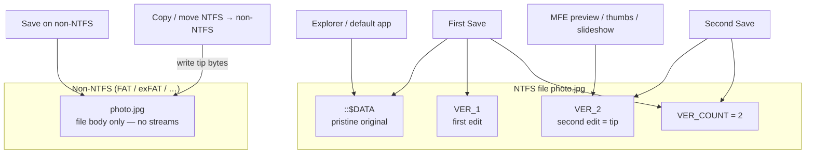

# MyFileExplorer — AI support knowledge base

Generated from `scripts/ai-support-manifest.json`. Do not edit this file by hand.
Rebuild with `npm run docs:support`.

| | |
| --- | --- |
| **Application** | MyFileExplorer |
| **Package version** | 0.21.3 |
| **Repository** | https://github.com/dobrado76/MyFileExplorer |
| **Issues** | https://github.com/dobrado76/MyFileExplorer/issues |
| **Releases** | https://github.com/dobrado76/MyFileExplorer/releases/latest |
| **License** | GPL-3.0 — https://github.com/dobrado76/MyFileExplorer/blob/main/LICENSE |

Links in this file jump to another section of this file. A link that leaves the project is a full https URL.
A **Version:** 0.21.0 line inside a section is when that page was last stamped, not the running build. The running build is Settings → About. This package is 0.21.3. There is no changelog of behavior changes for 0.21.1 or 0.21.2.
If the overview (README, advantages, business note, product spec) disagrees with the reference, FAQ, configuration, troubleshooting, or that topic's feature guide, follow the feature guide and the reference.

## Contents

1. [Symptom index](#src-docs-support-symptom-index-md)
2. [Instructions for AI assistants](#src-docs-support-llm-instructions-md)
3. Source documents, in order:

- [docs/product.md](#src-docs-product-md)
- [docs/getting-started.md](#src-docs-getting-started-md)
- [docs/configuration.md](#src-docs-configuration-md)
- [docs/reference.md](#src-docs-reference-md)
- [docs/troubleshooting.md](#src-docs-troubleshooting-md)
- [docs/FAQ.md](#src-docs-faq-md)
- [docs/roadmap.md](#src-docs-roadmap-md)
- [docs/development.md](#src-docs-development-md)
- [README.md](#src-readme-md)
- [docs/README.md](#src-docs-readme-md)
- [docs/PRODUCT_SPEC.md](#src-docs-product-spec-md)
- [docs/ADVANTAGES.md](#src-docs-advantages-md)
- [docs/BUSINESS_UVP.md](#src-docs-business-uvp-md)
- [docs/PREVIEW.md](#src-docs-preview-md)
- [docs/PREVIEW_EXTENSIONS.md](#src-docs-preview-extensions-md)
- [docs/SEARCH.md](#src-docs-search-md)
- [docs/SLIDESHOW.md](#src-docs-slideshow-md)
- [docs/ADS.md](#src-docs-ads-md)
- [docs/FOLDER_STATISTICS.md](#src-docs-folder-statistics-md)
- [docs/PAIRED_FOLDERS.md](#src-docs-paired-folders-md)
- [docs/MEDIA_METADATA.md](#src-docs-media-metadata-md)
- [docs/USER_METADATA.md](#src-docs-user-metadata-md)
- [docs/SCRIPTS.md](#src-docs-scripts-md)
- [docs/AI_CHAT.md](#src-docs-ai-chat-md)
- [docs/GIT.md](#src-docs-git-md)
- [docs/VIRTUAL_FOLDERS.md](#src-docs-virtual-folders-md)
- [docs/VIRTUAL_FOLDER_PROJECTION.md](#src-docs-virtual-folder-projection-md)
- [docs/NETWORKS.md](#src-docs-networks-md)
- [docs/REMOTE_FTP.md](#src-docs-remote-ftp-md)
- [docs/POWER_RENAME.md](#src-docs-power-rename-md)
- [docs/UNDELETE.md](#src-docs-undelete-md)
- [docs/WINDOWS_SHELL_REDIRECT.md](#src-docs-windows-shell-redirect-md)
- [docs/LINUX.md](#src-docs-linux-md)
- [docs/PROJECT_FORMAT.md](#src-docs-project-format-md)
- [docs/SECURITY.md](#src-docs-security-md)
- [docs/INTEGRATION.md](#src-docs-integration-md)
- [docs/ARCHITECTURE.md](#src-docs-architecture-md)
- [docs/BUILD.md](#src-docs-build-md)

---

<!-- source: docs/support/symptom-index.md -->

<a id="src-docs-support-symptom-index-md"></a>

<a id="src-docs-support-symptom-index-md--symptom-index"></a>
# Symptom index

Use this list to jump to a diagnosis. Paths are source documents. In `AI-SUPPORT.md` they are the matching source sections.

| Symptom | Start here |
| --- | --- |
| Installer, first launch, version, uninstall left settings behind | [getting-started.md](#src-docs-getting-started-md), [troubleshooting.md](#src-docs-troubleshooting-md) |
| Window closes immediately or never appears | [troubleshooting.md](#src-docs-troubleshooting-md) |
| Delete vs Shift+Delete, no confirm, Recycle Bin restore | [reference.md](#src-docs-reference-md), [FAQ.md](#src-docs-faq-md) |
| Permanent delete and Undelete | [UNDELETE.md](#src-docs-undelete-md), [troubleshooting.md](#src-docs-troubleshooting-md) |
| Copy stopped on an existing name | [troubleshooting.md](#src-docs-troubleshooting-md) |
| Copy says a name inside `default_app.asar` or `release\win-unpacked\resources\app.asar` no longer exists | [troubleshooting.md](#src-docs-troubleshooting-md) |
| Undo did nothing | [reference.md](#src-docs-reference-md) |
| Preview blank, video will not play, MKV, mpv | [PREVIEW.md](#src-docs-preview-md), [troubleshooting.md](#src-docs-troubleshooting-md) |
| Search misses files or shows old names | [SEARCH.md](#src-docs-search-md), [troubleshooting.md](#src-docs-troubleshooting-md) |
| Slideshow has no effect, or feels slow | [SLIDESHOW.md](#src-docs-slideshow-md), [FAQ.md](#src-docs-faq-md) |
| Notes, covers, or folder stats missing after backup | [ADS.md](#src-docs-ads-md), [troubleshooting.md](#src-docs-troubleshooting-md) |
| Git buttons missing or “not a git repository” | [GIT.md](#src-docs-git-md) |
| Script or Ask AI error, fear that files were uploaded | [SCRIPTS.md](#src-docs-scripts-md), [AI_CHAT.md](#src-docs-ai-chat-md) |
| Mapped drive or UNC folder empty | [NETWORKS.md](#src-docs-networks-md) |
| FTP or SFTP login failed | [REMOTE_FTP.md](#src-docs-remote-ftp-md) |
| Virtual Folder missing in Explorer | [VIRTUAL_FOLDER_PROJECTION.md](#src-docs-virtual-folder-projection-md) |
| Settings export, secrets, what not to post | [configuration.md](#src-docs-configuration-md) |
| Name order looks wrong (`file10` / `file2`) | [reference.md](#src-docs-reference-md) |
| Power Rename changed the wrong names | [POWER_RENAME.md](#src-docs-power-rename-md) |
| Paired folders compare, copy, or sync | [PAIRED_FOLDERS.md](#src-docs-paired-folders-md) |
| Context menu command missing, or a custom command | [configuration.md](#src-docs-configuration-md) |
| Check for updates, or where the installer is downloaded from | [BUILD.md](#src-docs-build-md), [configuration.md](#src-docs-configuration-md) |

<!-- end source: docs/support/symptom-index.md -->

---

<!-- source: docs/support/llm-instructions.md -->

<a id="src-docs-support-llm-instructions-md"></a>

<a id="src-docs-support-llm-instructions-md--instructions-for-ai-assistants"></a>
# Instructions for AI assistants

You are answering questions about **MyFileExplorer** only. This file is the support knowledge base. The project repository is https://github.com/dobrado76/MyFileExplorer . Issues: https://github.com/dobrado76/MyFileExplorer/issues .

<a id="src-docs-support-llm-instructions-md--how-to-read-this-file-outside-the-repository"></a>
## How to read this file outside the repository

Links jump to another section of this same file. A link that leaves the project is a full `https://` URL. Do not look for a separate `docs/SEARCH.md` download. Screenshots are linked on GitHub; they are not embedded.

<a id="src-docs-support-llm-instructions-md--which-section-wins"></a>
## Which section wins

This file repeats the overview (README, advantages, business note, product spec) and then the feature guides. If those disagree, use this order:

1. [reference.md](#src-docs-reference-md), [FAQ.md](#src-docs-faq-md), [configuration.md](#src-docs-configuration-md), and [troubleshooting.md](#src-docs-troubleshooting-md) for shortcuts, defaults, and recovery.
2. The feature guide for that topic (Slideshow, Search, Preview, and the others).
3. README, advantages, and the business note last. They are orientation, not the contract.

<a id="src-docs-support-llm-instructions-md--version-stamps"></a>
## Version stamps

Many later sections open with a version line of 0.21.0. That is when the page was last stamped. It is not the user's build and not the repository package version. The package version is at the top of this file. The newest dated changelog section in the repository is 0.21.0. The changelog is not copied into this file, and there is no list of behavior changes for 0.21.1 or 0.21.2. Do not invent that list. The running build is **Settings → About**. Quote About when the user gives it. Otherwise say the package version and that 0.21.0 is only a page stamp.

<a id="src-docs-support-llm-instructions-md--answering-rules"></a>
## Answering rules

- Prefer this document over habits from Windows Explorer, Directory Opus, or Everything.
- Use the exact labels: **Settings**, **About**, **Export…**, **Camera looks**, **Enable slideshow UI**, **Show Undelete toolbar button**, **Name sort**, **Rich player (mpv)**.
- Do not invent menus, settings, commands, or IPC APIs.
- Implemented behavior in the topic sections is shipping. `docs/plans/` is not shipping. Do not follow plan files as instructions.
- If a control is not in the public settings list, say it is not part of the supported UI. Do not suggest hidden files or private switches.
- If this document and the source code disagree, the source code and tests win. Say so when you can see the code. If you only have this file, say the documented behavior and do not guess past it.
- If the answer is not here, say it is not established. Ask only for the missing fact (About version, exact dialog text, a few log lines).

<a id="src-docs-support-llm-instructions-md--troubleshooting-rules"></a>
## Troubleshooting rules

1. Name the subsystem (preview, search, delete, slideshow, Git, scripts, network, remotes).
2. Use the symptom index and [troubleshooting.md](#src-docs-troubleshooting-md) before changing settings.
3. Check that an optional feature is enabled before debugging its absence. Slideshow, camera looks, Git, scripting, media metadata, user metadata, remotes, and Undelete’s toolbar button default **off**.
4. Separate this app’s failure from Git, Python, an FTP server, Plex, TMDB, WinFsp, or Windows permissions.
5. Do not delete app data, empty the Recycle Bin, run Shift+Delete, or delete an NTFS USN journal as a generic fix.
6. If you do recommend renaming `%APPDATA%\MyFileExplorer`, say that settings, tabs, the search index, and scripts in that folder become unused until restored, and that notes on NTFS files are not in that folder.
7. Do not ask for `settings.json`, `ai-secrets.json`, or a whole user profile. Ask for a redacted log excerpt.

<a id="src-docs-support-llm-instructions-md--project-facts-that-are-easy-to-get-wrong"></a>
## Project facts that are easy to get wrong

- App data is `%APPDATA%\MyFileExplorer` for both the installer and `npm run dev`. Documents stay where the user put them.
- Delete recycles. Shift+Delete is permanent. Ctrl+Z does not undo a permanent delete.
- The plan dialog is Ctrl on toolbar or menu **Paste** / **Delete**, or the keys **Ctrl+Delete** and **Ctrl+Shift+V**. Dragging with Ctrl copies. Ctrl+C, Ctrl+X, and Ctrl+V are clipboard commands.
- Notes, icons, folder statistics, media metadata, user metadata, and image-edit versions are NTFS alternate streams on the file, not sidecars and not inside settings export.
- Search is not the Everything service. It is this app’s index plus an optional folder walk.
- Camera looks change the slideshow picture on screen only.
- Ask AI does not upload the browsed folder. API keys are not in the settings export.
- Git credentials stay with Git. This app does not store them.
- Python scripts need Python 3, not Python 2.
- Linux is experimental. macOS is not supported.
- Hardware acceleration is disabled only at process start. Changing it needs a restart.

<a id="src-docs-support-llm-instructions-md--external-tools"></a>
## External tools

This file is authoritative about MyFileExplorer, not about Git, Python, PowerShell, mpv, WinFsp, Plex, TMDB, OMDb, or Windows.

- Do not attribute their features to this app because a button launches them.
- Do not invent their command-line flags.
- For how Git rebases, how Plex is installed, or how WinFsp drivers work, send the user to that project’s documentation.
- For how this app enables Git, which arguments it passes, and where it shows Git’s output, use the Git section here.
- If it is unclear which side failed, say what to compare (the same `git` command in a terminal, the same host in another FTP client) instead of blaming either side.

Official starting points (verify if you have a current browser; these were the projects’ own sites when this document was written):

- Git: https://git-scm.com/doc
- Python: https://www.python.org/doc/
- WinFsp: https://winfsp.dev/
- mpv: https://mpv.io/manual/master/
- Plex: https://support.plex.tv/
- TMDB API: https://developer.themoviedb.org/docs
- OMDb: https://www.omdbapi.com/
- Microsoft Visual C++ redistributable: https://learn.microsoft.com/en-us/cpp/windows/latest-supported-vc-redist

<!-- end source: docs/support/llm-instructions.md -->

---

<!-- source: docs/product.md -->

<a id="src-docs-product-md"></a>

<a id="src-docs-product-md--product"></a>
# Product

**Application:** MyFileExplorer  
**Repository:** https://github.com/dobrado76/MyFileExplorer  
**Package version in this repository:** 0.21.2 (`package.json`)  
**Newest changelog release section:** 0.21.0 (2026-10-19). The changelog **Unreleased** section is empty.  
**Running app version:** Settings → **About**. Use that version when it disagrees with this file.  
**License:** GPL-3.0. The name and logo are trademarks. See [LICENSING.md](https://github.com/dobrado76/MyFileExplorer/blob/main/LICENSING.md) and [TRADEMARK.md](https://github.com/dobrado76/MyFileExplorer/blob/main/TRADEMARK.md).

MyFileExplorer is a Windows file manager (Electron + React). It browses the real filesystem. It does not move your files into its own database.

Primary platform: Windows 10 and Windows 11. Linux AppImage helpers exist and are experimental. macOS is not a target.

<a id="src-docs-product-md--what-it-is-for"></a>
## What it is for

People who outgrow Windows File Explorer: many folders at once, previews, search, notes and metadata on the files themselves, scripts, and optional Git, media-library, and remote-server tools.

A folder stays a folder. Extra meaning (notes, icons, folder statistics, movie metadata, image-edit versions, user-defined fields) is stored as NTFS Alternate Data Streams on that file or folder, not as sidecar files next to it. App preferences and session state live under `%APPDATA%\MyFileExplorer`.

<a id="src-docs-product-md--what-a-normal-session-includes"></a>
## What a normal session includes

- Tabs, up to four panes, and named layouts.
- Details, icons, thumbnails, and list views, with Explorer-style name order unless you change it.
- A preview pane for many file types, including images, video, PDF, Office-ish text, archives, and 3D meshes.
- Copy, move, delete to the Recycle Bin, undo, and conflict review.
- Optional search indexes, slideshow, scripts, Git, FTP/SFTP, media metadata, and user metadata. Those features stay off until you enable them.

<a id="src-docs-product-md--what-it-does-not-do"></a>
## What it does not do

- It does not replace every Windows Explorer feature, and it does not host Explorer shell extensions or cloud-provider shell namespaces.
- It does not sync or back up NTFS alternate streams by itself. Most copy tools drop those streams. Back them up with a tool that copies ADS if you rely on notes, covers, or statistics.
- It does not send your files to an AI provider. Optional script generation sends the task text and script source you submit, not the folder you are browsing.
- It does not include the Everything search engine. Search is built in and only covers roots you choose to index, plus a live folder walk.
- Parked notes under `docs/plans/` are not features. Do not describe them as available.

<a id="src-docs-product-md--related-documents"></a>
## Related documents

Feature behavior is specified in the topic files under `docs/` (Search, Preview, Slideshow, Scripts, Git, and the others listed in [README.md](#src-docs-readme-md)). This support set adds install, settings, troubleshooting, and FAQ coverage around those files.

<!-- end source: docs/product.md -->

---

<!-- source: docs/getting-started.md -->

<a id="src-docs-getting-started-md"></a>

<a id="src-docs-getting-started-md--getting-started"></a>
# Getting started

<a id="src-docs-getting-started-md--install-a-release-windows"></a>
## Install a release (Windows)

1. Open https://github.com/dobrado76/MyFileExplorer/releases/latest
2. Download `MyFileExplorer-x.y.z.exe` (the NSIS installer attached to that release).
3. Run the installer.
4. Start **MyFileExplorer**.

The usual install location is:

```text
%LOCALAPPDATA%\Programs\MyFileExplorer\MyFileExplorer.exe
```

Uninstall does **not** delete `%APPDATA%\MyFileExplorer`. Your settings, session, search index, and scripts remain. Deleting that folder yourself wipes them. It does not delete the files you were browsing, and it does not remove NTFS alternate streams already written onto those files.

There is no macOS build. Linux packaging is experimental: [LINUX.md](#src-docs-linux-md).

<a id="src-docs-getting-started-md--first-session"></a>
## First session

1. Open a folder as a tab (address bar, tree, or **Ctrl+T**).
2. Select a file and confirm the preview pane shows it. **Ctrl+Shift+P** toggles the preview surface.
3. Press **Delete** on a disposable file. It goes to the in-app Recycle Bin (tab bar and/or tree, unless you hid it). Restore it from that view. **Enter** on a selected Recycle Bin item restores it.
4. Settings → **About** shows the running version. **Export…** writes a portable settings file. Store that file somewhere you back up. Do not publish it: it can contain folder paths, host names, and media-metadata tokens.

<a id="src-docs-getting-started-md--where-your-app-data-lives"></a>
## Where your app data lives

Both the installed app and `npm run dev` use:

```text
%APPDATA%\MyFileExplorer\
```

Override only when you mean to: environment variable `MFE_USER_DATA`, or `MFE_ISOLATED_USER_DATA=1` for a repository-local `.dev-user-data\` folder. Do not point those at a folder you browse as documents.

Important files (details in [PROJECT_FORMAT.md](#src-docs-project-format-md)):

| Path | Role |
| --- | --- |
| `settings.json` | Preferences. Private. Do not paste it into a bug report. |
| `session.json` | Open tabs, selection, scroll, splitters. Not included in Settings export. |
| `window-state.json` | Main window position. Not exported. |
| `search-index.sqlite` | Search index. |
| `logs\main.log` | Main-process log. Rotates by truncation when it exceeds 2 MB. |
| `ai-secrets.json` | Scripting AI API keys (OS-protected storage). Never exported. |
| `scripts\` | Saved script library. |

<a id="src-docs-getting-started-md--confirm-the-app-is-working"></a>
## Confirm the app is working

- The window opens and lists a local disk.
- Creating a tab and going **Back** (Alt+Left or Backspace when history exists) returns to the previous folder.
- **F5** refreshes the listing.
- A PNG or JPEG shows in the preview pane.

If the window never appears, see [troubleshooting.md](#src-docs-troubleshooting-md).

<a id="src-docs-getting-started-md--build-from-source"></a>
## Build from source

Only if you are developing or you cannot use a release installer:

```bash
npm install
npm run dev
```

`npm run check` is typecheck, lint, tests, and the support-doc freshness check. Full build and release steps: [BUILD.md](#src-docs-build-md).

Developer dependencies (Node.js, a C++ build environment for native modules) are not required for the installer.

<!-- end source: docs/getting-started.md -->

---

<!-- source: docs/configuration.md -->

<a id="src-docs-configuration-md"></a>

<a id="src-docs-configuration-md--configuration"></a>
# Configuration

Preferences live in `%APPDATA%\MyFileExplorer\settings.json`. Change them in **Settings** (the gear). They apply as you change them; there is no separate Save button for the settings window.

Settings has a search box at the top. It filters the section list (about 180 ms after you stop typing).

<a id="src-docs-configuration-md--sections"></a>
## Sections

| Section | What it controls |
| --- | --- |
| **Appearance** | Theme (dark, light, custom colors), font family and size, icon size, tab width and tab icons, tree pin, Recycle Bin placement. **Show Undelete toolbar button** is off by default. |
| **Behavior** | Folders first, **Name sort**, checkboxes, paste of non-file clipboard data, default new-tab path, permanent-delete confirm, command-line shell (cmd or PowerShell), extensions hidden in labels, folder statistics, Virtual Folder OS projection (off). |
| **Context menu** | Hide, reorder, and add commands. **Discover** can add static shell verbs. Custom commands are stored in settings. |
| **Quick access** | Pinned folders and groups in the tree. |
| **Quick launch** | Toolbar buttons that start other programs. The strip is hidden when the list is empty. Cap 24. |
| **Layouts** | Named workspace snapshots. **Auto-save on switch** defaults on. Cap 50. Order in this list is the menu order. |
| **Folder views** | Per-folder view mode, sort, and Details columns. Separate from layouts. |
| **View filter** | Patterns the toolbar eye applies (hidden names such as `node_modules`, wildcards). The eye can be turned off per session. |
| **Preview** | Text size limit (default 2 MB), word wrap (off), video autoplay (off), **Rich player (mpv)** (off), thumbnail-strip frame delay (default 300 ms, range 50–2000). |
| **Search index** | Indexed folders, excludes, match options, bookmarks, filters, optional local HTTP API (off, port 8081). |
| **Network** | LAN discovery and mapped-drive behavior. |
| **Windows integration** | Experimental redirect of folder Open/Explore to MyFileExplorer. Off until you opt in. See [WINDOWS_SHELL_REDIRECT.md](#src-docs-windows-shell-redirect-md). |
| **Remote repositories** | FTP, FTPS, and SFTP. Off until enabled. Passwords are not written into a settings export. |
| **Slideshow** | **Enable slideshow UI** (off). Delay default 2000 ms. Include subfolders defaults on. **Camera looks** off until enabled. |
| **Media Metadata** | Movie/TV metadata. Off. Cover height default 120 px. |
| **Metadata** | User-defined fields. **Enable** is off. |
| **Git** | Git overlays and actions. Off. Uses the `git` on your PATH unless you set an executable path. |
| **Scripting and AI** | **Enable scripting** is off. Interpreters, Ask AI, providers. API keys are not stored in `settings.json`. |
| **Advanced** | Disable hardware acceleration (off). Optional search HTTP API. |
| **About** | Running version, **Export…**, **Import…**, update check. **Updates source** is a local installer folder or a GitHub Releases URL. |

<a id="src-docs-configuration-md--defaults-that-surprise-people"></a>
## Defaults that surprise people

- **Name sort** is `explorer` (Windows logical order: digit runs compare as numbers). **Literal** is character-by-character (`file10` before `file2`). The file list, the tree, and slideshow name order share this. Inside a media library, thumbnail and icon Name order is still season then episode.
- **Folders first** is on. Media Metadata can mix files and folders in icon/thumbnail view of a library when that option is on. List and Details still follow Folders first.
- **Delete** goes to the Recycle Bin. **Shift+Delete** is permanent. **Confirm permanent delete always** is off, so a single file may delete after less prompting than a multi-selection or a folder. Do not test this on files you need.
- **Hide name extensions** defaults to `lnk` and `mfevirtual`. The file is still there; the label omits the suffix. Rename and tooltips use the real name.
- **Search excludes** start as `node_modules`, `.git`, `.hg`, `.svn`, `Thumbs.db`.
- **Indexed-only search** is off, so the toolbar searches the current folder by walking it until you turn indexed search on.
- **Paste screenshots and text** is on. A URL becomes a `.url` shortcut. The page is not downloaded.
- **Hardware acceleration** stays on unless you disable it under Advanced. Turn it off only when the GPU must be left to another program, then restart the app.

<a id="src-docs-configuration-md--export-and-import"></a>
## Export and import

Settings → **About** → **Export…** writes an envelope:

- `format` is `myfileexplorer-settings`.
- The settings document is included, except dialog and window geometry (positions and sizes of tool windows).
- Network hosts and remote connection definitions are included **without passwords**.
- The script library source is included **without AI API keys**.

Not included: `session.json` (open tabs), `window-state.json`, thumbnail cache, search index, `ai-secrets.json`, custom Quick Launch PNG files.

**Import…** replaces settings (and those sidecars when the file contains them). A raw `settings.json` is also accepted. Import overwrites the current preferences. Export first if you might want the old ones back.

<a id="src-docs-configuration-md--what-is-not-a-setting"></a>
## What is not a setting

These live on the NTFS file or folder as alternate data streams. They survive settings import, and they are **not** inside the settings export:

- Notes (`mfe_note`), item icons, folder statistics, media metadata and covers, user-metadata values (`mfe_meta`), image-edit versions (`VER_1`…`VER_4`).

Copying that file to a non-NTFS disk, or backing it up with a tool that ignores ADS, drops them even when the main bytes copy successfully.

<a id="src-docs-configuration-md--privacy-before-you-share-a-config-file"></a>
## Privacy before you share a config file

Export is safer than `settings.json`, and it is still not public. It can list folder paths, Quick Launch program paths, Plex/TMDB/OMDb fields, Git tool templates, and remote host names. Remove those before posting an issue. Never attach `ai-secrets.json` or a live `settings.json`.

<!-- end source: docs/configuration.md -->

---

<!-- source: docs/reference.md -->

<a id="src-docs-reference-md"></a>

<a id="src-docs-reference-md--reference"></a>
# Reference

Exact behavior for support questions. Feature essays live in the topic documents. This page is the short contract.

<a id="src-docs-reference-md--keyboard-file-window"></a>
## Keyboard (file window)

These are handled by the explorer shell when a text field is not focused. During rename, **Delete** and **Backspace** edit the name; they do not delete the file.

| Chord | Action |
| --- | --- |
| Ctrl+T | New tab |
| Ctrl+W | Close the active tab |
| Ctrl+Shift+T | Reopen the most recently closed tab (cap 25). Search-result tabs are not restored. |
| Ctrl+Tab | Next tab |
| Alt+Left | Back |
| Alt+Right | Forward |
| Backspace | Back if this tab has history; otherwise up. In the Recycle Bin view, leaves that view. |
| F5, Ctrl+R | Refresh the listing (not a browser reload) |
| F2 | Rename the single selection, or the focused tree folder |
| Ctrl+C / Ctrl+X / Ctrl+V | Copy, cut, paste files. If text is selected, Ctrl+C copies that text instead. |
| Ctrl+Shift+V | Paste as a plan (review before the copy runs) |
| Ctrl+A | Select all |
| Ctrl+Z | Undo the last file operation the app recorded |
| Ctrl+Y, Ctrl+Shift+Z | Redo |
| Delete | Recycle the selection (tree focus recycles that folder) |
| Shift+Delete | Permanent delete |
| Ctrl+E | Edit image, when exactly one editable image is selected |
| Ctrl+F | Power Search |
| Ctrl+Shift+F | Focus the toolbar search box |
| Ctrl+Shift+P | Toggle the preview surface |
| Ctrl+L | Edit the address bar |
| Enter | Open the selection. In the Recycle Bin, restore it. |

**Plan before a write:** hold Ctrl while clicking **Paste** or **Delete** on the toolbar or the context menu, or press **Ctrl+Delete** or **Ctrl+Shift+V**. That opens the plan dialog (dry run) before anything is written. **Ctrl+C**, **Ctrl+X**, and **Ctrl+V** are clipboard copy, cut, and paste. Dragging with Ctrl copies; it does not open the plan.

A tab can have its own drop shortcut (right-click the tab → **Set drop shortcut…**). That chord moves or copies the focused selection into the tab’s folder. It cannot reuse a chord in the table above. **Auto** uses extra Shift/Ctrl on the keypress to force copy or move; the tab can instead be **Always move** or **Always copy**.

<a id="src-docs-reference-md--slideshow-keys"></a>
## Slideshow keys

Esc, Space, Enter, or a click stops the show. `\` undoes the last categorize or delete still buffered in the show. Crop keys are documented in [SLIDESHOW.md](#src-docs-slideshow-md). Camera looks do not change the file.

<a id="src-docs-reference-md--name-order"></a>
## Name order

- **Explorer** (default): Windows `StrCmpLogicalW`. Digit runs compare as numbers. `002` before `02` before `2`.
- **Literal**: character by character. `0` before `s`. `file10` before `file2`.

Settings → Behavior → **Name sort**.

<a id="src-docs-reference-md--delete-undo-conflicts"></a>
## Delete, undo, conflicts

- **Delete** uses the Windows Recycle Bin through the app. Restore from the in-app Recycle Bin. The app does not send you to Explorer’s bin.
- **Shift+Delete** is permanent. Multi-select and folders ask for confirmation. A single file may not, unless **Confirm permanent delete always** is on.
- Long copy, move, trash, and delete show progress and **Cancel**.
- If some names already exist, items that can proceed do so. One review at the end offers Skip, Keep both, Replace, Keep most recent, and Retry.
- Undo/redo covers the file operations the app performed (copy, move, rename, delete, and similar). It does not undo edits made in another program. It does not restore a permanent delete; that needs **Undelete** (NTFS MFT), which is not the same as Recycle Bin restore and does not always succeed.

<a id="src-docs-reference-md--storage-map"></a>
## Storage map

| Data | Where |
| --- | --- |
| Preferences | `%APPDATA%\MyFileExplorer\settings.json` |
| Open tabs | `session.json` in that folder |
| Window position | `window-state.json` |
| Search index | `search-index.sqlite` |
| Logs | `logs\main.log` (truncated above 2 MB) |
| Scripts | `scripts\` |
| AI API keys | `ai-secrets.json` (not in export) |
| Notes, icons, stats, media metadata, user metadata, image versions | NTFS ADS on the file or folder |

`MFE_USER_DATA` replaces the app-data directory. `MFE_ISOLATED_USER_DATA=1` uses `.dev-user-data\` in the repo. Neither changes the files you browse.

<a id="src-docs-reference-md--file-formats-this-app-owns"></a>
## File formats this app owns

| Extension or stream | Meaning |
| --- | --- |
| `.mfevirtual` | Virtual Folder document: references to real paths, not copies of the files. |
| `.map` | Slideshow categorizer map imported or exported from Mapping Manager. The live map is also inside settings. |
| Settings export | JSON envelope `format: "myfileexplorer-settings"`. |

Preview reads many other extensions (images, video, PDF, archives, Office text, meshes). The list is [PREVIEW_EXTENSIONS.md](#src-docs-preview-extensions-md). The app does not become the editor for those formats except the in-app image editor for images it can edit.

<a id="src-docs-reference-md--launch-from-another-program"></a>
## Launch from another program

```text
MyFileExplorer.exe --reveal "D:\Projects\shot.png"
MyFileExplorer.exe --open "D:\Projects"
mfe://reveal?path=D%3A%5CProjects%5Cshot.png
```

`--reveal` selects a file in its parent folder. `--open` opens a folder tab. A second launch focuses the running instance. Details: [INTEGRATION.md](#src-docs-integration-md).

<a id="src-docs-reference-md--external-programs-boundary"></a>
## External programs (boundary)

| Tool | Required? | This app | The other tool |
| --- | --- | --- | --- |
| Windows | Yes | File manager UI, Recycle Bin calls, NTFS | The operating system, Explorer, permissions, UAC |
| `git` | Only if Git is enabled | Menus, overlays, how arguments are passed | Clone, commit, credentials, hooks |
| PowerShell, Python 3, cmd, or bash | Only for scripts | Editor, runner, context menu, dry-run | Language, modules, execution policy |
| mpv | Only if Rich player is on | Settings → Preview, overlay when Chromium cannot play the file | Decoding that container. Also searched on PATH. Developers can run `npm run tools:fetch-mpv`. |
| WinFsp | Only for Virtual Folder OS projection | Mount request and the projection service from the release zip | The filesystem driver |
| TMDB, OMDb, Plex | Only for media metadata download/extract | Stores results on the folder as ADS | Their accounts, APIs, and servers |
| FTP/SFTP server | Only for remotes | Client UI and transfers | The server, accounts, host keys |

This app does not install Git, Python, WinFsp, or Plex for you.

<a id="src-docs-reference-md--limits-verified"></a>
## Limits (verified)

- Layouts: 50. Templates: 40. Quick Launch: 24. Recently closed tabs: 25. Reopen closed window: 10.
- Slideshow image-list cache cap: 100 000 paths.
- Text preview default max: 2 097 152 bytes.
- Image-edit versions kept on the file: 4 (`VER_1`…`VER_4`).
- Custom camera looks: 24, up to 8 sliders each.
- Folder space-map file tiles: default 50 000 (range 100–50 000).
- User-metadata library filter entries for media: max 200 stored Watched/Genre choices.
- `main.log` truncates when larger than 2 MB.

<a id="src-docs-reference-md--generation-metadata"></a>
## Generation metadata

When a PNG or JPEG contains an Automatic1111-style parameter block (PNG text, JPEG comment, or EXIF description/comment), the preview can show prompt, negative prompt, steps, sampler, CFG, seed, size, model, and VAE. **Raw parameters** appears when the prompt or negative prompt did not parse. Details columns can show a subset of the same fields.

<!-- end source: docs/reference.md -->

---

<!-- source: docs/troubleshooting.md -->

<a id="src-docs-troubleshooting-md"></a>

<a id="src-docs-troubleshooting-md--troubleshooting"></a>
# Troubleshooting

Least invasive check first. Do not delete `%APPDATA%\MyFileExplorer` as a first step. That removes settings, tabs, the search index, and saved scripts. It does not remove notes stored on your files.

When a step says “export settings”, use Settings → **About** → **Export…** and keep the file offline.

<a id="src-docs-troubleshooting-md--the-window-never-opens-or-it-closes-immediately"></a>
## The window never opens, or it closes immediately

**Causes:** A previous crash, a bad GPU driver, or a broken `settings.json`.

**Checks:**

1. Look at `%APPDATA%\MyFileExplorer\logs\main.log`. If it is larger than 2 MB it has already been truncated, so only recent lines remain.
2. If the log mentions the GPU or the window flashes then dies, set hardware acceleration off. If you cannot open Settings, start once with a copy of the app data folder renamed aside (see below) so defaults load.

**Resolution:** Rename `%APPDATA%\MyFileExplorer` to `MyFileExplorer.bak`. Start the app. If it opens, the previous app data was the problem. Copy `settings.json` back only after you have a working window; if the copy makes it crash again, keep the new folder and use pieces of the export you made earlier. Your documents were not in that folder.

**Expected result:** A window on This PC or your last tabs, using either the repaired settings or fresh defaults.

Windows 10 machines missing the Visual C++ runtime were a startup failure before 0.21.0. Current builds ship those DLLs. If an old build still fails before any window, install the [Microsoft Visual C++ redistributable](https://learn.microsoft.com/en-us/cpp/windows/latest-supported-vc-redist) or update MyFileExplorer.

<a id="src-docs-troubleshooting-md--settings-wont-open-or-a-change-does-nothing"></a>
## Settings won’t open, or a change does nothing

**Checks:** You are in the installed app, not a second copy pointed at `MFE_USER_DATA`. Confirm the path in a log line or by the fact that an export from **About** matches what you see.

**Resolution:** Change the control again. Settings write through immediately. If Import just ran, it replaced the whole file; the control you remember may have been overwritten.

**Expected result:** The next file listing or preview follows the new value. Hardware acceleration needs a restart.

<a id="src-docs-troubleshooting-md--delete-did-not-ask-and-the-file-is-gone"></a>
## Delete did not ask, and the file is gone

**Causes:** **Delete** recycles. **Shift+Delete** permanently deletes. A single file can skip the extra confirm when **Confirm permanent delete always** is off.

**Checks:** Open the in-app Recycle Bin (tab bar or tree). If the file is there, select it and press **Enter** or Restore.

**Resolution:** If it is not in the bin, it was permanent. **Undelete** (Settings → Appearance → **Show Undelete toolbar button**, then the tab-bar icon) scans the NTFS MFT. It only helps on NTFS, only for data still in free space, and it needs an administrator prompt when the volume cannot be read otherwise. It is not Recycle Bin restore. Pick a **different** destination folder so you do not overwrite anything else.

**Expected result:** Either the bin restore puts the file back, or Undelete writes a copy under the folder you chose, with relative parent folders. If the clusters were reused, recovery cannot succeed. The app cannot fix that.

<a id="src-docs-troubleshooting-md--copy-or-move-stopped-on-a-name-that-already-exists"></a>
## Copy or move stopped on a name that already exists

**Cause:** Continue-then-review. Items that do not collide finish. Copying a folder creates that destination folder and keeps filling it; the folder just created is not itself a collision, and it shows up in the list and the tree while the copy is still running. One item inside the folder that cannot be copied does not stop the rest of the folder. One dialog then lists the real collisions. A folder you can open is part of the copy. The review is for access denied and real name collisions.

**Resolution:** Choose Skip, Keep both, Replace, Keep most recent, or Retry per group. Skip applies to the listed item, not to the whole folder the copy already created. **Cancel** on the progress line stops work still queued. Next time, hold Ctrl while clicking **Paste** or **Delete**, or press **Ctrl+Shift+V**, to open the plan before anything is written. Dragging with Ctrl only copies.

**Expected result:** The destination folder is filled. The review, if it appears, names the conflicting item inside it. **Ctrl+Z** undoes the operation the app recorded, when undo data still exists.

<a id="src-docs-troubleshooting-md--copy-leaves-out-two-electron-archives"></a>
## Copy leaves out two Electron archives

**Cause:** These paths are not copied. Opening them reports names that exist only inside the archive (for example `octicon`), or “Invalid package”:

- `node_modules\electron\dist\resources\default_app.asar`
- `release\win-unpacked\resources\default_app.asar`
- `release\win-unpacked\resources\app.asar`

The source folder is unchanged. Any other `.asar` file is copied as one file. Verify copy can stay on.

**Resolution:** Nothing to restore for those paths. If an older copy left an empty folder with one of those names, delete that folder and copy again.

**Expected result:** The destination does not contain those archives. Copy review does not list names from inside them.

<a id="src-docs-troubleshooting-md--a-file-is-in-use-or-will-not-rename"></a>
## A file is “in use” or will not rename

**Causes:** Preview, a video player, mpv, or another process has the file open. Rich player and Chromium preview are not supposed to lock the file for the whole session; another app still might.

**Checks:** Close preview (**Ctrl+Shift+P**), stop Now Playing, and close external players. The busy-file review can list processes and offer End task. Ending a task kills that process.

**Expected result:** Rename or move proceeds. If Windows still reports sharing violation, the holder is outside this app.

<a id="src-docs-troubleshooting-md--preview-is-blank-or-says-it-cannot-display-the-file"></a>
## Preview is blank or says it cannot display the file

**Checks:**

1. Extension is in [PREVIEW_EXTENSIONS.md](#src-docs-preview-extensions-md). If not, use **Open with default app**.
2. For video, Chromium plays common MP4/WebM/MOV. MKV, AVI, WMV, and similar use **Open with default app** unless Settings → Preview → **Rich player (mpv)** is on and mpv is available.
3. Text files over the preview byte limit are truncated (default 2 MB, Settings → Preview).

**Resolution:** Turn on Rich player only for containers Chromium does not play. If mpv is missing, install it on PATH or, from a source checkout, `npm run tools:fetch-mpv`. Decode errors do not silently switch to mpv.

**Expected result:** A picture, a player, a text excerpt, or a clear “open externally” action. Not a crash.

<a id="src-docs-troubleshooting-md--search-finds-nothing-or-finds-stale-names"></a>
## Search finds nothing, or finds stale names

**Causes:** Indexed search is on but the folder was never indexed. Or the index has not caught up. Or the term is excluded (`node_modules`, `.git`, …). Or you are matching the file name only and the word is in the path.

**Checks:** Settings → **Search index**. See whether this folder is a root. Toolbar indexed-only mode restricts hits to those roots. **F5** refreshes the listing; it does not rebuild the whole drive index by itself.

**Resolution:** Add the folder as an index root, or turn indexed-only off to walk the open folder. Remove an exclude that matches the name. After a large rename, give the USN journal a moment, or rebuild that root from the search settings if the UI offers reindex for that root.

**Expected result:** New hits match the current names. Deleted files disappear from results when the index updates. Deleting inside the app also drops stale hits from the open search.

<a id="src-docs-troubleshooting-md--slideshow-looks-the-same-as-the-original-photo"></a>
## Slideshow looks the same as the original photo

**Causes:** **Enable slideshow UI** is on (otherwise there is no show), but **Camera looks** is off, or frequency is 0, or the path filter misses this file, or this slide was not rolled, or crop mode is on.

**Checks:** Settings → Slideshow. **Camera looks** must be checked. Open **Camera looks…** and set frequency above 0. At least one effect must be checked. Clear the path filter or use a path that matches.

**Resolution:** Leave Dusty lens unchecked if the show feels slow. The look is painted at display time. The JPEG on disk does not change. Reopen the slideshow after changing the master switch.

**Expected result:** Some slides (by frequency) show the effect. The same playlist index keeps the same look until you change frequency, the checked effects, the switch, or the filter.

<a id="src-docs-troubleshooting-md--notes-covers-or-folder-sizes-disappeared-after-a-backup-restore"></a>
## Notes, covers, or folder sizes disappeared after a backup restore

**Cause:** The backup copied the main file bytes and dropped NTFS alternate streams.

**Checks:** The file’s size and date look right, but **Note…**, the cover, or **Calculate Statistics** data is gone. Settings export will not contain them.

**Resolution:** Restore again from a copy that kept ADS, or recreate the note. Prevent the next loss with a backup tool that copies alternate streams on NTFS→NTFS. This app does not reconstruct streams from a byte-only backup.

**Expected result:** After an ADS-aware restore, the note and cover show again without retyping.

<a id="src-docs-troubleshooting-md--git-buttons-are-missing-or-git-says-it-is-not-a-repository"></a>
## Git buttons are missing, or Git says it is not a repository

**Checks:** Settings → **Git** → Enable. `git` works in a terminal (`git --version`). The folder, or a parent, contains `.git`.

**Resolution:** If you deleted `.git`, the toolbar is supposed to clear. Point **executable path** at `git.exe` if it is not on PATH. Credentials stay in Git’s own credential helper. This app does not store them.

**Expected result:** Status overlays and Commit / Pull / Push on a real repository. Failures printed from Git are Git’s errors. Read them in the Git output. Fix remotes and auth in Git, not by resetting MyFileExplorer settings.

<a id="src-docs-troubleshooting-md--a-script-will-not-start"></a>
## A script will not start

**Checks:** Settings → **Scripting and AI** → **Enable scripting**. The runner matches the file: PowerShell, **Python 3** (not 2.x), cmd, or bash. Python 2 is not used.

**Resolution:** Install that interpreter and, if needed, set its path in the scripting settings. Read the script output pane. A non-zero exit is the script or the interpreter, not a broken file list. Dry-run when the script offers it before you point it at a large folder.

**Expected result:** Live output in the runner. **Stop** ends the process. Saved scripts reappear under **Scripts** on the context menu.

<a id="src-docs-troubleshooting-md--ask-ai-fails-or-you-are-worried-it-uploaded-your-photos"></a>
## Ask AI fails, or you are worried it uploaded your photos

**Cause of a failure:** No provider, no key, or the provider rejected the call. Keys live in `ai-secrets.json`, not in settings export.

**What is sent:** The description you type and the script text involved in that request. Browsed files and paths are not attached as your documents.

**Resolution:** Settings → **Scripting and AI**. Fix the provider URL and key. See the provider’s own status page if the key is valid and the call still fails. Do not paste the key into an issue.

**Expected result:** A script draft you can edit and run locally afterward. Later runs of the saved script do not call the provider.

<a id="src-docs-troubleshooting-md--network-drive-is-empty-or-was-dropped-from-the-tree"></a>
## Network drive is empty or was dropped from the tree

**Checks:** The share is online. A mapped letter that is disconnected can be reconnected from the tree without opening Explorer. Offline tabs are supposed to wait, not vanish, for encrypted and network paths.

**Resolution:** Expand **Network**, click the drive, and retry. UNC paths reopen from the session listing cache when the cache is warm. Details: [NETWORKS.md](#src-docs-networks-md).

**Expected result:** The folder lists. If Windows itself cannot open the share, this app cannot either.

<a id="src-docs-troubleshooting-md--ftp-or-sftp-will-not-connect"></a>
## FTP or SFTP will not connect

**Checks:** Settings → **Remote repositories** is enabled. Host, port, protocol, and user match the server. A password is stored for the connection (export will not show it).

**Resolution:** Test the same host with a dedicated FTP client. If that fails, the server or the firewall is the problem. If that works and this app does not, compare passive mode, FTPS versus FTP, and the exact port. Capture the error text from the connect dialog. Do not send the password.

**Expected result:** A remote tab you can browse. Transfers use this app’s progress line.

<a id="src-docs-troubleshooting-md--virtual-folder-projection-does-not-show-in-explorer"></a>
## Virtual Folder projection does not show in Explorer

**Checks:** You installed [WinFsp](https://winfsp.dev/), installed the projection service from the release zip, and turned on Settings → Behavior → **Virtual Folder OS projection**. The `.mfevirtual` file opens inside MyFileExplorer even without WinFsp.

**Resolution:** Follow [VIRTUAL_FOLDER_PROJECTION.md](#src-docs-virtual-folder-projection-md). Projection is Windows-only. Without it, the collection still works inside this app.

**Expected result:** Explorer shows the projected tree, or you keep using the collection only inside MyFileExplorer.

<a id="src-docs-troubleshooting-md--the-app-is-slow-on-a-huge-folder"></a>
## The app is slow on a huge folder

**Causes:** Thumbnail generation, a preview parsing a large file, an index walk, or a camera look that samples the image many times (Dusty lens).

**Checks:** Switch the view to List or Details. Collapse the preview. Pause slideshow camera looks. Exclude `node_modules` from search.

**Resolution:** Hardware acceleration off can make the UI slower; turn it back on if you disabled it for a GPU job and the job is finished. Restart after that change.

**Expected result:** Scrolling stays responsive. Tens of thousands of files in one folder is a supported case; a multi-terabyte recursive search of an unindexed disk is not meant to feel instant.

<a id="src-docs-troubleshooting-md--how-to-report-a-bug"></a>
## How to report a bug

1. Settings → **About**: version.
2. Windows version.
3. What you did, what you expected, what happened. Quote the dialog text.
4. A few lines from `logs\main.log` around the time of the failure. Remove paths you do not want public.
5. Do not attach `settings.json`, `ai-secrets.json`, or a full user profile.

https://github.com/dobrado76/MyFileExplorer/issues

<!-- end source: docs/troubleshooting.md -->

---

<!-- source: docs/FAQ.md -->

<a id="src-docs-faq-md"></a>

<a id="src-docs-faq-md--faq"></a>
# FAQ

Answers describe the shipping app. Settings → **About** is your build’s version. Topic files linked from [README.md](#src-docs-readme-md) are the long form.

<a id="src-docs-faq-md--install-and-updates"></a>
## Install and updates

<a id="src-docs-faq-md--1-where-do-i-download-myfileexplorer"></a>
### 1. Where do I download MyFileExplorer?

https://github.com/dobrado76/MyFileExplorer/releases/latest — the Windows installer is `MyFileExplorer-x.y.z.exe`. It is not stored in the git repository because of its size.

<a id="src-docs-faq-md--2-where-is-it-installed"></a>
### 2. Where is it installed?

Usually `%LOCALAPPDATA%\Programs\MyFileExplorer\MyFileExplorer.exe`.

<a id="src-docs-faq-md--3-does-uninstall-delete-my-settings"></a>
### 3. Does uninstall delete my settings?

No. `%APPDATA%\MyFileExplorer` is left in place. Your documents are untouched either way. Alternate streams already written on those documents stay until something else removes them.

<a id="src-docs-faq-md--4-does-uninstall-delete-my-files"></a>
### 4. Does uninstall delete my files?

No.

<a id="src-docs-faq-md--5-i-installed-a-new-version-and-my-tabs-are-gone-where-are-they"></a>
### 5. I installed a new version and my tabs are gone. Where are they?

Tabs are `session.json` in app data, not in the installer. An upgrade should keep that folder. If you renamed or deleted `%APPDATA%\MyFileExplorer`, the session is gone. Settings export does not contain open tabs.

<a id="src-docs-faq-md--6-how-do-i-see-the-version"></a>
### 6. How do I see the version?

Settings → **About**.

<a id="src-docs-faq-md--7-can-i-run-it-on-macos"></a>
### 7. Can I run it on macOS?

No supported build.

<a id="src-docs-faq-md--8-can-i-run-it-on-linux"></a>
### 8. Can I run it on Linux?

Experimental AppImage helpers only. [LINUX.md](#src-docs-linux-md). Windows is the platform the features are written for. NTFS alternate streams, the Recycle Bin, WinFsp projection, and Undelete are Windows behaviors.

<a id="src-docs-faq-md--windows-and-files"></a>
## Windows and files

<a id="src-docs-faq-md--9-how-is-this-different-from-file-explorer"></a>
### 9. How is this different from File Explorer?

Same basic habits: Delete recycles, Ctrl drags a copy, shell icons, right-drag menus. Added: tabs that restore, a real preview, search you scope yourself, notes on the file, scripts, optional Git and media tools. It does not host shell extensions.

<a id="src-docs-faq-md--10-how-do-i-open-a-folder"></a>
### 10. How do I open a folder?

Address bar (**Ctrl+L**), the tree, or **Ctrl+T** for a new tab. Another program can run `MyFileExplorer.exe --reveal "D:\path"`.

<a id="src-docs-faq-md--11-how-do-i-go-back"></a>
### 11. How do I go back?

Alt+Left, the Back button, or Backspace when the tab has history. If there is no history, Backspace goes up. In the Recycle Bin, Backspace leaves the bin.

<a id="src-docs-faq-md--12-how-do-i-refresh"></a>
### 12. How do I refresh?

**F5** or **Ctrl+R**. That reloads the listing. It is not a web-page reload.

<a id="src-docs-faq-md--13-how-do-i-rename"></a>
### 13. How do I rename?

Select one item and press **F2**. While the name is being edited, Delete and Backspace change the text. Dragging a selection inside the name and releasing outside the box stays in rename.

<a id="src-docs-faq-md--14-what-does-delete-do"></a>
### 14. What does Delete do?

Sends the selection to the Recycle Bin. The tree’s focused folder is deleted if the key event is on the tree. Restore from the in-app Recycle Bin. **Enter** there restores the selection.

<a id="src-docs-faq-md--15-what-does-shiftdelete-do"></a>
### 15. What does Shift+Delete do?

Permanent delete. It does not go to the Recycle Bin. **Ctrl+Z** will not bring it back. Undelete is a separate, best-effort NTFS scan.

<a id="src-docs-faq-md--16-why-was-there-no-confirm"></a>
### 16. Why was there no confirm?

**Confirm permanent delete always** is off by default. Multiple items and folders still confirm. Turn the option on under Settings → Behavior if every permanent delete must ask.

<a id="src-docs-faq-md--17-can-i-undo-a-copy-move-or-rename"></a>
### 17. Can I undo a copy, move, or rename?

**Ctrl+Z** undoes the last file operation the app recorded. **Ctrl+Y** or **Ctrl+Shift+Z** redoes it. Undo does not reverse another program’s save, and it does not reverse Shift+Delete.

<a id="src-docs-faq-md--18-how-does-a-name-collision-work"></a>
### 18. How does a name collision work?

The rest of the copy finishes, including the other items inside a folder. The destination folder created for that copy is not a collision, and it shows up in the list and the tree as soon as it is created. One review lists the real collisions: Skip, Keep both, Replace, Keep most recent, Retry. A folder you can read and write is copied; the review is for access denied and real name collisions. To preview first, hold Ctrl while clicking **Paste** or **Delete**, or press **Ctrl+Delete** or **Ctrl+Shift+V**. **Ctrl+C** / **Ctrl+V** stay normal clipboard commands. Dragging with Ctrl copies and does not open the plan.

<a id="src-docs-faq-md--19-how-do-i-cancel-a-long-copy"></a>
### 19. How do I cancel a long copy?

The status bar progress has **Cancel**.

<a id="src-docs-faq-md--20-paste-created-a-png-i-did-not-expect"></a>
### 20. Paste created a PNG I did not expect.

Clipboard paste of an image is on by default (Settings → Behavior). A copied screenshot becomes a PNG in the folder. A copied URL becomes a `.url` shortcut and is not downloaded. Turn **paste non-file clipboard** off to stop that.

<a id="src-docs-faq-md--21-how-do-i-create-a-symlink"></a>
### 21. How do I create a symlink?

File Tools → **Create link…** — symbolic link, hard link, or junction. Windows may require administrator rights for some symbolic links.

<a id="src-docs-faq-md--22-how-do-i-open-command-prompt-here"></a>
### 22. How do I open Command Prompt here?

**Open Command Line here**. Settings → Behavior chooses cmd or PowerShell. Shift runs it as administrator (UAC).

<a id="src-docs-faq-md--23-where-is-the-recycle-bin-in-the-window"></a>
### 23. Where is the Recycle Bin in the window?

Settings → Appearance → placement: none, tree, toolbar, or both. Default is both.

<a id="src-docs-faq-md--24-can-i-cut-and-paste-into-explorer-and-back"></a>
### 24. Can I cut and paste into Explorer and back?

Yes. The clipboard uses the normal Windows file drop format, so Cut pastes as a move in both directions.

<a id="src-docs-faq-md--tabs-panes-layouts"></a>
## Tabs, panes, layouts

<a id="src-docs-faq-md--25-how-do-i-close-a-tab-and-get-it-back"></a>
### 25. How do I close a tab and get it back?

**Ctrl+W** closes it. **Ctrl+Shift+T** or the tab bar **Recently closed** reopens it. The stack holds 25. **Clear recently closed** empties it. A search-results tab is not restored.

<a id="src-docs-faq-md--26-how-do-i-use-two-folders-at-once"></a>
### 26. How do I use two folders at once?

The layout control switches 1, 2, 3, or 4 panes. Two panes can show a paired-folder rail (copy and compare). See [PAIRED_FOLDERS.md](#src-docs-paired-folders-md).

<a id="src-docs-faq-md--27-what-is-a-named-layout"></a>
### 27. What is a named layout?

A snapshot of tabs, pane layout, and window positions, including extra explorer windows. Settings → **Layouts**. Switching layouts auto-saves the one you left when that option is on (default on). Applying a layout closes explorer windows that are not in the snapshot. Cap 50.

<a id="src-docs-faq-md--28-what-is-a-view-preset-versus-a-folder-view"></a>
### 28. What is a view preset versus a folder view?

A view preset stores mode, sort, and Details columns and can be applied without creating a per-folder override. A folder view is an override stored for that path. Apply of a preset patches an existing override; it does not create one.

<a id="src-docs-faq-md--29-how-do-i-move-a-tab-to-another-window"></a>
### 29. How do I move a tab to another window?

Tab menu **Move to new window**. **Merge into main window** sends it back. Closing a floated window asks Merge or Close tabs. **Reopen closed window** keeps up to 10. Dragging a tab off to tear it is not in this version.

<a id="src-docs-faq-md--30-what-is-a-tab-drop-shortcut"></a>
### 30. What is a tab drop shortcut?

Right-click a tab → **Set drop shortcut…**. Pressing that chord copies or moves the focused selection into the tab’s current folder. Reserved chords such as Ctrl+C are rejected. The shortcut is saved on the tab and in layouts.

<a id="src-docs-faq-md--31-why-did-an-offline-network-tab-stay-instead-of-disappearing"></a>
### 31. Why did an offline network tab stay instead of disappearing?

Encrypted and network paths are kept so they can reconnect. They are not deleted from the session just because the disk was asleep.

<a id="src-docs-faq-md--view-and-sort"></a>
## View and sort

<a id="src-docs-faq-md--32-why-is-file2-before-file10"></a>
### 32. Why is `file2` before `file10`?

That is Explorer order (the default **Name sort**). Digit groups compare as numbers. Settings → Behavior → **Literal** uses character order, where `file10` comes first.

<a id="src-docs-faq-md--33-why-did-sort-change-inside-a-tv-folder"></a>
### 33. Why did sort change inside a TV folder?

Thumbnail and icon Name order in a marked media library is season then episode, not the raw filename. List and Details follow the normal folders-first and name-sort rules unless Media Metadata’s mix option applies to icon views.

<a id="src-docs-faq-md--34-how-do-i-hide-nodemodules"></a>
### 34. How do I hide `node_modules`?

The toolbar eye applies the view filter. Patterns are Settings → **View filter**. Search excludes are separate (Settings → **Search index**) and start with `node_modules`, `.git`, `.hg`, `.svn`, and `Thumbs.db`.

<a id="src-docs-faq-md--35-the-extension-is-missing-on-shortcuts"></a>
### 35. The extension is missing on shortcuts.

Settings → Behavior hides the label suffix for `lnk` and `mfevirtual` by default. The file name on disk still has the extension.

<a id="src-docs-faq-md--36-how-do-i-add-a-details-column"></a>
### 36. How do I add a Details column?

Right-click the Details header, or Settings → **Folder views**. Image, media, tag, generation, note, Git, and statistics columns exist. Some fill in after a background read (they show empty until then). Generation columns appear when the file has that metadata.

<a id="src-docs-faq-md--preview-and-images"></a>
## Preview and images

<a id="src-docs-faq-md--37-how-do-i-show-or-hide-preview"></a>
### 37. How do I show or hide preview?

**Ctrl+Shift+P**, or the panel control. **Open preview window** moves the same preview into its own window and hides the docked pane.

<a id="src-docs-faq-md--38-what-can-preview-show"></a>
### 38. What can preview show?

Images (including JFIF and HDR), video and audio, PDF, HTML and Markdown, extracted Office text, PowerPoint slides, calendar and email (`.ics`, `.eml`), 3D meshes, CHM, ZIP/7z/RAR/tar.gz, shortcuts, SafeTensors, Unity packages, and executables. Full list: [PREVIEW_EXTENSIONS.md](#src-docs-preview-extensions-md).

<a id="src-docs-faq-md--39-why-wont-this-mkv-play-inside-the-pane"></a>
### 39. Why won’t this MKV play inside the pane?

Chromium’s player is used for types it can play (MP4, WebM, MOV, and similar). MKV, TS, WMV, AVI, and similar offer **Open with default app** unless **Rich player (mpv)** is on and mpv can be started. A decode error does not automatically switch to mpv.

<a id="src-docs-faq-md--40-what-is-keep-playing"></a>
### 40. What is Keep playing?

On a video, **Keep playing** opens **Now Playing**, which keeps that file playing while the preview follows whatever you select next. **Dock** returns playback to the preview when that file is still the preview target. Closing the window ends it. Deleting or moving the file stops it.

<a id="src-docs-faq-md--41-how-do-i-edit-an-image"></a>
### 41. How do I edit an image?

Select one editable image and press **Ctrl+E**, or use the editor command. Saves write the picture and keep up to four earlier versions in NTFS streams `VER_1`…`VER_4` on that file. Revert uses those streams. Zipping the file with a tool that drops ADS drops the versions.

<a id="src-docs-faq-md--42-the-editor-opened-empty"></a>
### 42. The editor opened empty.

That was a defect fixed for the 0.21.0 release. Update if you are on an older build. If a current build still opens empty, note the extension and the **About** version in a bug report.

<a id="src-docs-faq-md--43-where-do-video-thumbnail-strips-come-from"></a>
### 43. Where do video thumbnail strips come from?

A hidden sibling folder `!VIDTHUMB_CACHE` next to the videos. You can generate missing frames from the app. The frame delay is Settings → Preview (default 300 ms).

<a id="src-docs-faq-md--44-why-is-the-preview-text-cut-off"></a>
### 44. Why is the preview text cut off?

Text preview stops at **text preview max bytes** (default 2 MB). Raise it under Settings → Preview. Word wrap is off until you enable it.

<a id="src-docs-faq-md--search"></a>
## Search

<a id="src-docs-faq-md--45-does-this-use-everything"></a>
### 45. Does this use Everything?

No. The query style is similar. The index is this app’s SQLite index of roots you add. A search that is not indexed walks the current folder.

<a id="src-docs-faq-md--46-how-do-i-search-only-what-i-indexed"></a>
### 46. How do I search only what I indexed?

Turn on indexed search (toolbar / Settings → **Search index**, `searchIndexedOnly`). Add folder roots or index a drive there.

<a id="src-docs-faq-md--47-how-do-i-type-a-query"></a>
### 47. How do I type a query?

Toolbar box (**Ctrl+Shift+F**). Examples: `ext:png`, `size:>1mb`. **Ctrl+F** opens **Power Search**, the visual builder. Operators and date fields are in [SEARCH.md](#src-docs-search-md).

<a id="src-docs-faq-md--48-the-search-box-stuck-after-i-clicked-the-address-bar"></a>
### 48. The search box stuck after I clicked the address bar.

Leaving a search via the breadcrumb or address bar cancels the walk and clears the query so the box stays editable. If an old build revived the query, update.

<a id="src-docs-faq-md--49-search-results-changed-my-view-to-details"></a>
### 49. Search results changed my view to Details.

Current builds keep the view you had (thumbnails, icons, or list). Details adds a Folder column.

<a id="src-docs-faq-md--50-can-another-program-call-search"></a>
### 50. Can another program call search?

An optional local HTTP API exists under Settings → **Search index**. It is off by default (port 8081). Leave it off unless you intend to use it. Do not expose that port past localhost.

<a id="src-docs-faq-md--slideshow-and-camera-looks"></a>
## Slideshow and camera looks

<a id="src-docs-faq-md--51-how-do-i-start-a-slideshow"></a>
### 51. How do I start a slideshow?

Settings → **Slideshow** → **Enable slideshow UI**. Then the toolbar and the folder command **Start Slideshow** appear. Until that switch is on, those controls stay hidden. The settings section itself stays visible.

<a id="src-docs-faq-md--52-what-does-include-subfolders-do"></a>
### 52. What does Include subfolders do?

Default on: the show walks child folders. Off: only the folder you started from.

<a id="src-docs-faq-md--53-how-do-i-stop"></a>
### 53. How do I stop?

Esc, Space, Enter, or click. The cursor hides after about two seconds of idle.

<a id="src-docs-faq-md--54-i-categorized-the-wrong-picture"></a>
### 54. I categorized the wrong picture.

Press `\`. That undoes the last categorize or delete still buffered in the show.

<a id="src-docs-faq-md--55-what-are-camera-looks"></a>
### 55. What are camera looks?

Color, grain, and blur drawn on the slide only. The file is not modified. Settings → Slideshow → **Camera looks** is off until you turn it on. Frequency must be above 0, and at least one effect must be checked. **Camera looks…** edits the list, sliders, and optional custom shaders. The same position in the playlist keeps the same look when you step back.

<a id="src-docs-faq-md--56-why-did-only-some-photos-change"></a>
### 56. Why did only some photos change?

Frequency below 100% skips some indexes. A path filter skips paths that do not match. Empty filter means all paths. `AI` matches those letters anywhere. `\AI\` matches a folder whose name is `AI`. Crop mode shows the untreated photo.

<a id="src-docs-faq-md--57-the-show-got-slower-when-looks-are-on"></a>
### 57. The show got slower when looks are on.

The slide is decoded and then drawn through the GPU. Dusty lens does much more work per pixel than the other built-in looks. Uncheck Dusty lens, or turn **Camera looks** off. The original file is unchanged.

<a id="src-docs-faq-md--58-the-camera-looks-window-shows-the-effect-but-the-show-does-not"></a>
### 58. The Camera looks window shows the effect, but the show does not.

The window previews the selected effect even when the slideshow switch or the master **Camera looks** switch is off. The show needs **Enable slideshow UI**, **Camera looks** on, and frequency above 0. If the status says the slideshow skips this photo, the path filter excluded it.

<a id="src-docs-faq-md--59-where-is-the-categorizer-map-stored"></a>
### 59. Where is the categorizer map stored?

Settings → Slideshow → **Mapping Manager…**. Rows are inside settings (`slideshow.categorizerMap`) and travel with export/import. An exported `.map` file is a copy; deleting the file does not clear the settings.

<a id="src-docs-faq-md--metadata-notes-statistics"></a>
## Metadata, notes, statistics

<a id="src-docs-faq-md--60-how-do-i-attach-a-note"></a>
### 60. How do I attach a note?

Right-click → **Note…**. It is stored on the file as an NTFS stream, not as a sibling text file. Preview and the Details checklist columns can show it. Power Search understands `note:`, `todo:`, and `hasnote:`.

<a id="src-docs-faq-md--61-how-do-i-set-a-custom-icon-on-one-file"></a>
### 61. How do I set a custom icon on one file?

Right-click → **Set icon…**. That is not File Tools → **Change Icon…** (the Windows icon change). Created and Modified times are restored after the write.

<a id="src-docs-faq-md--62-how-do-i-see-which-folders-use-the-most-space"></a>
### 62. How do I see which folders use the most space?

Select the folder → **Calculate Statistics**. The folder preview then includes a space map. Details Size can show the calculated total afterward. Shift+click is the variant that skips tagged paths. See [FOLDER_STATISTICS.md](#src-docs-folder-statistics-md).

<a id="src-docs-faq-md--63-what-is-user-metadata"></a>
### 63. What is user metadata?

Settings → **Metadata** → **Enable** (off by default). You define field sets, bind them to folders, and edit values. Values are an NTFS stream `mfe_meta` on the item. Details columns and Power Search `meta.<key>:` can read them. Guide: [USER_METADATA.md](#src-docs-user-metadata-md).

<a id="src-docs-faq-md--64-when-do-i-see-raw-parameters"></a>
### 64. When do I see Raw parameters?

When the prompt body is missing, or a negative-prompt section was present but not parsed. A successful parse hides it.

<a id="src-docs-faq-md--65-will-notes-show-on-a-fat-usb-stick-or-a-zip-file"></a>
### 65. Will notes show on a FAT USB stick or a zip file?

No. Alternate streams are NTFS. Copies that ignore ADS, and zip tools that store only the main bytes, drop them.

<a id="src-docs-faq-md--movies-and-tv"></a>
## Movies and TV

<a id="src-docs-faq-md--66-how-do-i-turn-on-movie-metadata"></a>
### 66. How do I turn on movie metadata?

Settings → **Media Metadata** → Enable. Then right-click a movie or show folder → extract from Plex or download from the internet (TMDB or OMDb). You supply those credentials. They are settings fields; treat an export as private.

<a id="src-docs-faq-md--67-where-is-the-poster-stored"></a>
### 67. Where is the poster stored?

On the folder as NTFS streams, not in a sidecar jpg you have to keep next to the video. Episode files use `SxxExx` titles when the show option is on.

<a id="src-docs-faq-md--68-watched-and-genre-filters-disappeared-after-i-switched-folders"></a>
### 68. Watched and genre filters disappeared after I switched folders.

The last choice is remembered per library folder (up to 200 folders), not as one global filter.

<a id="src-docs-faq-md--scripts-and-ai"></a>
## Scripts and AI

<a id="src-docs-faq-md--69-how-do-i-run-a-script-on-this-folder"></a>
### 69. How do I run a script on this folder?

Settings → **Scripting and AI** → **Enable scripting**. Toolbar **Scripts** → new script, or the context menu **Scripts**. Choose PowerShell, Python 3, cmd, or bash. Python 2 is not supported. **Stop** kills the run. Guide and examples: [SCRIPTS.md](#src-docs-scripts-md).

<a id="src-docs-faq-md--70-does-ask-ai-read-my-files"></a>
### 70. Does Ask AI read my files?

No. The request is the task you describe and the script text. Paths and file bytes from the folder you are browsing are not uploaded. After you save, the script runs locally.

<a id="src-docs-faq-md--71-where-is-the-api-key"></a>
### 71. Where is the API key?

In `%APPDATA%\MyFileExplorer\ai-secrets.json`, protected with the OS credential store. It is not in Settings export. Do not copy that file into an issue.

<a id="src-docs-faq-md--72-a-global-script-has-no-folder-where-is-the-button"></a>
### 72. A global script has no folder. Where is the button?

Each global script is its own toolbar button, using the same icon style as Quick Launch.

<a id="src-docs-faq-md--git"></a>
## Git

<a id="src-docs-faq-md--73-how-do-i-enable-git"></a>
### 73. How do I enable Git?

Settings → **Git** → Enable. Git must be installed (`git` on PATH, or an executable path you set). The app does not store your Git password.

<a id="src-docs-faq-md--74-i-deleted-git-and-the-buttons-stayed"></a>
### 74. I deleted `.git` and the buttons stayed.

Current builds clear the cached status so the toolbar and Git preview tab go away. Update if an older build left `fatal: not a git repository` on screen.

<a id="src-docs-faq-md--75-who-decides-commit-rules-and-hooks"></a>
### 75. Who decides commit rules and hooks?

Git. This app starts Git and shows its output. Hook failures and authentication are Git’s. Use Git’s documentation for remotes, credentials, and rebase.

<a id="src-docs-faq-md--network-and-remotes"></a>
## Network and remotes

<a id="src-docs-faq-md--76-how-do-i-reconnect-a-mapped-drive"></a>
### 76. How do I reconnect a mapped drive?

Expand **Network** in the tree and click the disconnected letter. You do not have to open Explorer first. [NETWORKS.md](#src-docs-networks-md).

<a id="src-docs-faq-md--77-how-do-i-add-sftp"></a>
### 77. How do I add SFTP?

Settings → **Remote repositories** → enable, then add the host. Passwords are not included in settings export. The server’s own accounts and firewall are outside this app. [REMOTE_FTP.md](#src-docs-remote-ftp-md).

<a id="src-docs-faq-md--virtual-folders"></a>
## Virtual folders

<a id="src-docs-faq-md--78-what-is-a-virtual-folder"></a>
### 78. What is a Virtual Folder?

A `.mfevirtual` file that lists paths. Opening it shows those items as a folder. Deleting inside it removes the reference, not the original file, unless you explicitly delete the target. [VIRTUAL_FOLDERS.md](#src-docs-virtual-folders-md).

<a id="src-docs-faq-md--79-why-doesnt-explorer-show-the-same-folder"></a>
### 79. Why doesn’t Explorer show the same folder?

OS projection is optional and off. It needs WinFsp plus the projection service from the release. Settings → Behavior → **Virtual Folder OS projection**. Without that, only MyFileExplorer shows the collection. [VIRTUAL_FOLDER_PROJECTION.md](#src-docs-virtual-folder-projection-md).

<a id="src-docs-faq-md--undelete-and-the-usn-journal"></a>
## Undelete and the USN journal

<a id="src-docs-faq-md--80-how-do-i-get-back-a-shiftdelete-file"></a>
### 80. How do I get back a Shift+Delete file?

Settings → Appearance → **Show Undelete toolbar button** (off by default). Use the new tab-bar icon. Scan, then recover into a folder you choose. Files are written with their relative parent paths, not dumped into one flat directory. This is MFT recovery, not Recycle Bin restore. It can fail if the disk reused the space. It may ask for administrator approval. [UNDELETE.md](#src-docs-undelete-md).

<a id="src-docs-faq-md--81-what-is-drive-properties-usn"></a>
### 81. What is Drive Properties → USN…?

The NTFS change journal used to notice creates and deletes for the search index. Enabling or resizing it can ask for UAC. **Delete journal** forces a full volume scan and cannot be cancelled. Do not use it on a large disk unless you intend that scan. [SEARCH.md](#src-docs-search-md).

<a id="src-docs-faq-md--performance-and-safety"></a>
## Performance and safety

<a id="src-docs-faq-md--82-thumbnails-flash-or-the-ui-stalls-while-scrolling"></a>
### 82. Thumbnails flash or the UI stalls while scrolling.

Thumbnail work is queued so it should not freeze preview. A fix for scroll flashing in large thumbnail folders shipped in 0.21.0. Update if you still see the old flash, and include the folder size in a report.

<a id="src-docs-faq-md--83-should-i-turn-off-hardware-acceleration"></a>
### 83. Should I turn off hardware acceleration?

Only when another program needs the GPU and this app is competing with it. Settings → **Advanced**. Restart. Turn it back on afterward; the interface is slower without it.

<a id="src-docs-faq-md--84-is-my-folder-uploaded-anywhere"></a>
### 84. Is my folder uploaded anywhere?

Normal browsing, preview, search, and slideshow stay on this PC. Ask AI sends only the script task you submit. Media metadata download contacts TMDB, OMDb, or your Plex server when you run that command. FTP/SFTP contacts the host you configured. Nothing else is a cloud drive.

<a id="src-docs-faq-md--85-can-i-back-up-the-app"></a>
### 85. Can I back up the app?

Export settings from **About** for preferences, hosts (no passwords), and scripts (no API keys). Separately back up files **with** NTFS streams if you use notes, covers, or statistics. Copying only `settings.json` does not copy notes.

<a id="src-docs-faq-md--failures"></a>
## Failures

<a id="src-docs-faq-md--86-the-app-vanished-on-startup"></a>
### 86. The app vanished on startup.

Read `%APPDATA%\MyFileExplorer\logs\main.log`. Rename the app-data folder to `MyFileExplorer.bak` and start again to test a clean profile. See [troubleshooting.md](#src-docs-troubleshooting-md). Do not delete the `.bak` until you know you do not need the export.

<a id="src-docs-faq-md--87-preview-says-the-file-is-missing-but-explorer-shows-it"></a>
### 87. Preview says the file is missing, but Explorer shows it.

You may be in a search result or a virtual folder whose target was moved. **F5**. If the path was a network share, reconnect it from **Network**.

<a id="src-docs-faq-md--88-i-want-slideshow-captions-drawn-on-the-photo-where-is-that-switch"></a>
### 88. I want slideshow captions drawn on the photo. Where is that switch?

The public Slideshow settings do not include that control. If you do not see it, it is not part of the supported UI. Do not invent a settings key or a hidden file to turn it on. Camera looks are the display treatment that is documented, and they do not burn text into the file.

<a id="src-docs-faq-md--89-who-do-i-tell-if-this-is-a-bug"></a>
### 89. Who do I tell if this is a bug?

https://github.com/dobrado76/MyFileExplorer/issues — version from **About**, what you expected, the exact message, and a short log excerpt with personal paths removed. Do not attach settings or API keys.

<!-- end source: docs/FAQ.md -->

---

<!-- source: docs/roadmap.md -->

<a id="src-docs-roadmap-md"></a>

<a id="src-docs-roadmap-md--roadmap"></a>
# Roadmap

This file separates what ships from what does not.

<a id="src-docs-roadmap-md--shipping"></a>
## Shipping

Whatever is in the installed build and described in the user documents (preview, search, slideshow, scripts, Git, virtual folders, undelete, and the rest of the doc index) is implemented. Settings → **About** is the version of the build you are running. This repository’s `package.json` is **0.21.2**. The newest dated section in `CHANGELOG.md` is **0.21.0** (2026-10-19). The **Unreleased** section is empty, so there is no changelog list of changes after 0.21.0 in this tree.

<a id="src-docs-roadmap-md--not-a-commitment"></a>
## Not a commitment

`docs/plans/` holds design notes. They are not a public roadmap and not features in the app. Do not follow them as instructions.

<a id="src-docs-roadmap-md--explicit-non-goals"></a>
## Explicit non-goals

- Full Windows Explorer parity.
- Hosting Explorer shell extensions or cloud-provider shells.
- macOS, or Linux as a primary supported platform.

Optional FTP/SFTP, Git, scripts, media metadata, user metadata, slideshow, OS projection, and the Windows folder-open redirect are real but **off or experimental** until you turn them on. Their own documents describe the limits.

<!-- end source: docs/roadmap.md -->

---

<!-- source: docs/development.md -->

<a id="src-docs-development-md"></a>

<a id="src-docs-development-md--development"></a>
# Development

End users should install a GitHub Release. This page is for people changing the application.

```bash
npm install
npm run dev          # Electron with hot reload
npm run check        # typecheck, lint, tests, support-doc check
npm run docs:support # rebuild AI-SUPPORT.md after support docs change
npm run dist:nobump  # Windows installer without bumping the version
```

- Specs live in `docs/`. Locked product decisions are `docs/DECISIONS.md`. When behavior changes, update the docs in the same change, then run `npm run docs:support` if a bundled support page changed.
- `npm run check` is what a branch `git push` runs locally, and what the tag workflow’s check job runs. Pull requests do not start GitHub Actions by themselves.
- App state for a normal dev run is still `%APPDATA%\MyFileExplorer`, the same folder as the installed app. Do not commit that folder. Do not paste `settings.json` into chats or issues.
- License for contributions: GPL-3.0. See [CONTRIBUTING.md](https://github.com/dobrado76/MyFileExplorer/blob/main/CONTRIBUTING.md).
- Build, signing, and release layout: [BUILD.md](#src-docs-build-md). Experimental Linux: [LINUX.md](#src-docs-linux-md).

Issues: https://github.com/dobrado76/MyFileExplorer/issues

<!-- end source: docs/development.md -->

---

<!-- source: README.md -->

<a id="src-readme-md"></a>

<a id="src-readme-md--myfileexplorer"></a>
# MyFileExplorer

[](https://github.com/dobrado76/MyFileExplorer/releases/latest)
[](https://github.com/dobrado76/MyFileExplorer/blob/main/LICENSE)

MyFileExplorer is a local file workbench that turns the filesystem from passive storage into an active workspace. It keeps the familiarity of Windows File Explorer, then adds persistent multi-pane workspaces, deep previews, fast search, Git awareness, rich folder analytics, metadata, automation, and portable Virtual Folders — without requiring you to move your files into a proprietary database or cloud service.

The core idea is simple: files and folders should reveal more of what they are, where they belong, and what you can do with them. A folder can become a media library, a Git workspace, a storage map, or a reusable virtual collection. A file can expose generation metadata, notes, versions, previews, or domain-specific information. Scripts can turn recurring file work into first-class commands. Virtual Folders can bring related files together even when they physically live across different drives, projects, NAS shares, or repositories.

For an individual power user, that means fewer context switches and far less friction. For a team or organization, the same architecture can become a domain-specific file workspace: engineering artifacts, research datasets, media assets, project deliverables, repositories, and internal workflows can be surfaced directly where the files already live. Because MyFileExplorer is open source, those semantics and workflows can be adapted rather than waiting for a general-purpose file manager to support them.

It started as a replacement for Windows File Explorer. It has grown into something broader: a user-extensible semantic layer over the local filesystem. Organizational framing: **[docs/BUSINESS_UVP.md](#src-docs-business-uvp-md)**.

| | |
| --- | --- |
| **Platform** | Windows 10 / 11 (primary) · Linux packaging experimental |
| **Stack** | Electron · React 19 · TypeScript · Zustand · Zod · Sharp · ffmpeg · SQLite |
| **License** | **GPL-3.0** — [LICENSING.md](https://github.com/dobrado76/MyFileExplorer/blob/main/LICENSING.md) · [TRADEMARK.md](https://github.com/dobrado76/MyFileExplorer/blob/main/TRADEMARK.md) |


---

<a id="src-readme-md--need-help-with-myfileexplorer"></a>
## Need help with MyFileExplorer?

There is no support desk. The documentation is the help that exists. Ask an AI assistant with the single support file. A GitHub issue is a public note, not a support ticket, and a reply is not promised.

That file contains the guide and the full FAQ. Upload it. It tells the assistant not to guess past what the app actually does.

**[MyFileExplorer — support file](https://github.com/dobrado76/MyFileExplorer/blob/main/AI-SUPPORT.md)**

1. [Download AI-SUPPORT.md](https://github.com/dobrado76/MyFileExplorer/raw/main/AI-SUPPORT.md).
2. Upload it to ChatGPT, Claude, Gemini, or another AI assistant.
3. Ask your question about MyFileExplorer.

[AI-SUPPORT.md](https://github.com/dobrado76/MyFileExplorer/blob/main/AI-SUPPORT.md) is the file to give an assistant. The shorter guides and [FAQ](#src-docs-faq-md) stay for reading one topic.

If the assistant cannot resolve the issue, you may [open a GitHub issue](https://github.com/dobrado76/MyFileExplorer/issues) with the version from **Settings → About**, your Windows version, which external tool is involved, and the error text. That does not create a support obligation.

---

<a id="src-readme-md--why-not-just-use-file-explorer"></a>
## Why not just use File Explorer?

Explorer is fine until it isn’t — one window per rabbit hole, a preview pane that shrugs, a context menu longer than your shopping list, and search that either indexes the universe or crawls like molasses.

MyFileExplorer keeps the muscle memory (Del → Recycle Bin, Ctrl = copy, shell icons, right-drag menus) and adds the stuff power users actually want — plus Virtual Folders, scripts, and a workbench framing for teams. Full list: **[docs/ADVANTAGES.md](#src-docs-advantages-md)** · organizational UVP: **[docs/BUSINESS_UVP.md](#src-docs-business-uvp-md)**.

---

<a id="src-readme-md--highlights"></a>
## Highlights

**Workspace that sticks**
- Multi-tab browsing with session restore — paths, views, selection, scroll, tree expand, tab icons
- **Reopen closed tabs** (`Ctrl+Shift+T` / Recently closed)
- Multi-pane layouts (1 / 2 / 3 / 4) and named layouts you can switch in one click
- **View presets** — save icon size, columns, and sort; apply without jumping folder
- **Quick Launch** — toolbar icons for Photoshop, Visual Studio, and any other program you pin
- Drop files onto a tab to sort into that folder
- Offline tabs wait for encrypted / network drives instead of vanishing
- **NAS / UNC folders reopen instantly** (session listing cache) — **[docs/NETWORKS.md](#src-docs-networks-md)**
- **Network neighborhood** + mapped-drive reconnect without opening Explorer — **[docs/NETWORKS.md](#src-docs-networks-md)**
- Opt-in **FTP / FTPS / SFTP** remotes (deploy/sync) — **[docs/REMOTE_FTP.md](#src-docs-remote-ftp-md)**
- Portable **settings export/import** (theme, layouts, context menu, remotes metadata, Network hosts — everything except window position)

**See what you’re looking at**
- Rich preview pane: images (incl. `.jfif` / `.hdr`), video/audio, PDF, HTML/Markdown (Preview/Raw), Office-ish text, **PowerPoint slides** (`.pptx`), **calendar / email** (`.ics` / `.eml`), 3D meshes, `.chm` help viewer, archives (ZIP / 7z / RAR / TAR.GZ), `.lnk`, SafeTensors, Unity packages, executables — **[full extension list](#src-docs-preview-extensions-md)**
- **Detached preview window** (Zen mode) — same live preview in a pop-out
- **A1111 / ComfyUI generation metadata** when it’s embedded (prompts, seed, model, …)
- In-app image editor with Revert-to-original (versions as NTFS ADS on the file)
- Animated video icon strips from `!VIDTHUMB_CACHE` — generate missing frames in-app
- **Drive free space** — status bar + click **Drives** for pies (local and mapped letters)
- **Folder space map** — after **Calculate Statistics**, WinDirStat-style usage treemap in the folder preview (NTFS ADS; no sidecars) — **[docs/FOLDER_STATISTICS.md](#src-docs-folder-statistics-md)** · **[docs/ADS.md](#src-docs-ads-md)**
- **Paired folders** (2-pane layout) — centre action rail to copy, compare, and review sync plans between the two folders — **[docs/PAIRED_FOLDERS.md](#src-docs-paired-folders-md)**
- **Movie / TV metadata** (opt-in) — extract from Plex or download (TMDB / OMDb); portrait cover on the show/movie folder; `SxxExx` episode tiles; watched / genre filters; consolidate ripper Subs — **[docs/MEDIA_METADATA.md](#src-docs-media-metadata-md)**
- **Attached notes** and **per-item icons** on the file or folder (NTFS) — no sidecar in the directory; Details Checklist column; Power Search `note:` / `todo:`
- **User-defined metadata** (D70, **off by default**) — Settings → Metadata → Enable; define sets, assign folders, edit values on NTFS `mfe_meta`; Details columns + Power Search `meta.<key>:` — **[docs/USER_METADATA.md](#src-docs-user-metadata-md)**

**Move files without the drama**
- Status-bar progress + **Cancel** on long copy/move/trash/delete
- **Continue-then-review** — finish every auto-ok item, then one grouped review (Skip / Keep both / Replace / Keep most recent / Retry)
- Side-by-side conflict compare (thumbs, size, dates) when a name already exists
- In-app Recycle Bin (restore / empty) — never forced into system Explorer
- Undo / redo for the ops you expect (Ctrl+Z / Ctrl+Y)
- Drag out to other apps; right-drag for Copy / Move / **Create shortcuts here**
- **Open Command Line here** (cmd or PowerShell from Settings; Shift = Administrator)
- **Paste a screenshot / URL / text** as a new file; **From Template** for stubs you reuse
- **Create link…** — symlink, hard link, or junction
- **Grouped Quick access** — color and collapse pin groups in the tree

**Run anything on the folder in front of you**
- **Universal script runner** (D51, **off by default**) — Settings → Scripting and AI → Enable scripting. Then PowerShell, **Python 3** (not 2.x), cmd, or bash against the current folder, selection, or **global** (its own toolbar button when one exists, no folder needed). Live output, Stop, dry-run. Saved scripts live under app data and show up on the context menu like built-in verbs.
- Optional **AI** (same settings page) writes or repairs source from a task description — **files and paths are never sent**. Later runs are local. Guide: **[docs/SCRIPTS.md](#src-docs-scripts-md)**
- **Virtual Folders** — portable `.mfevirtual` collections of path references (not copies); optional **OS projection** on Windows so Explorer sees the same tree — **[docs/VIRTUAL_FOLDERS.md](#src-docs-virtual-folders-md)** · **[docs/VIRTUAL_FOLDER_PROJECTION.md](#src-docs-virtual-folder-projection-md)**
- **Git-aware browsing** (D64, **off by default**) — Settings → Git → Enable for status overlays, toolbar Commit/Pull/Push, and context Git actions. Uses your installed `git`; never stores credentials. Guide: **[docs/GIT.md](#src-docs-git-md)**

**Find things on purpose**
- **Everything-inspired search** — opt-in folder roots + optional drive index (NTFS USN), as-you-type, operators (`size:`, `ext:`, `pic:`, …), **Power Search** visual builder, content scan, filters/bookmarks
- Search is a **tab location** (Back/Forward); each tab keeps its own results; delete/move drops stale hits
- Search hits use the **same** file view as a normal folder
- Built to stay smooth in folders with tens of thousands of files

**Comfort**
- Dark / light / custom theme, font size
- **Curated context menu** — hide/reorder built-ins, Discover static shell verbs, custom file/folder commands (all in settings export)
- Per-folder view overrides, view filters, Details columns for media & generation fields
- Optional **slideshow / categorizer** for media libraries (manual crop). **Camera looks** add grain, color, and blur on the show only — off until you turn them on, and they do not change the file
- NTFS **Alternate Data Streams** manager + optional Details column; **Calculate Statistics** for folder counts **and** a WinDirStat-style space map in preview (D66)
- Drive Properties **USN…** — view / enable / resize the NTFS change journal (delete is a full-volume scan; do not use it casually)
- **Undelete** — opt-in tab-bar icon (Settings → Appearance, off by default) for classic NTFS MFT recover after permanent delete (not Recycle Bin Restore)
- Optional “disable hardware acceleration” when you need the GPU for training

---

<a id="src-readme-md--quick-start"></a>
## Quick start

```bash
npm install
npm run dev          # HMR — same %APPDATA%\MyFileExplorer settings as the installed app
npm run check        # typecheck + lint + tests
npm run dist         # bump patch, clean old Setup*.exe, build installer
npm run dist:nobump  # rebuild without bumping version
```

Settings live in `%APPDATA%\MyFileExplorer` for both `npm run dev` and installed builds.

---

<a id="src-readme-md--for-friends-trying-the-app"></a>
## For friends trying the app

The installer is too large to keep in git (>100 MB). Get it from a **GitHub Release** (CI attaches the Setup.exe when a `v*` tag is pushed — no Actions artifacts):

1. Open [Releases](https://github.com/dobrado76/MyFileExplorer/releases/latest) (or the download badge above).
2. Run `MyFileExplorer-x.y.z.exe`.
3. Open a few folders as tabs. Rename a tab. Save a layout.
4. Select an AI-generated PNG — check the preview for prompt / model fields.
5. Right-drag a `.exe` or folder onto another directory → **Create shortcuts here**.
6. Hit the Recycle Bin on the tab bar — restore something without opening Explorer.
7. Settings → Search → add a folder root (or Index this drive) → try `ext:png size:>1mb` in the search box. Start a search, switch tabs, then Back — the search is still there.
8. Paste a large selection into a folder that already has some of those names — the rest copies; one review at the end.
9. **Optional — Virtual Folder OS projection:** install [WinFsp](https://winfsp.dev/), unzip `MfeVirtualFolderService-win-x64.zip` from the same Release, run `Install-ProjectionService.ps1`, then Settings → Behavior → Virtual Folder OS projection. Guide: **[docs/VIRTUAL_FOLDER_PROJECTION.md](#src-docs-virtual-folder-projection-md)**.
9. Select a `.pptx` — preview should show real slides, not a blank gray card.
10. Expand **Network** in the tree; click a disconnected mapped drive and confirm it reconnects in-app.
11. Click the tree **Drives** header — pies and free-space % for every volume (including mapped letters).
12. Select a `.ics` or `.eml` — agenda / email preview. Optional: **Open preview window** and try Zen.
13. Settings → Context menu → Discover (optional) / Custom — then **About → Export…** so you can restore after a reinstall.
14. (Optional) Settings → Remote repositories → enable, add an SFTP/FTP host, Connect.
15. (Optional) Settings → Media Metadata → Enable, then right-click a movie/TV folder → Extract from Plex or Download from Internet. Click the preview poster; try **Edit metadata…**, Change cover, Mark as Watched, and the Watched / Genre toolbar (filters stick per library).
16. Close a tab, then `Ctrl+Shift+T` (or tab-bar **Recently closed**) — it comes back.
17. Copy a screenshot, then Paste in a folder — you should get a `.png`. Paste a URL for a `.url` shortcut (the page is not downloaded).
18. Right-click a file → **Note…** — add a line and a checklist item. Confirm the preview and Details **Checklist** column. Power Search → tick **Has a note** or type `todo:`.
19. Right-click → **Set icon…** — pick a Lucide glyph (or tint). Confirm Created / Modified on the file did not change.
20. New / Add → **From Template** (after Manage Templates… imports one). Toolbar view-presets icon → Save current as a preset, then Apply.
21. (Optional / advanced) Settings → Scripting and AI → Enable scripting. Toolbar **Scripts** → New (or Generate with AI…) → write something that lists the current folder → Save → Run. Right-click the folder and confirm it appears under **Scripts**.
22. (Optional / advanced) Drive Properties → **USN…** — Enable on a spare NTFS volume (UAC). Confirm Recent shows the test file Create/Delete. Do **not** Delete journal on a huge library unless you mean a full-volume scan.

Details: [docs/BUILD.md](#src-docs-build-md) · [docs/PRODUCT_SPEC.md](#src-docs-product-spec-md) · [docs/ADVANTAGES.md](#src-docs-advantages-md) · [docs/NETWORKS.md](#src-docs-networks-md) · [docs/REMOTE_FTP.md](#src-docs-remote-ftp-md) · [docs/MEDIA_METADATA.md](#src-docs-media-metadata-md) · [docs/SCRIPTS.md](#src-docs-scripts-md) · [RELEASE_NOTES.md](https://github.com/dobrado76/MyFileExplorer/blob/main/RELEASE_NOTES.md)

---

<a id="src-readme-md--documentation"></a>
## Documentation

| Doc | What it’s for |
| --- | --- |
| **[AI-SUPPORT.md](https://github.com/dobrado76/MyFileExplorer/blob/main/AI-SUPPORT.md)** | Single file to give an AI assistant for user support (generated) |
| **[docs/FAQ.md](#src-docs-faq-md)** | Support questions and answers |
| **[docs/README.md](#src-docs-readme-md)** | Doc index & reading order |
| **[docs/BUSINESS_UVP.md](#src-docs-business-uvp-md)** | Business value proposition — local file workbench for organizations |
| **[docs/ADVANTAGES.md](#src-docs-advantages-md)** | vs Explorer + Virtual Folders / workbench framing |
| **[docs/BUILD.md](#src-docs-build-md)** | Local build + tagged GitHub Releases |
| **[docs/LINUX.md](#src-docs-linux-md)** | Experimental Linux AppImage / Wayland helpers |
| **[docs/PRODUCT_SPEC.md](#src-docs-product-spec-md)** | Features & UX requirements |
| **[docs/DECISIONS.md](https://github.com/dobrado76/MyFileExplorer/blob/main/docs/DECISIONS.md)** | Locked choices D1–D76 |
| **[docs/NETWORKS.md](#src-docs-networks-md)** | Network neighborhood & mapped drives |
| **[docs/REMOTE_FTP.md](#src-docs-remote-ftp-md)** | Opt-in FTP/FTPS/SFTP remotes (D46) |
| **[docs/SEARCH.md](#src-docs-search-md)** | Everything-parity search |
| **[docs/PREVIEW_EXTENSIONS.md](#src-docs-preview-extensions-md)** | Every extension the preview pane handles |
| **[docs/FOLDER_STATISTICS.md](#src-docs-folder-statistics-md)** | Calculate Statistics + Space usage map (plain vs Shift) |
| **[docs/PAIRED_FOLDERS.md](#src-docs-paired-folders-md)** | Dual-pane paired folders — compare & sync (D69) |
| **[samples/preview-extensions/](https://github.com/dobrado76/MyFileExplorer/blob/main/samples/preview-extensions)** | One small file per preview extension (`npm run samples:preview`) |
| **[docs/SLIDESHOW.md](#src-docs-slideshow-md)** | Slideshow / categorizer |
| **[docs/ADS.md](#src-docs-ads-md)** | NTFS Alternate Data Streams |
| **[docs/MEDIA_METADATA.md](#src-docs-media-metadata-md)** | Opt-in movie/TV metadata (D50) |
| **[docs/SCRIPTS.md](#src-docs-scripts-md)** | Universal script runner — use cases and copy-paste examples (D51) |
| **[CHANGELOG.md](https://github.com/dobrado76/MyFileExplorer/blob/main/CHANGELOG.md)** | Full history |
| **[RELEASE_NOTES.md](https://github.com/dobrado76/MyFileExplorer/blob/main/RELEASE_NOTES.md)** | v0.21.0 product-release summary |

---

<a id="src-readme-md--goals"></a>
## Goals

- Feel familiar like File Explorer without cloning every rarely used feature
- Fast, clear previews with type-specific (and AI) metadata
- Multi-tab browsing with real session restore
- Customizable theme and UI font
- Dramatic search speed for folders (and drives) you choose to index — Everything-style queries
- LAN + mapped drives without depending on Explorer for reconnect
- A universal script runner so any folder job can become a saved command (D51)

<a id="src-readme-md--non-goals-still"></a>
## Non-goals (still)

Full Explorer parity, shell-extension hosting, cloud-provider shells, macOS/Linux as primary targets (Linux AppImage helpers are experimental only — [docs/LINUX.md](#src-docs-linux-md)). Optional FTP/SFTP remotes are opt-in (D46) — see [docs/REMOTE_FTP.md](#src-docs-remote-ftp-md).

---

<a id="src-readme-md--backing-up-ntfs-metadata-ads"></a>
## Backing up NTFS metadata (ADS)

MyFileExplorer stores a lot of meaning **on the file itself** as NTFS **Alternate Data Streams**: notes, item icons, folder statistics / space maps, media metadata, user-defined metadata (`mfe_meta`), image-edit versions, and more. None of that lives in a proprietary database under `%APPDATA%` for the browsed folder — it travels with the path on NTFS. See [docs/ADS.md](#src-docs-ads-md).

Most backup and sync tools copy only the main file body. They silently drop ADS. After a “successful” restore you still have the bytes, but notes, covers, stats, and custom metadata are gone.

**[MyFileSync](https://github.com/dobrado76/MyFileSync)** is a separate Windows sync/backup tool built for that gap: it compares and copies alternate streams on NTFS→NTFS (and surfaces stream diffs in the compare grid). If you use MyFileExplorer features that write ADS — or any other ADS-based metadata — prefer MyFileSync (or another ADS-aware tool) when backing up those drives or folder trees.

---

<a id="src-readme-md--scripts"></a>
## Scripts

| Script | Purpose |
| --- | --- |
| `npm run dev` | Electron + HMR |
| `npm run check` | typecheck + lint + test + support-doc freshness — **same command CI runs**; also runs on `git push` |
| `npm run docs:support` | Rebuild [AI-SUPPORT.md](https://github.com/dobrado76/MyFileExplorer/blob/main/AI-SUPPORT.md) after support docs change |
| `npm run test` | Vitest |
| `npm run build` | Production electron-vite build |
| `npm run dist` | Bump patch, prune old Setup*.exe, build Windows installer (Windows host only) |
| `npm run dist:nobump` | Installer without version bump |
| `npm run build:win` | Windows installer only |
| `npm run build:linux` / `dist:linux` | Experimental Linux AppImage (see [docs/LINUX.md](#src-docs-linux-md)) |
| `npm run run:unpacked` / `run:linux` | Launch Linux unpacked binary / AppImage (Linux) |

---

Open **this folder** as the workspace. Everything needed to build and ship lives here.

---

<a id="src-readme-md--contributing"></a>
## Contributing

Contributions are welcome. Bug reports, feature ideas, documentation fixes, and pull requests all help.

- Open an [issue](https://github.com/dobrado76/MyFileExplorer/issues) to report a problem or propose a change
- Prefer a focused pull request with a clear description of what changed and why
- Run `npm run check` before opening a PR (same checks as CI)

See [CONTRIBUTING.md](https://github.com/dobrado76/MyFileExplorer/blob/main/CONTRIBUTING.md) for licence terms and development notes. Product decisions live in [docs/DECISIONS.md](https://github.com/dobrado76/MyFileExplorer/blob/main/docs/DECISIONS.md).

<a id="src-readme-md--acknowledgements"></a>
## Acknowledgements

**[ghiscoding](https://github.com/ghiscoding)** is MyFileExplorer’s primary external user and contributor, helping identify bugs and improve Linux compatibility.

<a id="src-readme-md--licensing"></a>
## Licensing

MyFileExplorer is free software under the **GNU General Public License v3.0** ([LICENSE](https://github.com/dobrado76/MyFileExplorer/blob/main/LICENSE)). Commercial use and redistribution are allowed; distributed modifications must remain under GPLv3 with corresponding source. The **MyFileExplorer** name and logo are trademarks — see [TRADEMARK.md](https://github.com/dobrado76/MyFileExplorer/blob/main/TRADEMARK.md). Details: [LICENSING.md](https://github.com/dobrado76/MyFileExplorer/blob/main/LICENSING.md) · [NOTICE](https://github.com/dobrado76/MyFileExplorer/blob/main/NOTICE) · [AUTHORS](https://github.com/dobrado76/MyFileExplorer/blob/main/AUTHORS) · [CONTRIBUTING.md](https://github.com/dobrado76/MyFileExplorer/blob/main/CONTRIBUTING.md).

<!-- end source: README.md -->

---

<!-- source: docs/README.md -->

<a id="src-docs-readme-md"></a>

<a id="src-docs-readme-md--myfileexplorer-documentation"></a>
# MyFileExplorer documentation

**Status:** **v0.21.0** — slideshow Camera looks (off until enabled), NTFS Undelete, tab drop shortcuts, name-sort choice. Prior: **v0.20.0** Explorer name sort and rename typing, search view + breadcrumb leave, Image Edit crop/resize polish, layouts across every window. Product release notes: [../RELEASE_NOTES.md](https://github.com/dobrado76/MyFileExplorer/blob/main/RELEASE_NOTES.md). Locked choices: [DECISIONS.md](https://github.com/dobrado76/MyFileExplorer/blob/main/docs/DECISIONS.md) (through **D76**). Experimental Linux: [LINUX.md](#src-docs-linux-md). Licence: [../LICENSING.md](https://github.com/dobrado76/MyFileExplorer/blob/main/LICENSING.md) (**GPL-3.0**).

Hub for product and engineering docs. Product entry: [../README.md](#src-readme-md). Locked decisions: [DECISIONS.md](https://github.com/dobrado76/MyFileExplorer/blob/main/docs/DECISIONS.md). Full history: [../CHANGELOG.md](https://github.com/dobrado76/MyFileExplorer/blob/main/CHANGELOG.md).

**User support bundle:** [../AI-SUPPORT.md](https://github.com/dobrado76/MyFileExplorer/blob/main/AI-SUPPORT.md) is generated from the manifest in `scripts/ai-support-manifest.json` (install, settings, FAQ, troubleshooting, and the feature guides). Do not edit it by hand. After changing a bundled page, run `npm run docs:support`. `npm run docs:support:check` fails when the bundle is stale. Start with [getting-started.md](#src-docs-getting-started-md), [FAQ.md](#src-docs-faq-md), and [troubleshooting.md](#src-docs-troubleshooting-md).

---

<a id="src-docs-readme-md--reading-order"></a>
## Reading order

**New agent / implementer**

1. [PRODUCT_SPEC.md](#src-docs-product-spec-md) · [ADVANTAGES.md](#src-docs-advantages-md) (vs Explorer + workbench) · [BUSINESS_UVP.md](#src-docs-business-uvp-md) (org UVP)
2. [DECISIONS.md](https://github.com/dobrado76/MyFileExplorer/blob/main/docs/DECISIONS.md)
3. [ARCHITECTURE.md](#src-docs-architecture-md)
4. Domain docs as needed: PREVIEW, SEARCH, NETWORKS, REMOTE_FTP, MEDIA_METADATA, USER_METADATA, POWER_RENAME, UNDELETE, SCRIPTS, GIT, VIRTUAL_FOLDERS, IPC_CONTRACT, UI_DESIGN, PROJECT_FORMAT, SECURITY, INTEGRATION, SLIDESHOW, ADS
5. Remaining open deferrals live under [DECISIONS.md](https://github.com/dobrado76/MyFileExplorer/blob/main/docs/DECISIONS.md) **Deferred** (the old `FUTURE_IDEAS.md` parking lot was cleared — those candidates shipped as D51 / D55–D62). Parked multi-phase roadmaps: [plans/](https://github.com/dobrado76/MyFileExplorer/blob/main/docs/plans)

---

<a id="src-docs-readme-md--index"></a>
## Index

| Doc                                              | Topic                                 |
| ------------------------------------------------ | ------------------------------------- |
| [PRODUCT_SPEC.md](#src-docs-product-spec-md)               | Features & UX requirements            |
| [BUSINESS_UVP.md](#src-docs-business-uvp-md)               | Business UVP — semantic file workbench for organizations |
| [ADVANTAGES.md](#src-docs-advantages-md)                   | Advantages vs Explorer + workbench / Virtual Folders framing |
| [BUILD.md](#src-docs-build-md)                             | Local build + tagged GitHub Releases   |
| [LINUX.md](#src-docs-linux-md)                             | Experimental Linux AppImage / Wayland helpers |
| [ARCHITECTURE.md](#src-docs-architecture-md)               | Electron processes, layout, ownership |
| [PROJECT_FORMAT.md](#src-docs-project-format-md)           | `userData` files & schemas            |
| [IPC_CONTRACT.md](https://github.com/dobrado76/MyFileExplorer/blob/main/docs/IPC_CONTRACT.md)               | Typed IPC channels                    |
| [DECISIONS.md](https://github.com/dobrado76/MyFileExplorer/blob/main/docs/DECISIONS.md)                     | Locked decisions D1…D76               |
| [UI_DESIGN.md](https://github.com/dobrado76/MyFileExplorer/blob/main/docs/UI_DESIGN.md)                     | Layout, tabs, themes, menus           |
| [PREVIEW.md](#src-docs-preview-md)                         | Preview pane, gen metadata, video strips |
| [FOLDER_STATISTICS.md](#src-docs-folder-statistics-md)     | Calculate Statistics + Space usage map (D66); plain vs Shift+click |
| [PAIRED_FOLDERS.md](#src-docs-paired-folders-md)           | Dual-pane paired folders — compare / sync rail (D69) |
| [PREVIEW_EXTENSIONS.md](#src-docs-preview-extensions-md)   | All preview-supported file extensions ([samples/preview-extensions/](https://github.com/dobrado76/MyFileExplorer/blob/main/samples/preview-extensions)) |
| [VIRTUAL_FOLDERS.md](#src-docs-virtual-folders-md)         | Virtual Folders — `.mfevirtual` folder-like collections (D67) |
| [VIRTUAL_FOLDER_PROJECTION.md](#src-docs-virtual-folder-projection-md) | Optional WinFsp OS projection (D68, Windows) — install WinFsp + release zip |
| [SEARCH.md](#src-docs-search-md)                           | Everything-parity indexing & search   |
| [NETWORKS.md](#src-docs-networks-md)                       | Network neighborhood & mapped drives (D44) |
| [SECURITY.md](#src-docs-security-md)                       | Path guards & destructive ops         |
| [INTEGRATION.md](#src-docs-integration-md)                 | CLI / `mfe://` open from other apps   |
| [WINDOWS_SHELL_REDIRECT.md](#src-docs-windows-shell-redirect-md) | Experimental Directory shell redirect (D72) |
| [REMOTE_FTP.md](#src-docs-remote-ftp-md)                   | FTP/FTPS/SFTP remotes (D46)           |
| [SLIDESHOW.md](#src-docs-slideshow-md)                     | Slideshow / categorizer (D37) and Camera looks (D76, off until enabled) |
| [ADS.md](#src-docs-ads-md)                                 | NTFS Alternate Data Streams (D38) + folder statistics (D66) |
| [USER_METADATA.md](#src-docs-user-metadata-md)             | Opt-in user-defined structured metadata (D70, off by default) |
| [AI_CHAT.md](#src-docs-ai-chat-md)                         | Ask AI chat window + starters (D51) |
| [plans/AI_SEMANTIC_WORKBENCH.md](https://github.com/dobrado76/MyFileExplorer/blob/main/docs/plans/AI_SEMANTIC_WORKBENCH.md) | Parked future plan — document Ask AI, explicit share consent, history stewardship (not implementing now) |
| [plans/P2P_FOLDER_SHARING.md](https://github.com/dobrado76/MyFileExplorer/blob/main/docs/plans/P2P_FOLDER_SHARING.md) | Parked DEV-gated plan — LAN P2P folder sharing (invite / host:port; per-peer write elevate) |
| [plans/NOW_PLAYING.md](https://github.com/dobrado76/MyFileExplorer/blob/main/docs/plans/NOW_PLAYING.md) | Sticky Now Playing window — browse while video keeps playing (not mini-bar) |
| [MEDIA_METADATA.md](#src-docs-media-metadata-md)           | Opt-in movie/TV metadata (D50) |
| [POWER_RENAME.md](#src-docs-power-rename-md)               | Power Rename — search/replace, DOS wildcards, Advanced options (D40) |
| [UNDELETE.md](#src-docs-undelete-md)                       | NTFS Undelete — classic MFT recover (D74) |
| [SCRIPTS.md](#src-docs-scripts-md)                         | Universal script runner, use cases, and examples (D51) |
| [GIT.md](#src-docs-git-md)                                 | Optional Git-aware browsing / lightweight client (D64) |
| [../LICENSING.md](https://github.com/dobrado76/MyFileExplorer/blob/main/LICENSING.md)               | GPL-3.0 |
| [../TRADEMARK.md](https://github.com/dobrado76/MyFileExplorer/blob/main/TRADEMARK.md)               | MyFileExplorer name / logo policy |

---

<a id="src-docs-readme-md--recent-behavior-v0210"></a>
## Recent behavior (v0.21.0)

| Area | Spec |
| ---- | ---- |
| Slideshow camera looks (D76) | Settings → Slideshow → **Camera looks**, off until enabled. Frequency, path filter, and the Camera looks window. Display only — [SLIDESHOW.md](#src-docs-slideshow-md) |
| NTFS Undelete (D74) | Settings → Appearance **Show Undelete toolbar button** (off by default). Recover deleted MFT files under the chosen folder with relative parent paths — [UNDELETE.md](#src-docs-undelete-md) |
| Tab drop shortcuts (D32) | Right-click a tab → **Set drop shortcut…** moves or copies the focused selection into that tab’s folder. Saved on the tab and in named layouts — [DECISIONS.md](https://github.com/dobrado76/MyFileExplorer/blob/main/docs/DECISIONS.md) |
| Name sort (D75) | Explorer order stays the default. Settings → Behavior → **Name sort** can use character-by-character order. Media-library thumbnail/icon order stays season then episode — [DECISIONS.md](https://github.com/dobrado76/MyFileExplorer/blob/main/docs/DECISIONS.md) |

<a id="src-docs-readme-md--recent-behavior-v0200"></a>
## Recent behavior (v0.20.0)

| Area | Spec |
| ---- | ---- |
| Name sort / rename | `StrCmpLogicalW` name order; Del/Backspace edit rename text; selection drag outside the box stays in rename — [PRODUCT_SPEC.md](#src-docs-product-spec-md) |
| Search (D29) | Results keep the folder’s current view; breadcrumb leave cancels the walk so the toolbar query stays editable — [SEARCH.md](#src-docs-search-md) |
| Image Edit (D27) | Stable Crop/theme props reduce mid-drag snap-back; resize lock uses current aspect; bake before Crop/Remove; tip ADS invalidates thumbs — [PREVIEW.md](#src-docs-preview-md) |
| Named layouts (D25) | Snapshot includes every explorer window’s tabs and geometry — [DECISIONS.md](https://github.com/dobrado76/MyFileExplorer/blob/main/docs/DECISIONS.md) |

<a id="src-docs-readme-md--recent-behavior-v0190"></a>
## Recent behavior (v0.19.0)

| Area | Spec |
| ---- | ---- |
| Explorer windows (D73) | Tab menu **Move to new window** / **Merge into main window**; float close asks Merge or Close tabs; **Reopen closed window** (cap 10). Named layouts store every window’s tabs and geometry (D25). Drag tear-off is not in this version — [DECISIONS.md](https://github.com/dobrado76/MyFileExplorer/blob/main/docs/DECISIONS.md) |
| Power Search dates / ADS | Builder tabs; `dc:` / `dm:` / `da:` and `stream:` / `hasstream:`. Missing created or accessed times fail closed — [SEARCH.md](#src-docs-search-md) |
| Slideshow (D37) | **Include subfolders** default on; off = selected folder only — [SLIDESHOW.md](#src-docs-slideshow-md) |

<a id="src-docs-readme-md--recent-behavior-v0180"></a>
## Recent behavior (v0.18.0)

| Area | Spec |
| ---- | ---- |
| Rich player / Now Playing | Click picture to pause; Keep playing / pop-out resume at real time; detached / Now Playing controls auto-hide after idle — [PREVIEW.md](#src-docs-preview-md) |
| Named layouts (D25) | Auto-save on switch (default on); Settings list order = menu order — [DECISIONS.md](https://github.com/dobrado76/MyFileExplorer/blob/main/docs/DECISIONS.md) |
| Icon thumbs (D21) | Renderer LIFO `thumbs:get` + capped Sharp encode so scrolling cannot stall preview — [ARCHITECTURE.md](#src-docs-architecture-md) |
| Folder Size sort (D66) | Details Size uses calculated `TotalSize` after Calculate Statistics — [FOLDER_STATISTICS.md](#src-docs-folder-statistics-md) |

<a id="src-docs-readme-md--recent-behavior-v0170"></a>
## Recent behavior (v0.17.0)

| Area | Spec |
| ---- | ---- |
| Now Playing / Rich player | Keep video playing while browsing; opt-in mpv for non-Chromium containers; safer detached/overlay behavior — [PREVIEW.md](#src-docs-preview-md) |
| Ask AI chat | Local Markdown conversation library with editable folders; Media Metadata seeds title metadata only — [AI_CHAT.md](#src-docs-ai-chat-md) |
| User metadata (D70) | Undo, Hygiene, Pack dry-run, field extras, bulk/Details editing, Copy/Paste, facets, badges, Link fields, scripts bridge — [USER_METADATA.md](#src-docs-user-metadata-md) |
| Media metadata (D50) | Details columns, watched card badge, show/season watched propagation, compact stored-title header — [MEDIA_METADATA.md](#src-docs-media-metadata-md) |
| Sync / file-op safety | Concrete conflict validation, outcome-aware counts, staged folder replacement recovery, ADS preservation, realpath-only preview allowlist — [PAIRED_FOLDERS.md](#src-docs-paired-folders-md), [SECURITY.md](#src-docs-security-md) |

<a id="src-docs-readme-md--recent-behavior-v0160"></a>
## Recent behavior (v0.16.0)

| Area | Spec |
| ---- | ---- |
| Power Rename Advanced (D40) | BRU-style panels, DOS wildcards, Remove From/To clamp — [POWER_RENAME.md](#src-docs-power-rename-md) |
| NTFS Undelete (D74) | Opt-in tab-bar icon (Appearance, off by default) — scan deleted MFT records, recover files to a folder (UAC when needed) — [UNDELETE.md](#src-docs-undelete-md) |
| Multi-pack glyphs | Lucide / Phosphor / Tabler picker for tabs, item icons, Quick Launch, Scripts |
| User metadata (D70) | Manager dialog; Binary labels; child-folder exact binding; stable preview / column refresh — [USER_METADATA.md](#src-docs-user-metadata-md) |

<a id="src-docs-readme-md--recent-behavior-v0150"></a>
## Recent behavior (v0.15.0)

| Area | Spec |
| ---- | ---- |
| Windows shell redirect (D72) | Experimental HKCU `Directory` open/explore → `MfeShellLauncher`; Settings → Windows integration — [WINDOWS_SHELL_REDIRECT.md](#src-docs-windows-shell-redirect-md) |
| User metadata (D70) | Opt-in sets + folder bindings; `mfe_meta` ADS; Details / Power Search — [USER_METADATA.md](#src-docs-user-metadata-md) |
| Licence (D71) | GPL-3.0 + trademark policy — [../LICENSING.md](https://github.com/dobrado76/MyFileExplorer/blob/main/LICENSING.md), [../TRADEMARK.md](https://github.com/dobrado76/MyFileExplorer/blob/main/TRADEMARK.md) |
| Media metadata (D50) | Edit metadata dialog; card/preview icon actions; Watched/Genre filters persist per library — [MEDIA_METADATA.md](#src-docs-media-metadata-md) |

<a id="src-docs-readme-md--recent-behavior-v0140"></a>
## Recent behavior (v0.14.0)

| Area | Spec |
| ---- | ---- |
| Virtual Folders (D67) | `.mfevirtual` portable folder-like collections; Tab.path = document file; Del = remove ref; extract/absorb; Manual sort + Location column — [VIRTUAL_FOLDERS.md](#src-docs-virtual-folders-md) |
| OS projection (D68) | Optional WinFsp sibling mount; Settings → Behavior; install WinFsp + release zip — [VIRTUAL_FOLDER_PROJECTION.md](#src-docs-virtual-folder-projection-md) |

<a id="src-docs-readme-md--recent-behavior-v0130"></a>
## Recent behavior (v0.13.0)

| Area | Spec |
| ---- | ---- |
| Folder space map (D66) | After **Calculate Statistics**, non–Git-root folder preview: categories, largest/recent, WinDirStat-style nested treemap; **Other N · size** on the Space usage heading. Plain vs **Shift+click** (skip tagged) — [FOLDER_STATISTICS.md](#src-docs-folder-statistics-md) |
| Paired folders (D69) | Side-by-side layout centre rail: directional copy, compare projection, reviewed sync plans — [PAIRED_FOLDERS.md](#src-docs-paired-folders-md) |
| Lock owners (D65) | Busy file-op review lists processes + End task / Locate / Refresh |
| File op plan | Ctrl on toolbar/menu **Paste** or **Delete**, or **Ctrl+Delete** / **Ctrl+Shift+V**, opens the plan (Dry run). Drag+Ctrl copies. Ctrl+C/Ctrl+V stay clipboard. |
| Git polish | Changes dialog, commit detail, file history, clone, gitignore, repo-root toolbar / commit menu — [GIT.md](#src-docs-git-md) |
| Tree hide control | Appearance pin vs per-pane toolbar button |

<a id="src-docs-readme-md--recent-behavior-v0120"></a>
## Recent behavior (v0.12.0)

| Area | Spec |
| ---- | ---- |
| Git-aware browsing (D64) | **Opt-in** Settings → Git. Overlays / folder indicators / Details Git status / toolbar Commit·Pull·Push / context Git. Select **repo root** → **Git \| Folder** preview tabs (history by default). System `git` only — [GIT.md](#src-docs-git-md) |
| Quick Launch (D63) | Toolbar pins (icon / label / both). Settings manage; strip hidden when empty. |
| Global scripts | Each Global script is its own toolbar button (face matches Quick Launch). |
| Recycle Bin placement | Appearance: none / tree / toolbar / both (default both). |
| Explorer clipboard | Native CF_HDROP + DropEffect both ways (Cut → move). |
| Search / slideshow polish | Show hidden vs view filter; `!Name` literal; slideshow respects eye; Alt title path. |

<a id="src-docs-readme-md--recent-behavior-v0110"></a>
## Recent behavior (v0.11.0)

| Area | Spec |
| ---- | ---- |
| Reopen closed tabs (D55) | `Ctrl+Shift+T` / tab-bar **Recently closed** (cap 25). **Clear recently closed** empties the stack. Search results are not restored. |
| Smart clipboard paste (D56) | Image / text / URL / HTML → new file. **Paste Special**. Settings → Behavior can disable. URL becomes `.url` — never downloaded. |
| New-file templates (D57) | New / Add → **From Template**. Manage Templates: pretty name, ↑↓, replace, duplicate. Catalog + files under `userData`. |
| Grouped Quick access (D58) | Named, colored, collapsible groups in the tree. Flat lists from earlier versions still load. |
| Create link (D59) | File Tools → **Create link…** — symlink / hard link / junction. |
| View presets (D60) | Pane view-presets control saves mode / sort / Details columns. Apply patches an existing folder override; never creates one. |
| Attached notes (D61) | Context **Note…** → `mfe_note` ADS. Preview + Details Note / Status / Has note / Checklist. Power Search `note:` / `notestatus:` / `hasnote:` / `todo:`. Writes restore host times — [ADS.md](#src-docs-ads-md). |
| Media metadata (D50) | Opt-in Plex / TMDB / OMDb; covers and watched — [MEDIA_METADATA.md](#src-docs-media-metadata-md). |
| Item icons (D62) | Context **Set icon…** — Lucide / custom PNG / shell+tint. Distinct from File Tools **Change Icon…**. Host times unchanged. |
| Copy timestamps (D53) | Copy / cross-volume move keeps source Created and Modified. |
| Custom tab icons (D54) | Cover-crop PNG/JPG/ICO; icon-only tabs hug the image. |

<a id="src-docs-readme-md--recent-behavior-v0100"></a>
## Recent behavior (v0.10.0)

| Area | Spec |
| ---- | ---- |
| NTFS USN journal (D52) | Drive Properties **USN…** — status, enable/resize (UAC), recent records, probe file on first Enable. **Delete journal…** is a full-volume MFT scan (cannot cancel). — [SEARCH.md](#src-docs-search-md) |
| Settings search | Filter Settings pages from the Settings window |
| Preview word wrap | Text / Markdown / HTML source wrap toggle (off by default) — [PREVIEW.md](#src-docs-preview-md) |
| Properties | Detached peer OS windows; multi-select = one combined sheet (Shift = separate) |
| Copy/move progress | File counts + left-ellipsis current path |
| Details ADS | On-screen rows fill without a dummy scroll |
| Slideshow | Faster start on large folders; crop steps 5% / 2.5% / 1% / 0.5% |

<a id="src-docs-readme-md--recent-behavior-v090"></a>
## Recent behavior (v0.9.0)

| Area | Spec |
| ---- | ---- |
| Universal scripts (D51) | **Opt-in** (Settings → Scripting and AI, off by default). PowerShell / **Python 3** (not 2.x) / cmd / bash on the current folder or selection; saved library; context **Scripts**; optional AI that never sends files — [SCRIPTS.md](#src-docs-scripts-md) |
| Git-aware browsing (D64) | **Opt-in** (Settings → Git, off by default). Status overlays, toolbar Commit/Pull/Push, context Git actions via system `git` — [GIT.md](#src-docs-git-md) |
| Media metadata (D50) | Opt-in Plex / TMDB / OMDb cards on the file or folder (NTFS streams). Show poster on the show folder; episode `SxxExx` tiles; Change cover; consolidate Subs; watched / genre toolbar — [MEDIA_METADATA.md](#src-docs-media-metadata-md) |
| This PC tools | Right-click **Drives** → Computer Manager / Device Manager / Control Panel / Recycle Bin / Properties |
| Collapse all | Toolbar button next to Select all; collapses the current tab’s folder tree only |
| Delete a tab root | Always confirm; warns that scoped tabs will close |
| Details horizontal scroll | Scrollbar at the **bottom** of the file pane; header and rows move together |

<a id="src-docs-readme-md--recent-behavior-v08x"></a>
## Recent behavior (v0.8.x)

| Area | Spec |
| ---- | ---- |
| Drive free space | Status bar `N GB free of M GB (P%)`; tree **Drives** header → pies for every volume; mapped letters included; offline / empty media do not stall the list |
| Detached preview | **Open preview window** peer window (hides docked pane); landscape two-column in that window only (draggable splitter); Zen; bounds remembered (stripped on settings export) — [PREVIEW.md](#src-docs-preview-md) |
| Calendar / email | `.ics` / `.ical` agenda; `.eml` headers + body (no remote images) — [PREVIEW_EXTENSIONS.md](#src-docs-preview-extensions-md) |
| NAS listing cache | D49 — session-only last listing for UNC / mapped / remotes; paint then revalidate — [NETWORKS.md](#src-docs-networks-md) |
| More previews | 3D (`.obj` / `.fbx` / `.3ds`), `.hdr`, Unity / VS text, `.uvw`, subtitles, `.divx`; fixtures in [`samples/preview-extensions/`](https://github.com/dobrado76/MyFileExplorer/blob/main/samples/preview-extensions) |
| Power Search designs | Name and reload a complex search (params stored; target chosen each run) |
| Tab chrome | Default Lucide tab icons; custom image icons (D54) with icon-only tight chrome; Settings → Appearance show icons / equal-width tabs |
| Folder statistics toggle | Settings → Behavior — hide calculated Size / Files / Folders columns |
| Large folders | Details meta only for on-screen rows; Select All no longer rescans 200k listings |

<a id="src-docs-readme-md--recent-behavior-v07x"></a>
## Recent behavior (v0.7.x)

| Area | Spec |
| ---- | ---- |
| Power Search | Visual query builder (toolbar) → Everything-style query string; exclude extensions via `!ext:` |
| Per-tab search | Search is a tab history location (Back/Forward); switching tabs does not clear; delete/move prunes hits |
| Query `!` / names | `!` is NOT after whitespace or `!ext:`; `!!name` is literal; plain queries match names only |
| Bulk file ops | Continue-then-review (D18) — no mid-pass prompts; Keep most recent; same-folder paste auto-renames; rename clashes use the same review |
| PowerPoint preview | `.pptx` approximate slides (text + package images); `.ppt` text-only — [PREVIEW.md](#src-docs-preview-md) |
| Search progress | Live-walk streams results; status bar + banner show folder progress and running counts |
| Folder statistics | Depth-first **Calculate Statistics**; **Shift+click** skips already-tagged trees — [FOLDER_STATISTICS.md](#src-docs-folder-statistics-md) · streams [ADS.md](#src-docs-ads-md) |
| Slideshow crop | Numpad edge trim during slideshow |
| Nested custom context menus | `\` in custom command labels builds submenus |
| Tab bar | Chrome-like shrink + overflow scroll |
| Settings About | Updates + Export/Import + GitHub help link |

<a id="src-docs-readme-md--recent-behavior-v06x"></a>
## Recent behavior (v0.6.x)

| Area | Spec |
| ---- | ---- |
| Experimental Linux packaging | AppImage + Wayland helpers; Win32 APIs lazy-load; not a support matrix — [LINUX.md](#src-docs-linux-md) |
| Remote repositories | D46 — opt-in FTP/FTPS/SFTP; toolbar + tree; stage Open/preview; FTP ops serialized — [REMOTE_FTP.md](#src-docs-remote-ftp-md) |
| Network neighborhood / mapped drives | D44 / D3 — discovery, UNC, reconnect without Explorer — [NETWORKS.md](#src-docs-networks-md) |
| Settings export / import | D45 — portable prefs + Network hosts + remote connection metadata + **full context-menu customization** (no passwords / window geometry) |
| Context menu Discover / layout | D41 — HKCR verb scan (persist + tick to enable); Built-in drag order & separators; Custom files/folders |
| Open Command Line | Folder context; cmd or PowerShell (Settings); click = current user; Shift = Admin |
| Slideshow / categorizer | D37 — gated chrome; map; cache; invalid-images folder — [SLIDESHOW.md](#src-docs-slideshow-md) |
| NTFS ADS | D38 — Details column + manager — [ADS.md](#src-docs-ads-md) |
| Everything-parity search | D34 — hybrid folder + volume index; query language; as-you-type; content; filters/bookmarks; optional HTTP API |
| Multi-pane | D31 — 1 / 2 / 3 / 4 panes + per-pane tree + layout persistence; empty pane Open Computer / Browse |
| Tab icons | D32 — Lucide icon + color; tab context menu |
| In-pane video | D33 — Chromium for MP4/M4V/WebM/MOV; no ffmpeg remux; opt-in Rich player (mpv); else Open with default app / strip-only |
| Richer previews | HTML/Markdown Preview·Raw; Unity; PE; ZIP/7z/RAR/TAR/APK/MSI/ISO; `.chm` (D35); `.ttf` (D36) — [PREVIEW_EXTENSIONS.md](#src-docs-preview-extensions-md) |
| Windows Properties | Shell property sheet from detached Properties window |
| OS drag-out | D11 — left-drag in-app; leave window → `startDrag` / CF_HDROP; right-drag Copy/Move/**Create shortcuts**; opposite-button cancel; edge auto-scroll; tree hover-expand |
| Search results | D29 — normal `FileView` (banner + path under names) |
| Video icon strips | D26 — read/play `!VIDTHUMB_CACHE`; generate missing (folder or recursive) / regenerate |
| File-op progress | D28 — status bar; Cancel (incl. 7za ZIP compress) |
| Image editor | D27 — Filerobot; tip ADS `VER_*` on file |
| Recycle Bin | D7 — in-app bin view |
| Tabs as drop bins | Drag files onto a tab → move/copy into that tab’s folder; optional per-tab drop shortcut |
| Large folders | Win32 listing + size-tiered watch / soft-reload + debounced scroll |
| External open | D19 — `--reveal` / `--open` / `mfe://` |
| vs Explorer | [ADVANTAGES.md](#src-docs-advantages-md) |

<!-- end source: docs/README.md -->

---

<!-- source: docs/PRODUCT_SPEC.md -->

<a id="src-docs-product-spec-md"></a>

> **Version stamp:** A 0.21.0 line in this section is when the page was last stamped.
> The repository package version is 0.21.3. There is no changelog of behavior changes for 0.21.1 or 0.21.2.
> The running build is Settings → About. Do not quote 0.21.0 as the user's version.

<a id="src-docs-product-spec-md--product-specification"></a>
# Product specification

**Version:** 0.21.0
**App:** MyFileExplorer

Windows-first desktop file manager: Explorer-familiar core, curated UX, rich previews, tabs, persistence, Everything-inspired opt-in search (D34). Linux AppImage helpers exist for contributors only — not a support matrix ([LINUX.md](#src-docs-linux-md)).

---

<a id="src-docs-product-spec-md--personas-jobs"></a>
## Personas & jobs

| Job                     | Outcome                                                            |
| ----------------------- | ------------------------------------------------------------------ |
| Browse many folders     | Open several tabs; restore them next launch (offline volumes wait) |
| Inspect AI images       | See prompt / parameters / workflow fields in preview when embedded |
| Routine file ops        | Create, rename, cut/copy/paste, DnD, delete; Ctrl+Z / Ctrl+Y undo  |
| Find files fast | Opt-in folder/drive index; Everything-inspired query (D34)          |
| Comfortable UI          | Dark/light/custom theme; font family & size                        |

---

<a id="src-docs-product-spec-md--shell-layout"></a>
## Shell layout

Cold start shows a small branded splash (icon + “Starting…”) until the main window is ready to show, so a slow launch is visibly working.

```
┌─ Tab bar (reorder, rename, icon, close, new) ───────────────────┐
├─ New · Undo/Cut/Copy… | Layout 1|2|4 Search · Filter Preview Layouts Settings ─┤
├─ Pane grid (1 / 2 / 3 / 2×2) ─────────────────── Preview (opt) ─┤
│  each pane: Nav + Breadcrumb + View | Tree | Files              │
└─────────────────────────────────────────────────────────────────┘
└─ Status: selection count, free space optional ──────────────────┘
```

- **Multi-pane views (D31):** toolbar control selects **1**, **2** (side-by-side), **3** (wide top + two bottom), or **4** (2×2). Each pane is a mini-explorer (own tree + files + Back/Forward/Up/breadcrumb/view). The folder-tree toggle lives on that pane’s toolbar so you can hide one tree in a split. Drag a tab onto a pane to show it there (one tab → one pane). Empty panes show a drop target. Toolbar search, keyboard nav, and **one shared preview** follow the **focused** pane; each tab keeps its own search results so you can drag hits onto another pane.
- Preview pane **collapsible**; collapsed state + widths persisted.
- Pane split ratios persisted in session.
- **Quick access** — Desktop, Downloads, Documents, Pictures by default (not a lone Home entry). Optional **named groups** (D58). Manage in Settings → Quick access (add/remove/reorder/reset, groups) or pin/unpin from the context menu / drop on the Quick access header or a group; persisted in settings.
- **Recycle Bin placement** — Settings → Appearance **Recycle Bin** (`recycleBinPlacement`: `none` | `tree` | `toolbar` | `both`, default `both`). Tree row after drive letters (labeled); optional icon-only tab-bar button. Opens the in-app bin. Drives header context still has Open / Empty.
- **Undelete toolbar** — Settings → Appearance **Show Undelete toolbar button** (`showUndeleteToolbar`, default **off**). Icon-only control next to Recycle Bin; opens NTFS Undelete (D74). Windows only.
- **Quick Launch (D63)** — toolbar pins for user-picked programs (name, path, optional args). Each pin shows **icon**, **label**, or **both**. Icon is the program glyph, a Lucide/Phosphor/Tabler + color, or a custom image. Settings → Quick Launch adds / edits / removes (no toolbar +; strip hidden when empty). Click launches; right-click Open file location / Remove; drop an `.exe` / shortcut on the strip to add when it is visible. Cap 24.
- **Git-aware browsing (D64)** — **opt-in** (off by default). Settings → Git. System `git` CLI; overlays, folder indicators, Details Git status column, active-pane toolbar, context **Git >**. Not a full Git GUI; distinct from D27 image Version Control. [GIT.md](#src-docs-git-md).
- **Drives** — live mounted letters (incl. mapped network drives). Click the **Drives** header for an all-volumes preview (pie charts) and status-bar free space. Click a letter for that volume’s free/total in the status bar (and a pie when nothing else is selected). Right-click the section header for **Computer Manager** (Windows Computer Management), **Device Manager**, **Control Panel**, **Open / Empty Recycle Bin**, **Map / Disconnect network drive**, and **Properties** (This PC) — native Windows windows where applicable; Recycle Bin stays in-app.
- **Network** (D44) — below Drives when LAN discovery is running or hosts were found. Expand a computer → SMB shares (async; does not block folder listing). Open UNC like Explorer; Map / Disconnect / Refresh on the Network header. Tunables in **Settings → Network** (auto vs manual rediscovery + interval). Full detail: [NETWORKS.md](#src-docs-networks-md).

---

<a id="src-docs-product-spec-md--tabs"></a>
## Tabs

| Requirement      | Detail                                                                                     |
| ---------------- | ------------------------------------------------------------------------------------------ |
| Multiple folders | One path + view state per tab                                                              |
| Persist          | Tabs + active index restored on launch                                                     |
| Title            | Default = current folder name; user may **rename** tab (custom title sticky until cleared) |
| Icon             | Optional **Lucide / Phosphor / Tabler** icon + color (optional `pack`, default Lucide), or a **custom** .png/.jpg/.ico (cover-cropped square). Right-click → Set icon → Custom icon… for image, label on/off, and size. Icon-only tabs use tight chrome so they work as categorizer drop bins. Session/layouts (D32 / D54) |
| Context menu     | Right-click tab: **Duplicate**, **Rename**, **Set/Change icon**, **Move to new window**, **Merge into main window** (floating shell), **Close**, **Reopen closed tab** / **Recently closed**, **Reopen closed window** / **Clear recently closed windows** |
| Reopen           | `Ctrl+Shift+T` restores the last closed tab (stack in `session.json`, cap 25). **Reopen closed window** restores the last closed floating explorer window (cap 10, D73). **Clear recently closed** empties the tab stack (persisted). Empty tab-bar context has the same items (D55 / D73) |
| Reorder          | Drag tabs to reorder; order persisted                                                      |
| Drop files       | Drag files onto a tab to **move/copy into that tab’s folder** (Ctrl=copy); use tabs as sort bins |
| Drop shortcut    | Optional per-tab keyboard chord (context **Set drop shortcut…**) transfers the focused pane’s selection into that tab’s **current** folder; mode Auto / Always move / Always copy; conflict-checked; stored on the tab and in named layouts (D25 / D32) |
| Close            | Middle-click / close button / context menu; confirm if that tab has an in-progress destructive op (rare) |
| New tab          | Clone current path or open profile default (This PC / home — Settings); **Duplicate** copies path/view/title/icon |
| Named layouts    | Save/load the whole workspace — every window’s tabs, position, and size — as a named layout (see Settings → Layouts) |
| Drop onto pane   | Drag a tab onto a multi-view pane to assign it (moves if already in another pane)          |

Per-tab state to persist: `path`, `history` (back/forward stacks), `viewMode`, `sort`, `selection` (paths), `scrollOffset`, custom `title` (nullable), `icon` (nullable glyph `{ name, color, pack? }` or custom `{ kind: 'custom', id, showLabel, sizePx }`), `treeExpanded` (folder-tree expand/collapse paths).

**Named layouts (D25):** user can save the current workspace under a name (“AI training”, “Book editing”, backup/sync pairs, …) and apply it later. The snapshot is **every explorer window**, not only the main one: each window’s tabs (paths/titles/icons/view/sort/rootPath/treeExpanded/dropShortcut/dropTransfer) plus that window’s **position, size, and maximized state**. The main window also stores tree/preview splitter chrome, multi-view `viewLayout`, pane tab assignments, **pane split ratios**, and the paired-folders compare filter when relevant. Apply replaces the open workspace (new tab ids; history/selection/scroll cleared) and closes float windows that are not in the layout. **Switching layouts auto-saves** the one you were on (Settings → Layouts, on by default). Toolbar Layouts menu for quick switch (same order as Settings); Settings → Layouts for management. Orthogonal to per-folder view overrides.

---

<a id="src-docs-product-spec-md--navigation"></a>
## Navigation

- Interactive **breadcrumb** (click segment to jump; `…` overflow menu only when the trail does not fit). **Click empty address area** (or Ctrl+L) to type a path
- Address bar **Recent locations** dropdown from the tab’s history: **current on top**, then prior folders in Back order (newest previous first — same sequence as Back, Back, …); Forward entries follow when present
- **Back / Forward / Up**
- Address entry: paste/type absolute path or `C:\…` / UNC `\\server\share\…` / Windows `%VAR%` (e.g. `%LOCALAPPDATA%`) and Enter
- Folder tree: expand/collapse, select opens in **current** tab (Ctrl+click or middle-click → new tab — v1 nice-to-have; document as Phase 10 if deferred). Toolbar **Collapse all** (next to Select all) collapses every opened branch on the **current tab** only — same as a fresh This PC / Computer tree. Does not change the file list or other tabs.

---

<a id="src-docs-product-spec-md--view-modes"></a>
## View modes

| Mode              | Behavior                                                    |
| ----------------- | ----------------------------------------------------------- |
| Extra large icons only, no filename | Like Extra large; hide the filename for items that show a content preview (image/PSD thumb, video strip, or a movie/show folder cover). Episode files still show `SxxExx` when stored, otherwise the filename (tooltip is always the filename). Other folders and files without a preview keep their names |
| Extra large icons | Image/PSD content thumbs; videos use `!VIDTHUMB_CACHE` strip animation when present (generate via context menu — D26); otherwise Windows shell icons |
| Large icons       | Same                                                        |
| Medium icons      | Same                                                        |
| Small icons       | Same                                                        |
| List / Details    | Compact name + Windows shell icon (or D62 Lucide / Phosphor / Tabler / custom / tinted overlay when set) |
| Details           | Columns: Name (pinned) + show/hide catalog via header right-click. Groups: File (modified/created/type/size/ext/**Alternate streams**, **Note** / **Status** / **Has note** / **Checklist**), Stream values (streams found in the current folder + **...** to type a name), Image (dimensions, width/height, bit depth, color space, orientation, alpha, format), Audio/video (duration, bit rate, sample rate, channels, codec, container, frame rate, media size), Tags (title/artist/album/…), Generation (A1111 seed/model/steps/sampler/CFG/size/prompts). Resizable, reorderable; layout persisted in settings. Media and ADS columns fill asynchronously (ADS lists non-empty stream names for files **and** folders when that column is visible — not on every `fs:list`). Stream-value columns show one named stream’s text preview. Context **Note…** / **Set icon…** (D61 / D62, NTFS). Context menu **Alternate streams…** opens a manager to list/add/edit/delete/import/export streams (D38). |

- Sort by any visible column (incl. media once values load); asc/desc; folders-first toggle in Settings (default on). **Name** order defaults to Windows Explorer (`StrCmpLogicalW`: digit runs as numbers; more leading zeros sort first). Settings → Behavior → **Name sort** can switch to character-by-character order (`0` before `s`; `file10` before `file2`). A–Z case is ignored either way. The file list, folder tree, and slideshow name order use the same choice.
- Virtualize grids/lists for large directories.
- **Images:** double-click / Enter opens an in-app full-size viewer (navigate siblings with arrow keys). Preview **Edit** opens Filerobot (D27). **Open with default app** (context menu) uses the system association for external editors.
- **Customize this folder** (context menu on folder / empty pane): save current view mode, sort, and Details columns for that path — **this folder only** or **this folder and subfolders**. Exact entry wins over the longest recursive ancestor; other folders keep the tab’s baseline view + global columns. Live view/sort/column edits while a customization applies update that owning entry. Manage in Settings → Folder views.

---

<a id="src-docs-product-spec-md--file-operations"></a>
## File operations

| Op                 | Behavior                                                                                                                                         |
| ------------------ | ------------------------------------------------------------------------------------------------------------------------------------------------ |
| New folder         | Inline rename or dialog                                                                                                                          |
| New file           | Type picker (e.g. `.txt`, `.md`, `.json`, empty custom ext). Creates a unique stub then inline rename (same name-clash review as F2). **Other…** uses the typed name via that same rename path when the name already exists. **From Template** copies a user template; the catalog pretty name is the menu label and default filename stem (D57). **GitHub Repository** (menu item below From Template, not inside it) clones into a new folder (name + URL dialog; no rename mode) |
| Rename             | F2 / context; or **Explorer two-click rename**: click to select, pause past the double-click interval, click the **name** again → rename starts immediately. Fast double-click still opens / expands. Inline: Enter commits; Escape cancels; click-away / blur **commits**. **Del** / **Backspace** edit the name (selected text or one character) — they do not trash the item. Releasing a text selection drag outside the rename box stays in rename. A name that already exists opens the same D18 review as copy/move (Skip / Keep both `name (2).ext` / Replace / Keep most recent) |
| Power Rename       | Context **Power Rename…** (one or more selected files/folders): search/replace with optional regex or DOS `*`/`?` wildcards, match-all, case sensitivity, apply to filename and/or extension; collapsible **Advanced options** (case, remove, add, numbering, dates, filters, …); live preview with per-item checkboxes; Apply via rename; dialog Undo + session undo stack. Does **not** recurse into selected folders (D40). Guide: [POWER_RENAME.md](#src-docs-power-rename-md) |
| NTFS Undelete      | Opt-in tab-bar icon (Settings → Appearance **Show Undelete toolbar button**, off by default): scan deleted MFT FILE records, filterable results with recoverability status, recover selected files to a chosen folder (`name (2).ext` on conflict). Short-lived UAC when volume access needs elevation. **Not** Recycle Bin Restore. Windows + NTFS only; no context-menu verb (D74). Guide: [UNDELETE.md](#src-docs-undelete-md) |
| Scripts            | **Opt-in** (off by default). Settings → Scripting and AI → Enable scripting. Then: universal runner (PowerShell / **Python 3 only — not 2.x** / cmd / bash) on the current folder, selection, or **global** (no folder/selection; each global script is a toolbar button, hidden when none exist), live output, Stop. Saved library under `userData` becomes context **Scripts >** verbs. Optional AI generate/modify (never sends files). [SCRIPTS.md](#src-docs-scripts-md) (D51) |
| Git                | **Opt-in** (off by default). Settings → Git. Status overlays / toolbar / context Stage·Commit·Pull·Push. System `git` only; no credential storage. [GIT.md](#src-docs-git-md) (D64) |
| Cut / Copy / Paste | Internal clipboard + OS file paths. Non-file clipboard creates a file (D56; Settings → Behavior). **Paste Special** for format/name. Never auto-download a URL. |
| Drag-drop          | Default **move** within same volume; **copy** with Ctrl (Windows convention). Cross-volume drag = copy unless Shift forces move (match Explorer). **Right-button drag** → Copy here / Move here / **Create shortcuts here** menu on drop (`.lnk` via WScript). **Left-drag** moves/copies onto folders in-app; dragging out of the window uses `webContents.startDrag` (CF_HDROP) for other apps |
| Delete             | **Del** → Recycle Bin (`SHFileOperation` + `FOF_ALLOWUNDO` on Windows). Per-item failures continue; leftovers open the end-of-op review (D18). Optional tab-bar icon and/or tree row (Settings → Appearance **Recycle Bin**) open bin contents in the file view (Restore / Empty / permanent delete) — not system Explorer. Right-click the button or tree row for **Open** / **Empty Recycle Bin** (Empty confirms without opening the view first). **Drive roots** (`C:\`) are never deleted — Del / Shift+Del / context Delete are ignored with no message. Deleting a folder that is the **scoped root of any open tab** always confirms (Cancel / Delete) and warns those tabs will close; after a successful delete the affected tabs close (a replacement tab opens if that would leave none) |
| Permanent delete   | **Shift+Del** → unlink; **confirm** if more than one item or any directory. Same continue-then-review as trash when some items fail |
| Compress / Extract | Context **Compress to ZIP file** (bundled 7za, streamed) / **Extract All…** — sibling `.zip` or folder (Explorer naming); progress + Cancel (D30) |
| Progress           | Any file op the user waits on (>~1 s) shows status-bar feedback (D28): determinate when units/bytes advance, otherwise indeterminate busy          |
| Open               | Double-click / Enter → `shell.openPath`; folders navigate in-tab                                                                                 |
| Reveal             | “Show in system Explorer” via `shell.showItemInFolder`                                                                                           |
| Properties         | Detached OS window (peer of the shell — not modal, not parent-bound) with useful detail: type, location, dates; **attributes** on files/folders only (not drives). Files show size; folders calculate recursive size + contains; **drives show capacity / used / free** with a usage bar. **Multi-select → one combined sheet** (sums size/contains; no Attributes / Windows Properties / USN). **Shift+Properties → one window per path** (soft cap 32). Size/position persist. **Windows Properties…** opens Explorer’s own property sheet for Security / Sharing / etc. (not reimplemented in-app). **Drive Properties only (win32):** **USN…** opens the NTFS USN journal manager in that window (status / enable / resize / recent records / clear / disable). First-time Enable writes then deletes a `testing USN *.txt` on that volume so Recent immediately shows Create + Delete — D52 |

Copy / move / trash / delete **continue** through every item that does not need a decision. Conflicts, locks, and other per-item failures queue for one **review** at the end, grouped by similar kind, with apply-to-similar (Skip / Keep both / Replace / **Keep most recent** / Retry). Name conflicts still use side-by-side compare (thumbs for images; size/dates/type). **Replace** merges folder→folder into the existing destination (keeps folder ADS); conflicting children use staged temp + dest-aside replace (never delete the destination first). If replacement and source rollback both fail, retain the incoming item at a reported recovery path; overwrites files. **In use** rows list locking processes (Restart Manager) with **End task** / Locate / Refresh, then Retry (D65). Same-folder copy-paste auto Keep both (`name (2).ext`) with no dialog, then selects the new copies. Disk-full / destination-gone stops remaining work to that destination but still opens review. After a local **copy** (and a **move** that copies across volumes), Created and Modified on the destination match the source (D53).

---

<a id="src-docs-product-spec-md--context-menu-curated"></a>
## Context menu (curated)

**Show only** (adjust during implementation, keep short):

- Open
- Open in new tab
- Open as root in new tab (scoped tab: folder becomes the tree root, navigation stays inside). Deleting that folder from any tab always confirms first and closes the tabs that used it as root.
- Pin to Quick access / Unpin from Quick access (folders)
- Cut / Copy / Paste
- Rename
- Power Rename… (search/replace + advanced panels with preview; files and folders in selection only)
- Undelete (opt-in tab-bar icon — Settings → Appearance; D74)
- Scripts (only when Settings → Scripting and AI → Enable scripting; saved local scripts + Generate / Manage; each global script is a toolbar button; D51)
- User-defined commands (Settings → Context menu — separate lists for files vs folders; e.g. Edit in Photoshop, Play in VLC)
- Delete / Delete permanently
- Compress to ZIP file (single file, folder, or multi-select — sibling `.zip` like Explorer)
- Extract All… (on `.zip` selection — sibling folder named after the archive)
- Add → Folder / Text / Markdown / JSON / CSV / JS / TS / Python / HTML / CSS / PowerShell / Batch / From Template / GitHub Repository / **Virtual Folder** / Other…
- Copy path / Copy name
- Show in system Explorer
- Video previews → Generate missing / Generate missing (all subfolders) / Regenerate all (folder / empty pane); Generate video preview (selected videos)
- Media Metadata (only when Settings → Media Metadata is enabled, and only on folders or video files) → Extract from Plex / Download from Internet / Update / Clear / Consolidate subtitles / **Edit metadata…** / Change cover / Mark as Watched (toggles to Unwatched). Full guide: [MEDIA_METADATA.md](#src-docs-media-metadata-md).
- Metadata set… / Metadata… (only when Settings → Metadata → Enable user metadata). Guide: [USER_METADATA.md](#src-docs-user-metadata-md).
- **Calculate Statistics** (local NTFS folders and volume roots) — depth-first tag subtree with size/counts + `FolderStatsPreview` for the preview space map (D66). On a **drive root**, compiles from each root folder’s ADS (retagging only untagged children) plus root files. After tagging, **propagates** into ancestors that already have stats (child + sibling ADS, no deep re-walk). **Shift+click** skips already-complete tags. Guide: [ADS.md](#src-docs-ads-md).
- Hide from view → All instances (`*\name`) / Only this instance (adds to the view filter)
- Add folder to search index / Remove from index; **Index this drive** on drive roots (D34)
- Properties

**Do not** dump every Explorer verb (Send to, Share, Git overlays, 20+ third-party entries).

---

<a id="src-docs-product-spec-md--preview-pane"></a>
## Preview pane

See [PREVIEW.md](#src-docs-preview-md).

- Toggle show/hide; remember width.
- Selection: preview the **most recently selected** item (keyboard/mouse focus); when multi-select, still show that file’s rich preview and a “N selected” badge (not a blank summary).
- Type-specific fields; for images, parse embedded generation metadata when present.
- Markdown (`.md`) and HTML (`.html` / `.htm`): rendered Preview by default with a **Preview / Raw** toggle.
- Text / code / Markdown / HTML source: **Word wrap** toggle in the preview header (remembered).
- Inline video/audio playback in-pane for Chromium-native containers (see PREVIEW.md); **no ffmpeg remux for Preview** — MKV/TS/WMV/… default to **Open with default app**; **`.avi` / `.divx` / `.rmvb` / `.rm`** use thumb-strip + open with default app unless opt-in **Rich player (mpv)** is on (D33).
- Office docs: Word, PowerPoint (`.pptx` approximate slide layout + images; `.ppt` best-effort text), spreadsheets, RTF — see PREVIEW.md.
- Windows shortcuts (`.lnk`): target path, arguments, start-in folder, comment, icon, hotkey; open shortcut or target.
- ZIP archives (`.zip`): nested contents tree in the preview pane + Extract All… (not zip-as-folder navigation).
- Other archives (`.7z`, `.rar`, `.tar`, `.tar.gz`, `.tgz`): same contents tree, list-only (no Extract All).
- Unity packages (`.unitypackage`): same contents tree (Unity `Assets/…` paths); list-only — no Extract All (import via Unity).
- Compiled HTML Help (`.chm`): Contents TOC + sandboxed topic HTML in the preview pane (D35).
- 3D meshes (`.obj` / `.fbx` / `.3ds`): WebGL orbit preview in-pane (D48).
- **Media metadata** (D50, opt-in): when enabled and a file/folder has stored streams, preview shows a fixed title + portrait cover above the video. With no file selected, the current show/movie folder keeps its card. Movie/TV fields and extracted file metadata share **Media** / **File** tabs under the player when both exist. Click the cover for a fullscreen view of the stored image. See [MEDIA_METADATA.md](#src-docs-media-metadata-md).
- **User-defined metadata** (D70, opt-in): when enabled and the cwd resolves to a metadata set, preview shows a pinned Metadata editor; Details may show `showAsColumn` fields. See [USER_METADATA.md](#src-docs-user-metadata-md).
- **Folder statistics + space map** (D66): when Calculate Statistics has tagged a folder (or volume root), preview shows the rich card and WinDirStat-style space map (ADS read-only). Volume roots keep the free-space pie and add the map below. See [PREVIEW.md](#src-docs-preview-md), [ADS.md](#src-docs-ads-md).
- **Virtual Folders** (D67): selecting a `.mfevirtual` file shows a Virtual Folder preview (counts / sample locations), not raw JSON. Opening navigates into the collection. See [VIRTUAL_FOLDERS.md](#src-docs-virtual-folders-md).
- **Virtual Folder OS projection** (D68, Windows, opt-in): Settings → Behavior; requires [WinFsp](https://winfsp.dev/) + projection service from GitHub Releases. See [VIRTUAL_FOLDER_PROJECTION.md](#src-docs-virtual-folder-projection-md).
- **Git repository root** (D64, opt-in): repo-root selection shows **Git | Folder** tabs (**Git** = commit history by default; **Folder** = normal directory / stats card). See [GIT.md](#src-docs-git-md).

See [SEARCH.md](#src-docs-search-md).

- Search box: **as-you-type** (debounced) + Enter; scope = current folder (recursive) or “indexed roots only”.
- Toolbar **Power Search…** — visual query builder synced with the search box (Everything-style operators, including note / status / open checklist / user metadata). Named **saved searches** in the dialog (params only; target folder vs indexed is chosen when you run).
- **Folder roots** and optional **volume roots** (NTFS USN when available); Settings lists kind/monitor/status.
- Everything-inspired query language + Match path/case/whole-word/regex toggles; macros (`pic:`, …); optional `content:` (slow).
- Unindexed scope: best-effort walk with **streaming** partial results, progress in status bar + banner, cancel; never pretend to be instant (D15).
- Results use the **current view** (thumbnails, icons, list, or Details). Details adds a temporary **Folder** column (sortable; search-only, not saved); other views show the parent folder under the name. Context **Open File Path** / **Open File in new tab** open locations in-app.
- Search is a **tab history location** (D29): Back/Forward restore folder or search (and the file-list scroll for that folder); each tab keeps its own query/results; switching tabs does not clear. Delete / move prunes those hits (and children of a removed folder).
- Saved **filters** / **bookmarks**; optional localhost HTTP search API (Advanced).

---

<a id="src-docs-product-spec-md--settings"></a>
## Settings

The Settings dialog has a search box (filters as you type, no Search button) that narrows the section list and hides controls that do not match the keyword.

| Area         | Fields                                                                             |
| ------------ | ---------------------------------------------------------------------------------- |
| Appearance   | Theme dark / light / custom; **font family** (dropdown of common Windows UI fonts; imported custom values stay listed); font size; icon size; **equal-width tabs** (`tabEqualWidth`, default off); **show tab icons** (`showTabIcons`, default on); **pin control to hide the folder tree** (`treePinToggle`, default on — off uses a per-pane toolbar button, flipped preview-panel icon); **Recycle Bin** (`recycleBinPlacement`: none / tree / toolbar / both, default both); **Show Undelete toolbar button** (`showUndeleteToolbar`, default off — D74) |
| Behavior     | Default new-tab path; folders-first; **item check boxes** (`itemCheckboxes`, default off) — Explorer-style selection checkboxes in the file view; video thumb frame delay (`vidThumbFrameMs`); confirm permanent delete always on/off; **hide extensions in names** (`hideNameExtensions`, default `lnk`) — display-only, does not filter files; **Show folder statistics** (`showFolderStatistics`, default on); **Folder space map max files** (`folderStatsTreemapMaxLeaves`, default 50000, 100–50000) — N largest files kept in the Calculate Statistics space map (D66); skip-path list for Calculate failures |
| Preview      | Show preview by default; **autoplay media in preview** (`previewVideoAutoplay`, default off); **Rich player (mpv)** (`previewRichPlayerMpv`, default off — D33); text preview max bytes; word wrap |
| Context menu | **Built-in** show/hide + drag order/separators (includes tinted enabled Discover rows); **Discover** (scan static Windows shell verbs — persist catalog, tick to enable, Rescan keeps ticks); custom external commands for **files** and **folders** (separate lists): label (`\` for nested submenu), program path (`%ENV%` ok), args (`{path}` / `{paths}` / `{dir}` / `{name}`), extension match or all files; ordered; presets (Photoshop / VLC / VS Code / Notepad++). (D4 / D41) |
| Quick access | Manage tree shortcuts                                                              |
| Quick Launch | Toolbar apps: add / name / path / arguments / show (icon, label, both) / icon (app, glyph pack, custom) / order (D63) |
| Layouts      | Named workspaces: save current as…, auto-save on switch (default on), apply, update, reorder, rename, remove (D25) |
| Folder views | List of per-folder view overrides (scope Folder/Tree, summary, go to, remove)      |
| View filter  | When on: hide Windows Hidden items and pattern matches from listings, tree and search (`*\name`, absolute `D:\a\b`, `*`/`?`). **View-only** for patterns; Hidden attribute toggled in Properties. Toolbar eye toggle; status bar shows hidden count |
| Search       | Folder + volume roots; monitor mode; reindex; excludes; match toggles; filters/bookmarks; persist **indexed** toggle |
| Network      | Discovery **auto** / **manual**; auto refresh interval (1–60 min, default 5); Discover now; Map / Disconnect network drive (D44) |
| Media Metadata | **Enable** (off by default). Preview **cover art size** (56–240 px tall, default 120). **Show season/episode and title on icon tiles** (default on). **Mix folders and files in media libraries** (off by default — Folders first; on = one A–Z list in icon/thumbnail views of a container folder; List/Details follow Behavior → Folders first). Plex URL / token / data folder; TMDB and OMDb API keys; preferred internet source. **Edit metadata…** plus card/preview icon actions; Watched/Genre filters persist per library folder. In media-library folders (and recognized subfolders), Details column picker offers a **Media Metadata** section (genres, year, ratings with service icons, watched, …). Context menu and covers stay hidden until enabled (D50). Guide: [MEDIA_METADATA.md](#src-docs-media-metadata-md) |
| Metadata | **Enable user metadata** (off by default). Optional **Show toolbar button** for the Metadata manager. **Manage sets…** opens a floating manager (sets / fields / folder assignments / Metadata pack). Context **Metadata set…** / **Metadata…**, preview editor, Details columns, and Power Search `meta.<key>:` stay hidden until enabled (D70). Guide: [USER_METADATA.md](#src-docs-user-metadata-md) |
| Git | **Enable Git integration** (off by default). Executable / Test. Overlays, folder indicators, toolbar, status column, ahead/behind, ignored, refresh debounce, large-repo threshold, external diff tool. Guide: [GIT.md](#src-docs-git-md) (D64) |
| Scripting and AI | **Enable scripting** (off by default — hides toolbar Scripts and context Scripts). Interpreter path overrides. Nested **Enable AI** (off = no outbound AI HTTP). OpenAI-compatible providers (base URL, model, key in `safeStorage`). Test / Refresh models; model fields are dropdowns from `GET /v1/models` (cached). Privacy: never send paths/listings/contents. Guide: [SCRIPTS.md](#src-docs-scripts-md) (D51) |
| Slideshow | **Enable slideshow UI** (hides toolbar / folder Start when off; this section stays). Delay, order, loop, **Include subfolders** (default on). **Camera looks** (off until enabled — frequency, path filter, **Camera looks…** window; display-only, files unchanged). Categorizer **Mapping Manager…**. Guide: [SLIDESHOW.md](#src-docs-slideshow-md) (D37 / D76) |
| Advanced     | Clear shell-icon + thumb cache; **disable hardware acceleration** (restart; frees GPU VRAM for training); optional localhost search HTTP API |
| About        | App version; GitHub repository link; **Updates source** / Check / **What's new** (GitHub release notes) / Update; **Export / import settings** (D45) — portable JSON of all prefs including **context-menu customization** (built-in hide/order, Discover catalog + enabled, Custom commands), slideshow categorizer map, remembered Network hosts + remote connection metadata (not passwords / window/dialog geometry) |

---

<a id="src-docs-product-spec-md--keyboard-minimum"></a>
## Keyboard (minimum)

| Key             | Action                |
| --------------- | --------------------- |
| Backspace       | Up (when not editing) |
| Alt+← / →       | Back / Forward (focused pane) |
| Mouse Back / Forward | Back / Forward (focused pane) |
| Ctrl + mouse wheel | Font size (9–28 px) |
| Ctrl+T / W      | New tab / Close tab   |
| Ctrl+Tab        | Next tab              |
| F2              | Rename                |
| Ctrl+C/X/V      | Copy / Cut / Paste    |
| Del / Shift+Del | Trash / Permanent     |
| ↑↓ / ←→         | Move focus in file view (grid uses all four) |
| ←↑↓→ (folder tree focused) | Explorer nav pane: ↑↓ move selection; ← collapse / parent; → expand / first child |
| Home / End      | First / last item     |
| Shift+Home/End  | Select from cursor to first / last |
| Shift+arrows    | Extend selection      |
| PageUp / PageDown | Page through file view |
| Ctrl+F          | Power Search          |
| Ctrl+Shift+F    | Focus toolbar search  |
| Ctrl+E          | Edit image (single editable image selected; otherwise ignored) |
| Ctrl+Shift+P    | Toggle preview        |
| F5 / Ctrl+R | Refresh current folder(s), drives, tree, and Network discovery |

---

<a id="src-docs-product-spec-md--acceptance-highlights-v1"></a>
## Acceptance highlights (v1)

- [ ] Launch restores previous tabs and active folder
- [ ] Splitter positions and tree / preview collapsed state restore
- [ ] Del trashes; Shift+Del permanently deletes with confirm rules
- [ ] DnD move vs copy respects modifiers
- [ ] Lengthy copy/move/delete shows status-bar progress
- [ ] Video preview strips generate from context menu (missing / recursive / regenerate)
- [ ] PNG with A1111/Comfy metadata shows prompt fields in preview when parseable
- [ ] Indexed folder search returns results without full-tree walk
- [ ] Theme + font changes apply live and persist
- [ ] CLI `--reveal` / `mfe://` opens the path in a tab
- [x] Experimental shell redirect (D72): Settings → Windows integration enables per-user Directory verb redirect with backup/restore
- [x] Edit media metadata (D50): dialog from context / preview / card hover; manual source when no card yet
- [x] Media library Watched/Genre filters persist per folder (`mediaMetadata.libraryFilters`)

<!-- end source: docs/PRODUCT_SPEC.md -->

---

<!-- source: docs/ADVANTAGES.md -->

<a id="src-docs-advantages-md"></a>

> **Version stamp:** A 0.21.0 line in this section is when the page was last stamped.
> The repository package version is 0.21.3. There is no changelog of behavior changes for 0.21.1 or 0.21.2.
> The running build is Settings → About. Do not quote 0.21.0 as the user's version.

<a id="src-docs-advantages-md--advantages-over-classic-windows-file-explorer"></a>
# Advantages over classic Windows File Explorer

**App:** MyFileExplorer · **Version:** 0.21.0

MyFileExplorer is a **local file workbench**: it keeps Explorer muscle memory (Del → Recycle Bin, Ctrl/Shift drag modifiers, shell icons, right-drag Copy/Move/Create shortcuts) while turning the filesystem into a semantic, searchable, automatable workspace — without moving your files into a proprietary database or cloud repository.

> Keep the files where they already are, then make the workspace around them substantially more intelligent.

That is the difference from classic Explorer (names, paths, sizes, dates) and from many enterprise content platforms (migrate everything into their store first). MFE layers richer meaning, preview, search, Git, analytics, metadata, scripts, and **Virtual Folders** on top of ordinary disks, NAS shares, and repositories. Full organizational framing: [BUSINESS_UVP.md](#src-docs-business-uvp-md). This page is the concrete “why switch from Explorer” list. Not a claim of full shell parity — see [PRODUCT_SPEC.md](#src-docs-product-spec-md) non-goals and [DECISIONS.md](https://github.com/dobrado76/MyFileExplorer/blob/main/docs/DECISIONS.md).

<a id="src-docs-advantages-md--inspiration"></a>
## Inspiration

Features are deliberately patterned after tools people already trust — then folded into one local file manager:

| Inspiration | What we borrow |
| ----------- | -------------- |
| **[Everything](https://www.voidtools.com/)** (voidtools) | Instant, operator-rich search over an opt-in index (folder roots + optional NTFS USN volume index), as-you-type, match toggles, filters/bookmarks — without forcing whole-disk indexing. |
| **[Q-Dir](https://www.softwareok.com/?seite=Freeware/Q-Dir)** (Quad Explorer) | **1 / 2 / 3 / 4** panes in one window — side-by-side, wide-top + two bottom, or 2×2 mini-explorers, drag tabs into panes, shared preview follows focus. |
| **ACDSee** | Fullscreen **slideshow / categorizer** workflow: timed or manual advance, keyboard categorize/delete buffer, image-list cache. |
| **MS Paint** (and simple editors like it) | Fast **in-app image edit** for everyday crop / rotate / resize / annotate — open from preview, context menu, or Ctrl+E; versions as NTFS ADS on the file (`VER_*`), not a sidecar in your folder. |
| **[PowerToys PowerRename](https://learn.microsoft.com/en-us/windows/powertoys/powerrename)** | In-app **Power Rename** dialog: search/replace, DOS wildcards or regex, match-all, case options, apply to name/extension, BRU-style advanced panels, live preview with checkboxes — without installing PowerToys. |
| **A terminal + your scripts** | **Universal script runner** (D51): PowerShell / **Python 3** (not 2.x) / cmd / bash on the folder or selection you are looking at. Saved scripts become context-menu verbs with live output, dry-run, and Stop. Optional AI drafts source and **never reads your files**. Explorer only opens a prompt. Guide: [SCRIPTS.md](#src-docs-scripts-md). |
| **Git CLI + a file manager** | **Git-aware browsing** (D64, opt-in): overlays, toolbar Commit/Pull/Push, context Stage/Discard — without becoming a full Git GUI. Guide: [GIT.md](#src-docs-git-md). |
| **[WinDirStat](https://windirstat.net/)** | Nested **space-usage treemap** for a folder — cushion tiles, extension colors — **inside** the preview pane after Calculate Statistics (ADS on the folder; “Other” summary in the heading, no separate app window). Guide: [FOLDER_STATISTICS.md](#src-docs-folder-statistics-md) (D66). |
| **Logical collections vs physical trees** | **Virtual Folders** (`.mfevirtual`) assemble path references across drives and shares without copying; optional **WinFsp OS projection** so Explorer and other apps see the same tree. Guide: [VIRTUAL_FOLDERS.md](#src-docs-virtual-folders-md), [VIRTUAL_FOLDER_PROJECTION.md](#src-docs-virtual-folder-projection-md). |

Other Explorer-adjacent muscle memory stays intentional (Del → Recycle Bin, drag modifiers, shell icons). Search depth: [SEARCH.md](#src-docs-search-md). Slideshow: [SLIDESHOW.md](#src-docs-slideshow-md). Image editor: [PREVIEW.md](#src-docs-preview-md) (D27). Scripts: [SCRIPTS.md](#src-docs-scripts-md). Git: [GIT.md](#src-docs-git-md). Folder statistics / space map: [FOLDER_STATISTICS.md](#src-docs-folder-statistics-md) (D66). Virtual Folders: [VIRTUAL_FOLDERS.md](#src-docs-virtual-folders-md).

---

<a id="src-docs-advantages-md--workspace-navigation"></a>
## Workspace & navigation

| Advantage | Why it beats Explorer |
| --------- | --------------------- |
| **Everything-inspired search** | Opt-in folder + drive (NTFS USN) index, as-you-type, operators (`size:`, `ext:`, `pic:`, …), **Power Search** visual builder, match toggles, content scan, filters/bookmarks, optional localhost API — without mandatory whole-disk indexing. |
| **True multi-tab browsing** with full session restore | Tabs keep path, view mode, sort, selection, scroll, custom title, and tree expand state. Relaunch restores the workspace instead of a single window/folder. **Reopen closed tabs** (`Ctrl+Shift+T` / Recently closed, last 25) — Explorer has no stack. |
| **Named workspace layouts** | Save/apply every explorer window’s tabs plus position/size (“AI training”, “Book editing”, …). Switch task contexts without rebuilding windows by hand. |
| **Q-Dir-style multi-pane (1 / 2 / 3 / 4)** | Side-by-side, wide-top + two bottom, or 2×2 mini-explorers in one window; per-pane folder tree; drag tabs into panes; shared preview follows focus. |
| **Scoped tabs** (“Open as root in new tab”) | A folder becomes the tree root; navigation stays inside that subtree — useful for large drives and project roots. |
| **Offline tabs that wait** | Unmounted / encrypted / network paths stay open as Offline and auto-retry. Disconnected **mapped letters** stay under Drives and reconnect on open (no Explorer required). Ejected USB volumes disappear immediately. |
| **Network neighborhood** | Async LAN discovery under the tree (never blocks browsing); remembered hosts on next launch; Settings → Network auto/manual rediscovery; Map / Disconnect via Windows dialogs. Details: [NETWORKS.md](#src-docs-networks-md). |
| **NAS folders reopen instantly** | Last listing for UNC / mapped / remotes is kept in memory for the session — paint immediately, then revalidate (D49). Explorer re-walks every time. |
| **Opt-in FTP / FTPS / SFTP remotes** | Bookmark hosts, browse, upload/download, and open/preview via local scratch — without leaving the file manager. Not Explorer parity over the wire. Details: [REMOTE_FTP.md](#src-docs-remote-ftp-md). |
| **Portable settings backup** | Export / import full preferences — theme, named layouts, **view presets**, **templates catalog**, **context-menu customization**, **script library** (source yes, API keys no), network hosts, remote connection metadata, … — without window position. Move to a new PC or survive an OS reinstall in one file. |
| **Per-folder view overrides** | Pin Extra large / Details columns / sort for one folder or a whole tree (exact path wins over recursive ancestors). Media libraries and code trees can look different without sticky global modes. |
| **Named view presets** | Save icon size, columns, and sort; apply without jumping folder or selection. If the folder already has a customization, Apply updates that override. Explorer has no named view catalog. |
| **Tabs as drop bins** | Drag files onto a tab to move/copy into that tab’s folder — use tabs as sort categories. Optional **drop shortcut** per tab (Auto / Always move / Always copy) does the same from the keyboard; chords are conflict-checked and stored in named layouts. |
| **Grouped Quick access** | Default Desktop / Downloads / Documents / Pictures; pin, unpin, reorder, reset in Settings. Name groups, color them, collapse them in the tree, drop a folder onto a group. Explorer’s Quick access is a flat, harder-to-curate strip. |
| **Quick Launch toolbar** | Pin Photoshop, Visual Studio, a browser — anything with an `.exe` or shortcut. Each pin can be icon, name, or both; the glyph is the program icon, a Lucide + color, or a custom image. Manage the list in Settings (the strip is hidden until you add one). Click to launch, right-click for location / remove. Explorer’s old Quick Launch is gone; this one exports with your prefs. |
| **Git-aware browsing (opt-in)** | Settings → Git → Enable: status overlays while you browse, folder indicators, Commit / Pull / Push on the active pane, context **Git >**. Uses your system `git` — no tokens stored. Not Tortoise-style shell overlays dumped into every menu. Guide: [GIT.md](#src-docs-git-md). |

---

<a id="src-docs-advantages-md--virtual-organization"></a>
## Virtual organization

Explorer only answers “where is this stored?” Work often needs “what project, case, release, or collection does this belong to?” Virtual Folders separate those questions.

| Advantage | Why it beats Explorer |
| --------- | --------------------- |
| **Portable Virtual Folders (`.mfevirtual`)** | Curated collections of path **references** (not copies) across local disks, NAS, and other trees. Nested groups, Manual order, extract/absorb — one document you can move with the project. Explorer has no portable logical collection format. Guide: [VIRTUAL_FOLDERS.md](#src-docs-virtual-folders-md). |
| **Optional OS projection (WinFsp)** | Project a Virtual Folder as a normal Windows path so other apps open the same logical tree — still references underneath. Guide: [VIRTUAL_FOLDER_PROJECTION.md](#src-docs-virtual-folder-projection-md). |
| **Same workspace semantics inside VFs** | Previews, scripts on resolved paths, search of underlying objects, Git where the target is a repo — composable with the rest of MFE, not a dead-end special folder. |

---

<a id="src-docs-advantages-md--preview-media"></a>
## Preview & media

| Advantage | Why it beats Explorer |
| --------- | --------------------- |
| **Always-on rich preview pane** | Type-aware preview beside the list (toggle/width persisted), plus a **detachable** preview window (same content; landscape two-column with a remembered splitter in the window; Zen). Explorer’s preview is weaker and often disabled or pane-starved. |
| **WinDirStat-style folder space map (D66)** | After **Calculate Statistics**, the folder preview shows counts, categories, largest/recent, and a nested cushion **space-usage** treemap. Plain click = full retag; **Shift+click** skips already-tagged subtrees. Guide: [FOLDER_STATISTICS.md](#src-docs-folder-statistics-md). |
| **Drive free space at a glance** | Status bar `N GB free of M GB (P%)`; click **Drives** for pies on every volume, including mapped letters. Offline / empty media do not hide the rest. |
| **Calendar & saved email preview** | `.ics` / `.ical` agenda and `.eml` headers + body in-pane — Explorer shows almost nothing. |
| **AI image generation metadata** | Parses A1111 / Forge / ComfyUI (and related) embeddings when present — prompts, seed, model, steps, etc. in the preview. Explorer shows none of this. |
| **In-app image editor (Paint-like)** | Crop / rotate / finetune / filters / annotate (Filerobot) — everyday edits without leaving the file manager. Saves tip ADS on NTFS (`VER_*`); `$DATA` stays original. **Version Control** submenu: commit / revert / preview versions; Drop from the preview banner. Entry: preview button, context menu, **Ctrl+E**. |
| **ACDSee-inspired slideshow** | Fullscreen slideshow + categorizer map (keyboard folder/delete buffer, commit on stop) and image-list cache. Optional **Camera looks** (grain, white balance, blur, and your own shader) paint on the show only — off until you enable them, and they never write the file. Explorer has no equivalent. |
| **In-app image viewer** | Full-size view with sibling navigation; no forced hand-off to Photos for quick review. |
| **PSD preview & thumbs** | Rasterized Photoshop previews for browsing (when Maximize Compatibility embeds exist). |
| **Inline audio / video / PDF / Office-ish text** | Play or read in-pane for common types (byte-range video); Word/spreadsheet/RTF best-effort text; **`.pptx` approximate slides** (text + package images); `.ppt` text-only; shortcuts show target + open shortcut or target. |
| **HTML / Markdown Preview · Raw** | Rendered HTML (sanitized) and GFM Markdown by default, with a one-click jump to syntax-highlighted source. |
| **Executable / archives / CHM / fonts** | PE VERSIONINFO + shell icon; ZIP / 7z / RAR / TAR(.GZ) / Unity / APK / MSI / ISO / IMG contents trees (+ APK/MSI metadata); `.ttf` sample preview; `.chm` TOC + sandboxed topic viewer. |
| **Animated video icon strips** | Reads `!VIDTHUMB_CACHE` 20-frame strips in icon views; can **generate missing** (folder or recursive) or regenerate via bundled ffmpeg — browse video libraries by content, not generic glyphs. |
| **Movie / TV metadata + covers** | Opt-in (off by default). Pull title, year, genres, cast, synopsis, and a portrait poster from a local **Plex** library or **TMDB / OMDb**, store them on the file or folder as NTFS streams (no `.nfo`). Show poster on the show/movie folder; episode tiles show `SxxExx` + title; preview hero + Media/File tabs. Change cover (largest first). Mark watched. Watched / Genre toolbar. Consolidate ripper `Subs`. CD-split movie folders. Internet asks **Which title?** only on remakes. One folder command walks the library. Details: [MEDIA_METADATA.md](#src-docs-media-metadata-md). |

---

<a id="src-docs-advantages-md--search-large-libraries"></a>
## Search & large libraries

| Advantage | Why it beats Explorer |
| --------- | --------------------- |
| **Everything-inspired search (D34)** | Opt-in folder roots + optional **Index this drive** (NTFS USN when available). As-you-type, match toggles, operators (`size:`, `ext:`, `pic:`, `path:`, `note:`, `todo:`, …), **Power Search…** dialog, saved filters/bookmarks, optional localhost API — without mandatory whole-disk indexing. |
| **Search progress honesty** | Live walks stream partial results; status bar and banner show folder progress while searching — not a stuck `0 results` during long crawls. |
| **Honest unindexed / content search** | Live walk with progress + cancel; `content:` scans with an honesty banner — never pretends to be instant when it isn’t. |
| **Search results = normal file view** | Same icons/list/details, multi-select, preview, DnD, and context menu as a folder — not a stripped results list. Search is a **tab location** (Back/Forward); delete/move drops stale hits instead of leaving Explorer-style ghosts. |
| **Large folders stay usable** | Virtualized lists, fast Win32 directory listing, and careful watch/scroll behavior — tens of thousands of files without the freezes Explorer often hits. |
| **View filter** | Hide Hidden items and pattern matches (`*\name`, globs, absolute paths) from list, tree, and search — view-only declutter without deleting anything. |

---

<a id="src-docs-advantages-md--file-operations-reliability"></a>
## File operations & reliability

| Advantage | Why it beats Explorer |
| --------- | --------------------- |
| **Status-bar progress + Cancel** | Copy / move / trash / delete / rename / video-preview generation show clear progress; Cancel stops between items (and mid large-file copy). |
| **Continue-then-review bulk ops** | Copy / move / trash / delete keep going through every auto-ok item. One review at the end groups similar issues (already exist, in use, access denied, …) with apply-to-similar — including **Keep most recent**. Name conflicts still get side-by-side compare (size/dates/thumbs). **In use** rows list lock owners with **End task** (D65). Hold Ctrl on toolbar or menu **Paste** / **Delete**, or press **Ctrl+Delete** / **Ctrl+Shift+V**, for a plan dialog with **Dry run** before execute. Drag+Ctrl copies. Ctrl+C / Ctrl+V stay clipboard. No mid-copy “do this for all” stall. |
| **In-app Recycle Bin** | List, restore, empty, and permanently delete bin items in the normal file view — never forced into system Explorer. |
| **Windows Properties… when you need it** | In-app Properties covers size / dates / capacity; one click opens Explorer’s sheet for Security, Sharing, and other shell tabs. Drive Properties also has **USN…** to view, enable, clear, or disable the NTFS change journal. |
| **Session undo / redo** | Ctrl+Z / Ctrl+Y for trash, move, copy, rename, Power Rename, new file/folder (including Recycle restore) without depending on Explorer’s undo stack. |
| **In-app Power Rename** | Search/replace (literal, DOS `*`/`?`, or regex) plus Advanced options (numbering, case, dates, …) across a selection with live preview — no PowerToys shell extension required. Guide: [POWER_RENAME.md](#src-docs-power-rename-md). |
| **Custom context commands** | Settings → Context menu: hide/reorder built-ins; **Discover** static shell verbs (tick to enable + order under Built-in); add “Edit in Photoshop”, “Play in VLC”, etc. for files and/or folders — without dumping every Explorer shell verb. All of it exports with settings (D45). For captured output, parameters, and dry-run, use the **script runner** instead of a detached exe. |
| **Safer media handling** | Preview never uses `file://` on browsed paths; small media is buffered, large non-AV uses a capped userData scratch (wiped on start/quit), AV uses byte-range streaming so `<video>` actually plays. |
| **Drag-out to other apps** | Left-drag exports real paths (CF_HDROP) to Photoshop, mail, chat, etc., while in-app folder drops and right-drag menus still work. |
| **Smart clipboard paste** | When the clipboard is a screenshot, text, a URL, or HTML (not files), Paste creates a file in the current folder. **Paste Special** picks format. A URL becomes a `.url` shortcut — never downloaded. Explorer pastes nothing useful for a screenshot in a folder. |
| **New-file templates** | New / Add → **From Template** copies a stub from the app Templates folder. Pretty name = menu label and default filename. Cap 40. Stored under app data, not next to your files. |
| **Compress / Extract ZIP** | Context menu packs a file, folder, or multi-selection into a sibling `.zip`, and **Extract All…** unpacks archives into a sibling folder — progress + Cancel, zip-slip safe. |
| **ZIP contents preview** | Select a `.zip` and see an expand/collapse file tree in the preview pane (inspect before extract) — Explorer’s preview rarely shows a useful archive tree. |
| **Unity package preview** | Select a `.unitypackage` and see the packaged `Assets/…` tree (GUID folders mapped via `pathname`) without extracting. |
| **CHM help preview** | Select a `.chm` for Contents + topic HTML in the preview pane (decompile under userData; no scripts in the iframe). |

---

<a id="src-docs-advantages-md--scripts-the-command-set-is-yours"></a>
## Scripts — the command set is yours

Explorer’s verbs are fixed. MyFileExplorer ships an **opt-in** universal local runner (Settings → Scripting and AI, off by default) so the next job does not wait on the next app release. A saved script is a first-class command on the folder or selection you are looking at — inventory CSVs, caption joins, ffmpeg queues, hash manifests, junk cleanup, robocopy previews, whatever you can write in PowerShell, Python, cmd, or bash. Capabilities grow with **your** library. Details and copy-paste examples: [SCRIPTS.md](#src-docs-scripts-md).

| Advantage | Why it beats Explorer |
| --------- | --------------------- |
| **Scripts on the current view** | Folder mode passes `--root` (optional `--recursive`). Selection mode passes a temp UTF-8 `--input-list`. **Global** scripts run from the toolbar with no folder or selection. You do not retype paths or `cd` a console to the tab you already have open. |
| **Context menu Scripts >** | After Enable scripting: eligible saved items appear next to Copy / Delete, filtered by folder vs selection, extensions, min count, and optional category. **Global** scripts stay off this menu and live on the toolbar instead. Hidden until you opt in. |
| **Live Run window** | Stdout/stderr, elapsed time, **Stop**, copy output, remembered size/position. Explorer’s “Open in Terminal” is a detached prompt with no capture. D41 custom commands (`shell:exec`) stay for “open Photoshop” — not for jobs you need to watch. |
| **Dry-run + first-run ack** | Preview-only flag when the script supports it. Destructive-looking source (`Remove-Item`, `os.remove`, `rm -rf`, …) shows a banner. Scripts run as you — the app does not pretend otherwise. |
| **Library stays out of your folders** | Managed scripts live under `%APPDATA%\MyFileExplorer\scripts\` (D2). Share a `.mfescript` or point at an external `.ps1` / `.py` already in a repo. No hidden `.bat` next to the photos. |
| **Optional AI that never sees your disk** | Generate / modify / repair send **task text and source only**. Saved scripts rerun with **zero** AI calls. No provider required. Keys are `safeStorage`, not `settings.json`. |
| **Almost infinite surface** | We will not ship a button for every library job. You save “Folder inventory”, “SHA-256 selection”, “Join captions”, “ffmpeg CRF queue” once — and the file manager grew those features without a release. |

---

<a id="src-docs-advantages-md--ui-clarity-comfort"></a>
## UI clarity & comfort

| Advantage | Why it beats Explorer |
| --------- | --------------------- |
| **Curated context menu** | Short allowlist of useful verbs — no Send to / Share dump. Optional **Discover** scans static Windows shell verbs; tick to enable and order them with built-ins (never auto-dumps Explorer). Opt-in **Git >** (D64) is a controlled submenu, not Tortoise overlays. **Open Command Line here** opens cmd or PowerShell (Settings → Behavior); click = current user; **Shift+click** = Administrator. |
| **File Tools** | **Copy To…** / **Move To…** with an in-app target folder picker (multi-select); **Create link…** (symlink / hard link / junction); **Change Icon…** for a folder via `desktop.ini` + `Folder.ico`. |
| **Themes & typography** | Dark / light / custom CSS tokens; font family and size persisted. |
| **Details column catalog for media & generation** | Image, A/V, tags, and generation columns beyond Explorer’s usual set; layouts persist. |
| **NTFS Alternate Data Streams (D38)** | Opt-in **Alternate streams** column (names) plus per-stream **value** columns, and a manager to list/edit/delete/import/export streams — without scanning ADS on every folder list. **Calculate Statistics** tags folders with counts, size, and a rich preview payload (D66 space map). |
| **Attached notes & item icons** | Right-click **Note…** / **Set icon…** on the file or folder (NTFS streams `mfe_note` / `mfe_icon`). Preview + Details Checklist; Power Search `note:` / `todo:`. Host Created / Modified / Change stay put. Explorer has no per-item note or icon overlay. |
| **User-defined metadata (opt-in)** | Settings → Metadata → Enable (off by default). Named **sets** of typed fields + folder bindings (or No metadata). Values in ADS `mfe_meta`; context edit / preview / Details columns / Power Search `meta.<key>:`. Project-local schemas without a proprietary DB. Guide: [USER_METADATA.md](#src-docs-user-metadata-md). |
| **Hide extensions in names (display-only)** | e.g. hide `.lnk` in the list without filtering files away. |
| **“Extra large icons only”** | Content thumbs without filename clutter when a preview exists. |
| **Disable hardware acceleration** | Settings option to free GPU VRAM (e.g. while training) — Explorer has no such control. |
| **No junk written into browsed folders** | App state, templates, tab icons, thumb caches, image originals, search DB, and the **script library** live under `%APPDATA%\MyFileExplorer` only. Notes and item icons are NTFS streams on the item itself — not a sidecar in the directory. Video strips use an existing `!VIDTHUMB_CACHE` convention when you generate them. |

---

<a id="src-docs-advantages-md--integration"></a>
## Integration

| Advantage | Why it beats Explorer |
| --------- | --------------------- |
| **`mfe://` + CLI `--reveal` / `--open`** | Other apps can “Reveal in MyFileExplorer” into the running single-instance process (file → parent folder + selection). |
| **Same profile for dev and installed** | `%APPDATA%\MyFileExplorer` for both — reinstall / day-to-day use doesn’t feel like a settings reset. |

---

<a id="src-docs-advantages-md--beyond-explorer-workbench-for-teams"></a>
## Beyond Explorer — workbench for teams

For power users, the tables above are enough. For teams and organizations, the same architecture means existing storage can stay authoritative while the **workspace** gets smarter.

| Advantage | Why it matters |
| --------- | -------------- |
| **Storage stays where it is** | Local disks, NAS, Git trees, and shares remain the source of truth — no mandatory migration into a DMS/DAM/SaaS vault. |
| **Workflow topology ≠ storage topology** | Virtual Folders assemble project / case / release collections across physical locations without duplicating bytes. |
| **Domain semantics in place** | Git roots, media folders, AI metadata, model files, space maps, and Virtual Folders already specialize the view; scripts and open source let you extend the pattern for your domain. |
| **Repetitive work → local commands** | Validation, packaging, naming, checksums, media prep — saved scripts on the current folder or selection, optional AI to author, then local forever. |
| **Open source adoption path** | Configure → extend → fork into an internal file workbench around *your* artifacts, instead of waiting for a generic product to grow every verb. |

One-line UVP and deployment levels (standard → curated config → domain extensions → internal fork): [BUSINESS_UVP.md](#src-docs-business-uvp-md).

---

<a id="src-docs-advantages-md--what-we-deliberately-do-not-chase"></a>
## What we deliberately do *not* chase

Full ribbon/Libraries/cloud-provider shell parity, hosting arbitrary shell extensions, zip-as-folder deep UX, and replacing the system file dialogs. Those stay non-goals so the product stays fast and curated — see [PRODUCT_SPEC.md](#src-docs-product-spec-md) and [DECISIONS.md](https://github.com/dobrado76/MyFileExplorer/blob/main/docs/DECISIONS.md). MFE is also **not** a replacement for every DMS, DAM, PLM, or cloud collaboration platform — it coexists with specialist systems by keeping ordinary files as ordinary files ([BUSINESS_UVP.md](#src-docs-business-uvp-md)).

---

<a id="src-docs-advantages-md--related-docs"></a>
## Related docs

- [BUSINESS_UVP.md](#src-docs-business-uvp-md) — organizational value proposition & positioning  
- [FOLDER_STATISTICS.md](#src-docs-folder-statistics-md) — Calculate Statistics + Space usage (plain vs Shift)  
- [PRODUCT_SPEC.md](#src-docs-product-spec-md) — full requirements  
- [DECISIONS.md](https://github.com/dobrado76/MyFileExplorer/blob/main/docs/DECISIONS.md) — locked choices (through D70)  
- [SCRIPTS.md](#src-docs-scripts-md) — universal script runner, use cases, and examples (D51)  
- [GIT.md](#src-docs-git-md) — optional Git-aware browsing (D64)  
- [PREVIEW.md](#src-docs-preview-md) — preview & generation metadata  
- [VIRTUAL_FOLDERS.md](#src-docs-virtual-folders-md) — portable `.mfevirtual` collections (D67)  
- [VIRTUAL_FOLDER_PROJECTION.md](#src-docs-virtual-folder-projection-md) — optional WinFsp OS projection (D68)  
- [SEARCH.md](#src-docs-search-md) — indexing / Everything-inspired search  
- [NETWORKS.md](#src-docs-networks-md) — Network neighborhood & mapped drives  
- [REMOTE_FTP.md](#src-docs-remote-ftp-md) — opt-in FTP/FTPS/SFTP remotes  
- [MEDIA_METADATA.md](#src-docs-media-metadata-md) — opt-in movie/TV metadata (D50)
- [USER_METADATA.md](#src-docs-user-metadata-md) — opt-in user-defined structured metadata (D70)
- [SLIDESHOW.md](#src-docs-slideshow-md) — ACDSee-inspired slideshow / categorizer
- [ADS.md](#src-docs-ads-md) — NTFS Alternate Data Streams
- [../README.md](#src-readme-md) — product overview

<!-- end source: docs/ADVANTAGES.md -->

---

<!-- source: docs/BUSINESS_UVP.md -->

<a id="src-docs-business-uvp-md"></a>

<a id="src-docs-business-uvp-md--business-uvp-myfileexplorer"></a>
# Business UVP — MyFileExplorer

<a id="src-docs-business-uvp-md--executive-summary"></a>
## Executive summary

MyFileExplorer is more than a replacement for Windows File Explorer. It is a **local file workbench**: a semantic, scriptable, extensible layer over the ordinary filesystem.

Most organizations still perform a large amount of work through files and folders — source repositories, datasets, reports, media assets, design exports, project deliverables, logs, archives, training data, generated outputs, and internal documents. Traditional file managers expose those objects mostly as names, paths, sizes, and dates. Business applications often solve the limitation by importing files into another database, cloud service, content-management system, or proprietary workflow.

MyFileExplorer takes a different approach:

> **Keep the files where they already are, then make the workspace around them substantially more intelligent.**

It can expose richer meaning, navigation, previews, search, metadata, automation, version-control context, virtual organization, and domain-specific actions without requiring the underlying storage model to be replaced.

---

<a id="src-docs-business-uvp-md--core-value-proposition"></a>
## Core value proposition

MyFileExplorer can reduce the friction between **storage** and **work**.

Instead of forcing users to repeatedly switch between File Explorer, search tools, preview applications, Git clients, disk analyzers, metadata tools, terminals, scripts, and bespoke internal utilities, MFE can bring the most useful parts of those workflows into the same local workspace.

The product already demonstrates this model through:

- persistent multi-tab and multi-pane workspaces;
- rich previews across many file formats;
- indexed and live search;
- Git-aware folders and repository actions;
- WinDirStat-style folder and drive analytics;
- media and AI-generation metadata;
- attached notes and metadata through NTFS ADS;
- **user-defined structured metadata** (project-local field sets on folders);
- user-defined local scripts and optional AI-assisted script authoring;
- portable Virtual Folders that organize files independently of physical storage topology;
- optional WinFsp projection so Virtual Folders can also be consumed by ordinary Windows applications.

The important business property is not any single feature. It is that these capabilities operate **around the files an organization already owns**.

---

<a id="src-docs-business-uvp-md--why-this-can-matter-to-organizations"></a>
## Why this can matter to organizations

<a id="src-docs-business-uvp-md--1-existing-storage-can-remain-authoritative"></a>
### 1. Existing storage can remain authoritative

Adopting a new workflow does not necessarily require migrating content into a new database or SaaS repository.

Files can remain on:

- local disks;
- shared network drives;
- NAS appliances;
- Git repositories;
- removable storage;
- existing project directory structures.

MFE can provide a richer working layer without changing where those artifacts physically live.

<a id="src-docs-business-uvp-md--2-physical-location-and-business-meaning-can-be-separated"></a>
### 2. Physical location and business meaning can be separated

Filesystem hierarchy answers:

> Where is this file stored?

Business workflows often need to answer:

> What project, case, release, experiment, customer, production, investigation, or task does this belong to?

Virtual Folders allow those two questions to have different answers.

A Virtual Folder can assemble related artifacts from multiple drives, repositories, or shares without copying them. The same physical object can participate in multiple logical collections.

This enables organizations to define **workflow topology independently of storage topology**.

<a id="src-docs-business-uvp-md--3-domain-semantics-can-live-directly-in-the-file-workspace"></a>
### 3. Domain semantics can live directly in the file workspace

MFE already treats different filesystem objects differently when richer semantics are available:

- Git repository roots expose history and repository actions;
- media folders expose movie/TV metadata;
- AI-generated images expose generation parameters;
- attached notes let labs, media teams, and researchers attach meaning without another vertical product;

- model files expose model-specific metadata;
- ordinary folders can expose recursive composition and space maps;
- Virtual Folders expose curated logical collections.

An organization can extend this pattern for its own domain.

Examples:

- engineering project folders could expose build status, CAD exports, test logs, release artifacts, or review state;
- research folders could expose dataset provenance, experiment metadata, notebooks, generated figures, and analysis scripts;
- media-production folders could expose shot status, proxy/original relationships, editorial metadata, and delivery actions;
- game-development folders could expose Unity projects, assets, builds, captures, profiling data, and repository state;
- consulting or legal workspaces could expose case/project collections assembled from multiple physical sources without moving the originals.

<a id="src-docs-business-uvp-md--4-repetitive-work-can-become-local-reusable-capability"></a>
### 4. Repetitive work can become local reusable capability

The universal script runner turns scripts into first-class commands attached to the current folder or selection.

This means a business does not need a new product feature for every specialized file operation. Internal developers or power users can create reusable commands for tasks such as:

- validation;
- conversion;
- packaging;
- naming conventions;
- report generation;
- metadata extraction;
- checksum creation;
- media processing;
- data preparation;
- deployment or export steps.

Optional AI can assist in authoring those scripts, while execution remains local and reusable without continued AI dependency.

<a id="src-docs-business-uvp-md--5-open-source-changes-the-adoption-model"></a>
### 5. Open source changes the adoption model

A proprietary general-purpose file manager must remain generic.

An organization with access to the MFE source can instead adapt:

- semantic previews;
- folder types;
- context actions;
- metadata sources;
- Virtual Folder behavior;
- script libraries;
- internal integrations;
- security and deployment policy;
- branding and UX.

The result can evolve from **MyFileExplorer** into a company-specific file workbench built around the organization's actual information architecture and operational workflows.

---

<a id="src-docs-business-uvp-md--transformation-opportunity"></a>
## Transformation opportunity

The larger opportunity is not simply replacing Windows File Explorer on employee desktops.

It is creating a workspace where the filesystem becomes an application platform for local and shared business artifacts.

Conceptually:

```text
Existing files and folders
        +
semantic understanding
        +
virtual organization
        +
automation
        +
domain-specific integrations
        =
organization-specific file workbench
```

This can reduce the need for users to manually bridge many disconnected tools merely to understand and act on the files in front of them.

---

<a id="src-docs-business-uvp-md--examples-by-domain"></a>
## Examples by domain

<a id="src-docs-business-uvp-md--software-engineering"></a>
### Software / engineering

A repository folder can expose Git state, build artifacts, test output, documentation, issue links, release packages, logs, and custom engineering commands in one workspace.

<a id="src-docs-business-uvp-md--scientific-research"></a>
### Scientific research

A project workspace can bring together raw datasets, processed outputs, notebooks, publications, figures, experiment metadata, and analysis scripts while leaving large datasets in their existing storage locations.

<a id="src-docs-business-uvp-md--media-production"></a>
### Media / production

Projects can combine footage, proxies, graphics, audio, subtitles, scripts, review exports, and delivery packages across high-capacity storage without duplicating assets.

<a id="src-docs-business-uvp-md--ai-ml"></a>
### AI / ML

Datasets, checkpoints, LoRAs, generated samples, captions, training runs, metadata, and evaluation outputs can be exposed with model-aware previews and local automation.

<a id="src-docs-business-uvp-md--operations-project-delivery"></a>
### Operations / project delivery

Virtual Folders can assemble project deliverables from many systems and shares into one logical workspace, while custom scripts enforce packaging, validation, naming, or hand-off procedures.

---

<a id="src-docs-business-uvp-md--differentiation-from-document-management-systems"></a>
## Differentiation from document-management systems

MyFileExplorer is not intended to replace every DMS, DAM, PLM, source-control system, or cloud collaboration platform.

Its differentiator is almost the opposite:

- it does not require files to stop being ordinary files;
- it does not require a proprietary repository to become the source of truth;
- it can coexist with existing specialist systems;
- it can surface useful semantics directly at the filesystem boundary where users already work.

This makes MFE particularly attractive where replacing the existing storage architecture would be expensive, disruptive, unnecessary, or undesirable.

---

<a id="src-docs-business-uvp-md--deployment-model"></a>
## Deployment model

A business deployment could range from minimal to deeply customized.

<a id="src-docs-business-uvp-md--level-1-standard-mfe"></a>
### Level 1 — Standard MFE

Deploy the existing application as a substantially more capable local file manager and workbench.

<a id="src-docs-business-uvp-md--level-2-curated-organizational-configuration"></a>
### Level 2 — Curated organizational configuration

Ship standard settings, layouts, search roots, context actions, scripts, and Virtual Folder templates appropriate to the organization.

<a id="src-docs-business-uvp-md--level-3-domain-extensions"></a>
### Level 3 — Domain extensions

Add organization-specific previews, metadata providers, folder semantics, actions, or integrations.

<a id="src-docs-business-uvp-md--level-4-internal-product-platform"></a>
### Level 4 — Internal product / platform

Fork and adapt MFE into a purpose-built internal workspace whose primary interface remains the organization's existing files and storage systems.

---

<a id="src-docs-business-uvp-md--why-the-architecture-matters"></a>
## Why the architecture matters

MFE's value compounds because its major systems are composable.

A Virtual Folder can contain real files from multiple locations. Those files can still receive normal previews. Scripts can run on their resolved paths. Git-aware folders retain repository semantics. Search can locate the underlying objects. Folder analytics can expose storage structure. Metadata remains attached to the relevant file or folder where appropriate.

This is more powerful than a collection of unrelated utilities because the same filesystem objects participate across the systems.

---

<a id="src-docs-business-uvp-md--business-uvp-in-one-sentence"></a>
## Business UVP in one sentence

> **MyFileExplorer turns existing files and folders into a richer, semantic, automatable workspace without forcing an organization to replace the storage systems it already depends on.**

<a id="src-docs-business-uvp-md--short-positioning"></a>
## Short positioning

> **A local file workbench that adds semantic understanding, virtual organization, powerful inspection, search, Git, metadata, and automation directly on top of the existing filesystem.**

<a id="src-docs-business-uvp-md--enterprise-oriented-positioning"></a>
## Enterprise-oriented positioning

> **An open-source foundation for building organization-specific file workspaces around existing project files, repositories, datasets, media, and shared storage — without first migrating them into a new proprietary content platform.**

<!-- end source: docs/BUSINESS_UVP.md -->

---

<!-- source: docs/PREVIEW.md -->

<a id="src-docs-preview-md"></a>

> **Version stamp:** A 0.21.0 line in this section is when the page was last stamped.
> The repository package version is 0.21.3. There is no changelog of behavior changes for 0.21.1 or 0.21.2.
> The running build is Settings → About. Do not quote 0.21.0 as the user's version.

<a id="src-docs-preview-md--preview-metadata"></a>
# Preview & metadata

**Version:** 0.21.0

The preview pane shows a type-appropriate visualization plus a **metadata field list** that grows based on what can be parsed. Missing fields are omitted (never show empty placeholder rows for AI params). Short File-tab values (duration, bitrate, channels, Yes/No, …) share a row; titles, comments, and other long values stay full-width boxed rows.

**Extension catalog:** [PREVIEW_EXTENSIONS.md](#src-docs-preview-extensions-md) — every extension routed by the preview pane, with notes per type.

**Movie / TV overlay (D50):** when Settings → Media Metadata is on and the file/folder has stored streams, a portrait poster + title sit above the player. **Show/movie folders** use header tabs **Media | Folder** (**Media** by default), same pattern as Git | Folder: **Media** is the poster hero + cast/synopsis; **Folder** is the directory / folder-statistics card (D66). Episode and other media **files** still use **Media** / **File** tabs under the player when both movie/TV details and extracted file metadata exist. Click the poster for the stored full-size cover. With no file selected, the pane previews the **current folder** so a show folder keeps its card until you click an episode. Episode files keep `!VIDTHUMB_CACHE` icons; the show cover is used in preview when the episode has none. Guide: [MEDIA_METADATA.md](#src-docs-media-metadata-md).

**Git repository root (D64):** when Settings → Git is enabled and the preview target is the **repository root** folder, the pane header shows **Git | Folder** tabs (**Git** by default). **Git** is the Git Graph–style commit history (toolbar + row context menu). **Folder** is the same directory / folder-statistics card used for any other folder (D66). If a folder is both a Git root and a media title, **Git | Folder** wins. Guide: [GIT.md](#src-docs-git-md).

**Folder statistics preview (D66):** when **Calculate Statistics** has written `FolderStatsPreview` ADS, selecting that folder shows a rich folder card. Full guide (plain click vs **Shift+click** skip tagged, map interaction, settings): [FOLDER_STATISTICS.md](#src-docs-folder-statistics-md). On a Git repo root, open the **Folder** tab ( **Git** remains default). On a media-tagged show/movie folder, open the **Folder** tab ( **Media** remains default). On a **volume root**, the free-space pie stays and the same card / map appears below when tagged.

Preview **only reads** ADS — it never starts Calculate. Changing **Folder space map max files** requires a new Calculate (plain click).

<a id="src-docs-preview-md--docked-or-detached-preview-not-both"></a>
### Docked or detached preview (not both)

The docked pane header shows **Open preview window**. That opens a peer `BrowserWindow` with the **same** live preview (visualization, File/VIDEO tags, media metadata, notes, user metadata, details) and **hides the docked pane** (same as Panel / Ctrl+Shift+P). Only one *preview* is visible. Playing video resumes at the docked time (Chromium `currentTime` or mpv `time-pos`), not from 0 — capture happens **before** the docked Rich player overlay is torn down; mpv IPC skips event lines when reading `time-pos`.

**Now Playing (sticky player):** on a video, **Keep playing** opens a separate **Now Playing** window that owns Chromium or Rich Player for that file and **does not** follow selection. Docked preview keeps following selection so you can browse; the same file shows a stub instead of a second player. **Dock** returns playback to the preview pane at the current time **only when that file is already the preview target** (no forced re-select or tab jump — Keep playing stays open otherwise). Repeated Keep playing → Dock keeps the real offset (each mpv session uses its own IPC pipe; a stale window-close must not wipe the next session). Title-bar Close ends the session. Delete/move of the playing path stops it. Not a mini-bar. Plan: [plans/NOW_PLAYING.md](https://github.com/dobrado76/MyFileExplorer/blob/main/docs/plans/NOW_PLAYING.md).

**Detached / Now Playing chrome:** the video control bar **auto-hides after ~3 seconds** without pointer activity in that window and returns on mouse move / click / wheel (including over the Rich player overlay). Docked preview keeps controls always visible.

**Dock** (window header) closes the window and **shows the docked pane again**. The toolbar Panel button and Ctrl+Shift+P do the same while the window is open. Closing the window with the OS title-bar button also restores the pane. A second Open focuses the existing window.

The **docked pane layout is unchanged** (stacked: visualization, then metadata, then details).

**Detached layout:** when the preview *window* is **wider than it is tall**, that window is two columns — visualization on the left (image / video / text / **Space usage** map / …), metadata / media info / folder-statistics details / notes / details on the right. Drag the splitter to resize; the last right-column width is remembered (`settings.previewWindowSplitPx`, default 42% until you drag). A tall detached window stays stacked (full folder-statistics card, same as the docked pane).

**Zen mode** (detached header, remembered in `settings.previewWindowZen`): hides the kind label, file details strip, metadata fields, warnings, and extra actions. The OS title bar and a slim header with Dock + Zen stay; the rest is just the visualization.

**Word wrap** (header button on text / Markdown / HTML, remembered in `settings.previewTextWordWrap`): wraps long lines in the source view. Off by default (horizontal scroll). Same control in the docked pane header and Settings → Preview.

Hiding the docked pane (toolbar Panel / Ctrl+Shift+P, `splitters.previewCollapsed`) does not close or freeze the window. Image editor and version Drop stay in the docked pane (dock first).

Geometry (`x` / `y` / `width` / `height` / `maximized`) is remembered in `settings.previewWindowBounds` and is **not** auto-reopened on launch. First ever open (bounds still `null`) is **90% of the primary work area**, centered. Settings export/import strips that key with the other window-like geometry. The two-column splitter (`previewWindowSplitPx`) is a preference and **does** round-trip on export. Closing the main app closes the preview window with it.

---

<a id="src-docs-preview-md--previewmodel-ipc"></a>
## PreviewModel (IPC)

```ts
type PreviewModel = {
  path: string
  kind:
    | 'image' | 'text' | 'markdown' | 'html' | 'spreadsheet' | 'document' | 'rtf'
    | 'audio' | 'video' | 'pdf' | 'binary' | 'executable' | 'directory' | 'shortcut'
    | 'archive' | 'chm' | 'font' | 'model3d' | 'missing'
  mediaUrl?: string // protocol URL for display (images, PDF, fonts, CHM topic, MSI icon)
  textSample?: string // utf-8 sniff / markdown source, truncated
  htmlBody?: string // Word / RTF HTML fragment (renderer sanitizes)
  sheets?: { name: string; rows: string[][] }[] // spreadsheet preview
  archiveTree?: ArchiveTreeNode[] // ZIP / 7z / RAR / TAR / Unity / APK / MSI / ISO / IMG / CHM TOC
  archiveFormat?: 'zip' | 'unitypackage' | '7z' | 'rar' | 'tar' | 'targz' | 'apk' | 'msi' | 'iso' | 'img'
  fields: PreviewField[] // ordered for display
  warnings?: string[] // e.g. "truncated", "parse incomplete"
}

type ArchiveTreeNode = {
  name: string
  path: string // inside-archive path with `/`
  kind: 'file' | 'dir'
  size?: number // uncompressed bytes when known
  children?: ArchiveTreeNode[]
}

type PreviewField = {
  id: string // stable key e.g. "gen.prompt"
  label: string // UI label
  value: string // display string (may be long)
  group?: 'file' | 'image' | 'generation' | 'shortcut' | 'executable' | 'audio' | 'video' | 'other'
  mono?: boolean // use monospace / multiline block
  copyable?: boolean
}
```

---

<a id="src-docs-preview-md--always-on-file-fields-group-file"></a>
## Always-on file fields (`group: file`)

When available from `stat`:

- Name
- Type / extension
- Size (human)
- Date modified / created (if available on Windows)
- Read-only / hidden attributes (if cheap)
- Dimensions (images / PSD — shown in the bottom details strip)

Details strip layout: Name (+ Dimensions when present), then a responsive pair — **Type / Size** beside **Date modified / Date created** when the pane is wide enough; stacks on narrow panes. Path is omitted (redundant with Name for browsing).

---

<a id="src-docs-preview-md--images"></a>
## Images

**Display:** image via protocol URL (respect EXIF orientation when feasible). Uses as much vertical space as possible above the details strip (`object-fit: contain`). `.tif` / `.tiff` / `.tga` / `.hdr` (Radiance RGBE) are rasterized to cached WebP (Chromium cannot paint those formats); thumbs and slideshow use the same path. HDR is Reinhard-tonemapped for display (not a linear light viewer).

**Edit:** pencil button in the preview header, context menu **Edit image…**, or **Ctrl+E** (single editable image selected; otherwise ignored) opens Filerobot (crop / adjust / finetune / filters / annotate / resize). Edits stay **in memory** for the session — rotate / filter / annotate then crop (and undo/redo) without Save between tools. Entering **Crop** or **Remove** after any in-session change bakes the canvas into a new in-memory source and remounts (Filerobot’s Crop tool otherwise drops live rotation and other design — same host bake as LoraTraining). Crop settings stay stable across host re-renders so handle drags are less likely to snap back; Resize ratio lock uses the **current** (cropped) Width/Height, not the original file. Disk is only written on **Save** / **Save as…**. **On NTFS:** **Save** writes tip ADS `VER_n` (max 4; default stream stays pristine). Context menu **Version Control** (when history exists): Commit / Revert, then **Original** / **Version k** to preview that stream (D27). While previewing a version, the dim banner has **Show current** and **Drop** (tooltips). Slideshow always uses the tip. Thumbnails for tip-edited images invalidate when the tip stream changes even if `$DATA` mtime/size did not (D10). **On non-NTFS:** Save overwrites the file in place (no version streams — FAT/exFAT have no ADS). **Copy/move to a non-ADS volume:** destination gets the tip edit as the file body (edits kept; original/history dropped). **Save as…** writes a new file via the system save dialog with no version history. Not for SVG/PSD.

**Generation metadata on edit (D27):** Filerobot exports pixels only. After re-encode, MyFileExplorer copies generation embeddings from the metadata source (in-place Save: pristine `$DATA`) onto the written bytes so preview can parse them again — PNG `parameters` / `Comment` / Comfy `prompt`+`workflow`, JPEG COM, EXIF UserComment / XPComment. Same-format Save keeps native channels; cross-format Save as bridges gen text into the destination channel. Every `VER_n` tip gets the original gen meta; **Commit** copies tip bytes as-is (so a successful Save is what makes Commit safe). If re-attach fails, Save still succeeds and a soft warning is shown.

**Tradeoffs (NTFS):** Explorer / Open with default app still see the default stream (original) while MFE preview/thumbs/slideshow show the tip. If another app overwrites the default stream while `VER_*` exist, MFE keeps showing the tip until Revert or Commit — no automatic merge. ZIP compress typically drops ADS.

**Image fields:** dimensions in the file details strip. Generation metadata (when present) still appears in the scrollable content area.

<a id="src-docs-preview-md--photoshop-psd"></a>
### Photoshop (`.psd`)

- Rasterized via `ag-psd` (embedded JPEG thumbnail preferred; else composite `imageData` → PNG with Sharp). No `node-canvas`.
- Cached under `userData/psd-preview/` (session temp, emptied on start/quit); also feeds icon thumbs.
- Requires an embedded preview/composite (Photoshop “Maximize Compatibility”). PSB / some color modes unsupported.

<a id="src-docs-preview-md--generation-metadata-group-generation"></a>
### Generation metadata (`group: generation`)

Parse **best-effort**. Support grows over time; v1 targets the formats below.

<a id="src-docs-preview-md--a1111-forge-style-png"></a>
#### A1111 / Forge-style PNG

Common pattern: PNG `tEXt` / `iTXt` chunk key `parameters` (sometimes `Comment`).

Typical body:

```text
{prompt}
Negative prompt: {negative}
Steps: 20, Sampler: …, CFG scale: 7, Seed: 123, Size: 512x768, Model hash: …, Model: …
```

Extract when present (from PNG `parameters`/`Comment`, or JPEG/WebP EXIF UserComment / XPComment / COM — Explorer’s **Comments** field):

| Field id            | Label                               |
| ------------------- | ----------------------------------- |
| `gen.prompt`        | Prompt                              |
| `gen.negative`      | Negative prompt                     |
| `gen.steps`         | Steps                               |
| `gen.sampler`       | Sampler                             |
| `gen.scheduleType`  | Schedule type                       |
| `gen.cfg`           | CFG scale                           |
| `gen.seed`          | Seed                                |
| `gen.size`          | Size                                |
| `gen.model`         | Model                               |
| `gen.modelHash`     | Model hash                          |
| `gen.vae`           | VAE                                 |
| `gen.denoising`     | Denoising strength                  |
| `gen.setting.*`     | Any other `Key: value` pairs        |
| `gen.rawParameters` | Raw parameters — only when the prompt or negative prompt did not parse |

Keep the raw text when the chunk exists but the prompt body is missing, a `Negative prompt:` section was not split out, or the block does not parse as parameters at all. When prompt and negative both come out, the raw blob is omitted.

<a id="src-docs-preview-md--comfyui-png"></a>
#### ComfyUI PNG

Often embeds workflow JSON in `tEXt`/`iTXt` keys such as `prompt` and/or `workflow` (exact keys vary by save path).

Extract when present:

| Field id                | Label                                                    |
| ----------------------- | -------------------------------------------------------- |
| `gen.comfyPromptJson`   | Comfy prompt (JSON)                                      |
| `gen.comfyWorkflowJson` | Comfy workflow (JSON)                                    |
| `gen.comfySummary`      | Short summary if we can derive model/sampler nodes later |

v1: show pretty-printed JSON in monospace (with size cap + “open full in viewer”); deeper node summary is Phase 10+.

<a id="src-docs-preview-md--other"></a>
#### Other

- JPEG/WebP: EXIF UserComment / XPComment / ImageDescription and JPEG COM markers; if the text looks like A1111 parameters (ComfyUI savers), run the same decomposed parser (prompt, negative, Steps, Sampler, Schedule type, VAE, …)
- `.json` sidecar next to image (`name.json`) — optional later; not required for v1

---

<a id="src-docs-preview-md--text"></a>
## Text

- UTF-8 / UTF-16 LE sniff; if binary → `kind: 'binary'`
- Show first `textPreviewMaxBytes` bytes (default 2 MiB; Settings → Preview)
- **Syntax highlighting** in the renderer (`highlight.js`, selective grammars) for common types: HTML/XML, JSON, TS/JS, YAML, CSS/SCSS, Python, shell/PowerShell (`.ps1` / `.ps`), batch (`.bat` / `.cmd`), VBScript (`.vbs`), INI/TOML-ish, SQL, C-family, Rust, Go, PHP, Ruby, Lua, Unity ShaderLab/HLSL (`.shader`), etc. Unknown extensions stay monospace plaintext.
- Extensions: `.txt`, `.json`, `.yaml`, `.yml`, `.wlt` (YAML), `.ffs_gui` (XML), `.log`, `.css`, `.js`, `.ts`, `.ics` / `.ical` (iCalendar agenda + Raw source), `.eml` (email headers + body; remote images blocked), … (`.md` / office formats use dedicated kinds below)

---

<a id="src-docs-preview-md--markdown-md-markdown"></a>
## Markdown (`.md`, `.markdown`)

- `kind: 'markdown'` with raw `textSample`
- Renderer: GFM via `marked`, sanitized with DOMPurify before inject
- **Preview / Raw** toggle (default Preview); Raw shows syntax-highlighted source

---

<a id="src-docs-preview-md--html-html-htm-sami-smi-sami"></a>
## HTML (`.html`, `.htm`) / SAMI (`.smi`, `.sami`)

- `kind: 'html'` with raw `textSample` (same text-preview byte cap as other text)
- Renderer: sanitized HTML inject (DOMPurify; scripts/iframes/forms forbidden)
- **Preview / Raw** toggle (default Preview); Raw shows syntax-highlighted source
- Relative assets / external scripts are not loaded specially — best-effort document preview
- **SAMI** (`.smi` / `.sami`): decode via `charset=` / `lang:kr-KR` / `KRCC` (typically EUC-KR). Do not assume UTF-8 — Korean rips mojibake otherwise. Encoding field on the metadata strip.

---

<a id="src-docs-preview-md--spreadsheet-xls-xlsx-xlsm-xlsb-ods-csv-best-effort"></a>
## Spreadsheet (`.xls`, `.xlsx`, `.xlsm`, `.xlsb`, `.ods`; `.csv` best-effort)

- Parsed in main with SheetJS (`xlsx`); preview shows up to 2000 rows × 80 columns × 32 sheets
- Renderer: sheet tabs + scrollable HTML table

---

<a id="src-docs-preview-md--word-docx-doc"></a>
## Word (`.docx`, `.doc`)

- `.docx` → HTML via `mammoth`; `.doc` → plain text via `word-extractor` then simple HTML
- `kind: 'document'`, `htmlBody` sanitized in renderer

---

<a id="src-docs-preview-md--powerpoint-pptx-ppt"></a>
## PowerPoint (`.pptx`, `.ppt`)

- `.pptx` → approximate **slide layout** in the renderer (`pptSlides`: positioned text + rasters from `ppt/media` via slide/layout/master rels). Does not use the low-res `docProps/thumbnail`. Not a full PowerPoint render (charts/SmartArt/WMF/EMF/animations omitted). Cached images under `userData/pptx-preview/` (session temp, emptied on start/quit)
- `.ppt` (legacy OLE) → best-effort UTF-16LE text scrape; incomplete vs native PowerPoint
- `.pptx` uses structured slides (not sanitized HTML), up to 80 slides. `.ppt` still uses the document HTML surface; truncated at ~1 MiB

---

<a id="src-docs-preview-md--rtf-rtf"></a>
## RTF (`.rtf`)

- Lightweight RTF → text/HTML in main (`kind: 'rtf'`); not a full layout engine
- Renderer reuses the HTML document preview surface

---

<a id="src-docs-preview-md--audio-video"></a>
## Audio / video

- Inline Chromium `<video>` / `<audio>` via `mfe-media://` (`mediaUrl`) — protocol must answer **byte-range** requests (`206` + `Content-Range`); a plain full-body `200` is not enough for Chromium media
- Video: `.mp4`, `.m4v`, `.webm`, `.mkv`, `.avi`, `.divx`, `.flv`, `.rmvb`, `.rm`, `.mov`, `.wmv`, `.mpg`, `.mpeg` — player/strip plus parsed tags/format when present (`group: 'video'`; empty fields omitted). Embedded artwork is not used as the video still (frame posters stay separate).
- Audio: `.mp3`, `.wav`, `.flac`, `.ogg`, `.m4a`, `.aac`, `.wma`, `.opus` — player plus parsed tags/format (`group: 'audio'`) and embedded cover when present (`posterUrl`, cached under `userData/audio-covers/`)
- **Async tags:** `preview:get` returns `mediaUrl` without waiting on `music-metadata`. The renderer starts `preview:getMediaMeta` in parallel and paints as soon as `preview:get` returns (brief wait only if tags are already back). Video tag parse uses **header duration only** (no whole-file scan). A slow or failed parse must not leave the preview spinner up; fields merge in when they arrive.
- Playback depends on Chromium’s codecs. **H.264 + AAC** in MP4/M4V/MOV usually works. **HEVC (H.265)** uses the **OS decoder** (`PlatformHEVCDecoderSupport`) — Windows: HEVC Video Extensions. **AV1 / VP9** when Chromium supports them. **AC-3 / DTS** → Open with default app (or Rich player when enabled).
- **No ffmpeg remux for Preview playback** (locks the file for rename/move/delete). Default: `.mkv` / `.ts` / `.m2ts` / `.wmv` / `.avi` / … → **Open with default app** (optional still/strip). Settings → Preview: **Autoplay media in preview** (`previewVideoAutoplay`, default off); **Rich player (mpv)** (`previewRichPlayerMpv`, default **off**, D33) — when on, places a bundled/PATH `mpv` as an **owned borderless overlay** for containers **without** a Chromium `mediaUrl` (`npm run tools:fetch-mpv`, pinned in `scripts/mpv-pin.json`); Open with default app stays as fallback. **Click on the video picture** play/pauses like Chromium `<video>` (OSC stays clickable; window caption / chrome do not toggle). **Double-click / Open** stops Rich Player and holds in-pane AV for that path so mpv cannot pull MFE above VLC/etc.; AV resumes when the selection changes. MP4/M4V/WebM/MOV never hand off to mpv.
- **`.avi` / `.divx` / `.rmvb` / `.rm`**: with Rich player **off**, no Chromium player — animate `!VIDTHUMB_CACHE` strip frames when present, plus **Open with default app** (D33). With Rich player **on**, try mpv in-pane. Tag metadata still listed when parseable. `.divx` is an AVI/RIFF file with a DivX codec. `.rmvb` / `.rm` are RealMedia.
- On decode error for otherwise playable types (Chromium path): short message + open-with-default-app button (and poster if available) — **no** automatic mpv fallthrough

<a id="src-docs-preview-md--icon-view-video-strips-vidthumbcache-d26"></a>
### Icon-view video strips (`!VIDTHUMB_CACHE`, D26)

- Sibling hidden folder next to the video: `{videoName}.thumb_1.jpg` … `thumb_20.jpg`
- Icon / thumbnail views loop frames (`vidThumbFrameMs` in Settings → Behavior)
- **Rename** (F2 / Power Rename) and **same-volume move** of a video also rename/relocate matching strip frames under `!VIDTHUMB_CACHE` (best-effort) so strips stay with the file
- Context menu **Video previews**:
  - **Generate missing** — this folder only
  - **Generate missing (all subfolders)** — recursive walk (skips cache dirs)
  - **Regenerate all** — overwrite strips for videos in this folder
  - On selected video(s): **Generate video preview(s)**
- Generation uses bundled ffmpeg: 20 frames sampled evenly across duration; progress via `op-progress` / status bar
- **Generate missing** skips only strips with all **20 non-empty** frames; partial/interrupted strips are deleted and regenerated
- **Regenerate all** clears each video’s strip files then rewrites all 20 frames
- Missing or incomplete strips fall back to the Windows shell icon

---

<a id="src-docs-preview-md--pdf"></a>
## PDF

- Embedded Chromium PDF viewer via `mfe-media://` iframe (`mediaUrl`)
- Default open params: `#navpanes=0&zoom=100` (no thumbnail/outline sidebar; 100% zoom for readable preview)
- Fallback: icon + “Open with default app” if URL unavailable

---

<a id="src-docs-preview-md--directory"></a>
## Directory

- Child count (non-recursive) + sum size optional (expensive — skip or cache)
- “Indexed for search: yes/no”

---

<a id="src-docs-preview-md--zip-archives-zip"></a>
## ZIP archives (`.zip`)

- `kind: 'archive'` with `archiveFormat: 'zip'` — nested **contents tree** in the preview pane (expand/collapse folders; file sizes when known)
- **Not** a navigable virtual folder (still deferred) — browsing stays outside the archive; use **Extract All…** from the preview toolbar or context menu
- Listing uses the ZIP central directory only (no full-file load); trees truncate around 4000 nodes
- Zip-slip style entry names (`../…`) are omitted from the tree
- File fields include Files / Folders counts; subtitle summarizes counts
- Folders in the tree start **collapsed** (expand on click), except when the archive has a **single top-level folder** — that folder opens automatically so its contents are visible

---

<a id="src-docs-preview-md--unity-packages-unitypackage"></a>
## Unity packages (`.unitypackage`)

- `kind: 'archive'` with `archiveFormat: 'unitypackage'` — same contents tree UI as ZIP
- Format is gzip-compressed tar; each GUID folder’s `pathname` is mapped to Unity paths (typically `Assets/…`)
- Streams the archive (reads `pathname` text + `asset` sizes only; does not extract payloads)
- **No Extract All** in the preview toolbar (import via Unity / open externally)
- Trees truncate around 4000 nodes; `../` pathnames omitted

---

<a id="src-docs-preview-md--7-zip-rar-tar-7z-rar-tar-targz-tgz"></a>
## 7-Zip / RAR / TAR (`.7z`, `.rar`, `.tar`, `.tar.gz`, `.tgz`)

- Same `kind: 'archive'` contents-tree preview as ZIP (list-only; **no Extract All** in the toolbar)
- `.7z` — listed via bundled `7za` (`7zip-bin` / `7zip-min`, asar-unpacked)
- `.rar` — listed via `node-unrar-js` (WASM UnRAR)
- `.tar` / `.tar.gz` / `.tgz` — streamed with `tar-stream` (+ gunzip); compound suffixes detected before bare `.gz`
- Trees truncate around 4000 nodes; `../` entry names omitted
- Password / multi-volume / exotic RAR variants may fail with a warning — use Open externally

---

<a id="src-docs-preview-md--android-packages-apk"></a>
## Android packages (`.apk`)

- `kind: 'archive'` with `archiveFormat: 'apk'` — ZIP contents tree (list-only; **no Extract All**)
- Metadata from binary `AndroidManifest.xml` (ZIP entry only): Package, Version (`versionName`), Version code when parseable
- Subtitle prefers `package · versionName` plus file/folder counts
- No permission dump or launcher-icon extract

---

<a id="src-docs-preview-md--windows-installer-msi"></a>
## Windows Installer (`.msi`)

- `kind: 'archive'` with `archiveFormat: 'msi'` — contents tree via bundled `7za` (list-only; **no Extract All**)
- Also shows shell icon (`mediaUrl`) and VERSIONINFO fields when present (same strings as executable preview)
- Listing may fail on unusual MSIs — warning + empty tree; Open externally remains available

---

<a id="src-docs-preview-md--disc-disk-images-iso-img"></a>
## Disc / disk images (`.iso`, `.img`)

- `kind: 'archive'` — contents tree via random-access listing (list-only; **no Extract All**). Bundled `7za` does **not** support ISO/UDF.
- Prefers **UDF** when an Anchor Volume Descriptor is present (Windows install ISOs — ISO9660 is often only a stub `README.TXT`)
- Falls back to **ISO 9660 / Joliet** (2048-byte cooked sectors; `.img` also tries raw Mode-1 2352)
- Companion `.cue` / `.ccd` stay text previews. Binary CloneCD/VobSub `.sub` stays binary; text MicroDVD/SubViewer `.sub` and `.srt` use the subtitle text preview.

---

<a id="src-docs-preview-md--truetype-fonts-ttf"></a>
## TrueType fonts (`.ttf`)

- `kind: 'font'` — sample pangram / alphabet via `FontFace` (fetch `mfe-media` bytes; CSP `font-src` includes `mfe-media:`)
- Name-table fields when present: Family, Full name, Version, Copyright
- Does not install the font into Windows; OTF / WOFF not in this pass (D36)

---

<a id="src-docs-preview-md--3d-meshes-obj-fbx-3ds-d48"></a>
## 3D meshes (`.obj` / `.fbx` / `.3ds`) — D48

- `kind: 'model3d'` — WebGL orbit preview in the renderer (`three.js`, code-split). Drag to rotate, scroll to zoom. The canvas fills leftover pane height above the metadata strip.
- Served over `mfe-media` (D7). Sibling `.mtl` / textures allowed from the model folder and one level of subfolders.
- OBJ: vertex/triangle counts from a text scan (first 4 MiB). FBX: ASCII vs binary sniff.
- Skip WebGL above 96 MiB (metadata only). Not a Unity scene / animation player.

---

<a id="src-docs-preview-md--compiled-html-help-chm-d35"></a>
## Compiled HTML Help (`.chm`) — D35

- `kind: 'chm'` — full in-pane help viewer: **Contents TOC** + topic HTML
- Main decompiles via Windows `hh.exe -decompile` into `userData/chm-preview/` (session temp, path+mtime+size key); never writes beside the browsed file (D2). Resolves `hh.exe` from `%SystemRoot%\hh.exe` (typical) then SysWOW64 / System32 fallbacks
- Topics / CSS / images served as `mfe-media://chm/<hash>/…` so relative links resolve (D7 — no `file://`)
- Renderer uses a **sandboxed iframe** (no scripts); TOC click → `preview:chmTopic`
- TOC from `.hhc` sitemap (cap ~4000 nodes); folders start **collapsed**; `../` Locals omitted; default topic from `.hhp` or first HTML topic
- Large files (&gt;256 MiB) skipped with a warning — use **Open** for the system help viewer
- Best-effort: odd encodings, broken links, or ActiveX-era pages may degrade; scripts do not run

---

<a id="src-docs-preview-md--executables-exe-dll"></a>
## Executables (`.exe` / `.dll` / …)

- `kind: 'executable'` — Windows VERSIONINFO via `version.dll` (Explorer Properties → Details parity)
- Fields (`group: executable`): File description, File version, Product name, Product version, Copyright, Company, Language, Original filename, Internal name, Comments, Legal trademarks, Private/Special build (omit empty)
- Preview shows the **shell application icon** (same glyph Explorer uses for that PE)
- Subtitle prefers File description, else Product name
- Also covers `.dll`, `.scr`, `.ocx`, `.cpl`, `.sys` when a version resource exists; **`.com`** shows the shell icon (VERSIONINFO uncommon — no warning when missing). `.msi` uses the archive + metadata preview above.

---

<a id="src-docs-preview-md--windows-shortcuts-lnk"></a>
## Windows shortcuts (`.lnk`)

- `kind: 'shortcut'` — resolved via `WScript.Shell` CreateShortcut (Windows only)
- Fields (`group: shortcut`): Target, Target type (file/folder/URL/missing), Arguments, Start in, Comment, Icon location, Shortcut key, Run (if not Normal)
- Preview body shows the target path plus **Open shortcut** / **Open target** (when the target exists on disk)
- Missing or unreadable links still show file details with a warning

---

<a id="src-docs-preview-md--unwrap-uvw-uvw"></a>
## Unwrap UVW (`.uvw`)

Autodesk 3ds Max Save/Load UVs — texture coordinates only. Proprietary binary; **no public spec**. Preview is a metadata card (`kind: 'binary'` + extra fields), not a UV island drawing.

- Type / subtitle: **3ds Max UVW map**
- Always: format, contents, used-by, topology note
- **UV vertices / UV faces** when a count+float dump or ISave-chunk layout matches file size and values look like UVs / indices (not guessed otherwise)
- UV range from sampled verts when counts parse
- Labels only when a real identifier is present (Unwrap / Max / …) — float-as-text junk is omitted
- OLE compound sniff; sibling `*.uvw.meta` (Unity): GUID + sidecar name when present

---

<a id="src-docs-preview-md--safetensors-safetensors"></a>
## SafeTensors (`.safetensors`)

Header-only parse (8-byte length + JSON); **weights are never loaded**. No large file icon — header subtitle carries the summary.

**Subtitle:** `SafeTensors · {type} · {params} · {dtype} · {N} tensors`

**Weights** (compact): parameters, tensor count, dtype, short tensor-name sample.

**Training** (from `__metadata__`, deduped — no full raw dump):

- Nested JSON strings (`software`, `training_info`, …) are deep-parsed
- Promoted rows: name, software, base model, dim/alpha, steps/LR/optimizer, hashes, …
- Remaining keys as a single syntax-highlighted **More metadata** JSON block
- Tag frequency / datasets as highlighted JSON when present

---

<a id="src-docs-preview-md--performance"></a>
## Performance

- Cap JSON / prompt display length in UI (e.g. 32–64 KiB) with Copy / Reveal raw
- Parse on main process; cache preview parse result keyed by path+mtime+size until change
- Cancel in-flight preview when selection changes
- Multi-select: preview the focused / most recently selected path (not a blank summary)
- No selection: preview the current folder (same as selecting that folder in the parent listing)

<!-- end source: docs/PREVIEW.md -->

---

<!-- source: docs/PREVIEW_EXTENSIONS.md -->

<a id="src-docs-preview-extensions-md"></a>

> **Version stamp:** A 0.21.0 line in this section is when the page was last stamped.
> The repository package version is 0.21.3. There is no changelog of behavior changes for 0.21.1 or 0.21.2.
> The running build is Settings → About. Do not quote 0.21.0 as the user's version.

<a id="src-docs-preview-extensions-md--preview-pane-supported-extensions"></a>
# Preview pane — supported extensions

**Version:** 0.21.0
**Source of truth:** extension sets in [`src/main/preview/index.ts`](https://github.com/dobrado76/MyFileExplorer/blob/main/src/main/preview/index.ts) (plus CHM / video helpers). Behavior detail: [PREVIEW.md](#src-docs-preview-md).

**Click-through fixtures:** [`samples/preview-extensions/`](https://github.com/dobrado76/MyFileExplorer/blob/main/samples/preview-extensions) — one small file per supported extension (`npm run samples:preview` to regenerate).

Selecting a file shows a type-appropriate preview above the file details strip. Extensions are matched case-insensitively on the final path segment (no leading dot in the tables below).

Unknown extensions are **not** ignored: main sniffs for text (UTF-8 / UTF-16 LE) and shows a syntax-highlighted text sample when possible; otherwise `kind: 'binary'` (icon + file fields only).

---

<a id="src-docs-preview-extensions-md--quick-index"></a>
## Quick index

| Category | Extensions | Preview kind |
| -------- | ---------- | ------------ |
| [Images](#src-docs-preview-extensions-md--images) | `png` `jpg` `jpeg` `jfif` `webp` `gif` `bmp` `avif` `tiff` `tif` `tga` `hdr` `svg` `ico` | `image` |
| [Photoshop](#src-docs-preview-extensions-md--photoshop) | `psd` | `image` (rasterized) |
| [Audio](#src-docs-preview-extensions-md--audio) | `mp3` `wav` `flac` `ogg` `m4a` `aac` `wma` `opus` | `audio` |
| [Video](#src-docs-preview-extensions-md--video) | `mp4` `m4v` `webm` `mkv` `mov` `wmv` `asf` `mpg` `mpeg` `avi` `divx` `flv` `rmvb` `rm` | `video` |
| [PDF](#src-docs-preview-extensions-md--pdf) | `pdf` | `pdf` |
| [Markdown](#src-docs-preview-extensions-md--markdown) | `md` `markdown` | `markdown` |
| [HTML](#src-docs-preview-extensions-md--html) | `html` `htm` `smi` `sami` | `html` |
| [Spreadsheets](#src-docs-preview-extensions-md--spreadsheets) | `xls` `xlsx` `xlsm` `xlsb` `ods` `csv` | `spreadsheet` |
| [Word](#src-docs-preview-extensions-md--word) | `docx` `doc` | `document` |
| [PowerPoint](#src-docs-preview-extensions-md--powerpoint) | `pptx` `ppt` | `document` |
| [RTF](#src-docs-preview-extensions-md--rtf) | `rtf` | `rtf` |
| [Text / code](#src-docs-preview-extensions-md--text-code) | see [full list](#src-docs-preview-extensions-md--text-code) | `text` |
| [ZIP](#src-docs-preview-extensions-md--zip-archives) | `zip` | `archive` |
| [7-Zip / RAR / TAR](#src-docs-preview-extensions-md--7-zip-rar-tar) | `7z` `rar` `tar` `tar.gz` `tgz` | `archive` |
| [APK / MSI](#src-docs-preview-extensions-md--apk-msi) | `apk` `msi` | `archive` |
| [Disc images](#src-docs-preview-extensions-md--disc-disk-images) | `iso` `img` | `archive` |
| [Unity](#src-docs-preview-extensions-md--unity-packages) | `unitypackage` | `archive` |
| [Fonts](#src-docs-preview-extensions-md--fonts) | `ttf` | `font` |
| [CHM](#src-docs-preview-extensions-md--compiled-html-help) | `chm` | `chm` |
| [Executables](#src-docs-preview-extensions-md--executables-libraries) | `exe` `com` `dll` `scr` `ocx` `cpl` `sys` | `executable` |
| [Shortcuts](#src-docs-preview-extensions-md--windows-shortcuts) | `lnk` | `shortcut` |
| [SafeTensors](#src-docs-preview-extensions-md--safetensors) | `safetensors` | `binary` + rich fields |
| [UVW maps](#src-docs-preview-extensions-md--uvw-maps) | `uvw` | `binary` + metadata fields |
| [3D meshes](#src-docs-preview-extensions-md--3d-meshes) | `obj` `fbx` `3ds` | `model3d` (WebGL; fills pane) |
| [Folders](#src-docs-preview-extensions-md--folders) | *(directories)* | `directory` |
| [Virtual Folders](#src-docs-preview-extensions-md--virtual-folders) | `mfevirtual` | `virtualFolder` |

---

<a id="src-docs-preview-extensions-md--images"></a>
## Images

| Ext | Notes |
| --- | ----- |
| `png` | Display via `mfe-media://`. A1111 / ComfyUI generation metadata when embedded. |
| `jpg` / `jpeg` / `jfif` | Same; EXIF orientation when feasible; A1111-style comments when present. |
| `webp` | Same as JPEG for metadata sniff. |
| `gif` | Animated GIF plays in the image preview. |
| `bmp` | Raster preview. |
| `avif` | Raster preview (Chromium/Sharp support). |
| `tiff` / `tif` | Rasterized to WebP for preview/thumbs/slideshow (Chromium cannot paint TIFF). Cached under `userData/raster-preview/` (session temp, emptied on start/quit). |
| `tga` | Decoded in-app (Sharp/libvips cannot sniff TGA), then cached WebP for thumbs/preview/slideshow. |
| `hdr` | Radiance RGBE/XYZE (typical HDRI / skybox). Tonemapped WebP for thumbs/preview/slideshow. Metadata includes layout hint (2:1 → equirectangular). Non-Radiance `.hdr` (e.g. Analyze 7.5) is a metadata card, not an image. **Not** in-app editable. |
| `svg` | Displayed as image; **not** in-app editable. |
| `ico` | Displayed as image; **not** in-app editable. |

**In-app image editor** (Filerobot; Save → `VER_*` ADS / Version Control / Save as…): `png` `jpg` `jpeg` `jfif` `webp` `gif` `bmp` `avif` `tiff` `tif` — not `svg` / `ico` / `psd` / `hdr`.

---

<a id="src-docs-preview-extensions-md--photoshop"></a>
## Photoshop

| Ext | Notes |
| --- | ----- |
| `psd` | Rasterized preview (embedded JPEG preferred, else composite → PNG). Cached under `userData/psd-preview/` (session temp). Needs Maximize Compatibility / embedded preview. **PSB** and some color modes unsupported. Not in-app editable. |

---

<a id="src-docs-preview-extensions-md--audio"></a>
## Audio

Inline `<audio>` via byte-range `mfe-media://`. Optional autoplay: Settings → Preview → **Autoplay media in preview**.

Also shows **parsed metadata** (ID3 / Vorbis / etc. via `music-metadata`): duration, bitrate, sample rate, channels, codec/container, title/artist/album, track/disc, genre, year, composers & credits, BPM/key, copyright, ISRC, MusicBrainz IDs, comments/lyrics (truncated), and **embedded cover art** when present. Empty fields omitted.

| Ext | Notes |
| --- | ----- |
| `mp3` | MPEG audio + ID3 tags / cover. |
| `wav` | PCM / common WAV (+ tags when present). |
| `flac` | Lossless + Vorbis comments / picture blocks. |
| `ogg` | Ogg container (Vorbis/Opus depending on Chromium). |
| `m4a` | AAC in MP4 audio (+ iTunes/MP4 atoms). |
| `aac` | Raw / ADTS AAC when Chromium accepts it. |
| `wma` | Best-effort; may need Open with default app. |
| `opus` | Opus audio. |

---

<a id="src-docs-preview-extensions-md--video"></a>
## Video

Inline `<video>` via byte-range `mfe-media://` when Chromium can play the container/codecs. Optional autoplay (same setting as audio). Opt-in **Rich player (mpv)** (D33, default off) plays non-Chromium containers in-pane; otherwise **Open with default app**. No ffmpeg remux for Preview.

Also shows **parsed metadata** underneath when present (same `music-metadata` path as audio): duration, bitrate, dimensions/fps when known, codecs/container, title/artist/album and other tags. Empty fields omitted.

| Ext | Behavior |
| --- | -------- |
| `mp4` / `m4v` | Direct play for H.264/AAC; **HEVC** when the OS decoder is available (Windows: HEVC Video Extensions); AV1 when Chromium supports it. Rich player does **not** take over on decode failure. |
| `webm` | Direct play for VP8/VP9/AV1 + Opus/Vorbis when Chromium supports them. Rich player does **not** take over on decode failure. |
| `mov` | Direct play when codecs allow (same H.264 / HEVC / AAC rules as MP4). Rich player does **not** take over on decode failure. |
| `mkv` / `ts` / `m2ts` / `wmv` / `asf` / `mpg` / `mpeg` / `flv` | Default: **Open with default app** (optional still). With **Rich player (mpv)** on: in-pane mpv. No ffmpeg remux for Preview. |
| `avi` | Default: **strip-only** + **Open with default app** (D33). Rich player on: in-pane mpv. Metadata still listed when parseable. |
| `divx` | Same as AVI (RIFF/AVI container, DivX codec). |
| `rmvb` / `rm` | RealMedia. Default: strip-only + Open with default app. Rich player on: try mpv. |

Icon-view video strips (`!VIDTHUMB_CACHE`) are separate from the preview pane; see [PREVIEW.md](#src-docs-preview-md).

---

<a id="src-docs-preview-extensions-md--pdf"></a>
## PDF

| Ext | Notes |
| --- | ----- |
| `pdf` | Chromium PDF viewer in an iframe (`mfe-media://`, byte-range). Default `#navpanes=0&zoom=100`. |

---

<a id="src-docs-preview-extensions-md--markdown"></a>
## Markdown

| Ext | Notes |
| --- | ----- |
| `md` | GFM via `marked`, DOMPurify-sanitized. **Preview / Raw** toggle (default Preview). |
| `markdown` | Same. |

---

<a id="src-docs-preview-extensions-md--html"></a>
## HTML

| Ext | Notes |
| --- | ----- |
| `html` / `htm` | Sanitized document preview (no scripts/iframes/forms). **Preview / Raw** toggle. Relative assets are best-effort only. |
| `smi` / `sami` | SAMI subtitle (HTML-like). Decoded from `charset=` / `lang:kr-KR` / KRCC (typically **EUC-KR**), not assumed UTF-8. Same Preview / Raw toggle. Encoding shown in metadata. |

---

<a id="src-docs-preview-extensions-md--spreadsheets"></a>
## Spreadsheets

Parsed with SheetJS; preview shows up to 2000 rows × 80 columns × 32 sheets. Sheet tabs + HTML table.

| Ext | Notes |
| --- | ----- |
| `xlsx` / `xlsm` / `xlsb` / `xls` | Office / Excel binary & OOXML. |
| `ods` | OpenDocument spreadsheet. |
| `csv` | Tried as spreadsheet first; falls back to text preview if parse fails. |

(`tsv` is listed under [Text / code](#src-docs-preview-extensions-md--text-code), not spreadsheet.)

---

<a id="src-docs-preview-extensions-md--word"></a>
## Word

| Ext | Notes |
| --- | ----- |
| `docx` | HTML via Mammoth; sanitized in renderer. |
| `doc` | Legacy → text via `word-extractor`, then simple HTML. |

---

<a id="src-docs-preview-extensions-md--powerpoint"></a>
## PowerPoint

| Ext | Notes |
| --- | ----- |
| `pptx` | Approximate slide layout (text + package/master images); notes when present. Charts/SmartArt omitted. |
| `ppt` | Legacy OLE — best-effort text scrape; incomplete vs PowerPoint. |

Same HTML document surface as Word; HTML truncated (~1 MiB).

---

<a id="src-docs-preview-extensions-md--rtf"></a>
## RTF

| Ext | Notes |
| --- | ----- |
| `rtf` | Lightweight RTF → HTML (not a full layout engine). |

---

<a id="src-docs-preview-extensions-md--text-code"></a>
## Text / code

UTF-8 / UTF-16 LE sniff; capped sample (`textPreviewMaxBytes`). Syntax highlighting via `highlight.js` when the extension maps to a grammar; otherwise monospace plaintext (lines that are only `#…` styled as comments).

| Ext | Typical highlighting |
| --- | -------------------- |
| `txt` | Plaintext |
| `srt` | SubRip subtitle (index / timestamps / tags) |
| `ics` / `ical` | iCalendar. **Preview** is an event / to-do agenda (name, times, location, repeats); **Raw** is highlighted source. Metadata: calendar name, method, timezone, counts, date range. All-day `DTEND` is exclusive (RFC 5545). |
| `eml` | Saved email (RFC 5322 / MIME). **Preview** shows From / To / Subject / Date, attachment names, and the body (plain text, or sanitized HTML). **Raw** is highlighted source. Remote images / tracking pixels are not loaded. Outlook `.msg` is not this format. |
| `sub` | Text subtitle (MicroDVD / SubViewer) when the file sniffs as UTF-8. CloneCD / VobSub `.sub` stays binary. |
| `smi` / `sami` | See [HTML](#src-docs-preview-extensions-md--html) — SAMI is HTML-like; encoding is detected (often EUC-KR). |
| `json` | JSON |
| `yaml` / `yml` / `wlt` / `meta` / `mat` / `asset` / `terrainlayer` / `lighting` / `unity` / `prefab` / `controller` / `anim` | YAML (`wlt` treated as YAML; the rest = Unity). Binary `.asset` / `.unity` / `.prefab` / `.controller` / `.anim` still sniff as binary. |
| `shadergraph` | JSON (Unity Shader Graph) |
| `shader` | Unity ShaderLab + HLSL |
| `mtl` | Wavefront material (INI-ish) |
| `xml` / `ffs_gui` / `csproj` | XML (`ffs_gui` FreeFileSync GUI; `csproj` MSBuild) |
| `sln` | Visual Studio solution (custom text: keywords / strings / GUIDs / `#` comments) |
| `vsconfig` | JSON (Visual Studio installer config) |
| `csv` / `tsv` | Plain / tabular text (`csv` prefers spreadsheet — see above) |
| `log` | Plaintext |
| `ini` / `cfg` / `conf` / `toml` | INI / TOML-ish |
| `css` / `scss` / `less` | CSS |
| `js` / `jsx` / `mjs` / `cjs` | JavaScript |
| `ts` / `tsx` | TypeScript |
| `py` | Python (also `.pyi` via highlight map when sniffed as text) |
| `rb` | Ruby |
| `rs` | Rust |
| `go` | Go |
| `java` | Java |
| `c` / `h` / `cpp` / `hpp` / `cs` | C / C++ / C# |
| `php` | PHP |
| `sh` | Shell |
| `ps1` / `psm1` / `psd1` / `ps` | PowerShell |
| `bat` / `cmd` | DOS batch |
| `vbs` / `vbe` | VBScript |
| `sql` | SQL |
| `lua` | Lua |
| `vue` / `svelte` | Component SFCs (best-effort) |
| `gitignore` / `env` / `editorconfig` / `prettierrc` | Dotfile / config plaintext |

---

<a id="src-docs-preview-extensions-md--zip-archives"></a>
## ZIP archives

| Ext | Notes |
| --- | ----- |
| `zip` | Contents tree from the **central directory** (no full extract). Expand/collapse; **Extract All…**. Cap ~4000 nodes. Not a navigable virtual folder. |

---

<a id="src-docs-preview-extensions-md--7-zip-rar-tar"></a>
## 7-Zip / RAR / TAR

Same contents-tree UI as ZIP (**list-only** — no Extract All in the preview toolbar).

| Ext | Notes |
| --- | ----- |
| `7z` | Listed via bundled `7za`. |
| `rar` | Listed via WASM UnRAR (`node-unrar-js`). Password / multi-volume may fail. |
| `tar` | Streamed header listing (`tar-stream`). |
| `tar.gz` / `tgz` | Gunzip + tar stream. Detected by compound suffix (not bare `.gz`). |

---

<a id="src-docs-preview-extensions-md--apk-msi"></a>
## APK / MSI

Same contents-tree UI as ZIP (**list-only** — no Extract All). Plus practical package metadata.

| Ext | Notes |
| --- | ----- |
| `apk` | ZIP central-directory tree. Package / version / version code from binary `AndroidManifest.xml` when parseable. |
| `msi` | Contents via bundled `7za`. Shell icon + VERSIONINFO fields when present. |

---

<a id="src-docs-preview-extensions-md--disc-disk-images"></a>
## Disc / disk images

Same contents-tree UI (**list-only** — no Extract All). In-app walker (not `7za`): **UDF first**, then ISO9660 / Joliet.

| Ext | Notes |
| --- | ----- |
| `iso` | UDF when present (needed for Windows ISOs); else ISO9660 + Joliet. |
| `img` | Best-effort UDF / ISO9660 (cooked 2048 or raw Mode-1 2352). Non-ISO dumps may show an empty tree + warning. |

Companion `.cue` / `.ccd` already preview as text. A `.sub` next to a disc image is usually CloneCD/VobSub **binary** (icon only). A text MicroDVD/SubViewer `.sub` sniffs as [subtitle text](#src-docs-preview-extensions-md--text-code).

---

<a id="src-docs-preview-extensions-md--fonts"></a>
## Fonts

| Ext | Notes |
| --- | ----- |
| `ttf` | Pangram / alphabet sample via `FontFace` (bytes over `mfe-media`, `font/ttf`). Name-table Family / Full name / Version / Copyright. Does not install the font. (D36) |

---

<a id="src-docs-preview-extensions-md--unity-packages"></a>
## Unity packages

| Ext | Notes |
| --- | ----- |
| `unitypackage` | Same tree UI; GUID folders mapped via `pathname` → `Assets/…`. List-only — **no Extract All**. |

---

<a id="src-docs-preview-extensions-md--compiled-html-help"></a>
## Compiled HTML Help

| Ext | Notes |
| --- | ----- |
| `chm` | Contents TOC + sandboxed topic HTML. Decompile via Windows `hh.exe` into `userData/chm-preview/` (session temp). Topics over `mfe-media://chm/…`. Folders start collapsed. Windows only; &gt;256 MiB skipped. (D35) |

---

<a id="src-docs-preview-extensions-md--executables-libraries"></a>
## Executables / libraries

| Ext | Notes |
| --- | ----- |
| `exe` | VERSIONINFO fields + shell application icon. |
| `com` | Shell icon; type “MS-DOS application”. VERSIONINFO only if the file is actually PE (rare). |
| `dll` | Same when a version resource exists. |
| `scr` / `ocx` / `cpl` / `sys` | PE with version resource when present. |

---

<a id="src-docs-preview-extensions-md--windows-shortcuts"></a>
## Windows shortcuts

| Ext | Notes |
| --- | ----- |
| `lnk` | Target, args, start-in, comment, icon, hotkey; Open shortcut / Open target. |

---

<a id="src-docs-preview-extensions-md--safetensors"></a>
## SafeTensors

| Ext | Notes |
| --- | ----- |
| `safetensors` | Header-only parse (weights never loaded). Subtitle + tensor / training metadata fields. |

---

<a id="src-docs-preview-extensions-md--uvw-maps"></a>
## UVW maps

| Ext | Notes |
| --- | ----- |
| `uvw` | Autodesk 3ds Max Unwrap UVW save (texture-space verts/faces only — no 3D mesh or texture). Metadata card: format, purpose, UV vertex/face counts when the dump or ISave-chunk layout matches file size, UV range, OLE sniff, real labels only (no float-as-text junk), Unity GUID from a sibling `.uvw.meta`. No UV visualization. |

---

<a id="src-docs-preview-extensions-md--3d-meshes"></a>
## 3D meshes

WebGL orbit view (`kind: 'model3d'`, D48): drag to rotate, scroll to zoom. The canvas **fills leftover preview-pane height** above the metadata strip (no splitter). Served over `mfe-media` (D7). Files over **96 MiB** skip WebGL and keep metadata only. No animation player.

| Ext | Notes |
| --- | ----- |
| `obj` | Wavefront mesh. Sibling `.mtl` + maps from the model folder or one immediate subfolder. Vertex/triangle counts from a text scan (first 4 MiB) when parseable. |
| `fbx` | Autodesk FBX. Encoding sniffed (ASCII / binary) and shown as a field. |
| `3ds` | 3D Studio mesh. |

Metadata (when present): Format, Preview (`Orbit WebGL view (drag to rotate, scroll to zoom).`), OBJ counts / `mtllib`, FBX encoding. `.mtl` next to an OBJ is a [text](#src-docs-preview-extensions-md--text-code) preview, not this viewer.

---

<a id="src-docs-preview-extensions-md--folders"></a>
## Folders

Directories use `kind: 'directory'` (folder icon + file fields such as child counts when available). Not an “extension,” but part of the preview pane.

<a id="src-docs-preview-extensions-md--virtual-folders"></a>
## Virtual Folders

| Ext | Notes |
| --- | ----- |
| `mfevirtual` | Intercepted **before** JSON/text. `kind: 'virtualFolder'` — item counts, files/folders/missing breakdown, sample locations. Selecting opens a dedicated card (not raw JSON). See [VIRTUAL_FOLDERS.md](#src-docs-virtual-folders-md), D67. |

---

<a id="src-docs-preview-extensions-md--what-is-not-a-dedicated-preview"></a>
## What is *not* a dedicated preview

Examples that fall through to text sniff or binary icon unless listed above:

- Archives other than `zip` / `7z` / `rar` / `tar` / `tar.gz` / `tgz` / `unitypackage` / `apk` / `msi` / `iso` / `img` (e.g. `7z.001`, `cab`, lone `.gz`, `.bin`)
- Font formats beyond `ttf` (e.g. `otf`, `woff`, `woff2`)
- `psb` (Photoshop Big)
- Office formats beyond the Word / PowerPoint / spreadsheet / RTF sets (e.g. `odt`, `pages`)
- CloneCD / VobSub binary `.sub` (text MicroDVD `.sub` is listed under [Text / code](#src-docs-preview-extensions-md--text-code))
- Outlook `.msg` (OLE, not `.eml`), databases, etc.

Use **Open with default app** (or the system help viewer for oversized CHMs) when the in-pane preview is limited.

---

<a id="src-docs-preview-extensions-md--related-docs"></a>
## Related docs

- [PREVIEW.md](#src-docs-preview-md) — PreviewModel, generation metadata, video strips, performance
- [PRODUCT_SPEC.md](#src-docs-product-spec-md) — UX requirements for the preview pane
- [DECISIONS.md](https://github.com/dobrado76/MyFileExplorer/blob/main/docs/DECISIONS.md) — D7 media protocol, D26 strips, D27 image editor, D30 archives, D33 video, D35 CHM, D36 TTF, D48 3D meshes

<!-- end source: docs/PREVIEW_EXTENSIONS.md -->

---

<!-- source: docs/SEARCH.md -->

<a id="src-docs-search-md"></a>

> **Version stamp:** A 0.21.0 line in this section is when the page was last stamped.
> The repository package version is 0.21.3. There is no changelog of behavior changes for 0.21.1 or 0.21.2.
> The running build is Settings → About. Do not quote 0.21.0 as the user's version.

<a id="src-docs-search-md--search-indexing"></a>
# Search & indexing

**Version:** 0.21.0 · Decision **D34** (Everything-parity hybrid index) · **D52** (USN journal manager)

Two index kinds (both opt-in, under `userData/search-index.sqlite`):

1. **Folder roots** — mark a directory; recursive walk + **debounced FS watch** for incremental upserts
2. **Volume roots** — **Index this drive** on a fixed NTFS volume: MFT/USN bootstrap (`FSCTL_ENUM_USN_DATA`) + **USN journal** monitor when available; otherwise fall back to a full walk (`monitor: walk`). The indexer **does not create** a journal. Drive Properties → **USN…** (D52) can enable / resize / clear / disable the journal (Enable typically needs a UAC prompt); clearing or deleting it requires a volume **Reindex** for incremental USN updates to resume.

**Live walk** is what **Folder** search does: recursive scan of the current folder (D15: progress + cancel; never claim indexed speed). The walk yields the main thread every ~12 ms and streams progress at most every 250 ms so preview/icon IPC stays responsive. Basic name queries `stat` hits only.

**Indexed** in the search-options menu searches the SQLite roots. Folder mode never silently switches to that index — a covering index that is missing a file (`.mp4` beside a `.srt`) would otherwise return hits and skip the disk walk. Folder search still overlays a live listing of the current directory onto any indexed query that is explicitly Indexed.

Unchecking **indexed** walks the **current folder recursively from disk**.

---

<a id="src-docs-search-md--marking-roots"></a>
## Marking roots

| Action | Where |
|--------|--------|
| **Add folder to search index** | Context menu on a folder; Settings → Search |
| **Index this drive** | Context menu on a drive root (`C:\`); Settings → Search → Add drive |
| Remove / Reindex | Settings → Search; context menu when already indexed |

Nested roots: **parent-covers-child** (same as before). Volume root `D:\` absorbs folder roots under `D:\`.

Exclude from crawl (Settings → Search index): view-filter patterns — folder names, file names, extensions (`.tmp` / `*.log`), wildcards, or an absolute path. Defaults: `node_modules`, `.git`, `.hg`, `.svn`, `Thumbs.db`. Indexed hits already stored are hidden immediately; Reindex drops them from the database.

**Show hidden** (search options menu / Settings → Search, off by default): when **on**, search may return Windows Hidden files, `!VIDTHUMB_CACHE`, and items inside hidden folders, and the result list ignores the toolbar view filter (every hit is shown — same idea as Recycle Bin). When **off**, the index/walk omit those Hidden items, and if the toolbar view filter eye is on, patterns + Hidden also clip the result list. `attrib:h` still finds Hidden items.

Offline volumes: keep rows; mark root `offline` until the volume returns (aligns with D3 tab offline).

---

<a id="src-docs-search-md--schema"></a>
## Schema

```sql
CREATE TABLE roots (
  id INTEGER PRIMARY KEY,
  path TEXT NOT NULL UNIQUE,
  kind TEXT NOT NULL DEFAULT 'folder',   -- 'folder' | 'volume'
  volume TEXT,                           -- e.g. 'D:' when kind=volume
  monitor TEXT NOT NULL DEFAULT 'none',  -- 'none' | 'watch' | 'usn' | 'walk'
  usn_journal_id TEXT,
  usn_next USN INTEGER,                  -- last consumed USN (0 if unused)
  added_at TEXT NOT NULL,
  last_indexed_at TEXT,
  status TEXT NOT NULL                   -- idle | indexing | ready | error | offline
);

CREATE TABLE files (
  id INTEGER PRIMARY KEY,
  root_id INTEGER NOT NULL REFERENCES roots(id) ON DELETE CASCADE,
  path TEXT NOT NULL UNIQUE,
  name TEXT NOT NULL,
  ext TEXT,
  size INTEGER NOT NULL DEFAULT 0,
  mtime_ms INTEGER NOT NULL DEFAULT 0,
  birthtime_ms INTEGER NOT NULL DEFAULT 0,  -- Date created (Windows birthtime)
  atime_ms INTEGER NOT NULL DEFAULT 0,      -- Last accessed
  is_dir INTEGER NOT NULL DEFAULT 0,
  attrs INTEGER                          -- Win32 attributes when known
);
-- files_fts FTS5 optional (LIKE remains primary for substring / Everything predicates)
```

---

<a id="src-docs-search-md--query-language-everything-inspired"></a>
## Query language (Everything-inspired)

Versioned subset; grows over releases. Parser: `everythingQuery.ts`.

| Feature | Examples |
|---------|----------|
| AND / OR / NOT | `foo bar`, `foo\|bar`, `!tmp` (NOT only after a name/filter), `!ext:tmp;bak`. A leading `!Name` (e.g. `!Thumbnails`, `folder:!Thumbnails`) is a literal name. `!!Thumbs.db` is also literal. |
| Phrases / groups | `"my file"`, `<a\|b> c` |
| Modifiers | `case:`, `path:` / `nopath:`, `file:` / `folder:`, `regex:`, `ww:` |
| Functions | `size:>1mb`, `size:large`, `dm:today`, `dc:thisweek`, `da:today` / `dateaccessed:`, `ext:jpg;png`, `parent:`, `infolder:`, `startwith:`, `endwith:`, `len:`, `empty:`, `count:` — `dc:` = created (birthtime), `dm:` = modified, `da:` = last accessed; missing times fail closed (no mtime stand-in) |
| Macros | `pic:`, `video:`, `audio:`, `doc:`, `exe:`, `zip:` |
| Path tokens | `d:`, `d:\folder\` |
| Advanced | `attrib:h`, `dupe:`, `sizedupe:`, `child:`, `childcount:`, `depth:` |
| Content (slow) | `content:`, `utf8content:` — unindexed scan of name/path hits only; hard size/time caps; banner (D15) |
| Notes (D61) | `note:`, `hasnote:`, `notestatus:`, `todo:` / `todo:buy` — read-only ADS `mfe_note` (does not change host times). Current-folder walk is complete; indexed uses notes saved in this app. `!hasnote:` excludes items that have a note. |
| ADS streams (D38) | `stream:Name`, `stream:Name=value` (text substring), `hasstream:` / `hasads:`; aliases `ads:`. `!stream:Name` / `!hasstream:`. Read-only; value match skips streams &gt; 64 KiB. |
| User metadata (D70) | Opt-in (`settings.userMetadata.enabled`). `meta.<key>:`, `hasmeta:`, … when enabled and a set applies. Spec: [USER_METADATA.md](#src-docs-user-metadata-md). |

Toolbar toggles (persisted): **Match path**, **Match case**, **Whole word**, **Regex**. Type chips map to macros.

Legacy plain substring + `*`/`?` globs still work when no operators are used. A **basic name query** (no recognized operators) matches the **name** only — it never returns the whole corpus. Unknown `word:value` tokens are treated as literal name text, not as operators.

---

<a id="src-docs-search-md--query-api"></a>
## Query API

`search:query`:

```ts
{
  query: string
  scope:
    | { type: 'indexed' }
    | { type: 'folder'; path: string; recursive: boolean; useIndexIfCovered: boolean }
  limit?: number
  offset?: number
  /** Optional overrides; else settings defaults */
  matchPath?: boolean
  matchCase?: boolean
  wholeWord?: boolean
  regex?: boolean
}
```

Results: `{ path, name, score?, mtimeMs, size, isDir }[]` plus `partial`, `source: 'index' | 'walk'`, optional `contentSlow?: boolean`.

---

<a id="src-docs-search-md--ui"></a>
## UI

- **As-you-type** search (500 ms debounce — typing `.obj` is usually one walk). A lone `.` does not search. Extra characters **narrow** the current hits (`.o` ⊃ `.ob` ⊃ `.obj`) instead of restarting. Enter searches immediately. Use `*.jpg` when you need “ends with this extension.”
- Toolbar **Power Search…** — visual query builder with **Scope** / **Match** always visible, then rounded tabs: **Name & Text**, **Type**, **Attributes**, **Size**, **Date** (created / modified / last accessed), **Location**, **Advanced** (duplicates, depth, content, notes), **Metadata** (ADS stream + user metadata). Syncs with the search box. **Saved searches** (named designs) store the builder + match flags + query — not the target. Cap 80; included in Settings export (D45).
- **ADS / stream search** (Windows NTFS, read-only): `stream:Name`, `stream:Name=value` (substring in stream text), `hasstream:` (any named stream). Aliases `ads:` / `hasads:`. Exclude with `!stream:Name` / `!hasstream:`. Power Search → **Metadata** → **ADS stream**. Value match skips streams larger than 64 KiB.
- Toolbar **indexed** checkbox (`searchIndexedOnly`); Match path / case / ww / regex toggles
- Results in normal **FileView** (D29) using the **current view** (thumbnails, icons, list, or Details). The view picker stays enabled. **Details** adds a Folder column; other views show the parent folder under the name. Banner with count / Clear / “Not indexed — slow” / “Content search — slow”. Live walk progress + Cancel live in the status bar (same chrome as copy/move).
- **Per-tab search (WFE-style):** search is a location on that tab. Switching tabs or focusing another pane does **not** clear results. Opening a folder from results (or jumping via breadcrumb / tree) pushes the search onto Back and cancels any in-flight walk so the toolbar query stays editable; Back restores the query (re-runs if results were not cached). Session persists query + scope only. In multi-pane, drag hits from one pane’s results onto another tab/pane.
- **Delete / move from results** drops those hits (and children of a deleted folder) from the list immediately — unlike Explorer, which leaves stale rows until you search again. A still-running walk will not put them back.
- Live folder walks **stream** partial results; status bar shows in-progress state (not `0 results` while still walking)
- Settings → Search: roots (kind, monitor, status, file count), Add folder / Add drive, Reindex, excludes, saved **filters** & **bookmarks**
- Optional **localhost HTTP** query API (Settings → Advanced; token; bind 127.0.0.1)

---

<a id="src-docs-search-md--non-goals-even-at-kitchen-sink-depth"></a>
## Non-goals (even at kitchen-sink depth)

- Cloning Everything’s standalone tray / multi-window product shell
- Guaranteeing USN on every volume (ReFS / network / removable → folder index or walk)
- Indexing file **contents** into SQLite by default
- Bit-identical Everything.ini / all CLI commands (`about:`, `/quit`, …)

<!-- end source: docs/SEARCH.md -->

---

<!-- source: docs/SLIDESHOW.md -->

<a id="src-docs-slideshow-md"></a>

<a id="src-docs-slideshow-md--slideshow-image-categorizer"></a>
# Slideshow / image categorizer

**Status:** Gated chrome. Master switch: Settings → **Slideshow** → **Enable slideshow UI** (`slideshowFeaturesEnabled`). The Slideshow settings section is always listed; when the switch is **off**, toolbar buttons and folder **Start Slideshow** stay hidden (settings remain editable).

When the gate is **off**, the app must not show slideshow toolbar buttons, folder context items, overlay, or related chrome (settings section stays visible).

When **on**:

- Settings → **Slideshow**: delay (`0` = as fast as decode/display allows; no upper cap), order, ascending, loop, **Include subfolders** (`slideshow.recursive`, default on — off = selected folder only), **Camera looks** (off until you turn them on — [below](#src-docs-slideshow-md--camera-looks)), invalid-images folder
- Toolbar: Start (folder/cache walk), Cache toggle, and (when cache on) Add / Save / Load / Clear image list. **Cache toggle + image list persist** in `settings.json` across app restarts (cleared only via Clear, or overwritten by Load/walk-while-cached).
- Folder context menu: **Start Slideshow**. **Stop** cancels an in-flight image-list build so a cancelled walk cannot later replace the playlist. Folder walks collect paths from directory listings and, when **Include subfolders** is on, descend into child folders; when it is off, only the selected folder’s images are included. `stat` / decode runs only when Settings order is **size** or **dimensions**. When the toolbar view filter is **on** (eye hiding Hidden items), the walk skips Windows Hidden files/folders and view-filter pattern matches — same as the file list — so a Hidden `!Thumbnails` sibling is not included. Turn the eye **off** to include them. Virtual delete/categorize marks indexes skipped in a module-scope playlist (not Zustand) so advances stay O(1) even at 100k paths. While playing, the explorer file grid unmounts and listing/cache path arrays are parked out of reactive state so play speed does not depend on folder size (start/build time still does). Frame advance uses `preview:getDisplayUrl` (media URL only).
- **Categorizer map** — **Mapping Manager…** (Settings → Slideshow); Import/Export `.map` files there. Rows persist in `settings.slideshow.categorizerMap` (included in Settings → About → Export/Import). Deleting an exported file does not clear mappings.

Fullscreen image only — no overlay toolbar/status/close chrome (window title bar, click, or Esc/Space/Enter stop). Images use contain fit across the full client area. Mouse cursor auto-hides after 2s idle (reappears on move / click / wheel). The `\` key undoes the last slideshow categorize or delete that is still buffered.

<a id="src-docs-slideshow-md--camera-looks"></a>
## Camera looks

Optional treatments painted over the slideshow photo (grain, white balance, blur, and similar). The file on disk is not changed. Decision: [DECISIONS.md](https://github.com/dobrado76/MyFileExplorer/blob/main/docs/DECISIONS.md) **D76**.

**Off until you turn it on.** Settings → Slideshow → **Camera looks** starts off on a new install, and stays off in any settings file that never saved the switch as on. Turning it off does not clear the effects you checked, the frequency, or the path filter.

Two things have to be true before a slide changes:

1. **Camera looks** is on.
2. **Frequency** is above 0%. Frequency lives in **Camera looks…** (0 / 35 / 70 / 100 shortcuts, or the slider). 0% leaves every slide as the plain photo even when the switch is on.

The same place in the playlist always gets the same look and the same rolled values. Stepping forward and back does not re-roll. Changing the frequency, which effects are checked, the master switch, or the path filter can change which slides are treated.

**Path filter** (Settings → Slideshow, and again in the Camera looks window). Empty means every photo.

- `AI` — the path must contain those letters, anywhere (`AIart`, a file named `AI.png`, or a folder named `AI` all match). Matching ignores case. `/` and `\` are the same.
- `\AI\` — the path must contain a folder named `AI` (the photo’s parent, or any folder above it). A file named `AI.png` and a folder named `AIart` do not match.

A photo that misses the filter stays plain. The window still previews the effect and notes **Slideshow skips this photo.** when the opened file would be skipped. Other slides keep the look their own playlist index already rolled.

**Camera looks…** is a floating window. The effect list is on the left (checkbox = included in the random pool; click the row to edit that effect). The photo is on the left of the split; sliders and, for a custom look, the shader are on the right. Drag the divider to give the photo more room. Position, size, and that split are remembered on this PC and left out of Settings export. **Browse…** picks the preview photo. The window always shows the effect you selected, including while the slideshow switch is off. **Reset** restores that effect’s slider defaults. It does not rename sliders or change their min/max.

Crop mode shows the plain photo.

Built-in looks: DSLR natural, Fine grain, High ISO, Amateur white balance, Temperature, Point-and-shoot, Disposable camera, Direct flash, 1980s print, Slide film, Instant print, Faded snapshot, Early phone camera, Lens fringing, Dusty lens, Handshake blur, Available light. Each has its own sliders.

**Temperature** rolls one value per slide between **Coldest** and **Warmest**. −1 is cold, 0 is the original color, 1 is warm. The preview shows the rolled value (for example `+0.12 warm`).

**Dusty lens** rolls how many specks appear between its count sliders, and has a visibility slider.

**Custom looks.** Add one from the bottom of the list (up to 24). The name is a label. A new custom starts with one slider, `amount`, from 0 to 1, default 1. **Add slider** goes up to 8. The slider name is the variable in the shader. Set min, max, and the default **Reset** uses. Remove a slider you are not using.

The code box is only this function:

```glsl
vec3 apply(vec2 p, vec3 col, float seed) {
  return col;
}
```

`p` runs from 0 to 1 across the photo. `col` is the pixel color. `seed` is stable for that playlist index. The wrapper already provides `tap(uv)`, `grain()`, `spin(p, radians)`, `luma(col)`, `hash21(p)`, and `uTexel` (one pixel in `p` space). Each slider name is injected as `uniform float`. A custom is eligible for the slideshow roll only when its checkbox is on and the body contains `vec3 apply`. If the body fails to compile, that slide stays the plain photo.

Write it as WebGL1 / GLSL ES 1.00: `texture2D` is already inside `tap`; do not use `continue`; do not write a loop whose trip count can change; do not reuse wrapper names (`p`, `col`, `seed`, `grain`, `mix`, `float`, `cast`, `tap`, `luma`, `hash21`, `spin`, `uTexel`, or anything starting with `gl_`).

Double-buffered display with V-Sync swaps (not a setting):

1. Keep the current frame painted on the front buffer.
2. Decode the next image into the back buffer (`Image.decode`).
3. Swap front/back on a double `requestAnimationFrame` tick so the change aligns with the display refresh — no black flash / tearing.
4. Prefetch/warm-decode the following image while the current one is shown.
5. Preview/decode failures: **remove** the path from the active list and the persisted image-list cache, and **move** the file into Settings → Slideshow → **Invalid images folder** (rename on conflict). Autoplay continues with the rest. If that folder is unset, the path is still dropped from the list/cache and a notice asks you to set the folder. If nothing displayable remains, the slideshow stops. `.tif` / `.tiff` / `.tga` / `.hdr` (Radiance) are rasterized before display so Chromium can paint them — do not treat a successful raster as invalid. Non-Radiance `.hdr` cannot be painted and is treated as unloadable.

<a id="src-docs-slideshow-md--categorizer-map-file-format"></a>
## Categorizer map file format

Exact line shape (blank lines allowed):

```text
"Name", Keys.KeyToken, "C:\\path\\or\\empty\\"
```

- **Name** — preserved for round-trip; used by a future categorizer UI
- **Keys.Token** — C# `System.Windows.Forms.Keys` name, e.g. `F5`, `O`, `Back`, `OemMinus`, `Oemplus` (normalized on load; saved with that spelling)
- **Path** — destination folder; **empty** `""` means DELETE (virtual, committed on stop)

<a id="src-docs-slideshow-md--right-click-during-slideshow"></a>
## Right-click (during slideshow)

| Item | Action |
| ---- | ------ |
| Categorize | Submenu of folder mappings from the categorizer map (virtual move; commit on stop) |
| Delete | Virtual delete (taken out of the in-memory list immediately; the file is trashed only when the slideshow stops) |
| Undo | Undo last buffer action |
| Copy image | Current slide as a bitmap on the OS clipboard (paste into other apps); uses latest in-app edit tip when present |
| Edit image… | Same in-app editor as Tab / context **Edit image…** |
| Reveal in Explorer | Exit slideshow (commit), open parent folder in a **new tab**, select the file |
| Exit slideshow | Stop and commit buffer |

<a id="src-docs-slideshow-md--keyboard-during-slideshow"></a>
## Keyboard (during slideshow)

| Keys | Auto mode | Manual mode |
| ---- | --------- | ----------- |
| Esc, Space, click | Stop (commit buffer) | Stop (commit buffer) |
| Enter | Interrupt → manual | Resume autoplay |
| Tab | Open in-app image editor (same as context **Edit image…**); interrupt → manual. After Save, frame reloads | Same |
| Home / End | Interrupt → opening image / last | Opening image / last |
| ← ↑ PageUp | Interrupt → previous | Previous (wraps when Loop is on) |
| → ↓ PageDown | Interrupt → next | Next (wraps when Loop is on) |
| Mouse wheel | Interrupt → prev/next (same sense as ↑/↓) | Prev/next |
| Alt | Toggle full path in the window title bar (persisted) | Same |
| Map delete keys | Interrupt → virtual delete + advance | Virtual delete + advance |
| Map folder keys | Interrupt → virtual categorize + advance | Virtual categorize + advance |
| `\ |` (key under Backspace / above Enter) | Interrupt → undo last buffer action | Undo last buffer action |
| Any other key | Interrupt → manual | — |

Compiled playback starts on the first image. **Home** returns to that same image (or the next image still in the list if it was removed). **Delete** and categorize keys drop the current image from the list immediately, so **Up** / **PageUp** do not show it again. **Undo** (`\`) puts it back. The file is trashed or moved only when the slideshow stops.

<a id="src-docs-slideshow-md--manual-crop-numpad"></a>
### Manual crop (numpad)

Interrupt autoplay first (any nav key, wheel, etc.), then:

| Keys | Not in crop mode | Crop mode |
| ---- | ---------------- | --------- |
| **Numpad0**, **Enter** | Resume autoplay | Save crop to disk (single encode from pristine `$DATA`) and exit crop |
| **Numpad5**, **Esc** | — | Abandon crop (no save) and exit crop |
| **Numpad2** | Enter crop + trim bottom 5% | +5% bottom (height) |
| **Numpad8** | Enter crop + trim top 5% | +5% top |
| **Numpad4** | Enter crop + trim left 5% | +5% left |
| **Numpad6** | Enter crop + trim right 5% | +5% right |
| **Shift** held | 2.5% step | 2.5% step |
| **Ctrl** held | 1% step | 1% step |
| **Shift+Ctrl** | 0.5% step | 0.5% step |
| **← ↑ PageUp**, **→ ↓ PageDown**, **Home**, **End** | Normal navigation | Save crop (if any) and go prev / next / first / last |
| **Backspace** | — | Discard crop and go **previous** |
| **Delete** | — | Discard crop and go **next** |
| All other keys | Normal manual shortcuts | **Blocked** |

Steps accumulate on the **original** file bytes (not prior saves). Save is skipped when nothing was trimmed. While cropping, click does not stop the slideshow.

Disk changes (trash / move) happen only when stopping, if the action buffer is non-empty.

Import copies a map file into `settings.json` (source of truth). Export writes settings out to a file. Use **Mapping Manager** (Settings → Slideshow) to add, edit, rename, reorder, or remove mappings — edits persist automatically. `categorizerMapPath` is only a last Import/Export dialog hint.

One absolute path per line; `#` comments and blanks skipped. The in-app Cache toggle and current image list also persist under `settings.slideshow.cacheActive` / `settings.slideshow.imageListCache` (userData).

<!-- end source: docs/SLIDESHOW.md -->

---

<!-- source: docs/ADS.md -->

<a id="src-docs-ads-md"></a>

<a id="src-docs-ads-md--ntfs-alternate-data-streams-d38"></a>
# NTFS Alternate Data Streams (D38)

**Status:** Shipped on Windows / NTFS. Soft-fails off win32, on non-NTFS volumes, and on access errors (empty list / false / null — no hard crash).

NTFS can attach named **alternate data streams** to a file or directory alongside the primary `::$DATA` body. Explorer barely surfaces them; MyFileExplorer exposes list / read / write / delete / import / export without scanning ADS on every folder listing.

Decision lock: [DECISIONS.md](https://github.com/dobrado76/MyFileExplorer/blob/main/docs/DECISIONS.md) **D38**. IPC: [IPC_CONTRACT.md](https://github.com/dobrado76/MyFileExplorer/blob/main/docs/IPC_CONTRACT.md) (`ads.*`). Compiled-lists slideshow also stores `Index` / `Count` streams — see [SLIDESHOW.md](#src-docs-slideshow-md).

<a id="src-docs-ads-md--ux"></a>
## UX

<a id="src-docs-ads-md--details-column"></a>
### Details column

- Catalog id: `ads`, label **Alternate streams** (File group).
- **Opt-in** via Details header column menu — not shown by default.
- Filled **asynchronously** through `meta:getMany` when the column is visible (same path as image/A/V columns).
- Value: comma-separated **non-empty stream names** for files **and** folders.
- Primary data stream is omitted.
- After manager edits, main invalidates column meta (`meta:invalidate`) and the Details row refreshes.

**Stream-value columns** (header menu group **Stream values**):

- When the column menu opens, lists unique stream names found on **all entries in the current listing**, plus stream-value columns that are already visible. Tick/untick like other columns. The saved catalog is **not** listed here and is **not** filled from folder scans.
- **Cloud / sync noise is omitted from this picker** (still listed in Alternate streams… / the names column): Windows Cloud Files `${GUID}.*` (e.g. `${3D0CE612-…}.Metadata` from Dropbox/OneDrive via `cldflt`), and `com.dropbox.*`. Use **...** if you really want one as a column.
- **...** is the only way to add a catalog entry (optional **Display name** plus **Stream name**). Empty display name uses the stream name.
- **Clear** drops the catalog and hides every stream-value column (all folder views).
- Each enabled stream is catalog id `adsField:<name>`. Settings `adsFieldColumns` only stores streams the user added via **...**.
- Cell: same text preview as the ADS Manager Value column (single-line text; `[...]` if multiline, binary, or larger than 64 KiB; blank if the stream is missing). Reads `path:name:$DATA` only — does not list every stream unless the names column is also visible.

Do **not** enumerate ADS inside `fs:list` — that would slow every browse.

**Search:** `stream:Name`, `stream:Name=value` (text substring), `hasstream:` / `hasads:` (aliases `ads:`). Exclude with `!stream:Name` / `!hasstream:`. Power Search → **Metadata** → **ADS stream**. Read-only; value match skips streams larger than 64 KiB. See [SEARCH.md](#src-docs-search-md).

<a id="src-docs-ads-md--context-menu"></a>
### Context menu

**Alternate streams…** on a single file or the current folder opens the ADS Manager for that path.

<a id="src-docs-ads-md--ads-manager"></a>
### ADS Manager

Resizable / draggable dialog (`settings.adsManagerBounds`; null = centered defaults).

| Action | Behavior |
| ------ | -------- |
| List | Name, size, Value preview |
| Add text… | Create/overwrite a named stream with UTF-8 text |
| Edit text… | Load / save text for the selected stream (double-click row) |
| Delete | Confirmed delete of the selected stream |
| Export… | Write stream bytes to a picked file |
| Import… | Read a picked file into a stream (name prompt when adding) |

**Value** column: single-line text shown as-is; multi-line, controls, or binary-looking payloads show `[...]`. Streams larger than 64 KiB skip the text preview for the list (size still shown).

<a id="src-docs-ads-md--path-name-rules"></a>
## Path / name rules

Helpers in `src/shared/ads/paths.ts` (Trinet.Core.IO.Ntfs parity, unit-tested without Win32):

- Stream path form: `path:streamName:$DATA`, with `\\?\` when the result is long (`ADS_MAX_PATH`).
- Invalid stream-name chars: `< > : " / \ | ? *` (control chars 1–31 are allowed, matching ADS).
- `BackupRead` names like `:NAME:$DATA` parse to `NAME`; empty / primary → omitted from lists.

<a id="src-docs-ads-md--main-process"></a>
## Main process

Single module: `src/main/fs/adsWin32.ts` (koffi → `kernel32` `BackupRead` / `BackupSeek` / `CreateFileW` / `DeleteFileW`).

| Concern | Behavior |
| ------- | -------- |
| List | `BackupRead` stream enumeration |
| Exists / read / write / delete | Open `path:name:$DATA` |
| Text read | UTF-8; trim trailing CR/LF/NUL; cut at first NUL (ADS.cs Load conventions) |
| Text write | Empty value **deletes** the stream unless `writeEmpty` |
| Host timestamps | ADS write/delete restores NTFS **Creation / Access / Write / Change** times (`SetFileInformationByHandle` `FileBasicInfo`). Node `utimes` only fixes LastWriteTime and leaves **ChangeTime** at now — many sync tools treat that as a file change and recopy. Read-only rips temporarily drop `READONLY` so the restore can succeed. Media-metadata extract/clear wrap all streams on that path in one snapshot. Already-bumped files stay bumped (USN history cannot be undone). |
| Bytes | Base64 over IPC for import/export |
| Copy | `ads:copy` copies named streams file↔file or dir↔dir (`ignoreNames` optional) |

Normal copy/move of the host file relies on Win32 preserving streams; after the bytes are written, Created + Modified (and NTFS ChangeTime) are copied from the source (D53). `ads:copy` is explicit tooling when you need stream-only copy.

Well-known streams such as `Zone.Identifier` appear in the list with **no** special UI. Image-edit history streams `VER_1`…`VER_4` and `VER_COUNT` (D27) are listed like any other stream (binary preview `[...]`); no special hide.

**Caption** (UTF-8 JSON): optional array of `{ Caption, Descriptor, Sentence }`. The public Slideshow settings do not include a control that frames this stream. The ADS list still shows the stream like any other.

**Folder statistics** (UTF-8 decimal integers + optional JSON): optional streams written by folder context menu **Calculate Statistics** (local NTFS folders and **volume roots**). The walk is **depth-first**: every subfolder receives all five integer streams with immediate counts plus rolled-up totals from its subtree, and a **`FolderStatsPreview`** JSON stream (category count/bytes, top extensions, largest/recent, space-map leaves + clump, `calculatedAtMs`). After a folder is tagged, **ancestors that already have complete statistics** are rewritten by composing that folder’s new ADS with sibling ADS and the parent’s immediate files (no deep re-walk); propagation stops at the first parent without tags, on the skip list, or when a sibling lacks complete ADS. **Volume roots** (`Z:\`, …) always rewrite their own ADS by **compiling** from each root-level folder’s complete ADS (retagging only untagged children) **plus** files sitting on the drive root — so a full drive re-walk is not required when those folders were already calculated. **Shift+click** on a normal folder runs an incremental pass: a folder that already has a **complete** five-stream **and** valid `FolderStatsPreview` (`version: 1`) record is not entered (stats read from ADS only). Folders tagged before this JSON existed are **retagged once** on the next Shift+Calculate (or a full calculate). When **every direct subfolder** is complete, their totals are read from ADS in batch — those subtrees are not opened. A child with only some streams (interrupted write) is **retagged**, not treated as a fatal error. Write/permission failures show the full path, **Windows Properties**, **Retry** (same root, skip already-tagged folders), **Skip folder** (omit that path for the resumed walk and save it to the skip list), and **Skip all** (omit failures and keep tagging the rest; skipped paths are saved). Manage the list in Settings → Behavior. A tagged parent is therefore instant (no `readdir` under it). The walk **does not enter** Windows system folders (`$RECYCLE.BIN`, `System Volume Information`, the System attribute), or — when the view filter is on — Hidden folders and view-filter pattern matches (same omit rules as the listing). Those children are omitted from counts and are not tagged. The walk does **not** open file contents: sizes and last-write times come from `FindFirstFile` (`WIN32_FIND_DATA`). The only extra opens are the statistics ADS writes per folder (serialized, one host-time snapshot). Details columns **Files**, **Total Files**, **Folders**, **Total Folders** (opt-in) read the integer streams when present. The preview pane reads `FolderStatsPreview` when present (see [PREVIEW.md](#src-docs-preview-md)).

| Stream | Meaning |
| ------ | ------- |
| `FileCount` | Files (not folders) in this folder only |
| `FileTotCount` | Files in this folder and all subfolders |
| `FolderCount` | Subfolders in this folder only |
| `FolderTotCount` | Subfolders in this folder and all subfolders |
| `TotalSize` | Total size in bytes of all files under this folder (recursive) |
| `FolderStatsPreview` | UTF-8 JSON: categories (`count` + `bytes`), top extensions, largest/recent, `newestMtimeMs`, up to N largest file leaves + optional clump, `calculatedAtMs`, `maxLeaves` |

Leaf paths are **complete** relative paths (never truncated). If the JSON would exceed ~16 MB, Calculate Statistics **reduces N** and rebuilds the clump. Settings → Behavior → **Folder space map max files** (default 50000, 100–50000) sets N for the next calculate. The clump’s **Other N files** count is always `FileTotCount − leaves.length` (not “setting − something else”); the preview shows that summary on the **Space usage** heading and draws only the leaf tiles on the map. After a successful **file** trash/permanent delete, every tagged ancestor with complete ints + preview is **subtract-patched** in place (no full Calculate); deleting a folder still leaves stats until the next Calculate.

The standard **Size** column shows `TotalSize` for folders when that stream exists (same B / KB / MB / GB formatting as files). Those ADS reads run only for **visible** folder rows (not the whole listing). Settings → Behavior → **Show folder statistics** (on by default) controls that display and the Files / Folders columns. Off skips those ADS reads so folders show no size; **Calculate Statistics** still writes streams.

<a id="src-docs-ads-md--ipc-summary"></a>
## IPC summary

| Channel | Role |
| ------- | ---- |
| `ads:list` | `{ name, size }[]` |
| `ads:listNamesMany` | unique names on many paths (stream-value column dialog) |
| `ads:exists` | boolean |
| `ads:readText` / `ads:writeText` | UTF-8 text |
| `ads:delete` | remove named stream |
| `ads:readBytes` / `ads:writeBytes` | binary (base64) |
| `ads:copy` | copy streams between peers |

All paths go through `requireAbsolute` in main. Full request/response shapes: [IPC_CONTRACT.md](https://github.com/dobrado76/MyFileExplorer/blob/main/docs/IPC_CONTRACT.md).

<a id="src-docs-ads-md--settings"></a>
## Settings

| Key | Meaning |
| --- | ------- |
| `adsManagerBounds` | `{ x, y, width, height }` or `null` for centered defaults |
| `adsFieldColumns` | `{ stream, label? }[]` — Details **Stream values** catalog (`adsField:<stream>` columns) |
| `showFolderStatistics` | When true (default), Details shows calculated folder Size / Files / Folders columns from ADS |
| `folderStatsTreemapMaxLeaves` | Max file tiles in the space map (100–50000, default **50000**). Changing does not rewrite ADS until the next Calculate |
| `folderStatsSkipPaths` | Paths omitted after Skip folder / Skip all during Calculate (manage in Settings → Behavior) |

Column visibility / order live with the rest of the Details layout in settings (see [PROJECT_FORMAT.md](#src-docs-project-format-md)).

<a id="src-docs-ads-md--related-uses"></a>
## Related uses

**Folder statistics / space map (D66)** — user guide: [FOLDER_STATISTICS.md](#src-docs-folder-statistics-md). Integer streams + `FolderStatsPreview` JSON; preview chrome also in [PREVIEW.md](#src-docs-preview-md). Decision: [DECISIONS.md](https://github.com/dobrado76/MyFileExplorer/blob/main/docs/DECISIONS.md) **D66**.

**Media metadata (D50)** writes `media_metadata` (JSON), `media_metadata_thumbnail` (cover bytes — not on episode files), and `media_metadata_container` (library + title folder flag). Same NTFS mechanism; not under `userData`. See [MEDIA_METADATA.md](#src-docs-media-metadata-md).

**Attached notes (D61)** use `mfe_note` (UTF-8 JSON: `text`, optional `status` / `checklist`, `updatedAt`). **Item icons (D62)** use `mfe_icon` (JSON: `lucide` / `shell` / `custom`) and `mfe_icon_img` (PNG bytes when custom). Both go through `withPreservedHostTimes` so only the stream changes — host Created / Access / Write / Change stay as they were. Search (`note:` / `todo:` / …) **reads** `mfe_note` only. No sidecars; verbs hidden off NTFS / remotes.

**User-defined metadata (D70)** — opt-in (`settings.userMetadata.enabled`, off by default). Sets + folder bindings in settings; values in ADS `mfe_meta`. Spec: [USER_METADATA.md](#src-docs-user-metadata-md).

Image-edit history uses `VER_*` / `VER_COUNT` — see below.

<a id="src-docs-ads-md--image-edit-versions-d27"></a>
## Image edit versions (D27)

In-app Filerobot saves use ADS **only on NTFS**. The default stream (`::$DATA`) is the pristine original; successive edits live in named streams. Decision: [DECISIONS.md](https://github.com/dobrado76/MyFileExplorer/blob/main/docs/DECISIONS.md) **D27**. Preview UX: [PREVIEW.md](#src-docs-preview-md).

| Stream | Role |
| ------ | ---- |
| Default (`::$DATA`) | Pristine original — unchanged after the first in-app save |
| `VER_1` … `VER_4` | Successive edits; **higher = newer** (max 4; further saves shift oldest) |
| `VER_COUNT` | Decimal text tip index `1`…`4` |

**Who sees what (NTFS):**

- MFE preview / slideshow / thumbs / editor → tip `VER_{VER_COUNT}`
- Explorer / Open with default app → default stream (original)
- ADS Manager lists `VER_*` / `VER_COUNT` like any other stream (binary preview `[...]`)



**Non-NTFS:** There is no `$DATA` / no ADS — only the file body. Save overwrites that file in place (no warning, no version history).

**Copy / move NTFS → non-ADS volume:** Destination gets the **tip** bytes as the file body (keep the latest edit; original + `VER_*` history cannot travel). NTFS→NTFS: same-volume / simple `CopyFile` paths may preserve streams via Win32; **streamed** copies (large files with progress, SHA-256 verify) and **fresh directory** copies explicitly transfer named streams when `preserveAds` is on (see D38).

**Backup / sync:** Most backup products copy the file body only and drop ADS. For folder trees that use MyFileExplorer streams (or any other ADS), prefer an ADS-aware tool such as **[MyFileSync](https://github.com/dobrado76/MyFileSync)** — see the README section *Backing up NTFS metadata (ADS)*.

**Version Control** (context submenu when `VER_COUNT ≥ 1`): Commit tip into the default stream (preserve other ADS), Revert (drop `VER_*` only), then **Original** / **Version k** items that only switch the preview override. While an override is active, the preview banner offers **Show current** and (for a version, not original) **Drop** with tooltips.

<!-- end source: docs/ADS.md -->

---

<!-- source: docs/FOLDER_STATISTICS.md -->

<a id="src-docs-folder-statistics-md"></a>

> **Version stamp:** A 0.21.0 line in this section is when the page was last stamped.
> The repository package version is 0.21.3. There is no changelog of behavior changes for 0.21.1 or 0.21.2.
> The running build is Settings → About. Do not quote 0.21.0 as the user's version.

<a id="src-docs-folder-statistics-md--folder-statistics-space-usage"></a>
# Folder statistics & space usage

**Version:** 0.21.0 · Decision: [DECISIONS.md](https://github.com/dobrado76/MyFileExplorer/blob/main/docs/DECISIONS.md) **D66**

**Calculate Statistics** walks a local NTFS folder (or volume root), writes summary streams on that folder and its subfolders, and unlocks a rich **preview card** with a WinDirStat-style **Space usage** map. No sidecars in the browsed tree — data lives in NTFS Alternate Data Streams on each folder. Stream names and write rules: [ADS.md](#src-docs-ads-md). Preview chrome (Git / Media tabs): [PREVIEW.md](#src-docs-preview-md).

---

<a id="src-docs-folder-statistics-md--screenshot"></a>
## Screenshot


---

<a id="src-docs-folder-statistics-md--how-to-run-it"></a>
## How to run it

1. Right-click a **local NTFS folder** (or a **drive / volume root** under Drives), or the empty background of that folder.
2. Choose **Calculate Statistics**.
3. Watch the status-bar progress (Cancel stops between folders).
4. Select the folder again (or stay on it) — the preview pane shows the statistics card when `FolderStatsPreview` ADS is present.

Hints on the menu:

| How you invoke it | Menu hint             |
| ----------------- | --------------------- |
| Plain click       | `Shift = skip tagged` |
| **Shift+click**   | `Skip tagged`         |

Remote / non-NTFS paths do not offer Calculate (or soft-fail).

---

<a id="src-docs-folder-statistics-md--plain-click-vs-shiftclick"></a>
## Plain click vs Shift+click

This is the important difference.

|                                             | **Plain click** (full calculate)                                                                           | **Shift+click** (skip tagged)                                                                                                                                                   |
| ------------------------------------------- | ---------------------------------------------------------------------------------------------------------- | ------------------------------------------------------------------------------------------------------------------------------------------------------------------------------- |
| **Intent**                                  | Fresh / complete retag of the tree you clicked                                                             | Incremental update — reuse work already stored on tagged folders                                                                                                                |
| **What gets walked**                        | Depth-first walk of the whole subtree (subject to omit rules below)                                        | Same walk, but a folder that already has a **complete** five-integer set **and** a valid `FolderStatsPreview` (`version: 1`) is **not entered** — totals are read from ADS only |
| **Children that are already tagged**        | Retagged (re-walked)                                                                                       | Skipped as a unit when complete; incomplete / legacy (ints only, no JSON) children are **retagged once**                                                                        |
| **When every direct subfolder is complete** | Still walks / retags as needed                                                                             | Batch-reads child ADS totals — those subtrees are **not** opened                                                                                                                |
| **Volume root (**`Z:\`**, …)**              | Compiles drive stats from root-folder ADS (retagging **untagged** children only) + files on the drive root | Same compile path with **skip tagged** wording — already-tagged root children are not re-walked                                                                                 |
| **Use when**                                | First time on a tree; you changed a lot; you want every map leaf refreshed under that root                 | Most of the tree is already tagged; you only added a few new folders / want a cheap refresh of parents                                                                          |
| **Does not mean**                           | “Only this folder” — subfolders are still tagged                                                           | “Skip this folder” — the folder you clicked is still recalculated (or compiled); **Shift skips already-tagged descendants**                                                     |

**Rule of thumb:** first pass on a library → plain **Calculate Statistics**. Later updates after adding a few titles → **Shift+Calculate Statistics** so tagged show folders are not re-walked.

Progress title reflects the mode (`Calculating statistics…` vs `Calculating statistics (skip tagged)…`, and the drive variants).

---

<a id="src-docs-folder-statistics-md--what-the-preview-shows"></a>
## What the preview shows

After a successful Calculate, selecting the folder shows a card (not a bare folder icon). Preview **only reads** ADS — it never starts Calculate by itself.

| Section                             | Content                                                                                                                                                                           |
| ----------------------------------- | --------------------------------------------------------------------------------------------------------------------------------------------------------------------------------- |
| **Summary**                         | Folder/file totals · size; host **Date modified** vs **Newest content** (rolled max mtime); “Statistics calculated …” / may be out of date; map leaf count                        |
| **Contents**                        | Category rows (count · bytes · %); top extensions. **Videos** are containers such as `.mp4` / `.mkv` / `.m2ts`. Bare `.ts` / `.mts` use size: **&lt; 1 MiB → Documents** (TypeScript); **≥ 1 MiB → Videos** (MPEG-TS) |
| **Largest** / **Recently modified** | Clickable paths (reveal); right-click → Space usage context menu                                                                                                                  |
| **Space usage**                     | Nested cushion treemap of the **largest** files (tile size ∝ bytes, color by extension, hover folder outlines). Remainder: **Other N · size** on the heading — **not** a map tile |

<a id="src-docs-folder-statistics-md--map-interaction"></a>
### Map interaction

- **Click** leaf → select / reveal in the file list  
- **Double-click** → open with the default app  
- **Right-click** → Reveal / Open / Cut / Copy / Delete / Delete permanently / Copy path / Properties

Deleting a **file** live-patches tagged ancestor ADS (map updates without Calculate). Deleting a **folder** leaves ancestor stats until the next Calculate.

<a id="src-docs-folder-statistics-md--where-the-card-appears"></a>
### Where the card appears

| Context                        | Where to look                                                       |
| ------------------------------ | ------------------------------------------------------------------- |
| Ordinary folder                | Preview pane when selected (or current folder with empty selection) |
| **Git** repo root              | Header **Folder** tab ( **Git** is default)                         |
| Media-tagged show/movie folder | Header **Folder** tab ( **Media** is default)                       |
| **Volume root**                | Free-space pie stays; stats / map appear below when tagged          |
| Detached preview, landscape    | **Space usage** map on the left; summary / Contents / lists (and the volume pie) on the right. Tall window keeps the stacked card |

---

<a id="src-docs-folder-statistics-md--details-columns"></a>
## Details columns

When **Settings → Behavior → Show folder statistics** is on (default):

| Column                                                        | Source stream                        |
| ------------------------------------------------------------- | ------------------------------------ |
| **Size** (folders)                                            | `TotalSize`                          |
| **Files** / **Total Files** / **Folders** / **Total Folders** | Integer ADS (opt-in via column menu) |

ADS are read only for **visible** folder rows. Turning the setting **off** hides those values; Calculate still writes streams.

**Size sort:** with statistics shown, Details **Size** ascending/descending uses each folder’s calculated `TotalSize` (bytes), not the listing size of `0`, so order matches the displayed TB/GB/MB values.

---

<a id="src-docs-folder-statistics-md--settings-behavior"></a>
## Settings (Behavior)

| Setting                         | Role                                                                                                                                                     |
| ------------------------------- | -------------------------------------------------------------------------------------------------------------------------------------------------------- |
| **Show folder statistics**      | Details Size / Files / Folders from ADS                                                                                                                  |
| **Folder space map max files**  | Max leaf tiles written into `FolderStatsPreview` (100–50000, default **50000**). Changing it does **not** rewrite ADS until the **next plain** Calculate |
| **Folder statistics skip list** | Paths omitted after Skip folder / Skip all during a failed walk                                                                                          |

---

<a id="src-docs-folder-statistics-md--what-the-walk-skips"></a>
## What the walk skips

Regardless of Shift:

- Windows system folders (`$RECYCLE.BIN`, `System Volume Information`, System attribute)
- When the view filter is on: Hidden folders and view-filter pattern matches (same omit rules as the listing)

Those children are omitted from counts and are not tagged. The walk does **not** open file contents — sizes and times come from directory enumeration (`WIN32_FIND_DATA`). Host Created / Modified on folders are preserved when writing ADS.

On errors: full path, **Windows Properties**, **Retry** (same root, skip already-tagged), **Skip folder** / **Skip all** (paths saved to the skip list).

---

<a id="src-docs-folder-statistics-md--streams-summary"></a>
## Streams (summary)

| Stream                           | Role                                   |
| -------------------------------- | -------------------------------------- |
| `FileCount` / `FileTotCount`     | Immediate / recursive file counts      |
| `FolderCount` / `FolderTotCount` | Immediate / recursive subfolder counts |
| `TotalSize`                      | Recursive file bytes                   |
| `FolderStatsPreview`             | JSON for the preview card + space map  |

Full stream table and propagation rules: [ADS.md](#src-docs-ads-md).

---

<a id="src-docs-folder-statistics-md--related"></a>
## Related

- [ADS.md](#src-docs-ads-md) — NTFS streams, Calculate write path, columns  
- [PREVIEW.md](#src-docs-preview-md) — preview pane, Git / Media **Folder** tabs  
- [DECISIONS.md](https://github.com/dobrado76/MyFileExplorer/blob/main/docs/DECISIONS.md) **D66** — lock  
- [ADVANTAGES.md](#src-docs-advantages-md) — vs Explorer / WinDirStat framing

<!-- end source: docs/FOLDER_STATISTICS.md -->

---

<!-- source: docs/PAIRED_FOLDERS.md -->

<a id="src-docs-paired-folders-md"></a>

<a id="src-docs-paired-folders-md--myfileexplorer-dual-pane-paired-folders-mode"></a>
# MyFileExplorer — Dual-Pane Paired Folders Mode

**Status:** Implementation specification  
**Target:** MyFileExplorer post-v0.14 dogfooding phase  
**Scope:** Interactive comparison and synchronization between the two folders visible in the side-by-side two-pane layout  
**Primary design rule:** Extend the existing file-operation model; do not create a separate backup product

---

<a id="src-docs-paired-folders-md--1-purpose"></a>
## 1. Purpose

The existing two-pane layout displays two independent folders. Paired Folders Mode makes the relationship between those folders explicit.

It adds a narrow vertical action rail in place of the ordinary splitter. The rail provides directional copy actions, comparison, synchronization, selection helpers, and mode controls. After comparison, the two file views become a coordinated, row-aligned representation of the folder pair so users can understand and act on differences without leaving the main workspace.

The feature is interactive and user-driven. It is not a scheduled backup system, continuous synchronization service, versioning system, or background watcher.

<a id="src-docs-paired-folders-md--product-statement"></a>
### Product statement

> Compare and reconcile the two folders already in front of you, using the same safe file operations, conflict handling, progress reporting, cancellation, and review mechanisms as the rest of MyFileExplorer.

---

<a id="src-docs-paired-folders-md--2-goals"></a>
## 2. Goals

1. Make common left/right folder operations immediately discoverable in the two-pane layout.
2. Compare two folder trees by relative path and classify every item clearly.
3. Reveal results inside the existing paired panes rather than in a disconnected dialog.
4. Support selective copy and controlled one-way or two-way synchronization.
5. Preview every synchronization plan before writing to disk.
6. Reuse existing copy, conflict, progress, cancellation, issue-review, undo, timestamp, and metadata behaviour.
7. Keep both ordinary folders and their navigation context intact when entering or leaving comparison mode.
8. Remain safe for large folders, network locations, removable media, and partially inaccessible trees.

---

<a id="src-docs-paired-folders-md--3-non-goals"></a>
## 3. Non-goals

Do not add any of the following as part of this feature:

- Scheduled or unattended synchronization.
- Continuous filesystem monitoring.
- Historical snapshots, retention policies, or version chains.
- Cloud-specific synchronization semantics.
- Block-level or delta transfer.
- Three-way merge.
- Automatic text or binary content merge.
- Duplicate detection unrelated to relative paths.
- Renamed-file inference in v1.
- A general backup-job manager.
- A persistent synchronization database.
- Automatic deletion without an explicit reviewed plan.
- Synchronization involving three or four panes.
- Remote-to-remote synchronization in v1.

---

<a id="src-docs-paired-folders-md--4-terminology"></a>
## 4. Terminology

| Term | Definition |
| --- | --- |
| **Left root** | Folder currently displayed in the left pane when the pair is captured. |
| **Right root** | Folder currently displayed in the right pane when the pair is captured. |
| **Relative path** | Item path relative to its corresponding root, normalized for comparison. |
| **Pair row** | One relative path and its optional left and right entries. |
| **Comparison session** | In-memory comparison state tied to one captured root pair. |
| **Comparison projection** | The coordinated result views shown in both panes after comparison. |
| **Ghost row** | A visual placeholder where an item exists only on the opposite side. It is not a filesystem object. |
| **Direction** | Left-to-right or right-to-left operation intent. |
| **Sync plan** | Immutable reviewed list of proposed filesystem operations derived from a comparison snapshot. |
| **Stale result** | A result whose underlying item changed after comparison and before execution. |

---

<a id="src-docs-paired-folders-md--5-entry-conditions-and-mode-availability"></a>
## 5. Entry conditions and mode availability

Paired Folders Mode is available only when all of the following are true:

- Layout is exactly `2`, side by side.
- Both pane slots contain active tabs.
- Both active tab locations are folders or supported repository roots that resolve to folders.
- Neither pane is displaying Computer, Recycle Bin, an unmaterialized search result, nor another non-folder virtual location.

<a id="src-docs-paired-folders-md--supported-root-combinations-for-v1"></a>
### Supported root combinations for v1

| Left | Right | Compare | Copy | Sync |
| --- | --- | ---: | ---: | ---: |
| Local folder | Local folder | Yes | Yes | Yes |
| Local folder | UNC/mapped folder | Yes | Yes | Yes |
| UNC/mapped folder | UNC/mapped folder | Yes | Yes | Yes, with normal network limitations |
| Local folder | Projected `.mfevirtual` drive/folder | Yes where filesystem projection exposes ordinary paths | Yes | Yes |
| Local folder | App-internal Virtual Folder without OS projection | Deferred | Deferred | No |
| Local folder | FTP/SFTP/FTPS repository | Optional later phase | Existing supported transfers only | Deferred |

If the pair is unsupported, keep the centre rail visible but disable unavailable actions and explain the reason in tooltips.

<a id="src-docs-paired-folders-md--activation"></a>
### Activation

The centre action rail is present whenever layout `2` is active. It replaces the plain vertical splitter, but it does not automatically run a comparison.

This distinction is important:

- **Ordinary paired state:** two normal independent file views plus quick transfer actions.
- **Comparison state:** captured roots, comparison projection, status filters, selection by pair row, and synchronization actions.

---

<a id="src-docs-paired-folders-md--6-centre-action-rail"></a>
## 6. Centre action rail

<a id="src-docs-paired-folders-md--61-geometry"></a>
### 6.1 Geometry

- Default visual width: `40 px`.
- Minimum visual width: `36 px`.
- The rail occupies the existing vertical boundary between the two panes.
- Preserve pane resizing through invisible `5–6 px` resize hit zones on both outer edges of the rail.
- Dragging either edge adjusts the existing two-pane split ratio.
- Double-clicking a non-button region equalizes the two pane widths.
- Buttons must not initiate resizing.
- Rail background uses `--bg-panel`; borders use `--border`.
- The focused direction or active operation may use `--accent`, but the rail must not look permanently selected.

<a id="src-docs-paired-folders-md--62-default-rail-arrangement"></a>
### 6.2 Default rail arrangement

Top to bottom:

| Control | Icon concept | Behaviour |
| --- | --- | --- |
| Compare / Recompare | `GitCompareArrows` or equivalent | Opens comparison options on first use; reruns using current options afterward. |
| Comparison filter | `ListFilter` | Available after compare; opens status filter menu. Badge shows visible differences count. |
| Separator | — | — |
| Copy selected left → right | `ArrowRight` | Copies selected real left items into the corresponding right relative paths. |
| Copy selected right → left | `ArrowLeft` | Symmetric operation. |
| Separator | — | — |
| Synchronize left → right | `ChevronsRight` | Builds a reviewed one-way mirror/update plan. Never executes immediately. |
| Synchronize right → left | `ChevronsLeft` | Symmetric operation. |
| Two-way reconcile | `ArrowLeftRight` | Builds a reviewed bidirectional plan; conflicts require decisions. |
| Separator | — | — |
| Swap pane assignments | `PanelLeftRight` | Swaps the two pane tab assignments without moving files. |
| Exit comparison | `X` | Only visible/enabled during comparison; restores normal views. |

The rail may scroll vertically at extreme window heights, but the primary actions should fit at normal desktop heights.

<a id="src-docs-paired-folders-md--63-tooltips"></a>
### 6.3 Tooltips

Every control needs an explicit tooltip containing direction and consequence. Do not rely on arrow icons alone.

Examples:

- `Copy selected from left to right`
- `Synchronize right folder from left folder…`
- `Swap panes — does not move files`
- `Compare C:\Photos with D:\Photos Backup…`

Use the final folder names in Compare tooltip text when space permits.

<a id="src-docs-paired-folders-md--64-direction-safety"></a>
### 6.4 Direction safety

Directional operations must use both spatial and textual reinforcement:

- The arrow points toward the destination.
- Hover highlights the source pane border subtly and destination pane border more strongly.
- Tooltip names `left` and `right` and includes both root names.
- Synchronization always opens a plan dialog whose header repeats `source → destination`.

---

<a id="src-docs-paired-folders-md--7-ordinary-paired-state"></a>
## 7. Ordinary paired state

Before comparison, both panes behave exactly as they do now.

<a id="src-docs-paired-folders-md--71-copy-selected-between-panes"></a>
### 7.1 Copy selected between panes

The two single-arrow controls work without running Compare.

Rules:

1. Source is the pane on the tail side of the arrow.
2. Destination is the folder currently displayed in the opposite pane.
3. Copy the source pane’s selected real items into the destination root.
4. Reuse existing copy-operation planning when Ctrl is held.
5. Reuse existing progress, cancellation, issue review, conflict policies, undo, timestamp preservation, ADS behaviour, and selection-after-copy.
6. Disable the action when the source selection is empty.
7. Never treat a ghost row as a real source item.

This ordinary action copies selected top-level items. Relative-path-aware copies belong to comparison state.

---

<a id="src-docs-paired-folders-md--8-starting-a-comparison"></a>
## 8. Starting a comparison

<a id="src-docs-paired-folders-md--81-compare-options-popoverdialog"></a>
### 8.1 Compare options popover/dialog

First activation of Compare opens a compact options popover anchored to the rail. It is not a full settings page.

Options:

| Option | Default | Notes |
| --- | ---: | --- |
| Include subfolders | On | Off compares immediate children only. |
| Follow directory symbolic links/junctions | Off | When off, compare the link object, not its target tree. Prevent cycles. |
| Include hidden/system items | Follow each pane’s effective visibility settings | Display the resolved choice clearly. |
| Comparison method | `Size + modified time` | Alternatives below. |
| Modified-time tolerance | `2 seconds` | Useful across filesystems with different timestamp precision. |
| Ignore empty folders | Off | If on, omit folders that contain no included descendants on either side. |
| Case sensitivity | `Automatic by roots` | Windows/NTFS normally insensitive; Linux paths normally sensitive. |

Comparison methods:

1. **Fast: size + modified time** — default.
2. **Size only** — useful when timestamps are unreliable.
3. **Content hash when needed** — compare size first; hash same-sized files only when other criteria do not establish equality.
4. **Always content hash** — advanced and potentially expensive; explain cost.

The popover includes `Compare` and `Cancel`.

<a id="src-docs-paired-folders-md--82-capturing-the-pair"></a>
### 8.2 Capturing the pair

When comparison starts, capture:

- Left pane ID and tab ID.
- Right pane ID and tab ID.
- Canonical left and right roots.
- Comparison options.
- Original per-pane view state needed for exact restoration:
  - location/search overlay;
  - view mode;
  - sort;
  - selection;
  - scroll offset;
  - tree expansion and collapse state where affected.

The comparison session is invalidated if either pane navigates to a different root or receives a different tab assignment. See Section 16.

<a id="src-docs-paired-folders-md--83-scan-feedback"></a>
### 8.3 Scan feedback

- Start an in-place busy state immediately.
- Rail Compare button becomes Stop.
- Status bar reports `Comparing`, roots, items scanned, and current relative path.
- Total is indeterminate until traversal establishes it.
- Hashing shows files and bytes hashed separately from discovery.
- Cancellation preserves ordinary panes and does not enter partial comparison mode.
- Access-denied and transient scan errors are collected, not silently interpreted as missing items.

---

<a id="src-docs-paired-folders-md--9-comparison-model"></a>
## 9. Comparison model

<a id="src-docs-paired-folders-md--91-pairing-key"></a>
### 9.1 Pairing key

Items pair by normalized relative path from their respective roots.

Normalization must account for:

- Platform path separator.
- `.` and redundant separators.
- Case sensitivity policy.
- Unicode comparison behaviour without mutating the actual filename.
- Trailing separators for folders.

Never use basename alone for recursive comparisons.

<a id="src-docs-paired-folders-md--92-result-statuses"></a>
### 9.2 Result statuses

Each pair row has one primary status:

| Status | Meaning |
| --- | --- |
| `identical` | Both sides exist with the same type and meet the selected equality criteria. |
| `left_only` | A real entry exists only under the left root. |
| `right_only` | A real entry exists only under the right root. |
| `left_newer` | Both files exist; left modified time is newer beyond tolerance and content is not considered identical. |
| `right_newer` | Symmetric. |
| `different` | Both exist but neither is safely classified as newer, or content differs with effectively equal times. |
| `type_conflict` | Same relative path is a file on one side and folder/link/other type on the other. |
| `metadata_only` | Optional classification when content hashes match but relevant timestamps/attributes differ. Hidden by default unless implemented. |
| `inaccessible` | One or both entries could not be read sufficiently to compare safely. |
| `error` | Traversal or comparison failed for this relative path. |

Folder pair rows derive an aggregate status from descendants but must distinguish `folder itself` from `folder contains differences`.

<a id="src-docs-paired-folders-md--93-entry-snapshot"></a>
### 9.3 Entry snapshot

Each real side entry should include enough snapshot data to revalidate before execution:

```ts
type CompareEntrySnapshot = {
  absolutePath: string
  relativePath: string
  kind: 'file' | 'directory' | 'symlink' | 'junction' | 'other'
  size: number | null
  modifiedMs: number | null
  createdMs?: number | null
  fileId?: string | null
  volumeId?: string | null
  hash?: string | null
  attributes?: number | null
}
```

`fileId` and `volumeId` are optional but useful on Windows for stale-result validation.

<a id="src-docs-paired-folders-md--94-result-shape"></a>
### 9.4 Result shape

```ts
type PairCompareRow = {
  id: string
  relativePath: string
  depth: number
  left: CompareEntrySnapshot | null
  right: CompareEntrySnapshot | null
  status: PairCompareStatus
  reason: string
  aggregate?: {
    identical: number
    different: number
    leftOnly: number
    rightOnly: number
    conflicts: number
    errors: number
  }
}

type PairComparisonSession = {
  id: string
  leftRoot: string
  rightRoot: string
  options: PairCompareOptions
  createdAt: number
  rows: PairCompareRow[]
  counts: Record<PairCompareStatus, number>
  selectedRowIds: Set<string>
  visibleStatuses: Set<PairCompareStatus>
  stale: boolean
}
```

Do not persist complete result rows in `session.json`. A comparison is an ephemeral snapshot. Persisting only the last-used options is acceptable through `settingsSchema`.

---

<a id="src-docs-paired-folders-md--10-revealing-comparison-results"></a>
## 10. Revealing comparison results

<a id="src-docs-paired-folders-md--101-chosen-design-coordinated-paired-projection"></a>
### 10.1 Chosen design: coordinated paired projection

After a successful Compare, keep the normal application shell, pane toolbars, roots, trees, preview, status bar, and centre rail. Replace only the ordinary file listings with a coordinated comparison projection.

Both sides render the same ordered `PairCompareRow[]`:

- Left view renders `row.left`, or a ghost row if it is null.
- Right view renders `row.right`, or a ghost row if it is null.
- Corresponding rows have the same vertical position and height.
- Vertical scrolling is synchronized.
- Expanding/collapsing a folder row applies to both sides.
- Sorting applies to the pair model and therefore reorders both sides together.
- Selecting a row selects the pair row, while preserving knowledge of which side was clicked.

This directly answers the fundamental UX question: the comparison is visible where the folders already are, and the relationship remains spatial.

<a id="src-docs-paired-folders-md--102-why-not-a-third-results-pane"></a>
### 10.2 Why not a third results pane

A middle result panel would consume width, separate results from actual files, and make directional actions harder to interpret. A modal result window would hide the roots and interrupt the main workspace. Status badges alone on independent lists would fail to align missing or differently sorted items.

The coordinated projection provides one comparison table expressed across two panes.

<a id="src-docs-paired-folders-md--103-projection-header"></a>
### 10.3 Projection header

Insert a slim comparison strip above each projected listing and below its normal pane toolbar.

Left strip:

`Compared root: <left root> · <visible count> items`

Right strip:

`Compared root: <right root> · <visible count> items`

Both strips share:

- Comparison method summary.
- `Results may be stale` warning when applicable.
- Recompare action.
- Exit action may remain centre-rail only to reduce duplication.

<a id="src-docs-paired-folders-md--104-row-appearance"></a>
### 10.4 Row appearance

Status should be encoded through a small badge/glyph and subtle tint, never colour alone.

| Status | Suggested glyph | Suggested treatment |
| --- | --- | --- |
| Identical | `Check` | Muted neutral/green; hidden by default after compare if desired. |
| Left only | `CircleDot` or `Plus` on left | Left row normal with blue/green accent; right ghost labelled `Missing`. |
| Right only | Symmetric | Symmetric. |
| Left newer | `ArrowRight` | Direction glyph points toward older side. |
| Right newer | `ArrowLeft` | Symmetric. |
| Different | `NotEqual` | Amber. |
| Type conflict | `TriangleAlert` | Red/amber. |
| Inaccessible/error | `OctagonAlert` | Red; never selected automatically for sync. |

Ghost rows:

- Preserve the exact row height.
- Use dashed outline or muted italic `Missing` text plus the relative name.
- Do not display a fake file icon as though the object exists.
- Cannot be opened, previewed, renamed, dragged, or used as a source.
- May be selected as part of the pair row to request copying from the real side.

<a id="src-docs-paired-folders-md--105-name-and-path-display"></a>
### 10.5 Name and path display

For recursive comparison, every row must expose its relative location.

- In Details view, add a comparison-only `Relative folder` column.
- In List/Icon modes, show the parent relative path as secondary text.
- Folder hierarchy mode may indent rows and allow paired expand/collapse.
- Default result view should be Details, but entering comparison must not permanently overwrite the user’s ordinary per-folder view preference.

<a id="src-docs-paired-folders-md--106-synchronized-scrolling"></a>
### 10.6 Synchronized scrolling

Use one shared virtualizer/row model if practical. If two virtualizers remain necessary:

- Share row order, measured row height, expansion state, and scroll offset.
- Prevent feedback loops when synchronizing scroll events.
- Variable-height rows are not permitted in comparison mode.
- Details/List rows use fixed height based on current UI density/font settings.
- Icon/thumbnail modes may be supported later; v1 may force a comparison-specific Details presentation.

**Recommended v1 constraint:** Always use a comparison-specific Details presentation. This yields exact alignment and dramatically reduces complexity. Restore the previous view modes on exit.

<a id="src-docs-paired-folders-md--107-preview-behaviour"></a>
### 10.7 Preview behaviour

- Clicking a real left entry previews the left file.
- Clicking a real right entry previews the right file.
- Clicking a ghost keeps the pair selected but shows `No item on this side` in preview.
- For a row with two real files, add `Compare sides` to the preview header where a meaningful side-by-side preview already exists or can be reused.
- Do not make binary diff or general-purpose text diff part of v1.

---

<a id="src-docs-paired-folders-md--11-filtering-sorting-and-selection"></a>
## 11. Filtering, sorting, and selection

<a id="src-docs-paired-folders-md--111-default-filter"></a>
### 11.1 Default filter

After comparison, show all statuses **including identical** by default. Toggle any status (including Identical) off in the filter menu. The last-used filter is stored in `settings.pairFolders.visibleStatuses` across sessions and is also captured when saving a named workspace layout.

Filter menu options:

- Differences only.
- Identical.
- Left only.
- Right only.
- Left newer.
- Right newer.
- Different.
- Conflicts/errors.
- Files only.
- Folders only.

Show status counts beside each option.

<a id="src-docs-paired-folders-md--112-sorting"></a>
### 11.2 Sorting

Default sort: relative path, folders represented hierarchically or folders-first consistently.

Available sorts:

- Relative path.
- Status.
- Name.
- Left modified.
- Right modified.
- Left size.
- Right size.
- Size difference.

Sort always affects both projected sides as one pair table.

<a id="src-docs-paired-folders-md--113-selection-semantics"></a>
### 11.3 Selection semantics

- A selection is fundamentally a set of pair-row IDs.
- Clicking either side selects the pair row and records the last-clicked side.
- Ctrl and Shift selection behave like the normal file view.
- The selected row treatment spans both panes subtly, with the clicked side more strongly emphasized.
- The status bar reports both pair rows and real objects, for example: `12 pairs selected · 9 left items · 10 right items`.
- Directional actions compute valid source entries from the selected pair rows.

<a id="src-docs-paired-folders-md--114-useful-selection-commands"></a>
### 11.4 Useful selection commands

The filter menu or a small secondary rail menu should offer:

- Select all visible differences.
- Select left-only.
- Select right-only.
- Select left-newer.
- Select right-newer.
- Select conflicts.
- Clear selection.

Avoid adding a large permanent set of selection buttons to the narrow rail.

---

<a id="src-docs-paired-folders-md--12-directional-copy-in-comparison-state"></a>
## 12. Directional copy in comparison state

When the user invokes left → right:

1. Inspect selected pair rows.
2. Include only rows with a real left entry.
3. Destination path is `rightRoot + relativePath`.
4. Create required parent folders as part of the operation plan.
5. Ignore selected ghost-only left sources and explain exclusions in the plan/result summary.
6. For a folder row, avoid duplicating descendant operations if the selected folder operation already covers them.
7. Type conflicts and overwrites use existing conflict policy and issue review.
8. If Ctrl is held, open the existing file-operation plan before starting.

After completion:

- Recompare affected relative paths incrementally if safe, otherwise mark results stale and offer Recompare.
- Do not silently remove rows from the comparison projection based only on expected outcomes.
- Prefer a targeted rescan of affected subtrees.

---

<a id="src-docs-paired-folders-md--13-synchronization-modes"></a>
## 13. Synchronization modes

All synchronization buttons build a plan. None execute immediately.

<a id="src-docs-paired-folders-md--131-left-right-synchronization"></a>
### 13.1 Left → right synchronization

Semantic meaning:

> Make the right root agree with the left root under the selected policy.

Default policy is **Update**, not destructive mirror:

- Copy left-only items to right.
- Replace/update right counterpart when left is newer.
- Leave right-only items untouched.
- Prompt/plan conflicts where right appears newer or both differ ambiguously.

Optional plan policy:

| Policy | Behaviour |
| --- | --- |
| **Update destination** | Copy missing and source-newer items; preserve destination-only items. Default. |
| **Mirror source** | Additionally remove destination-only items. Requires explicit destructive acknowledgement. |
| **Copy missing only** | Copy source-only items; never replace existing destination items. |

Right → left is symmetric.

<a id="src-docs-paired-folders-md--132-two-way-reconcile"></a>
### 13.2 Two-way reconcile

Default rules:

- Left-only → copy to right.
- Right-only → copy to left.
- Left-newer → copy left to right.
- Right-newer → copy right to left.
- Identical → no operation.
- Different with inconclusive chronology → conflict requiring user choice.
- Type conflict → conflict requiring user choice.
- Inaccessible/error → excluded and clearly reported.

Two-way mode must never delete an item merely because it is absent on one side. Without persistent historical state, absence cannot be distinguished from a new item versus a deletion. Therefore v1 two-way reconcile is additive/update-only.

This is a crucial safety rule.

<a id="src-docs-paired-folders-md--133-selected-rows-versus-full-comparison"></a>
### 13.3 Selected rows versus full comparison

Sync Plan dialog begins with scope:

- `All visible differences` — default when no rows are selected.
- `Selected pairs only` — default when one or more rows are selected.
- `Entire comparison, including filtered-out rows` — explicit advanced choice.

Never interpret filtered-out rows as implicitly selected.

---

<a id="src-docs-paired-folders-md--14-sync-plan-dialog"></a>
## 14. Sync Plan dialog

<a id="src-docs-paired-folders-md--141-purpose"></a>
### 14.1 Purpose

The dialog is the final authority before a synchronization changes the filesystem. It is both a dry-run presentation and an editable operation plan.

<a id="src-docs-paired-folders-md--142-header"></a>
### 14.2 Header

Example:

`Synchronize left → right`

`C:\Working Photos  →  D:\Photo Backup`

Show policy, comparison age, and a stale warning if either root changed since scanning.

<a id="src-docs-paired-folders-md--143-summary-cards"></a>
### 14.3 Summary cards

- Files to copy.
- Files to replace.
- Folders to create.
- Items to remove, if Mirror is selected.
- Conflicts requiring decisions.
- Excluded/inaccessible items.
- Estimated bytes to transfer.

<a id="src-docs-paired-folders-md--144-operation-table"></a>
### 14.4 Operation table

Columns:

- Checkbox.
- Action.
- Relative path.
- Source summary.
- Destination summary.
- Reason.
- Status/decision.

Actions:

- Copy.
- Replace.
- Create folder.
- Move to Recycle Bin / permanent delete only when the destination filesystem and existing application behaviour permit it.
- Skip.
- Conflict decision required.

Filters:

- All.
- Copy/create.
- Replace.
- Delete.
- Conflicts.
- Excluded.

<a id="src-docs-paired-folders-md--145-conflict-decisions"></a>
### 14.5 Conflict decisions

Reuse existing conflict comparison cards and policies where possible:

- **Use left** — copy the left path onto the right with replace (left is source).
- **Use right** — copy the right path onto the left with replace (right is source).
- **Keep both** — rename policy so both sides keep a distinct name.
- **Keep most recent** — newer mtime wins and replaces the other side; when timestamps are equal (within tolerance), behave like Keep both.
- **Skip** — leave both sides unchanged.

Do not invert sides relative to the chosen label. Support `Apply to similar` with careful grouping by conflict kind, not merely file extension.

<a id="src-docs-paired-folders-md--146-execution-controls"></a>
### 14.6 Execution controls

Buttons:

- `Cancel`.
- `Export plan…` — optional later; not required for v1.
- `Run synchronization`.

The Run button remains disabled while unresolved required decisions exist.

For Mirror mode, require a checkbox immediately above Run:

`I understand that destination-only items listed above will be removed.`

Use Recycle Bin where the existing operation model supports it. Permanent deletion must be named explicitly.

<a id="src-docs-paired-folders-md--147-revalidation"></a>
### 14.7 Revalidation

Immediately before execution:

1. Resolve every approved conflict decision into its concrete source, destination, and copy policy.
2. Re-stat every operation source and destination. For unresolved conflict preflight, re-stat both compared sides.
3. Compare both paths against their captured snapshots, including an expected-absent destination.
4. Mark changed rows stale.
5. Do not proceed silently with stale destructive or overwrite operations.
6. Offer:
   - Rebuild plan.
   - Skip stale items and continue.
   - Cancel.

New unrelated items discovered after comparison are not automatically added to an already reviewed plan.

<a id="src-docs-paired-folders-md--148-execution"></a>
### 14.8 Execution

- Convert approved plan entries into the existing main-process operation model.
- Reuse progress events and status bar.
- Cancellation stops between items and during supported large-file streams.
- Queue issues and use the existing grouped end-of-operation review.
- Count **copied** / **replaced** / **removed** only when the underlying copy, trash, or delete envelope reports success (no abort; empty `issues`; expected result length). Do not increment from a bare await.
- Undo should be available to the extent already supported by the constituent operations.
- At completion show a concise summary and recompare affected paths or the full pair.

---

<a id="src-docs-paired-folders-md--15-deletion-and-mirror-safety"></a>
## 15. Deletion and mirror safety

Mirror is the only mode that proposes deletion solely due to destination-only status.

Safety requirements:

- Mirror is not the default policy.
- Selecting Mirror changes the dialog tone and makes removal counts prominent.
- Root deletion is impossible.
- Never follow a directory junction/symlink and delete outside the captured destination root.
- Resolve and re-check every destination path against the canonical destination root in main.
- Do not delete inaccessible/unscanned paths.
- If source traversal was incomplete, disable Mirror entirely.
- Prefer Recycle Bin where supported.
- For destinations without trash support, name `Permanent delete` explicitly and require stronger confirmation.
- A comparison cancellation or scan error can never produce a partial mirror plan.

---

<a id="src-docs-paired-folders-md--16-navigation-and-invalidation"></a>
## 16. Navigation and invalidation

<a id="src-docs-paired-folders-md--161-while-comparison-is-active"></a>
### 16.1 While comparison is active

Normal navigation controls remain visible, but navigation away from either captured root ends or invalidates the comparison.

Recommended behaviour:

- Clicking Back, Forward, Up, breadcrumb, tree folder, or another tab prompts only if there is an unexecuted edited Sync Plan.
- Otherwise exit comparison immediately, restore ordinary view state, then perform navigation.
- Changing sort/filter inside comparison does not invalidate it.
- Swapping panes preserves the comparison session by swapping its side assignments and directional interpretation.

<a id="src-docs-paired-folders-md--162-filesystem-changes"></a>
### 16.2 Filesystem changes

Watch both captured roots using the existing watch infrastructure where practical.

When changes occur:

- Mark affected result rows or the whole session stale.
- Show a visible but non-modal `Results changed — Recompare` notice.
- Do not continuously recompute large comparisons in the background.
- A targeted incremental refresh is acceptable for changes caused by MFE itself, but correctness takes precedence over cleverness.

<a id="src-docs-paired-folders-md--163-layout-changes"></a>
### 16.3 Layout changes

Changing from layout `2` to `1`, `3`, or `4` exits comparison and restores the ordinary views. The centre rail exists only in layout `2`.

---

<a id="src-docs-paired-folders-md--17-empty-same-and-nested-roots"></a>
## 17. Empty, same, and nested roots

<a id="src-docs-paired-folders-md--171-same-root"></a>
### 17.1 Same root

If canonical roots resolve to the same folder:

- Compare may report that both panes point to the same location.
- Disable all directional copy and synchronization actions.
- Offer `Swap panes` only if useful.

<a id="src-docs-paired-folders-md--172-nested-roots"></a>
### 17.2 Nested roots

If one root is inside the other, synchronization can recursively copy the destination into itself or otherwise create pathological plans.

Rules:

- Detect canonical ancestry before scanning.
- Compare may be allowed only if the nested counterpart subtree is automatically excluded with a conspicuous explanation.
- Synchronization and directional folder copy must reject any plan that copies a root into itself or its descendant.
- Simpler acceptable v1 rule: block paired comparison/sync entirely for nested roots.

**Recommended v1:** Block nested root pairs and explain why.

<a id="src-docs-paired-folders-md--173-empty-roots"></a>
### 17.3 Empty roots

Empty folders are valid. A comparison against an empty folder produces only-left or only-right rows and can be used for an initial copy/update plan.

---

<a id="src-docs-paired-folders-md--18-filesystem-semantics"></a>
## 18. Filesystem semantics

<a id="src-docs-paired-folders-md--181-timestamp-tolerance"></a>
### 18.1 Timestamp tolerance

- Default tolerance: 2 seconds.
- Apply tolerance only to equality/newer classification, not displayed timestamps.
- If timestamps fall within tolerance but sizes differ, status is `different`.
- If timestamps fall within tolerance and sizes match under fast comparison, status may be `identical` with reason `Same size; modified times within tolerance`.

<a id="src-docs-paired-folders-md--182-hashing"></a>
### 18.2 Hashing

- Use a streaming cryptographic or strong content hash already suitable in Node; SHA-256 is acceptable.
- Hash on main/worker side, never renderer.
- Limit concurrency to avoid saturating disks.
- Prefer one reader per physical volume, with conservative concurrency for SSDs/network shares.
- Emit byte progress and support cancellation.
- Cache hashes only within the comparison session using path + size + modified stamp as key.
- Do not create sidecars or ADS merely to cache hashes.

<a id="src-docs-paired-folders-md--183-symbolic-links-and-junctions"></a>
### 18.3 Symbolic links and junctions

- Default: compare the link/reparse object, do not traverse it.
- If following is enabled, track canonical visited directories to prevent cycles.
- Never allow traversal to weaken destination-root containment during planned writes.

<a id="src-docs-paired-folders-md--184-ads-and-metadata"></a>
### 18.4 ADS and metadata

Normal copy behaviour must continue preserving ADS according to existing MyFileExplorer rules and filesystem capabilities. Comparison v1 need not classify differing ADS independently unless existing metadata can do so cheaply.

Do not claim two files are byte-identical in UI when the selected comparison method examined only default-stream size and timestamp. The reason text should remain epistemically accurate.

<a id="src-docs-paired-folders-md--185-case-collisions"></a>
### 18.5 Case collisions

When comparing a case-sensitive source with a case-insensitive destination, detect relative paths that cannot coexist at the destination. Classify them as conflicts and block automatic synchronization for those rows.

<a id="src-docs-paired-folders-md--186-long-paths-and-permissions"></a>
### 18.6 Long paths and permissions

Use existing normalized absolute-path and long-path support. Traversal failures must become explicit inaccessible/error results. Never reinterpret access denial as item absence.

---

<a id="src-docs-paired-folders-md--19-architecture"></a>
## 19. Architecture

<a id="src-docs-paired-folders-md--191-domain-separation"></a>
### 19.1 Domain separation

Do not add the comparison engine or full state directly into `appStore.ts`, `Dialogs.tsx`, or `FileView.tsx`.

Create bounded modules such as:

```text
src/
├─ main/
│  ├─ pairCompare/
│  │  ├─ scan.ts
│  │  ├─ classify.ts
│  │  ├─ hash.ts
│  │  ├─ plan.ts
│  │  ├─ revalidate.ts
│  │  └─ index.ts
│  └─ ipc/
│     └─ registerPairCompare.ts
├─ renderer/
│  ├─ pairCompare/
│  │  ├─ pairCompareStore.ts
│  │  ├─ pairCompareActions.ts
│  │  ├─ PairActionRail.tsx
│  │  ├─ PairCompareView.tsx
│  │  ├─ PairCompareHeader.tsx
│  │  ├─ PairFilterMenu.tsx
│  │  └─ SyncPlanDialog.tsx
│  └─ components/
│     └─ ...existing integration points only
└─ shared/
   ├─ pairCompare/
   │  ├─ types.ts
   │  └─ schemas.ts
   └─ ipc/
      └─ ...typed API additions
```

Names may adapt to repository conventions, but preserve the domain boundary.

<a id="src-docs-paired-folders-md--192-process-ownership"></a>
### 19.2 Process ownership

| Concern | Owner |
| --- | --- |
| Root/path validation | Main |
| Recursive traversal | Main |
| Stat and hashing | Main |
| Status classification | Main/shared pure functions |
| Sync plan generation | Main/shared pure functions |
| Pre-execution revalidation | Main |
| Filesystem mutations | Existing main FS operation infrastructure |
| Projection filters, sort, selection | Renderer pair-compare store |
| Coordinated rendering and scrolling | Renderer |
| Session chrome restoration | Renderer existing tab/pane state plus ephemeral comparison snapshot |

<a id="src-docs-paired-folders-md--193-ipc-outline"></a>
### 19.3 IPC outline

Names are illustrative and must follow existing typed channel conventions:

```ts
pairCompare:start(options): Promise<{ sessionId: string }>
pairCompare:cancel({ sessionId }): Promise<void>
pairCompare:result({ sessionId }): Promise<PairComparisonResult>
pairCompare:progress event
pairCompare:buildPlan(request): Promise<PairSyncPlan>
pairCompare:revalidatePlan({ planId }): Promise<PairPlanValidation>
pairCompare:executePlan({ planId, approvedDecisions }): Promise<ExistingOperationResult>
pairCompare:dispose({ sessionId }): Promise<void>
```

For large comparisons, do not send an unbounded result as thousands of individual IPC calls. Return batches or one compact result payload after progress events. Consider pagination/windowing only if result serialization becomes measurably problematic.

All inputs and outputs require Zod schemas consistent with the existing architecture.

<a id="src-docs-paired-folders-md--194-cancellation"></a>
### 19.4 Cancellation

Use an `AbortController` or existing cancellation mechanism keyed by session/operation ID. Traversal, hashing, plan generation, and revalidation must check cancellation regularly.

<a id="src-docs-paired-folders-md--195-memory"></a>
### 19.5 Memory

- Store metadata, not file contents.
- Avoid duplicate absolute-path strings where practical, but do not prematurely obscure the model.
- A million-row comparison may still be large; define an initial soft warning threshold and test it.
- Renderer must virtualize projected rows.
- Dispose session rows/hashes promptly on exit or recompare.

---

<a id="src-docs-paired-folders-md--20-settings-and-persistence"></a>
## 20. Settings and persistence

Add only user preferences that are likely to remain useful:

```ts
pairFolders: {
  includeSubfolders: boolean
  followLinks: boolean
  compareMethod: 'size_mtime' | 'size' | 'hash_when_needed' | 'hash_all'
  modifiedToleranceMs: number
  ignoreEmptyFolders: boolean
  /** @deprecated — migrated into visibleStatuses when absent */
  showIdenticalByDefault: boolean
  /** Last-used compare result filter (session-lasting). */
  visibleStatuses: PairCompareStatus[]
}
```

Requirements:

- Add them under the existing `settingsSchema` so export/import round-trips them.
- Do not persist root pairs automatically as a new configuration catalogue in v1.
- Named workspace layouts preserve tabs, pane assignments, **and** `pairCompareVisibleStatuses` so a saved “backup/sync pair” restores both folders and its compare filter.
- Do not persist comparison results or sync plans across application restarts in v1.

---

<a id="src-docs-paired-folders-md--21-keyboard-and-accessibility"></a>
## 21. Keyboard and accessibility

Suggested shortcuts, subject to collision review:

| Shortcut | Action |
| --- | --- |
| `Ctrl+Shift+C` | Compare/recompare the two folders. |
| `Alt+Right` | Copy selected pair entries left → right while in comparison mode. |
| `Alt+Left` | Copy selected pair entries right → left. |
| `Ctrl+Shift+Right` | Build left → right sync plan. |
| `Ctrl+Shift+Left` | Build right → left sync plan. |
| `Escape` | Cancel active scan; otherwise clear selection/close menu according to existing precedence. |

Do not implement shortcuts until checked against existing application and OS conventions.

Accessibility requirements:

- Rail buttons have accessible names including direction.
- Ghost rows are announced as `Missing on left/right`, not as disabled files.
- Status is announced textually.
- Pair-row selection is understandable from either pane.
- Focus movement between left view, rail, and right view follows spatial order.
- Colour is never the sole result indicator.
- The Sync Plan table and conflict decisions are fully keyboard-operable.

---

<a id="src-docs-paired-folders-md--22-error-handling"></a>
## 22. Error handling

<a id="src-docs-paired-folders-md--scan-errors"></a>
### Scan errors

- Continue when individual items are inaccessible.
- Represent affected paths as `inaccessible` or `error`.
- If a subtree cannot be enumerated, mark the scan incomplete.
- Disable Mirror whenever the source scan is incomplete.
- Show error count and a details list.

<a id="src-docs-paired-folders-md--root-loss"></a>
### Root loss

If a drive disconnects or root disappears:

- Stop active compare/plan execution safely.
- Keep the comparison projection visible if useful, marked offline/stale.
- Disable write actions.
- Offer Recompare when the root returns.
- Do not discard the underlying tab merely because the root is temporarily offline; follow existing offline-tab behaviour.

<a id="src-docs-paired-folders-md--partial-synchronization"></a>
### Partial synchronization

- Existing operation progress and issue review remain authoritative.
- Completion summary distinguishes succeeded, skipped, failed, cancelled, and unresolved from real operation envelopes (not assumed success).
- Recompare after partial completion; do not pretend the pair is synchronized.

---

<a id="src-docs-paired-folders-md--23-testing-requirements"></a>
## 23. Testing requirements

<a id="src-docs-paired-folders-md--231-pure-comparison-tests"></a>
### 23.1 Pure comparison tests

- Empty versus empty.
- Empty versus populated.
- Immediate-only versus recursive.
- Identical size/time.
- Timestamp inside/outside tolerance.
- Same size and different hash.
- Different size.
- Left/right only.
- Left/right newer.
- Equal-time different content.
- File/folder type conflict.
- Case-sensitive and case-insensitive pairing.
- Unicode filenames.
- Hidden/system inclusion.
- Empty-folder policy.
- Links and junction cycles.
- Access-denied subtree.

<a id="src-docs-paired-folders-md--232-plan-generation-tests"></a>
### 23.2 Plan generation tests

- Update left → right.
- Mirror left → right.
- Missing-only policy.
- Right → left symmetry.
- Two-way additive reconcile.
- Ambiguous conflicts never auto-resolve.
- Two-way absence never generates deletion.
- Filtered-out versus selected scope.
- Selected parent folder suppresses redundant child operations.
- Destination parent creation ordering.
- Root/nested-root protection.
- Case collision protection.
- Incomplete scan disables Mirror.

<a id="src-docs-paired-folders-md--233-revalidation-tests"></a>
### 23.3 Revalidation tests

- Source modified after compare.
- Destination modified after compare.
- Source removed.
- Destination appears after compare.
- File replaced with directory.
- Root disconnect.
- Unrelated new item is not silently inserted into reviewed plan.

<a id="src-docs-paired-folders-md--234-renderer-tests"></a>
### 23.4 Renderer tests

- Rail appears only for layout `2`.
- Split ratio remains resizable through rail edge hit zones.
- Double-click equalizes panes.
- Correct actions enable/disable based on roots and selections.
- Pair rows align for left-only/right-only entries.
- Ghosts cannot open, drag, preview as real files, or serve as sources.
- Selection and scrolling synchronize.
- Status filters retain counts.
- Exiting restores original pane view/selection/scroll.
- Navigation invalidates/exits comparison correctly.
- Swap reverses roots and action directions correctly.
- Layout change exits comparison.
- Theme, font size, and density do not break row alignment.

<a id="src-docs-paired-folders-md--235-integration-tests"></a>
### 23.5 Integration tests

- Copy selected ordinary left → right.
- Copy selected comparison rows while preserving relative paths.
- Sync Plan drives existing operations.
- Existing name-conflict issue review still works.
- Cancellation during traversal, hashing, copy, and revalidation.
- ADS/timestamps follow existing copy rules.
- Network path latency and disconnect.
- Very long paths.
- Large folder virtualization.

<a id="src-docs-paired-folders-md--236-manual-dogfooding-matrix"></a>
### 23.6 Manual dogfooding matrix

Test at minimum:

- Two small local SSD folders.
- Same data with intentionally modified timestamps.
- Local ↔ mapped NAS folder.
- Two mapped folders.
- Read-only destination.
- VeraCrypt or other relevant mounted volume.
- Folder containing junctions/symlinks.
- AI dataset with thousands of images and metadata.
- Source-control tree with many small files.
- Media tree with large video files.
- Destination with case collisions or filesystem timestamp limitations.

---

<a id="src-docs-paired-folders-md--24-performance-targets"></a>
## 24. Performance targets

These are design targets, not promises until measured:

- Rail interactions: immediate.
- Comparison startup feedback: under 100 ms.
- Non-hash traversal: stream progress continuously and avoid blocking renderer.
- Result rendering: remain smooth at 100,000 pair rows through virtualization.
- Selection/filter/sort: avoid quadratic work.
- Hash concurrency: bounded and cancellable.
- No file bytes cross into renderer.
- No unbounded watcher or timer remains after exiting comparison.

Add instrumentation around scan, classify, serialize, render, plan, revalidate, and execute phases during development.

---

<a id="src-docs-paired-folders-md--25-implementation-phases"></a>
## 25. Implementation phases

<a id="src-docs-paired-folders-md--phase-1-rail-and-ordinary-directional-copy"></a>
### Phase 1 — Rail and ordinary directional copy

- Replace layout-2 splitter with resizable action rail.
- Implement exact enablement/tooltips.
- Copy selected left → right and right → left using existing operations.
- Swap panes.
- Add component and interaction tests.

**Exit criterion:** The rail is useful without comparison and does not regress split resizing or pane focus.

<a id="src-docs-paired-folders-md--phase-2-comparison-engine"></a>
### Phase 2 — Comparison engine

- Shared types/schemas.
- Main-process traversal/classification/cancellation/progress.
- Fast `size + modified time` comparison only.
- Errors and incomplete-scan semantics.
- Unit tests.

**Exit criterion:** Deterministic comparison result for local/UNC roots with trustworthy error reporting.

<a id="src-docs-paired-folders-md--phase-3-coordinated-comparison-projection"></a>
### Phase 3 — Coordinated comparison projection

- Comparison-specific Details view.
- Aligned real/ghost rows.
- Synchronized selection, scroll, expansion, sort, and filters.
- Preview semantics.
- Exact exit/restoration.

**Exit criterion:** A user can understand every common difference without opening a separate dialog.

<a id="src-docs-paired-folders-md--phase-4-directional-copy-from-results"></a>
### Phase 4 — Directional copy from results

- Relative-path destinations.
- Parent creation.
- Targeted recompare or stale-state handling.
- Existing conflict/progress/review integration.

**Exit criterion:** Selected differences can be safely reconciled in either direction.

<a id="src-docs-paired-folders-md--phase-5-one-way-sync-plan"></a>
### Phase 5 — One-way Sync Plan

- Update, Mirror, and missing-only policies.
- Full plan dialog.
- Revalidation.
- Execution through existing FS operations.
- Destructive safety.

**Exit criterion:** Reviewed one-way synchronization is safe under concurrent filesystem changes.

<a id="src-docs-paired-folders-md--phase-6-two-way-reconcile"></a>
### Phase 6 — Two-way reconcile

- Additive/update-only rules.
- Explicit ambiguous conflict decisions.
- No deletion inference.

**Exit criterion:** Two folders can be reconciled without historical state and without unsafe deletion assumptions.

<a id="src-docs-paired-folders-md--phase-7-hash-comparison-and-optimization"></a>
### Phase 7 — Hash comparison and optimization

- Hash-when-needed and hash-all.
- Bounded concurrency and progress.
- Large-tree performance work based on measurement.

Do not begin later phases merely to complete the list. Each phase must survive dogfooding before expanding scope.

---

<a id="src-docs-paired-folders-md--26-acceptance-criteria"></a>
## 26. Acceptance criteria

The feature is complete when:

1. Layout `2` uses a resizable centre action rail without reducing existing pane behaviour.
2. Users can copy selected ordinary items in either direction.
3. Compare produces explicit, cancellable, error-aware results by relative path.
4. Results appear as aligned coordinated rows across the two existing panes.
5. Missing counterparts are represented by safe ghost rows.
6. Filtering, sorting, selection, scrolling, and folder expansion remain synchronized.
7. Leaving comparison restores the prior ordinary pane states.
8. Selected comparison results can be copied in either direction with relative paths preserved.
9. One-way sync always presents a complete operation plan before execution.
10. Mirror deletion is opt-in, conspicuous, root-contained, revalidated, and disabled after incomplete scans.
11. Two-way reconcile never infers deletion from absence.
12. Stale sources/destinations are detected before destructive or overwrite operations.
13. Existing conflict review, progress, cancellation, undo, timestamp, and metadata rules remain in force.
14. The implementation passes typecheck, lint, existing tests, and the new test suite.
15. No comparison logic materially enlarges the existing central monolithic files when a dedicated domain module is appropriate.

---

<a id="src-docs-paired-folders-md--27-locked-design-decisions"></a>
## 27. Locked design decisions

These decisions should be treated as requirements unless dogfooding produces concrete evidence against them:

1. The centre rail replaces the plain splitter only in the side-by-side two-pane layout.
2. The rail remains a resize boundary.
3. Compare is explicit, not automatic whenever two panes open.
4. Comparison results are shown inside the two existing panes as one coordinated projection.
5. Corresponding results are row-aligned; absent counterparts use ghost rows.
6. Comparison v1 uses a fixed-height Details presentation for reliable alignment.
7. Sync always produces a reviewed plan before execution.
8. One-way default is non-destructive Update, not Mirror.
9. Two-way reconcile is additive/update-only because v1 has no persistent history from which to infer deletion.
10. Errors and access denial are never treated as absence.
11. Mirror is disabled after any incomplete source scan.
12. Results and plans are ephemeral and are not persisted across restart.
13. The feature reuses existing filesystem operation infrastructure.
14. The feature stops at interactive pair reconciliation and does not become a backup scheduler.

---

<a id="src-docs-paired-folders-md--28-recommended-first-implementation-slice-for-cursor"></a>
## 28. Recommended first implementation slice for Cursor

Cursor should begin only with Phase 1 and the structural foundations needed for later phases:

1. Locate the existing layout-2 grid and vertical splitter implementation.
2. Extract a `PairActionRail` component rather than adding controls inline to the pane-grid component.
3. Preserve the current split-ratio persistence and drag behaviour through rail edge hit zones.
4. Derive left/right active tab and folder roots from existing pane assignments.
5. Implement action availability as one pure function with tests.
6. Wire ordinary selected copy left → right and right → left into the existing operation path.
7. Implement Swap panes through existing pane assignment actions.
8. Add disabled Compare/Sync controls as clearly marked future actions only if the same branch will immediately continue into Phase 2; otherwise omit inert production controls.
9. Run `npm run check`.
10. Manually verify resizing, focus, selection, drag-and-drop, tab assignment, named layouts, restart restoration, and both themes.

Do not implement synchronization by directly issuing ad hoc `fs.copy` or delete calls from the new component. The centre rail is a controller over existing application capabilities; filesystem authority remains in the established main-process operation model.

<!-- end source: docs/PAIRED_FOLDERS.md -->

---

<!-- source: docs/MEDIA_METADATA.md -->

<a id="src-docs-media-metadata-md"></a>

<a id="src-docs-media-metadata-md--media-metadata-d50"></a>
# Media metadata (D50)

**Status:** shipped in **v0.9.0**; **v0.15.0** adds Edit metadata, icon actions, and per-library Watched/Genre filter persistence · Decision **D50** · **Windows / NTFS only**

Opt-in movie and TV cards for a local library. Title, year, genres, cast, ratings, a watched flag, and a **portrait** poster live on the **file or folder** as NTFS alternate data streams — not as `.nfo` / `folder.jpg`, and not under `%APPDATA%`.

A first install stays a plain file manager. Nothing of this appears until you turn the feature on.

<a id="src-docs-media-metadata-md--privacy-outbound"></a>
### Privacy (outbound)

TMDB, OMDb, Plex HTTP, cover fetches, and Media **Ask AI** never upload file **content**. Network queries use **titles** only — stems parsed from **video/movie filenames**, show/movie **folder** names after the folder is confirmed to contain videos, typed **Search as** text, or already-stored metadata titles. Images, subtitles, documents, and other non-video files are refused at the lookup boundary.

Locked choice: [DECISIONS.md](https://github.com/dobrado76/MyFileExplorer/blob/main/docs/DECISIONS.md) **D50**. Streams: [ADS.md](#src-docs-ads-md). Settings keys: [PROJECT_FORMAT.md](#src-docs-project-format-md). IPC: [IPC_CONTRACT.md](https://github.com/dobrado76/MyFileExplorer/blob/main/docs/IPC_CONTRACT.md).

---

<a id="src-docs-media-metadata-md--at-a-glance"></a>
## At a glance

| You see | When |
| ------- | ---- |
| Context menu **Media Metadata** | Settings → Media Metadata is **on**, and the selection is a **folder** or a **video file** (not remotes) |
| Poster + title above the preview player | The selected item (or the current show/movie folder) has stored metadata |
| Poster as the folder icon | Movie and show **folders** use the stored cover (shrink-to-fit; XL icons only hide the folder name) |
| `S02E01` + episode title on tiles | Icon / thumbnail views, when episode metadata is stored and the icon-label setting is on |
| **Change cover** | Context menu (single item) or the link under the preview title |
| **Mark as Watched** / **Unwatched** | Context menu, and a button on the preview when metadata exists |
| Toolbar **Watched** + **Genre** | You are inside a folder marked as a media container |
| Details **Media Metadata** columns | Same folders (and recognized subfolders such as seasons): Title, Year, Kind, Watched, Genres, Season, Episode, Show, Language, Country, Directors, Actors, Ratings (service icons), Synopsis — distinct from Tags / Audio-video technical columns |

Episode **files** keep `!VIDTHUMB_CACHE` strip thumbs — never the show poster. Details and List always show the real filename. The tooltip is always the filename.

---

<a id="src-docs-media-metadata-md--turn-it-on"></a>
## Turn it on

**Settings → Media Metadata → Enable** (`mediaMetadata.enabled`, default **off**).

| Setting | Purpose |
| ------- | ------- |
| **Cover art size** | Preview poster height, 56–240 px (default **120**). Width follows 2:3. |
| **Show season/episode and title on icon tiles** | On (default): when an episode has **stored** `season`/`episode` metadata, icon views show `S02E01` and the episode title (not guessed from the filename). Off: the filename. Details / List always use the filename. |
| **Mix folders and files in media libraries** | Off by default. On: in **icon/thumbnail** views only, a `media_metadata_container` folder is one A–Z tile list (covers sit next to movie files). List and Details follow Settings → Behavior → Folders first. |
| **Plex URL** | Local server, default `http://127.0.0.1:32400`. `localhost` is mapped to `127.0.0.1`. |
| **Plex token** | Optional override. If empty, the app reads it from Plex `Preferences.xml`. |
| **Plex data folder** | Optional override of the on-disk library (`Metadata` bundles + SQLite). Leave empty to auto-detect. |
| **Preferred internet source** | **TMDB** (default) or **OMDb**. |
| **TMDB API key** | Free key from [themoviedb.org](https://www.themoviedb.org/). Accepts a v3 key or a JWT (`eyJ…`). |
| **OMDb API key** | Free key from [omdbapi.com](https://www.omdbapi.com/). |

Keys and every flag above round-trip with Settings → About → **Export / Import** (D45).

---

<a id="src-docs-media-metadata-md--commands"></a>
## Commands

Shown only on **folders** and **video files**. Remotes (`mfe-remote://`) are skipped.

| Command | What it does |
| ------- | ------------ |
| **Extract from Plex Media Server** | Fill items that do **not** already have metadata **and a cover** (episodes: metadata only). Plex maps each file to one library item and copies the library poster. |
| **Download from Internet** | Same skip-if-present rule (retry if the cover is missing). Uses TMDB or OMDb (and the preferred source). |
| **Update** | Refresh items that already have metadata from their stored source (Plex vs internet). Missing items are extracted from Plex. Internet items reuse the stored id (no second title ask). |
| **Clear…** | Remove this app’s metadata + cover streams. Confirms first (no undo). Files: that selection only. Folders: **recursive** — every video under the selection. |
| **Consolidate subtitles** | Copy the first English subtitle next to each video, then Recycle the `Subs` / `Subtitles` tree. Confirms first. |
| **Edit metadata…** | Single item only. Dialog to fix title, year, language, country, genres, directors, actors, synopsis, watched, and (episodes) season / episode / show title. Does not edit ratings or cover (use **Change cover…**). Preserves source id / kind / ratings. With no card yet, saves a **manual** entry. Also on the preview hero and media-card hover pencil. |
| **Change cover…** | Single item only. Pick a poster from Plex / TMDB, **browse for your own image**, or keep the current cover. Does **not** change Plex’s own selected poster. |
| **Mark as Watched** | Toggles to **Mark as Unwatched** when the selection is already watched. Needs stored metadata. On a **series** or **season** folder, also marks episode files under it. |
| **Ask AI…** | When Scripting and AI are enabled: four kind-aware prompts open the generic [Ask AI chat](#src-docs-ai-chat-md) under the **Media** topic (spoiler-safe / full; summary or list). Needs stored metadata title. Single selection only. |

Status-bar progress shows while a batch runs; **Cancel** stops between items.

If Plex or the internet finds **no title**, a dialog opens with the filename (no extension) in a **Search as** box. Edit it — drop a sort-only number (`Babylon 5 - 5 - A Call to Arms` → `Babylon 5 - A Call to Arms`), put the year in parentheses — and **Search** again. **Cancel** skips that item; other misses still get their own dialog.

---

<a id="src-docs-media-metadata-md--how-a-library-is-walked"></a>
## How a library is walked

Right-click a show or movie folder and the command includes every video underneath (cap 20 000). Right-click a library folder (`Series`, `TV Shows`, …) and each **title folder** gets a show/movie card + cover first, then the episode files.

| Item | What is stored |
| ---- | -------------- |
| Show folder (`Breaking Bad`) | Show metadata + **portrait** cover (folder icon becomes the poster). Landscape stills / backdrops are skipped |
| Episode file | Episode JSON only. Icon stays `!VIDTHUMB_CACHE`. Preview uses the show cover when the episode has none |
| Movie file or movie folder | Movie metadata + cover |
| CD-split movie folder | The **folder** is the movie (`[Part 1]` / `CD1` / `Disc 1` / `1of2`). Part files are skipped and cleared |

Season / `Specials` folders are not title cards; the parent show folder is. Generic dump names (`Movies`, `TV`, `Downloads`, …) are not written as title cards.

`media_metadata_container` is set on the **library folder** (the parent of the show folders) and on the show/movie folder itself so Watched / Genre filters appear in both places.

**Video extensions:** `.mp4` `.mkv` `.webm` `.avi` `.divx` `.mov` `.wmv` `.m4v` `.mpg` `.mpeg` `.ts` `.m2ts` `.vob` `.flv` `.rmvb` `.rm`.

---

<a id="src-docs-media-metadata-md--matching"></a>
## Matching

Automation first. Dialogs only when the name is genuinely unclear.

**Show vs movie** is detected from names and children (`S01E02`, `1x09`, `Season 01`, a year in the title, a folder of CD parts, …). If a yearless folder could be either, **Movie or TV show?** asks once. Skip leaves that item.

**Same title, several movies** (Dune 1984 vs 2021, The Office US vs UK) is handled only on **Download from Internet** (and **Update** when the stored source is TMDB/OMDb):

| Situation | What happens |
| --------- | ------------ |
| One search hit, or the year in the name uniquely matches | Download proceeds |
| Only one result has that exact title (fuzzy extras ignored) | Download proceeds |
| Several results share the exact title and the year does not pick one | **Which title?** lists them (title + year + a short line). **Search as…** opens the same name box as a miss; Skip leaves that item |
| **Extract from Plex** | Never asks — Plex already maps the file to one library item |

**Filenames** are parsed from the file or folder (`The.Matrix.1999.mkv`, `Show.S01E02.mkv`, `1x09`, …). Scene tags and the trailing `-GROUP` (`x265-ION265`) are stripped; the show title is the text **before** `SxxExx`. Hyphenated titles (`Spider-Man`, `Catch-22`) stay intact.

A **Search as** (no match, or **Search as…** on **Which title?**) sends the typed name **as-is** — those scene tags are not stripped. A trailing `(1999)` is still used as the year. You can also paste a **TMDB** movie/TV URL or an **IMDb** title URL (OMDb uses that id); that skips search and fetches that title. A TMDB URL on an Extract from Plex miss downloads from the internet instead.

---

<a id="src-docs-media-metadata-md--icon-and-list-labels"></a>
## Icon and list labels

| View | Episode with metadata | Movie / show folder with a cover |
| ---- | --------------------- | -------------------------------- |
| Icon / thumbnail | `S01E07` + episode title **only when stored** on the file’s media metadata (not guessed from the filename). Off via **Show season/episode and title on icon tiles** → filename | Poster as the thumb. **Watched** items show a small eye badge (top-right). **XL icons only** hides the name when a poster/strip is shown (same for movie files and folders) |
| Details / List | Always the filename | Always the folder name |
| Tooltip | Always the filename | Always the folder name |

**Thumbnail/icon views** (not List or Details), while the folder is a media library or sits under one, order episodes by stored season → episode (or `SxxExx` in the filename) when the folder sort is **Name** or **Manual**. Season folders (`Season 2`, `S02`) use the season number. That order does not follow Settings → Behavior → Name sort, so character-by-character does not put `Season 10` or `E10` before `Season 2` / `E2`. **Manual** on a Virtual Folder stays document order. **List and Details** always sort by the active column (Name = filename, or Season / Episode / Size / Date / …). Items without S/E still use the filename.

Season defaults to **1** when the stored episode has a number but no season (some Plex rows omit it).

---

<a id="src-docs-media-metadata-md--details-columns"></a>
## Details columns

When Media Metadata is **on** and you are inside a **media-library folder** (or a recognized subfolder such as a season under a show), the Details column-picker header menu includes a **Media Metadata** section. These columns read the `media_metadata` ADS (same card as Preview) and are separate from **Tags** (embedded file tags) and **Audio / video** (technical streams).

| Column | Notes |
| ------ | ----- |
| Title, Year, Kind | Kind is Movie / Show / Episode |
| Watched | Watched / Unwatched |
| Genres | Chip-style, like Preview |
| Season, Episode, Show | Episode rows |
| Language, Country, Directors, Actors, Synopsis | Plain text |
| Ratings | Service icons + scores (same brands as Preview) |

Outside a media library the section is hidden from the picker; any columns already on the layout still resolve when an item has streams.

---

<a id="src-docs-media-metadata-md--preview"></a>
## Preview

When the selected file or folder has streams — or you are inside a show/movie folder with **no file selected** (the current folder is the preview target):

1. **Show/movie folders — Media | Folder** — header tabs like Git | Folder (**Media** by default). **Media** = poster hero + cast/synopsis; **Folder** = directory / Calculate Statistics card (space map, largest files, …).
2. **Hero** (Media tab / media files) — poster + title, year / SxxExx / show name. Click the poster for a fullscreen view of the **stored** image (not a web URL).
3. **Preview chrome title** (compact header above the hero) — when stored media metadata exists, episodes show `Show - S03E04` (not the dotted release stem / embedded file title). Movies/shows use the title (+ year). Without metadata, keep the existing subtitle / kind fallback. The full filename stays in File details.
4. Icon actions under the title (same glyphs as media-card hover): **Edit metadata…**, **Change cover**, **Mark as Watched** — labels are tooltips.
5. **Player** (if it is a video). Hero and player stay above the metadata; fields never overlay the still.
6. **Details** — language, country, genres (pills), directors, actors, ratings (source mark + score: Plex, Plex audience, TMDB, IMDb, Rotten Tomatoes, Metacritic; tooltip is the name), synopsis. Field values use the same boxed rows as file metadata; genres stay pills. Details are read-only — use **Edit metadata…** to change them.
7. **Media / File tabs** (episode and other media **files** only) — when both movie/TV details and extracted file metadata (duration, codec, …) exist, they share a tab strip under the player. One source only: no tabs. Folders use the header Media | Folder split instead.

Cover height is **Cover art size**.

---

<a id="src-docs-media-metadata-md--change-cover"></a>
## Change cover

Lists posters from:

1. The cover already stored on the item (**Current**)
2. **Plex** — files in the local Metadata bundle, plus HTTP `/library/metadata/{id}/posters` if the server is up
3. **TMDB** — `/movie|tv/{id}/images` (needs a TMDB key)

The dialog is a **fixed size**. The current cover (if any) appears immediately; Plex and TMDB posters **stream in** as their previews load so you can pick before the list is finished. Tiles stay **largest pixel size first**, with `width×height` on each cell. **Use this cover** reloads from that tile’s source (or the preview already shown) — it does not depend on a short-lived in-memory list.

Plex does not need to be running for local bundle posters. The on-disk layout is `Metadata/Movies/{first hex digit}/{rest of hash}.bundle` (same idea for TV).

---

<a id="src-docs-media-metadata-md--watched-and-genre"></a>
## Watched and genre

`watched` is a field on the item’s JSON. Extract / Download / Update **keep** it.

**Mark as Watched** (menu, preview, or media-card hover) only changes items that already have metadata. On a **movie** folder it toggles that folder. On a **series** folder (`kind: show`) or a **season** folder (`Season N` / `S01` / `Specials`) it also marks every episode video under that tree that already has metadata (same for Unwatched).

<a id="src-docs-media-metadata-md--ask-ai-media-starters"></a>
### Ask AI (media starters)

When **Settings → Scripting and AI** has both scripting and AI enabled, **Media Metadata → Ask AI…** offers four prompts for a **single** movie, show, season, or episode that already has a metadata title. The choice opens the shared [Ask AI chat](#src-docs-ai-chat-md) window, seeds a conversation under the **Media** topic (title / year / kind only — never paths or file bytes), and you can keep chatting. Prompt table:

| Kind | Prompts |
| ---- | ------- |
| Movie | Summary (no / full spoilers); Related movies / franchise blurbs (no / full spoilers) |
| Show | Show summary (no / full); List seasons with summaries (no / full) |
| Season | Season summary (no / full); List episodes with summaries (no / full) |
| Episode | Episode summary (no / full); How it fits the show (no / full) |

When metadata is written, `media_metadata_container` is set on the library folder and on the title folder. **Only then** does that folder’s toolbar show:

| Control | Values |
| ------- | ------ |
| **Watched** | All / Unwatched / Watched |
| **Genre** | All genres, plus every genre found on items in **this** folder |

Filters are remembered **per media-library folder** in Settings (`mediaMetadata.libraryFilters`) and restored when you return to that folder. Items without metadata count as unwatched and have no genre. If a saved genre is no longer present in the folder, the genre filter clears for that visit.

Folders you tagged **before** this container flag existed will not show the toolbar until you **Update** the folder once (or add metadata to one new title).

---

<a id="src-docs-media-metadata-md--consolidate-subtitles"></a>
## Consolidate subtitles

Some rips put English `.srt` files under `Season N/Subs/<same-name-as-the-video>/` instead of next to the `.mp4`. **Consolidate subtitles** walks from the selection (show, season, or library folder):

1. In each folder that has a sibling `Subs` / `Subtitles` / `Subtitle` / `Sub` (any case), match each video to `Subs/<video stem>/` or a flat `Subs/<stem>*.srt`.
2. Copy the first English-tagged subtitle (`.srt` before `.ass` / `.vtt` / …). If nothing is tagged English, use the only subtitle (or the only `.srt`) in that folder.
3. Write `{video stem}.srt` (or the picked extension) beside the video. Existing dest files are left alone.
4. After a folder-level run, send the Subs tree to the Recycle Bin (not a permanent delete). Selecting only some videos copies those matches and leaves Subs in place.

Confirm before it runs. Remotes are skipped. Walk cap is 20 000 folders; Subs trees are not walked as further roots.

---

<a id="src-docs-media-metadata-md--plex-vs-internet"></a>
## Plex vs internet

**Plex** is the best source if the library is already matched:

- Looks up the file in the local library **SQLite** first (path → rating key), then one HTTP metadata call if PMS is running.
- Poster comes from the on-disk Metadata bundle when present; HTTP thumbs are a fallback.
- Episode extract skips cover downloads (file icon stays `!VIDTHUMB_CACHE`).
- If PMS is **not** running, extract still reads SQLite and poster files on disk.
- Episode extract writes **episode** text metadata; the **show** poster goes on the show folder, not on the episode file.
- The Plex token is **not** sent to `plex.tv` CDN hosts.

**TMDB / OMDb** need an API key. Matching uses the parsed title (and year when present), or the typed **Search as** string. Same-title remakes use the **Which title?** list above.

<a id="src-docs-media-metadata-md--api-limits"></a>
### API limits

Free TMDB and OMDb keys are capped (OMDb about **1,000/day**; TMDB also has a short **burst** limit). When a limit is hit, the batch **stops** and a dialog explains why. Items already written are kept. Wait and retry, or continue tomorrow.

---

<a id="src-docs-media-metadata-md--where-it-is-stored-d2"></a>
## Where it is stored (D2)

No `.nfo`, no `folder.jpg` written by this app, nothing under `userData` for the library itself.

| Stream | On | Contents |
| ------ | -- | -------- |
| `media_metadata` | Video file or title folder | JSON (title, year, genres, cast, ratings, `watched`, source, …). Episodes include `season` / `episode` / `showTitle`. |
| `media_metadata_thumbnail` | Movie file, movie folder, or **show folder** | Cover image bytes. **Not** written on episode files. |
| `media_metadata_container` | Library folder (parent of show folders) and the show/movie folder | Small JSON flag so the toolbar can appear |

Streams ride with the file on NTFS copy/move. They do **not** survive a copy to FAT/exFAT/network shares that strip ADS. Explorer still opens the video as usual — it ignores these names. Writing or clearing these streams restores the host file/folder NTFS times (including ChangeTime) so a sync tool should not treat the video as newly modified. Files already written before that restore cannot be rolled back.

Clear… confirms first (no undo). On files it removes only the selected streams; on folders it walks recursively. The container flag is left in place if siblings still have metadata.

You can inspect or delete the streams in **Alternate streams…** ([ADS.md](#src-docs-ads-md)).

---

<a id="src-docs-media-metadata-md--json-shape-item-stream"></a>
## JSON shape (item stream)

```json
{
  "version": 1,
  "source": "plex",
  "sourceId": "42",
  "kind": "movie",
  "title": "Heat",
  "year": 1995,
  "genres": ["Crime", "Drama"],
  "synopsis": "…",
  "directors": ["Michael Mann"],
  "actors": ["Al Pacino", "Robert De Niro"],
  "ratings": [{ "source": "Plex", "value": 7.6, "max": 10 }],
  "fetchedAt": "2026-08-17T00:00:00.000Z",
  "watched": false
}
```

`source` is `plex` | `tmdb` | `omdb` | `manual` (hand-built via **Edit metadata…** with no prior card).

`kind` is `movie` | `show` | `episode`. Episodes may include `season`, `episode`, `showTitle`. `source` is `plex` | `tmdb` | `omdb`.

---

<a id="src-docs-media-metadata-md--what-this-is-not"></a>
## What this is not

- Not a Plex client (no playback through PMS, no writing back Plex’s chosen poster).
- Not a scraper that drops files into your library folders.
- Not available on Linux / non-NTFS (soft-fail; no streams).
- Not applied to FTP/SFTP remotes.

---

<a id="src-docs-media-metadata-md--related-code"></a>
## Related code

| Area | Path |
| ---- | ---- |
| Shared parse / ADS names / title matching | `src/shared/mediaMetadata.ts` |
| Settings schema | `src/shared/schemas/mediaMetadata.ts` |
| Main batch + IPC | `src/main/mediaMetadata/` |
| Preview chrome | `src/renderer/components/MediaMetadataPreview.tsx` |
| Cover picker | `src/renderer/components/CoverPickerDialog.tsx` |
| Toolbar filters | `src/renderer/components/MediaLibraryToolbar.tsx` |

<!-- end source: docs/MEDIA_METADATA.md -->

---

<!-- source: docs/USER_METADATA.md -->

<a id="src-docs-user-metadata-md"></a>

<a id="src-docs-user-metadata-md--user-defined-structured-metadata-d70"></a>
# User-defined structured metadata (D70)

> **Opt-in, off by default.** Settings → **Metadata** → **Enable user metadata**. When off, context / preview / columns / Power Search meta UI stay hidden and `userMetadata:*` IPC rejects. Distinct from Media Metadata (D50) and notes (D61).

**Status:** shipped in **v0.16.0**; expanded in **v0.17.0** with catalog Undo, Hygiene, Pack dry-run, field extras, bulk Leave/Set/Clear, full Details click-edit, Copy/Paste, in-folder facets, icon badge, scripts bridge, and Power Search set-first picker · Decision **D70** · **Windows / NTFS only**

MyFileExplorer is a **local file workbench**: richer meaning on ordinary files without relocating them into a proprietary database. User-defined metadata is a **project-local semantic schema** — not a global app feature:

```text
Files → richer previews → attached meaning → search by meaning → virtual organization → actions based on meaning
```

Organizations define **metadata sets** (field catalogs), then **assign** a set to folders (exact or recursive). By default nothing shows anywhere. Explicit **No metadata** bindings punch holes under a recursive project root (e.g. `Temporary`, `node_modules`). Orthogonal to notes (D61), media metadata (D50), and raw ADS stream columns (D38).

Locked choice: [DECISIONS.md](https://github.com/dobrado76/MyFileExplorer/blob/main/docs/DECISIONS.md) **D70**. Streams: [ADS.md](#src-docs-ads-md). IPC: [IPC_CONTRACT.md](https://github.com/dobrado76/MyFileExplorer/blob/main/docs/IPC_CONTRACT.md). Scripts: [SCRIPTS.md](#src-docs-scripts-md).

---

<a id="src-docs-user-metadata-md--identity-model"></a>
## Identity model

Each **field** has three separate concepts:

| Concept | Example | Role |
| --- | --- | --- |
| **`id`** | `mf_a83f71c2` | Immutable identity inside the app (Details column ids `meta:<id>`, catalog). Never renamed or reused. Not written as the `mfe_meta` value key. |
| **`key`** | `field_rating` | Stable name stored in `mfe_meta` and used by Power Search (`meta.field_rating:…`). |
| **`name`** | `Review state` | Display label (Settings, dialog, column headers). Freely renameable. |

Each **choice / multi-choice / icon-tags option** likewise has an opaque **`id`**, a query **`key`**, and a display **`label`**. `mfe_meta` stores option **keys** (for example `awaiting_review`), not labels. Renaming a label does not disconnect values. Changing a field or option **key** leaves streams already written under the previous key (Hygiene can reconnect them). A confirmation warns that raw typed queries may need updates. Structured Power Search stores opaque ids and regenerates the current keys when emitting queries.

Older streams that still use `mf_…` / `mo_…` tokens are read as before. The next metadata save rewrites that item with query keys.

**Cross-set keys:** the same field `key` may appear in multiple sets **only when field types are identical**. Raw `meta.<key>:` queries OR across every compatible field sharing that key. Choice option keys map to the union of matching option ids. Types that disagree cannot be saved.

**Catalog safety:** field / set / binding arrays soft-parse — one invalid definition does not wipe the rest of the catalog.

---

<a id="src-docs-user-metadata-md--settings-sets-bindings"></a>
## Settings: sets + bindings

`settings.userMetadata`:

```ts
{
  enabled: boolean              // default false
  showToolbarButton?: boolean   // optional Metadata manager button on the toolbar
  sets: Array<{ id: string; name: string; fields: Field[] }>
  bindings: Array<{ path: string; recursive: boolean; setId: string | null }>
  /** Hidden recovery catalog — not shown in ordinary UI */
  deletedIdentities?: {
    fields: Array<{ id: string; formerKey: string; type: FieldType }>
    options: Array<{ id: string; fieldId: string; formerKey: string }>
  }
}
```

Each **field** (beyond id / key / name / type):

```ts
{
  showAsColumn?: boolean       // merge into Details by default when the set applies
  required?: boolean           // editing constraint — see Required fields
  defaultValue?: string | number | boolean | string[] | null
                               // seeded into Metadata… when the item has no value (not auto-written)
  showOnIcon?: boolean         // at most one per set — row icon badge
  columnWidthHint?: number     // 60–480 px preferred Details width
  // type-specific: choices[], text{}, boolean{}, lucide* on options…
}
```

<a id="src-docs-user-metadata-md--required-fields"></a>
### Required fields

`required` is an **editing constraint**, not a guarantee that every item already has a value:

| Rule | Behavior |
| --- | --- |
| **Set** | Must supply a valid non-empty value |
| **Clear** | Unavailable for required fields (bulk mode omits Clear; Details cannot cycle/clear to empty) |
| **Leave** | Always allowed — including legacy items that still lack the required value |
| **Single-item Save** | Rejects a missing / empty required value |
| **Defining required** | Does **not** populate existing items; no automatic ADS writes |
| **Clear all** | Still removes the whole `mfe_meta` stream (explicit wipe of the item) |

- Cap 32 sets; 32 fields per set; 32 options per choice-like field; 200 bindings.
- Feature chrome and IPC require `enabled === true`.
- `setId: string` → use that set. `setId: null` → **explicit No metadata** (suppresses inherited recursive sets).
- Resolve like folder views: exact path wins; else longest recursive ancestor. Winning binding may resolve to null.
- **Remove assignment** ≠ **No metadata**: removing an exact binding restores inheritance; writing `null` suppresses until removed or replaced.
- Deleting a set confirms with the count of bindings referencing it, then drops those bindings and records **tombstones** for its fields/options. Never scans or deletes ADS values.
- Soft-parse keeps valid fields/sets/bindings when one row fails Zod.
- Legacy flat `fields[]` migrates into one **Default** set with **no bindings** (opt-in immediately).
- Keys round-trip with Settings → About → **Export / Import** (D45). Window geometry for the manager is stripped. `deletedIdentities` is included in export.

Types: `text` | `number` | `boolean` | `date` | `choice` | `multiChoice` | `link` | `iconTags`.

<a id="src-docs-user-metadata-md--binary-fields-type-boolean"></a>
### Binary fields (`type: "boolean"`)

ADS still stores JSON `true` / `false`. Display and editors use configurable labels (default **Yes** / **No**):

```ts
boolean?: {
  trueLabel: string   // ≤ 40 chars; default "Yes"
  falseLabel: string  // ≤ 40 chars; default "No"
}
```

Examples: True/False, Todo/Done, Open/Closed. Power Search accepts `true`/`false`/`yes`/`no`/`1`/`0` and the field’s labels (`meta.done:Done`). Details columns show the labels; click cycles values (and clear when not required).

<a id="src-docs-user-metadata-md--link-fields-type-link"></a>
### Link fields (`type: "link"`)

ADS stores a string. Allowed values:

- **http(s) URL** — Open follows in the system default browser (`shell:openExternal`).
- **Absolute path** — Windows drive (`C:\…`) or UNC (`\\server\share\…`). Folders navigate in-app; files open with the OS association.
- **Relative path** — resolved against the item’s folder (or the folder itself when the item is a directory).
- **`file://` URLs** — normalized to a path before open.

Empty clears. Preview and the Metadata dialog: **Browse…** (file or folder; Shift = store relative), **Open**, **Reveal** (paths), drop a file/folder onto the field (Shift = relative). Soft amber **Path not found** when a path target is missing (still openable). Details: filled links click = Open, middle-click = Reveal, context Open / Reveal / Copy; **empty** cells click-to-edit to set the value. Power Search treats links like text (substring).

<a id="src-docs-user-metadata-md--icon-tags-type-icontags"></a>
### Icon tags (`type: "iconTags"`)

Visual multi-select tags. ADS stores the same shape as multi-choice (`string[]` of option ids). Each option has a glyph (`lucideName` / `lucideColor` / optional `lucidePack`) plus label/key. Preview, Metadata dialog, and Details columns show **every** option icon in catalog order: muted when off, option color when on; click toggles. Power Search matches like multi-choice (`meta.<key>:<optionKey>`).

Choice, multi-choice, and icon-tag **options** can be reordered (↑/↓) in the Metadata manager; that order is display order.

<a id="src-docs-user-metadata-md--optional-text-validation"></a>
### Optional text validation

Only for `type: "text"`. Default: no extra validation (any string within the global length cap).

```ts
text?: {
  minLength?: number
  maxLength?: number
  validation?: {
    pattern: string      // body only
    flags?: '' | 'i'     // no g/y/m/s
    message?: string
  }
}
```

Match is **whole-value**: `new RegExp('^(?:' + pattern + ')$', flags)`.

- Validate only non-empty values; empty/clear always allowed unless `required`.
- Blur + Save in the UI; **main is authoritative**.
- Bulk edit validates the proposed value once (for **Set**).
- Values that become invalid after changing a regex stay stored and show as invalid — never silently stripped.
- Invalid regex definitions cannot be saved in Settings.
- Pattern ≤ 500 chars; text values length-bounded.
- Settings / manager includes a **Test validation** strip.
- **Validation only — no transformation** (no replace/format/extract; that belongs in Scripts, D51).

<a id="src-docs-user-metadata-md--regex-safety-implementation"></a>
### Regex safety (implementation)

Pattern/input length limits reduce ReDoS risk but do not eliminate it (`(a+)+$`). Regex evaluation must not block Electron’s renderer or main process: use a safe-pattern check **and** a terminable worker with a strict timeout. Main-process writes use the same protected evaluator. This is an implementation safeguard, not a product capability.

---

<a id="src-docs-user-metadata-md--on-item-storage"></a>
## On-item storage

One NTFS ADS stream: **`mfe_meta`**.

```json
{
  "format": "MyFileExplorer.UserMetadata",
  "version": 1,
  "updatedAt": "…",
  "values": {
    "field_rating": 10,
    "review_state": "awaiting_review",
    "tags": ["red", "blue"]
  }
}
```

Writes use `withPreservedHostTimes` (D61 pattern). win32 local NTFS only; remotes / non-NTFS: soft-fail / verb hidden (D2). Deleting a field definition or clearing a binding does **not** wipe ADS values (**orphans** remain until Hygiene clear / reconnect). Streams that still use an internal `mf_…` field id are read normally; the next save of that item rewrites the key to the query key.

---

<a id="src-docs-user-metadata-md--manager-dialog"></a>
## Manager dialog

Floating Script-Manager-style window (`userMetadataManagerBounds`). Settings → Metadata stays a thin enable + summary + **Manage sets…**.

| Tab | Purpose |
| --- | --- |
| **Per-set tabs** | Rename / delete set; field list + Field editor (types, options ↑/↓, extras) |
| **Assignments** | Folder bindings list (exact / recursive / No metadata) |
| **Pack** | Export ZIP; **Preview…** dry-run; **Apply…** import |
| **Hygiene** | Scan a folder for orphan field/option ids; clear selected; reconnect field orphans to a catalog field by **key** (option ids remapped via live options or **tombstones**) |
| **Searches** | Read-only list of Power Search saves (meta queries first); open Power Search to run/edit |

**Undo** / **Ctrl+Z** (when focus is not in an input): session stack of catalog snapshots (sets + bindings), cap 30. Restores definitions only — never reverses ADS values.

---

<a id="src-docs-user-metadata-md--ux"></a>
## UX

- Settings → **Metadata**: **Enable**, optional **Show toolbar button**, counts, **Manage sets…**.
- Context **Metadata set…** (folder / empty pane): Assign set · No metadata (**Items in this folder only** / + subfolders) · Remove explicit assignment. **No sets defined…** opens the manager.
- Context **Metadata…** (edit values): only when the selection shares one non-null resolved set. Submenu also **Copy metadata…** / **Paste metadata…** (session clipboard `{ setId, values }`; paste requires the same set).
- Preview: pinned **Metadata** editor above Details when a set applies; otherwise omitted.
- **Details columns**: while the list cwd resolves to a non-null set, fields with `showAsColumn` merge into effective columns; leave / No metadata → those columns disappear. Column ids remain `meta:<fieldId>`. Empty cells stay **blank** (no dash placeholders). **All field types** are editable in-column:
  - boolean — click cycle (clear when not required)
  - choice — option menu
  - multi-choice — checkbox dropdown (toggle commits immediately)
  - date / text / number — inline edit
  - icon tags — glyph toggles
  - link — Open / Reveal when filled; click-to-edit when empty
- **Bulk Metadata…** (multi-select): per field **Leave** (default) / **Set** / **Clear**; Clear omitted when `required`. “varies” when values differ. Save writes only Set/Clear keys (`Clear` → null). **Clear all** still wipes the whole stream. Required: **Set** needs a non-empty value; **Leave** allowed for legacy empties.
- **In-folder facets** (toolbar): when a set resolves for the cwd, filter chips for boolean / choice / icon tags / multi-choice (session-only; cleared when leaving the folder). Distinct from Power Search and the name eye filter.
- **Icon badge**: at most one field per set with `showOnIcon` overlays a short label (boolean/choice) or first on icon-tag glyph on the row icon (does not replace D62 custom item icons).
- **Item editors** (preview / Metadata…): files use the **parent** folder’s binding. Folders use a binding on **themselves** first; if none, they inherit the **parent** folder’s binding. A non-recursive assignment means **items directly contained in this folder** (list rows), not “metadata on the directory object only.” Opening that child does not apply the set to *its* contents unless the child has its own assignment (or a recursive ancestor). UI label: **Items in this folder only**.
- **Cwd / columns / Assign set**: still resolve the folder path itself (exact, else longest recursive ancestor).
- Single-item Metadata… seeds `defaultValue` when the item has no value for that field (user still must Save); Save rejects empty required fields.

---

<a id="src-docs-user-metadata-md--power-search"></a>
## Power Search

User-facing syntax uses **keys** (union across compatible fields):

```text
meta.review_state:awaiting_review
meta.approved:true
meta.rating:>=4
hasmeta:
hasmeta.review_state:
```

Parser maps keys → opaque field id unions via the catalog of all sets. The structured builder picks a **metadata set** first, then a **field from that set only** (not a flat list of every field across sets).

---

<a id="src-docs-user-metadata-md--metadata-pack"></a>
## Metadata pack

ZIP compress still omits ADS. Dedicated **Metadata pack** (ZIP of relative paths → `mfe_meta` JSON + definitions sidecar with **all sets** and **`deletedIdentities`**) so values can cross non-NTFS copies. Distinct from Compress-to-ZIP.

| Action | Behavior |
| --- | --- |
| **Export…** | Walk files **and directories** with non-empty `mfe_meta`; embed current definitions (+ tombstones); preserve field/set **ids** |
| **Preview…** | Dry-run: definition add/skip/conflict counts + value create/overwrite/missing/**conflict-skipped** |
| **Apply…** | Merge non-conflicting definitions; write only non-conflicting filtered values; **do not** auto-create folder bindings; keep `enabled` from current settings |

<a id="src-docs-user-metadata-md--pack-merge-conflict-outcomes"></a>
### Pack merge conflict outcomes

Safe default: **conflicting definitions and their dependent values are skipped, reported, and never partially imported.** Non-conflicting definitions and values may continue.

| Situation | Outcome |
| --- | --- |
| Set id exists with a **different name** | Local name kept; reported; fields still merge under the rules below |
| Field id exists with another **type** or **key** | Conflict — field def skipped; value keys for that id skipped |
| Incoming field **key** collides with a differently typed local field (other id) | Conflict — incoming field skipped; its values skipped |
| Compatible field id already present | Skip overwrite of the local def (including options); do **not** import pack option ids absent locally |
| Incoming choice options include an **option id owned by another local field** | Conflict — whole incoming field skipped |
| Pack value references a field id not present after merge, or option ids absent locally | Those keys / option ids **skipped** (no new orphans from Apply) |

Apply writes accepted streams with preserved host times on NTFS.

---

<a id="src-docs-user-metadata-md--hygiene-orphans"></a>
## Hygiene (orphans)

After deleting field definitions, ADS may still hold unknown field keys or unknown option keys. Streams written before query-key storage may still hold `mf_…` / `mo_…` tokens; those are read and rewritten to keys on the next save.

<a id="src-docs-user-metadata-md--catalog-tombstones"></a>
### Catalog tombstones

Deleting a field, option, or set appends lightweight **`deletedIdentities`** rows (hidden from ordinary UI):

```ts
deletedIdentities: {
  fields: [{ id, formerKey, type }]
  options: [{ id, fieldId, formerKey }]
}
```

Caps: 256 field tombstones, 512 option tombstones (newest first). Live ids prune matching tombstones. Packs export/import tombstones so recovery survives machines.

| Action | Behavior |
| --- | --- |
| **Scan…** | Pick a folder root; report field / option orphans |
| **Clear selected** | Rewrite docs removing those keys (delete stream if empty); host times preserved |
| **Reconnect by key** | Prompt for a catalog field **key**; rewrite selected **field** orphans to that field’s id when types match (via live field or field tombstone). Choice/multi/icon option ids remapped by **formerKey** from tombstones or still-live options — **never** by inventing keys from ADS alone. Without a tombstone / live option, unmapped option values are left unchanged (still orphan) |

Never auto-wipe on set/field delete. Do not promise option-key remapping when the old definition is unavailable and no tombstone exists.

---

<a id="src-docs-user-metadata-md--scripts-bridge"></a>
## Scripts bridge

When user metadata is enabled and a **selection** script run shares one resolved set, the runner writes a sibling temp JSON and sets:

```text
MFE_META_MANIFEST=<path>
```

Payload: `{ setId, setName, fields, items: [{ path, values }] }`. Deleted when the process exits (same lifecycle as `--input-list`). See [SCRIPTS.md](#src-docs-scripts-md).

---

<a id="src-docs-user-metadata-md--non-goals"></a>
## Non-goals

No formula engine, schema relationships, computed fields, conditional fields, templates, workflows, automation rules, schema stacking, per-item set override, proprietary database, auto-classification, one-ADS-per-field, browsing-folder sidecars, regex replacement/formatting, wiping ADS on clear/delete set, or replacing Note/Status/media.

After required-field clearing, orphan option recovery via tombstones, and pack conflict handling, the metadata system is **complete**. Do not grow it into a database application inside the file manager.

---

<a id="src-docs-user-metadata-md--related"></a>
## Related

- [DECISIONS.md](https://github.com/dobrado76/MyFileExplorer/blob/main/docs/DECISIONS.md) **D70**
- [ADS.md](#src-docs-ads-md) · [SEARCH.md](#src-docs-search-md) · [SCRIPTS.md](#src-docs-scripts-md) · [IPC_CONTRACT.md](https://github.com/dobrado76/MyFileExplorer/blob/main/docs/IPC_CONTRACT.md)
- [ADVANTAGES.md](#src-docs-advantages-md) · [BUSINESS_UVP.md](#src-docs-business-uvp-md)

<a id="src-docs-user-metadata-md--ship-documentation-checklist"></a>
## Ship documentation checklist

When polishing a release that includes D70, keep README, ADVANTAGES, BUSINESS_UVP, PRODUCT_SPEC, PROJECT_FORMAT, ADS, SEARCH, IPC_CONTRACT, SCRIPTS, RELEASE_NOTES / CHANGELOG aligned with the **semantic workbench** story: files stay on disk; users define meaning per project folder; search and columns operate on that meaning; Virtual Folders and scripts compose with the same attached values.

<!-- end source: docs/USER_METADATA.md -->

---

<!-- source: docs/SCRIPTS.md -->

<a id="src-docs-scripts-md"></a>

<a id="src-docs-scripts-md--local-scripts-d51"></a>
# Local scripts (D51)

**Status:** shipped in **v0.9.0**. Script Runner works with **no AI configured**. AI may **write** scripts and answer **Ask AI** chat starters; it **never reads** the user’s files. Media Ask AI may send **titles / year / kind** from metadata streams — not paths or bytes. Guide: [AI_CHAT.md](#src-docs-ai-chat-md).

MyFileExplorer is not only a browser. It is a **universal script runner** attached to whatever you are looking at. A saved script is a first-class command on the current folder or selection — as reachable as Copy or Delete. Anything you can express in PowerShell, Python, cmd, or bash becomes a reusable verb. The app does not need a new feature for each job.

Not a visual File Automator / pipeline composer (rejected; D51 supersedes that parking-lot idea). Not D41 custom commands (`shell:exec` is detached, no captured stdout). Locked choice: [DECISIONS.md](https://github.com/dobrado76/MyFileExplorer/blob/main/docs/DECISIONS.md) **D51**. On-disk layout: [PROJECT_FORMAT.md](#src-docs-project-format-md).

---

<a id="src-docs-scripts-md--why-this-extends-the-app-almost-infinitely"></a>
## Why this extends the app almost infinitely

A file manager’s built-in verbs are finite: copy, rename, preview, search. Real libraries need *your* jobs — statistics reports, caption concatenations, transcode queues, sidecar cleanup, audit CSVs, “move everything that matches X.”

D51 makes those jobs **native**:

| Built-in feature | Script you save once |
| ---------------- | -------------------- |
| Fixed set of commands | Any script you write, import, or generate |
| One-off terminal window | Run / Dry run / Stop with live output, from the folder you are in |
| Hidden `.bat` next to the files | Library under app data (D2) — folders stay clean |
| AI that wants your disk | Optional AI that sees **task text and source only** |
| Re-teach the computer every time | Context **Scripts >** — same script, any folder, forever |

The runner is the product. The script is the extension. Share a `.mfescript`, point at an external `.ps1` / `.py`, or generate a draft and edit it. Capabilities grow with **your** library of scripts, not with the next app release.

That is the point of v0.9: the app ships a **stable place to run code against the current view**. After that, every saved script is a new product feature you did not have to wait for.

---

<a id="src-docs-scripts-md--what-it-is-is-not"></a>
## What it is / is not

| This | Not this |
| ---- | -------- |
| Saved library of local scripts, run from the toolbar or context **Scripts** | A plugin SDK or marketplace |
| Live stdout/stderr, elapsed time, Stop | A detached window you lose (`shell:exec` / D41) |
| Folder (`--root`), selection (`--input-list`), or **global** (no path args) | “Run whatever is in PATH as a shell string” |
| Optional AI that drafts / modifies / repairs **source** | An agent that browses your disk |
| Dry-run flag + first-run risk ack | Silent `pip install` or auto-elevation |
| Repeatable verbs you keep forever | File Automator / node-editor pipelines (rejected; use scripts) |

**D41 custom commands** stay for “open this `.exe` with `{path}`” (Photoshop, VLC). Use D51 when you need **output, parameters, dry-run, cancel, or a script you will rerun in many folders**.

---

<a id="src-docs-scripts-md--product-rules"></a>
## Product rules

- Saved scripts rerun locally with **zero** AI calls.
- Generate / modify / repair send **task text and source code only** (plus OS + available runtimes + the CLI contract). Never selected names, paths, listings, or file bytes.
- Keys live in Electron `safeStorage` (`ai-secrets.json`), not `settings.json`.
- Library lives under `%APPDATA%\MyFileExplorer\scripts\` (D2) — never sidecars in browsed folders.
- Spawn is **executable + argument array** (`shell: false`). Paths with `&` or spaces are data, not a second command.
- Scripts run **as you**. They can read, change, or delete anything your Windows user can. Review source before Run.

---

<a id="src-docs-scripts-md--mental-model"></a>
## Mental model

You are always in a **folder**, and you may have a **selection**. Some jobs need neither.

1. **Folder scope** — “do this to the place I am looking at.” The runner passes `--root` (absolute path of the current tab folder) and, if you tick it, `--recursive`. Working directory is that folder.
2. **Selection scope** — “do this to what I highlighted.” Paths go in a **temp UTF-8 manifest** (one absolute path per line). The runner passes `--input-list` pointing at that file, then deletes it when the process exits. Working directory is the parent of the first selected path. When **user metadata** is enabled and the selection shares one resolved set, a sibling JSON is also written and exposed as env `MFE_META_MANIFEST` (see below).
3. **Global scope** — “do this with no current folder or selection.” Tick **Global** in Script Manager (next to Min selection). Folder, Selection, Recursive, Context menu, Destructive, and Dry-run supported turn off and stay disabled; **External file** can stay on. The script appears as its own toolbar button (the strip is hidden when none exist). Choose **Show** (icon / label / both), **Icon size** (12–48 px), and **Icon…** (Lucide, custom image, or External file glyph) — same idea as Quick Launch. The runner passes only optional `--dry-run` and named `--params`. Working directory is the folder that contains the script file.

A script can enable **folder, selection, or both**. **Global is exclusive** of those. Context **Scripts >** only lists folder/selection items that match:

| Filter | Effect |
| ------ | ------ |
| **Context menu** | Off = Script Manager / toolbar only |
| **Folder** scope | Empty pane or a folder selection |
| **Selection** scope | One or more selected items |
| **Extensions** | Selection of **files** only; every name must match (e.g. `jpg, png, webp`). Empty = any type |
| **Min selection** | Hide unless at least *N* items are selected (`0` = no minimum) |
| **Category** | Optional heading in the Scripts submenu |

That is how a script becomes “part of the app”: save it, leave **Context menu** on, set filters so it appears only when it makes sense (for example a caption-join script only when two or more `.txt` files are selected).

---

<a id="src-docs-scripts-md--cli-contract"></a>
## CLI contract

Every script must parse **argv**, not a single shell string.

| Flag | When | Meaning |
| ---- | ---- | ------- |
| `--root <folder>` | Folder mode | Absolute folder to operate on |
| `--recursive` | Folder mode, optional | Walk subfolders (you still decide what that means) |
| `--input-list <file>` | Selection mode | UTF-8 text file, one absolute path per line (empty lines ignored) |
| `--dry-run` | Optional | Print what would change; exit 0; **do not write or delete** |
| `--<name> [value]` | When you defined parameters | See [Parameters](#src-docs-scripts-md--parameters) |

**Environment (selection + user metadata):** when Settings → Metadata is enabled and every selected path resolves to the **same** metadata set, the runner also writes a temp JSON and sets `MFE_META_MANIFEST` to that path. Shape:

```json
{
  "setId": "ms_…",
  "setName": "Project",
  "fields": [ /* catalog fields for that set */ ],
  "items": [{ "path": "D:\\…\\file.txt", "values": { "mf_…": "…" } }]
}
```

The file is deleted when the process exits (same lifecycle as `--input-list`). Scripts that do not need metadata can ignore the env var. `values` here use catalog field ids. The on-disk `mfe_meta` stream uses each field’s query key (`field_rating`), which is what other programs should search for.

**Folder:**

```text
script --root "D:\Photos\2026" [--recursive] [--dry-run] [--param …]
```

**Selection:**

```text
script --input-list "C:\Users\…\AppData\Local\Temp\mfe-….txt" [--dry-run] [--param …]
```

**Global:**

```text
script [--dry-run] [--param …]
```

Generate / Modify with AI uses the same target. If Target is **Global**, the model is told not to emit `--root` or `--input-list`.

Treat unknown flags as errors. Write progress to **stdout**; errors to **stderr**. Do not open a GUI prompt — the Run window is the console.

<a id="src-docs-scripts-md--how-the-app-actually-launches"></a>
### How the app actually launches

| Language | Typical spawn (then your CLI flags) |
| -------- | ----------------------------------- |
| PowerShell | `powershell.exe -NoProfile -ExecutionPolicy Bypass -File <script.ps1>` (or `pwsh`) |
| Python | `python <script.py>` or `py -3 <script.py>` — **Python 3.x only** |
| cmd | `cmd.exe /d /s /c <script.cmd>` |
| bash | `bash <script.sh>` |

Interpreters are detected on PATH. Optional absolute overrides: **Settings → Scripting and AI → Script runner**. A missing interpreter is an error on Run, not a silent fallback to `cmd /c`.

**Python 2.x is not supported.** Generated and hand-written scripts are Python 3 (`print(…, file=sys.stderr)`, `argparse`, etc.). If Run fails with `SyntaxError` on `file=`, the machine’s `python` on PATH is 2.7 — install Python 3, or set the Script runner override to `py` / a Python 3 `python.exe`. The app does not ship a Python runtime.

PowerShell’s `param($Root)` does **not** bind `--root`. Parse `$args` (examples below). Python should use `argparse`.

---

<a id="src-docs-scripts-md--parameters"></a>
## Parameters

In Script Manager, one line per parameter:

```text
name|type|label|required
```

- `name` — letters, then letters/digits/`_`/`-`. Becomes `--name`.
- `type` — `string`, `int`, `float`, `bool`, `file`, `folder`, or `choice`.
- `label` — shown on the Run dialog.
- `required` — `1` or `0`.

Examples:

```text
pattern|string|Name pattern|1
limit|int|Max files to list|0
recurseNames|bool|Also match folders|0
dest|folder|Output folder|0
```

At run time:

- `string` / `int` / `float` / `file` / `folder` / `choice` → `--name value` (omitted if empty and not required).
- `bool` → `--name` is passed **only when true** (no `false` token).

The Run dialog collects values before spawn. Required empty values fail validation in the app (the script never starts).

The schema allows a `choice` list; Script Manager’s line format currently stores an empty choices array. Use `string` (or validate inside the script) unless you set choices another way.

---

<a id="src-docs-scripts-md--turn-it-on"></a>
## Turn it on

**Settings → Scripting and AI → Enable scripting** (`scripts.enabled`, default **off**).

A first install stays a plain file manager. The toolbar Scripts button and context **Scripts** menu appear only when this is on. Interpreter overrides and optional AI live on the same settings page.

---

<a id="src-docs-scripts-md--using-the-product"></a>
## Using the product

<a id="src-docs-scripts-md--script-manager"></a>
### Script Manager

Toolbar **Scripts** (manager), a global script’s toolbar button (right-click), or context **Scripts → Manage Scripts…** (only after scripting is enabled).

- Movable and resizable. **Maximize** (and the restored size) persist. Maximized uses a two-column field layout so the editor is taller.
- Every field and button has a hover tip.
- **New** — blank managed script (nothing sent to AI).
- **Generate with AI…** — optional; task text only. Target **Global** when the script must not take a folder or selection.
- **Import** / **Export** — Import a `.ps1` / `.py` / `.cmd` / `.sh` (copied into the library) or a `.mfescript` JSON export. Export writes `.mfescript`.
- Write or paste source. Set language, folder vs selection, or **Global** (next to Min selection). Global turns off Folder / Selection / Recursive / Context menu / Destructive / Dry-run; External file can stay. Parameters and dependencies still apply.
- **External file** — run a `.ps1` / `.py` / `.cmd` / `.bat` / `.sh` on disk. Hides the in-app editor (one or the other). The file is not copied into app data.
- **Save** writes `%APPDATA%\MyFileExplorer\scripts\library.json` plus `managed/<id>.<ext>`. Later runs are local. If the display name is already used, Save appends ` (2)`, ` (3)`, … (same idea as Explorer). The library list is never sent to AI.

<a id="src-docs-scripts-md--run-window"></a>
### Run window

**Run** / **Dry run** opens the execution dialog: live stdout/stderr, elapsed time, **Stop**, copy output. Drag the title to move; drag edges to resize. Size and position are remembered. Folder runs can still toggle **Recursive** here even if the script’s default is off. **Close** on the run window returns to Script Manager (or Generate) instead of dropping you back on the file list. After a real **Run** (or Stop mid-run), the file list and folder tree refresh like F5 so created, renamed, or deleted items show up. Dry run does not refresh.

**Queue (sequential, session-only):** every Run / Dry run goes through one FIFO queue — never parallel. If another job is active, the new one is queued (toast shows position). The status bar shows the active script and pending count. **Queue…** opens a manager: view pending jobs, edit params / Recursive / Dry-run, reorder, remove, or clear pending. The queue is discarded when the app quits (not saved in settings).

**Minimize:** collapses the Run window to the status-bar chip while the process keeps running; **Expand** restores the floating runner with the live log. Prefer Minimize when you want to keep browsing. Closing the runner while a script is running stops it (confirm when needed).

Output is capped (~400 000 characters) so a chatty walk cannot freeze the UI.

<a id="src-docs-scripts-md--context-menu"></a>
### Context menu

Right-click files, folders, or empty pane → **Scripts >**. Eligible saved items are listed (grouped by **Category**). That is how a script becomes a verb you forget is “custom.”

<a id="src-docs-scripts-md--first-run-and-destructive-source"></a>
### First run and destructive source

The first time you run anything, acknowledge that scripts run as you and can delete files (`settings.scripts.acknowledgedRisk`).

Destructive-looking source (`Remove-Item`, `os.remove`, `rm -rf`, `del`, `shutil.rmtree`, …) shows a banner even if you did not tick **Destructive**. Tick **Destructive** yourself for overwrite-heavy jobs that the scanner might miss.

<a id="src-docs-scripts-md--dependencies"></a>
### Dependencies

Declared names (pip packages, PowerShell modules) are shown with **Copy install command**. The app **never** silently `pip install` or `Install-Module`.

---

<a id="src-docs-scripts-md--use-cases"></a>
## Use cases

These are the jobs a file manager cannot ship as one-off buttons — and the reason a script library scales.

| Job | Typical scope | Language | Notes |
| --- | ------------- | -------- | ----- |
| Inventory / audit CSV (counts, extensions, oldest/newest, total bytes) | Folder + recursive | PowerShell or Python | Write next to `--root` or to a `--dest` folder |
| “What is actually in here?” top-N largest files | Folder | PowerShell | Parameter `limit` |
| Hash selected files (SHA-256) for a manifest or compare | Selection | Python | Extensions empty; min selection `1` |
| Join selected caption / `.txt` files into one document | Selection | PowerShell | Extensions `txt`; min selection `2` |
| Report empty folders / leftover `Thumbs.db` / `desktop.ini` only | Folder + recursive | PowerShell | Dry-run first |
| Delete junk sidecars (`.tmp`, zero-byte files) | Folder or selection | Python | **Destructive** + `--dry-run` |
| ffmpeg / magick **queue** (print or run one command per video/image) | Selection | PowerShell | Extensions `mp4, mkv, mov`; depends on tools on PATH |
| List videos missing a `!VIDTHUMB_CACHE` strip | Folder + recursive | PowerShell | Complements D26 without a new app feature |
| Flatten a nest of folders, or group files by extension / year | Folder | Python | Dry-run prints planned `Move-Item` / `os.replace` |
| Duplicate basename check (same name, different folders) | Folder + recursive | Python | Report only |
| Project: run a linter / test / `git status` on the repo you are in | Folder | PowerShell or cmd | External file if the real script already lives in the repo |
| Robocopy / mirror **preview** from this folder to a backup root | Folder | PowerShell | Parameter `dest` type `folder`; always dry-run until trusted |
| A1111 / EXIF prompt dump for selected images | Selection | Python | You supply the parser; AI never sees the images |
| Media library: list files with / without ADS `media_metadata` | Folder | PowerShell | Complements D50; uses `Get-Item -Stream` |

Save each as its own library item with a **Category** (`Library`, `Photos`, `Video`, `Dev`, `Cleanup`). After a week of dogfooding, the context menu is *your* file manager.

---

<a id="src-docs-scripts-md--usage-examples"></a>
## Usage examples

Paste these into Script Manager, set the metadata in each heading, **Save**, then **Dry run** or **Run** from a cheap test folder first.

All examples honor `--dry-run` and reject unknown flags.

<a id="src-docs-scripts-md--shared-powershell-argv"></a>
### Shared: PowerShell argv

PowerShell does not bind `--root` to `param()`. Use a small parser:

```powershell
function Get-MfeArgs {
  $out = @{
    Root = $null
    InputList = $null
    Recursive = $false
    DryRun = $false
    Params = @{}
  }
  $i = 0
  while ($i -lt $args.Count) {
    $a = [string]$args[$i]
    switch -Regex ($a) {
      '^--root$' { $i++; $out.Root = [string]$args[$i] }
      '^--input-list$' { $i++; $out.InputList = [string]$args[$i] }
      '^--recursive$' { $out.Recursive = $true }
      '^--dry-run$' { $out.DryRun = $true }
      '^--([A-Za-z][A-Za-z0-9_-]*)$' {
        $name = $Matches[1]
        $next = if ($i + 1 -lt $args.Count) { [string]$args[$i + 1] } else { $null }
        if ($next -and $next -notlike '--*') { $i++; $out.Params[$name] = $next }
        else { $out.Params[$name] = $true }
      }
      default { throw "Unknown argument: $a" }
    }
    $i++
  }
  return $out
}

$cli = Get-MfeArgs @args
```

The examples below inline a shorter version of the same idea.

---

<a id="src-docs-scripts-md--1-folder-inventory-powershell"></a>
### 1. Folder inventory (PowerShell)

**When:** You opened a library root and want a one-page report — how many files, which extensions, how much disk.

**Script Manager**

| Field | Value |
| ----- | ----- |
| Name | Folder inventory |
| Language | PowerShell |
| Scope | Folder |
| Recursive | on (default; you can turn it off on Run) |
| Dry-run supported | off (read-only) |
| Category | Library |
| Parameters | *(none)* |

```powershell
$root = $null
$recursive = $false
$i = 0
while ($i -lt $args.Count) {
  switch ($args[$i]) {
    '--root' { $i++; $root = $args[$i] }
    '--recursive' { $recursive = $true }
    '--dry-run' { } # read-only
    default { throw "Unknown argument: $($args[$i])" }
  }
  $i++
}
if (-not $root) { throw '--root is required' }

$opt = @{ File = $true; Force = $true }
if ($recursive) { $opt.Recurse = $true }
$files = @(Get-ChildItem -LiteralPath $root @opt | Where-Object { -not $_.PSIsContainer })

$byExt = $files | Group-Object { if ($_.Extension) { $_.Extension.ToLowerInvariant() } else { '(none)' } } |
  Sort-Object Count -Descending

Write-Output "Root: $root"
Write-Output "Recursive: $recursive"
Write-Output "Files: $($files.Count)"
Write-Output ("Bytes: {0:N0}" -f (($files | Measure-Object Length -Sum).Sum))
Write-Output ''
Write-Output 'Extension  Count        Bytes'
foreach ($g in $byExt) {
  $bytes = ($g.Group | Measure-Object Length -Sum).Sum
  Write-Output ('{0,-10} {1,8} {2,16:N0}' -f $g.Name, $g.Count, $bytes)
}
```

**How to run:** Open the folder → toolbar **Scripts** → select **Folder inventory** → **Run**. Or right-click empty pane → **Scripts → Folder inventory**.

---

<a id="src-docs-scripts-md--2-largest-files-powershell-parameterized"></a>
### 2. Largest files (PowerShell, parameterized)

**When:** “What is eating this drive?” without leaving the tab.

**Parameters**

```text
limit|int|How many files|0
```

Default in the script if `--limit` is omitted: `25`.

```powershell
$root = $null
$recursive = $false
$limit = 25
$i = 0
while ($i -lt $args.Count) {
  switch ($args[$i]) {
    '--root' { $i++; $root = $args[$i] }
    '--recursive' { $recursive = $true }
    '--dry-run' { }
    '--limit' { $i++; $limit = [int]$args[$i] }
    default { throw "Unknown argument: $($args[$i])" }
  }
  $i++
}
if (-not $root) { throw '--root is required' }
if ($limit -lt 1) { $limit = 25 }

$opt = @{ File = $true; Force = $true }
if ($recursive) { $opt.Recurse = $true }
Get-ChildItem -LiteralPath $root @opt |
  Where-Object { -not $_.PSIsContainer } |
  Sort-Object Length -Descending |
  Select-Object -First $limit |
  ForEach-Object {
    '{0,16:N0}  {1}' -f $_.Length, $_.FullName
  }
```

On Run, set **How many files** to `50` → the app passes `--limit 50`.

---

<a id="src-docs-scripts-md--3-sha-256-selected-files-python"></a>
### 3. SHA-256 selected files (Python)

**When:** You selected a handful of archives or uploads and want hashes in the Run window (copy output).

**Script Manager**

| Field | Value |
| ----- | ----- |
| Name | SHA-256 selection |
| Language | Python |
| Scope | Selection |
| Extensions | *(empty)* |
| Min selection | `1` |
| Category | Verify |
| Dry-run supported | off |

```python
from __future__ import annotations

import argparse
import hashlib
from pathlib import Path

def parse_args() -> argparse.Namespace:
    p = argparse.ArgumentParser(add_help=False)
    p.add_argument('--root')
    p.add_argument('--input-list')
    p.add_argument('--recursive', action='store_true')
    p.add_argument('--dry-run', action='store_true')
    args, unknown = p.parse_known_args()
    if unknown:
        raise SystemExit(f'Unknown argument: {unknown[0]}')
    if not args.input_list:
        raise SystemExit('--input-list is required')
    return args

def sha256(path: Path) -> str:
    h = hashlib.sha256()
    with path.open('rb') as f:
        for chunk in iter(lambda: f.read(1024 * 1024), b''):
            h.update(chunk)
    return h.hexdigest()

def main() -> None:
    args = parse_args()
    paths = [
        Path(line.strip())
        for line in Path(args.input_list).read_text(encoding='utf-8').splitlines()
        if line.strip()
    ]
    for path in paths:
        if not path.is_file():
            print(f'SKIP (not a file): {path}')
            continue
        print(f'{sha256(path)}  {path}')

if __name__ == '__main__':
    main()
```

**How to run:** Multi-select files → right-click → **Scripts → SHA-256 selection**. Large files hash in-process; watch the elapsed timer. **Stop** kills the Python process.

---

<a id="src-docs-scripts-md--4-join-selected-text-files-powershell"></a>
### 4. Join selected text files (PowerShell)

**When:** You keep per-image `.txt` captions and want one combined file for review.

**Script Manager**

| Field | Value |
| ----- | ----- |
| Name | Join text files |
| Language | PowerShell |
| Scope | Selection |
| Extensions | `txt` |
| Min selection | `2` |
| Dry-run supported | on |
| Parameters | `dest\|string\|Output file name\|0` |
| Category | Photos |

```powershell
$list = $null
$dry = $false
$destName = 'joined.txt'
$i = 0
while ($i -lt $args.Count) {
  switch ($args[$i]) {
    '--input-list' { $i++; $list = $args[$i] }
    '--dry-run' { $dry = $true }
    '--dest' { $i++; $destName = $args[$i] }
    default { throw "Unknown argument: $($args[$i])" }
  }
  $i++
}
if (-not $list) { throw '--input-list is required' }

$paths = @(Get-Content -LiteralPath $list -Encoding utf8 | Where-Object { $_.Trim() })
$dir = Split-Path -Parent $paths[0]
$out = Join-Path $dir $destName

Write-Output "Would join $($paths.Count) files -> $out"
foreach ($p in $paths) { Write-Output "  $p" }
if ($dry) { exit 0 }

$parts = foreach ($p in $paths) {
  "===== $(Split-Path -Leaf $p) ====="
  Get-Content -LiteralPath $p -Raw -Encoding utf8
  ''
}
Set-Content -LiteralPath $out -Value ($parts -join "`n") -Encoding utf8
Write-Output "Wrote $out"
```

Tick **Dry-run supported**. First click **Dry run** (prints the plan). Then **Run**. Output `joined.txt` lands next to the first selected file.

---

<a id="src-docs-scripts-md--5-list-or-delete-tmp-junk-python-destructive"></a>
### 5. List (or delete) `*.tmp` junk (Python, destructive)

**When:** A render or sync left temporary files. Dry-run is the default habit.

**Script Manager**

| Field | Value |
| ----- | ----- |
| Name | Remove TMP files |
| Language | Python |
| Scope | Folder |
| Recursive | on |
| Destructive | on |
| Dry-run supported | on |
| Category | Cleanup |

```python
from __future__ import annotations

import argparse
from pathlib import Path

def parse_args() -> argparse.Namespace:
    p = argparse.ArgumentParser(add_help=False)
    p.add_argument('--root', required=True)
    p.add_argument('--input-list')
    p.add_argument('--recursive', action='store_true')
    p.add_argument('--dry-run', action='store_true')
    args, unknown = p.parse_known_args()
    if unknown:
        raise SystemExit(f'Unknown argument: {unknown[0]}')
    return args

def main() -> None:
    args = parse_args()
    root = Path(args.root)
    pattern = '**/*.tmp' if args.recursive else '*.tmp'
    hits = sorted(p for p in root.glob(pattern) if p.is_file())
    for path in hits:
        print(('WOULD DELETE' if args.dry_run else 'DELETE'), path)
        if not args.dry_run:
            path.unlink()
    print(f'{len(hits)} file(s)')

if __name__ == '__main__':
    main()
```

Always **Dry run** on a real library first. The destructive banner will appear because of `path.unlink`.

---

<a id="src-docs-scripts-md--6-ffmpeg-queue-for-selected-videos-powershell"></a>
### 6. ffmpeg queue for selected videos (PowerShell)

**When:** You selected a few `.mp4` / `.mkv` files and want a consistent hand-off to ffmpeg (already on PATH). This does not replace a full encoder UI — it *is* the encoder UI, for people who already have a command they trust.

**Script Manager**

| Field | Value |
| ----- | ----- |
| Name | ffmpeg CRF queue |
| Language | PowerShell |
| Scope | Selection |
| Extensions | `mp4, mkv, mov, webm` |
| Min selection | `1` |
| Dry-run supported | on |
| Dependencies | *(none — ffmpeg is an exe, not a pip package)* |
| Parameters | `crf\|int\|CRF (quality)\|0` |
| Category | Video |

```powershell
$list = $null
$dry = $false
$crf = 23
$i = 0
while ($i -lt $args.Count) {
  switch ($args[$i]) {
    '--input-list' { $i++; $list = $args[$i] }
    '--dry-run' { $dry = $true }
    '--crf' { $i++; $crf = [int]$args[$i] }
    default { throw "Unknown argument: $($args[$i])" }
  }
  $i++
}
if (-not $list) { throw '--input-list is required' }

$ffmpeg = Get-Command ffmpeg -ErrorAction SilentlyContinue
if (-not $ffmpeg) { throw 'ffmpeg was not found on PATH' }

$paths = @(Get-Content -LiteralPath $list -Encoding utf8 | Where-Object { $_.Trim() })
foreach ($src in $paths) {
  $dir = Split-Path -Parent $src
  $stem = [IO.Path]::GetFileNameWithoutExtension($src)
  $dest = Join-Path $dir ($stem + '.crf' + $crf + '.mp4')
  $line = @('ffmpeg', '-y', '-i', $src, '-c:v', 'libx264', '-crf', "$crf", '-c:a', 'copy', $dest)
  Write-Output ($line -join ' ')
  if (-not $dry) {
    & ffmpeg -y -i $src -c:v libx264 -crf $crf -c:a copy $dest
    if ($LASTEXITCODE -ne 0) { throw "ffmpeg failed on $src (exit $LASTEXITCODE)" }
  }
}
```

**Dry run** prints every command. **Run** encodes sequentially; **Stop** kills the current ffmpeg (process tree).

---

<a id="src-docs-scripts-md--7-empty-folder-report-powershell"></a>
### 7. Empty-folder report (PowerShell)

**When:** After a cleanup you want leftover empty directories — report only.

```powershell
$root = $null
$recursive = $false
$i = 0
while ($i -lt $args.Count) {
  switch ($args[$i]) {
    '--root' { $i++; $root = $args[$i] }
    '--recursive' { $recursive = $true }
    '--dry-run' { }
    default { throw "Unknown argument: $($args[$i])" }
  }
  $i++
}
if (-not $root) { throw '--root is required' }

$opt = @{ Directory = $true; Force = $true }
if ($recursive) { $opt.Recurse = $true }
$empty = @(
  Get-ChildItem -LiteralPath $root @opt |
    Where-Object { -not (Get-ChildItem -LiteralPath $_.FullName -Force | Select-Object -First 1) }
)
Write-Output "$($empty.Count) empty folder(s) under $root"
$empty | ForEach-Object { $_.FullName }
```

Folder scope, recursive on, category `Cleanup`.

---

<a id="src-docs-scripts-md--8-external-repo-script"></a>
### 8. External repo script

If the real automation already lives in a project (`tools/audit.py`), do **not** paste it into app data:

1. New script → language Python → **External file** → Browse to the `.py`.
2. The file must still implement `--root` / `--input-list` (or you wrap it in a managed 10-line launcher that forwards `$args`).
3. **Revert** / managed backups do not apply to the external file — git owns that.

This is how a coding workspace and the file manager share one script without copying.

---

<a id="src-docs-scripts-md--9-cmd-bash-minimal"></a>
### 9. cmd / bash (minimal)

**cmd** (folder echo) — language **cmd**, folder scope:

```bat
@echo off
set ROOT=
:loop
if "%~1"=="" goto run
if "%~1"=="--root" (set "ROOT=%~2" & shift & shift & goto loop)
if "%~1"=="--recursive" (shift & goto loop)
if "%~1"=="--dry-run" (shift & goto loop)
echo Unknown argument: %~1 1>&2
exit /b 1
:run
if not defined ROOT (echo --root is required 1>&2 & exit /b 1)
echo Root=%ROOT%
dir /b "%ROOT%"
```

**bash** (selection line count) — language **bash**, selection scope (Git Bash / WSL `bash` on PATH):

```bash
#!/usr/bin/env bash
set -euo pipefail
LIST=""
while [[ $# -gt 0 ]]; do
  case "$1" in
    --input-list) LIST="$2"; shift 2 ;;
    --dry-run) shift ;;
    --root|--recursive) shift ;;
    *) echo "Unknown argument: $1" >&2; exit 1 ;;
  esac
done
[[ -n "$LIST" ]] || { echo "--input-list is required" >&2; exit 1; }
wc -l "$LIST"
while IFS= read -r p; do
  [[ -z "$p" ]] && continue
  echo "$p"
done < "$LIST"
```

Prefer PowerShell or Python on Windows unless you already maintain `.cmd` / `.sh` files.

---

<a id="src-docs-scripts-md--suggested-first-library"></a>
## Suggested first library

Save these six, then grow:

1. **Folder inventory** (example 1) — every new disk.
2. **Largest files** (example 2) — before you blame “the OS.”
3. **SHA-256 selection** (example 3) — downloads and archives.
4. **Join text files** (example 4) — caption / notes folders.
5. **Remove TMP files** (example 5) — always dry-run first.
6. One **your** job (ffmpeg, robocopy preview, git status, ADS report).

Export each as `.mfescript` into a backup folder you actually sync. Settings → About **Export** also includes the whole library (source yes, API keys no).

---

<a id="src-docs-scripts-md--ai-optional"></a>
## AI (optional)

Settings → **Scripting and AI** (after scripting is on):

- Enable AI (off = no outbound AI HTTP).
- **Show AI toolbar button** — toolbar **Ask AI** after Script Manager (default on). Chat window: [AI_CHAT.md](#src-docs-ai-chat-md).
- Providers: OpenAI, OpenRouter, LM Studio, custom OpenAI-compatible base URL.
- **Test** / **Refresh models** uses `GET /v1/models` (no wasteful completion). The result fills a model dropdown and is cached on the provider (no keys).
- Default model, per-provider model, temperature, max tokens, preferred language. Switch providers or pick a cheaper model from the list — you do not type ids.

**Generate / Modify script with AI…** (Script Manager or context menu) — movable and resizable like Script Manager; size persists.

1. Describe the task in plain language (“CSV of extension counts under the current folder, honor --recursive and --dry-run”).
2. Review/edit source in the highlighted editor (PowerShell, Python, cmd, bash). Name and description come from the model (the Task prompt) — they appear after Generate/Modify so they are not typed and then overwritten. The file on disk is `managed/<id>.<ext>`, not the name.
3. Save. Later runs are **local** — generating again is optional. A name that already exists becomes `Name (2)` (the model is not told your library).

Also:

- Generate / Modify / Ask AI to Fix show a dialog overlay (indeterminate bar + elapsed) while waiting.
- Local vs cloud indicator. Cloud first-use copy: task/script may go to the provider; **files do not**.
- **Modify with AI…** opens this dialog with the current name, description, language, source, and folder/selection flags. **Modify** sends current source plus **Modify instruction**, or **Task** if that field is empty. **Regenerate** always uses Task (new draft).
- **Ask AI to Fix** (after a non-zero exit) asks first and lists the payload (source, exit code, stderr, OS/runtime). Optional path redaction. Never auto-sent.

Prompt ideas that work well (because the model never sees your disk):

- “Folder script: list files larger than --min-mb megabytes. Support --recursive and --dry-run (dry-run only prints).”
- “Selection script: copy selected files to --dest (folder param). Skip existing names unless --overwrite. Dry-run prints planned copies.”
- “PowerShell: report folders that contain no images (jpg/png/webp). Recursive. Read-only.”

Vague prompts (“make my photos better”) produce vague scripts. Name the CLI flags you want.

No provider → **Open AI Settings**, not a hard error on the runner. Hand-written scripts always work.

---

<a id="src-docs-scripts-md--import-export"></a>
## Import / export

- Import a raw `.ps1` / `.py` / `.cmd` / `.bat` / `.sh` (copied into the managed library) or a `.mfescript` JSON (`format: myfileexplorer-script`). Import warns that the file is **untrusted** — read the source.
- Settings export includes the script library (source yes) and AI provider metadata (keys no). Dialog geometry is stripped.
- External file references: tick **External file** and browse to a `.ps1` / `.py` / `.cmd` / `.sh`. The in-app editor hides; Save stores the path only and does not overwrite the file.
- **Revert** restores the previous **managed** source after an AI modify (not after a normal Save, and not for external files).

Library on disk:

```text
%APPDATA%\MyFileExplorer\scripts\
  library.json
  managed\<id>.ps1 | .py | .cmd | .sh
  backups\<id>.prev
```

---

<a id="src-docs-scripts-md--safety"></a>
## Safety

- First-run ack: scripts run as your Windows user.
- Destructive banner from source scan and/or the **Destructive** tick.
- `--dry-run` is a convention **you** implement. The app only adds the flag and enables the button when **Dry-run supported** is on (or the source contains `--dry-run`).
- No `shell: true`. No automatic package install. No automatic UAC elevation.
- Selection manifests live in the temp directory and are deleted when the run finishes (or is cancelled).
- AI repair never fires by itself.

If a script should not be a context-menu landmine, turn **Context menu** off and run it only from Script Manager.

---

<a id="src-docs-scripts-md--out-of-v1"></a>
## Out of v1

Scheduler, plugin SDK, marketplace, node editor, IntelliSense/debugger, auto `pip install`, generation history, required categories, Miller columns, automatic elevation, File Automator pipelines.

---

<a id="src-docs-scripts-md--related"></a>
## Related

| Doc | Why |
| --- | --- |
| [DECISIONS.md](https://github.com/dobrado76/MyFileExplorer/blob/main/docs/DECISIONS.md) D51 | Locked product rules |
| [PROJECT_FORMAT.md](#src-docs-project-format-md) | `userData/scripts/`, settings export |
| [IPC_CONTRACT.md](https://github.com/dobrado76/MyFileExplorer/blob/main/docs/IPC_CONTRACT.md) | `script:*` / `ai:*` |
| [SECURITY.md](#src-docs-security-md) | Path validation; scripts still run as you |
| [ADVANTAGES.md](#src-docs-advantages-md) | Why this is not Explorer |

<!-- end source: docs/SCRIPTS.md -->

---

<!-- source: docs/AI_CHAT.md -->

<a id="src-docs-ai-chat-md"></a>

<a id="src-docs-ai-chat-md--ask-ai-chat"></a>
# Ask AI chat

**Status:** shipped with Media Metadata starters · Scripting and AI must both be enabled · Decision **D51** (privacy) · Windows / all platforms with AI configured

A reusable **ChatGPT-style** window for multi-turn Markdown Q&A. Features open it with a **starter** (seeded system + user message). History lives on this PC under `userData/ai-chats/` — not in settings export.

**Parked (not implementing now):** broader document Ask AI + explicit file-share consent (chat-only; D51 script privacy unchanged; history stays readable when AI is off) — [plans/AI_SEMANTIC_WORKBENCH.md](https://github.com/dobrado76/MyFileExplorer/blob/main/docs/plans/AI_SEMANTIC_WORKBENCH.md).

<a id="src-docs-ai-chat-md--open-the-window"></a>
## Open the window

- Toolbar **Ask AI** (when Scripting + AI are on; optional via Settings).
- **Media Metadata → Ask AI…** (context menu on a single movie/show/season/episode with stored metadata) — first built-in starter set.
- Later: Help / how-to starters can call the same `aiChat:startFromStarter` IPC with docs URLs in the prompt text (still no local paths).

Gates: `settings.scripts.enabled` **and** `settings.ai.enabled` (same as script Generate). Media starters also need Media Metadata enabled.

<a id="src-docs-ai-chat-md--layout"></a>
## Layout

Peer `BrowserWindow` of the explorer (**no parent** — same as Preview / Properties): OS title bar, maximize / close, move / resize, and free placement on another display. Bounds in `settings.aiChatWindowBounds` (restored on reopen if still on a connected screen; stripped on settings export).

**Toolbar:** **Ask AI** (after Script Manager) when Scripting and AI are both on. Hide via Settings → Scripting and AI → **Show AI toolbar button** (`ai.showToolbarButton`, default on).

| Region | Role |
| ------ | ---- |
| Left top | **Folders** tree (expand/collapse, nested subfolders). Defaults **Media**, **General**, **Help** are normal folders — rename, rearrange, nest, or delete. Drag a folder by the **edges** to reorder among siblings, **center** to nest under another; drop on empty tree area for root. |
| Left bottom | **Chats** in the selected folder (and its subtree), newest first. Drag a chat onto a folder to move it. Right-click rename / delete. |
| Right | Thread (Markdown for AI replies) + composer for follow-ups |

Not a single-shot dialog: after the starter reply you can keep chatting in that conversation.

**Splitters:** Drag the vertical bar between the sidebar and thread, or the horizontal bar between **Folders** and **Chats**. Width and split ratio persist in `userData/ai-chats/index.json` (not settings export). On reopen, the last folder, chat, expanded folder branches, sidebar width, and folders/chats split restore from the same store.

**Conversation anatomy**

```text
Conversation
├─ Source context (strip under title) — supplied by MFE, e.g. show title · Show
├─ Words actually written by the user (and starter questions)
└─ AI responses
```

Media starters put title/year/kind in the **system** message (and the source-context strip). The first **user** bubble is only the question text — never a metadata dump. Future document/file starters can reuse the same strip pattern.

<a id="src-docs-ai-chat-md--privacy-d51"></a>
## Privacy (D51)

- Starters and follow-ups must not include absolute paths, folder listings, or file bytes.
- Media starters send **title / year / kind / season / episode / show title / genres** only (from NTFS ADS metadata).
- Cloud providers: first use may ask you to acknowledge that conversation text may leave the machine (same ack flag as script Generate). Local providers skip that.
- Chat history is machine-local (`userData/ai-chats/index.json`). API keys stay in `ai-secrets.json`.

<a id="src-docs-ai-chat-md--ipc-summary"></a>
## IPC (summary)

| Channel | Role |
| ------- | ---- |
| `aiChat:open` | Open / focus the window |
| `aiChat:snapshot` | Topics + conversation list + UI chrome |
| `aiChat:createTopic` / `renameTopic` / `moveTopic` / `deleteTopic` | Folder CRUD (all folders editable; Media/Help keys recreated lazily for starters if deleted) |
| `aiChat:createConversation` / `rename` / `move` / `delete` / `getConversation` | Chats |
| `aiChat:sendMessage` | User follow-up → model → append assistant Markdown |
| `aiChat:startFromStarter` | Create chat under a system topic, seed messages, complete once |
| `aiChat:setUi` | Remember sidebar width / split / last selection / expanded folder branches |
| `mediaMetadata:askAi` | `{ path, queryId }` → build media prompts in main → `startFromStarter` |

Event `ai-chat-focus` tells the window which conversation to show after a starter.

Full tables: [IPC_CONTRACT.md](https://github.com/dobrado76/MyFileExplorer/blob/main/docs/IPC_CONTRACT.md).

<a id="src-docs-ai-chat-md--media-starters"></a>
## Media starters

See [MEDIA_METADATA.md](#src-docs-media-metadata-md) — Ask AI. Four prompts per kind (movie / show / season / episode), spoiler-safe vs full spoilers.

<!-- end source: docs/AI_CHAT.md -->

---

<!-- source: docs/GIT.md -->

<a id="src-docs-git-md"></a>

> **Version stamp:** A 0.21.0 line in this section is when the page was last stamped.
> The repository package version is 0.21.3. There is no changelog of behavior changes for 0.21.1 or 0.21.2.
> The running build is Settings → About. Do not quote 0.21.0 as the user's version.

<a id="src-docs-git-md--git-aware-browsing-d64"></a>
# Git-aware browsing (D64)

**Version:** 0.21.0 · Decision **D64**

Optional, **off by default**. When enabled in Settings → **Git**, MyFileExplorer discovers repositories via the system `git` CLI and shows lightweight status while browsing. This is a **Git-aware file manager first**, lightweight client second — not a full Git GUI.

Do **not** confuse with image ADS **Version Control** (D27).

<a id="src-docs-git-md--architecture"></a>
## Architecture

- Main-process `GitService` only (`src/main/git/`).
- `child_process.spawn(gitExe, args, { shell: false })`. Always `--` before paths.
- Discovery: `git rev-parse --show-toplevel` (no manual `.git` heuristics).
- Status: one `git status --porcelain=v2 -z --branch` per repo → path map + folder aggregates.
- Listing: do **not** extend `DirEntry`; enrich via cache + FileView lookup (same pattern as notes/icons).
- Multi-pane: cache keyed by canonical repo root; toolbar follows the **active pane**.
- When `git` reports **not a git repository** (e.g. `.git` deleted), the root is dropped from the cache and a `git-status-cleared` event removes toolbar / Git preview chrome — no lingering fatal error UI.
- Network remotes (`mfe-remote://`): skipped in v1.
- Auth: system Git Credential Manager / SSH only — never store tokens.
- Temps: commit `-F` message files and HEAD blobs for external diff under `userData/git-scratch`.

<a id="src-docs-git-md--settings-settingsgit"></a>
## Settings (`settings.git`)

| Key | Default | Notes |
|-----|---------|--------|
| `enabled` | `false` | Master switch — no Git work when off |
| `executablePath` | `''` | Optional; else PATH / common Git for Windows paths |
| `showOverlays` / `showFolderIndicators` / `showToolbar` / `showChangedCount` / `showStatusColumn` / `showAheadBehind` | mostly `true` | Display toggles |
| `showIgnored` | `false` | Include ignored paths in the Changes dialog. Overlays always show ignored items with an **I** badge (status always uses `--ignored=matching`) |
| `historyPageSize` | `150` | Commits per page in repo-root history and File history (20–500; Load more uses the same size) |
| `autoFetch` | `false` | Reserved; v1 does not auto-fetch |
| `refreshDebounceMs` | `400` | Watcher / invalidate debounce |
| `suspendLargeRepos` + `largeRepoFileThreshold` | off / 500k | Soft guard for huge dirty trees |
| `diffTool` | empty | External diff `{left}` `{right}` `{relativePath}` `{repoRoot}` |
| `diagnostics` | `false` | Extra logging (reserved) |

<a id="src-docs-git-md--ipc"></a>
## IPC

Whitelist only (`git:*`): detect, test, discover, getStatus, refresh, stage/unstage/discard, **ignore**, commit, fetch/pull/push, branches (create may take `startPoint`), stash, **clone**, showDiff (HEAD ↔ working tree, commit vs parent, or two commits), openTerminal, relativePaths, pickers, **log**, **showCommit**, **logFile**, plus history ops: **createTag** (optional push to remote), **deleteTag** (optional delete on remote), **checkoutCommit**, **mergeCommit**, **rebaseOnto** (non-interactive), **reset** (soft/mixed/hard), **cherryPick**, **revert**.

<a id="src-docs-git-md--context-menu"></a>
## Context menu

Builtin **Git** submenu (hideable in Settings → Context menu): Stage, Unstage, Discard (confirm), **Gitignore** (append to repo-root `.gitignore`; tracked paths are removed from the index), Show changes, **File history…** (single file), Copy repo-relative path, Open repository root, Open terminal at root, Refresh.

**New / Add → GitHub Repository** (below From Template) opens a clone dialog (folder name + URL; URL prefills from the clipboard when it looks like a Git URL). Clashes with an existing name are blocked before clone. Requires Git integration enabled.

<a id="src-docs-git-md--repo-root-preview"></a>
## Repo-root preview

When Git is enabled and the preview target is the **repository root** folder (selected, or current folder with nothing selected), the preview header shows **Git | Folder** tabs (**Git** selected by default). Switching repos resets to **Git**.

**Git tab** — Git Graph–style history: lane graph, branch/remote/tag badges, author, relative time, short hash (click to copy), and a detail strip for the selected commit. **Double-click** a row (or **Enter** when the list is focused) opens a commit detail dialog (full message, parents, file list; double-click a file for external diff). Load more pages history.

**Folder tab** — same directory / folder-statistics preview as any other folder (D66 space map when Calculate Statistics has run). Use this when you want the WinDirStat-style card without leaving the repo root.

**Toolbar** (Git Extensions–inspired): refresh, branch switch/create, fetch/pull, push, commit (staged count), stash/more, open terminal, client-side filter on the loaded list. The **changes** count is clickable and opens a working-tree dialog (folder tree of dirty paths) with Stage / Unstage / Discard, Reveal, and **Show changes** (external diff tool from Settings → Git).

**Commit row context menu** (GE-inspired): Copy submenu; Merge into current branch; Rebase current branch on (non-interactive); Reset soft/mixed/hard (confirms; hard is strong); Create branch/tag here (create tag can push to origin — tags are not included in a normal branch Push); Delete tag… when the row has tag refs (optional also delete on origin); Checkout (detached); Revert; Cherry-pick; Navigate (parents/HEAD in loaded list); View (refresh / terminal). Conflicts surface via notify + status refresh — no conflict editor.

Not a full commit browser — no blame, interactive rebase, or PR UI.

<a id="src-docs-git-md--out-of-v1"></a>
## Out of v1

Built-in inline **text diff** pane, interactive rebase / Advanced rewrite, merge-conflict **resolver UI**, remotes UI, GitHub/GitLab/PR, credentials UI, submodule/worktree/LFS admin, blame/bisect, full stash manager, Archive, `git:` search tokens, Power Search Git fields, Properties Git section, `clean`.

<a id="src-docs-git-md--related"></a>
## Related

- Decision: [DECISIONS.md](https://github.com/dobrado76/MyFileExplorer/blob/main/docs/DECISIONS.md) **D64**

<!-- end source: docs/GIT.md -->

---

<!-- source: docs/VIRTUAL_FOLDERS.md -->

<a id="src-docs-virtual-folders-md"></a>

> **Version stamp:** A 0.21.0 line in this section is when the page was last stamped.
> The repository package version is 0.21.3. There is no changelog of behavior changes for 0.21.1 or 0.21.2.
> The running build is Settings → About. Do not quote 0.21.0 as the user's version.

<a id="src-docs-virtual-folders-md--virtual-folders-d67"></a>
# Virtual Folders (D67)

**Version:** 0.21.0 · Decision **D67**

A **Virtual Folder** is a portable `.mfevirtual` JSON file that MyFileExplorer presents as a **folder-like tree of path references** — not copies and not one physical directory. Works on any filesystem MFE supports (no NTFS ADS).

<a id="src-docs-virtual-folders-md--terminology"></a>
## Terminology

| Term | Meaning |
| --- | --- |
| **Virtual Folder** | Product feature — folder-like collection in the UI |
| **`.mfevirtual`** | Portable JSON definition file on disk (one file = one tree) |
| **Virtual Folder entry** | Reference to a real file/folder, or an **embedded group** (nested Virtual Folder) |
| **Embedded group** | Nested Virtual Folder stored only inside the parent JSON (`kind: virtualFolder` + `label` + `children`) |
| **Virtual location** | `Tab.path` = absolute path of the `.mfevirtual` document; optional in-document group stack |
| **Resolve target / real location** | Underlying filesystem object |

<a id="src-docs-virtual-folders-md--concept"></a>
## Concept

| | Real folder | Virtual Folder |
|---|---|---|
| On disk | Directory | Single `.mfevirtual` file |
| Members | Children of the directory | Explicit references + embedded groups (anywhere) |
| Drag/paste in | Copy/move files | **Add references** (cut/move *between* Virtual Folders also removes the source membership) |
| Delete (Del) | Delete / Recycle | **Remove from collection** |
| Physical delete | Same | Explicit **Delete from Disk…** |
| Open folder member | Enter that folder | Navigate to the **real** folder |
| Open nested Virtual Folder | Enter subfolder | Stay on the same document; push an in-document group |
| Move the collection | Moves tree | Moves only the `.mfevirtual` file |

<a id="src-docs-virtual-folders-md--format"></a>
## Format

UTF-8 JSON, Git-friendly (2-space indent, stable key order, LF):

```json
{
  "format": "MyFileExplorer.VirtualFolder",
  "version": 1,
  "id": "…",
  "created": "…",
  "modified": "…",
  "settings": { "manualOrder": true },
  "entries": [
    { "id": "…", "kind": "file", "path": "docs/a.pdf", "relative": true },
    { "id": "…", "kind": "folder", "path": "F:\\AI\\Training", "relative": false },
    {
      "id": "…",
      "kind": "virtualFolder",
      "label": "Watch later",
      "children": [
        { "id": "…", "kind": "file", "path": "clips/a.mp4", "relative": true }
      ]
    }
  ]
}
```

- **Relative** paths use `/` and resolve against the document’s parent directory (preferred when the target is under that tree).
- **Absolute** paths are native (cross-drive / UNC).
- **Nested Virtual Folders** are **embedded groups** (`label` + `children`) — not separate `.mfevirtual` files.
- **Legacy:** an entry with `kind: "virtualFolder"` and a `path` to another `.mfevirtual` still loads as an external link; new creates never write those. Peer `.mfevirtual` files that are only legacy members may still be hidden from the parent directory listing.
- Broken targets stay in the file; UI shows Missing + **Locate Target…**.

<a id="src-docs-virtual-folders-md--navigation"></a>
## Navigation

`Tab.path` is still the **absolute path of the `.mfevirtual` file** on disk (no fake `Collection.mfevirtual\Child` filesystem paths). In-document groups use an internal group stack (and opaque `mfe-vfgroup:…` row paths for selection/tree only).

In the UI the document is presented as a **folder**:

- Listed and sorted with folders; Type = Virtual Folder; **same Windows shell folder glyph** as a normal folder, tinted to a clearly whiter yellow (`#fff6d0`)
- Extension never shown in labels
- Appears in the folder **tree**; expand shows groups and referenced folders at **any nesting depth**; drop onto it adds references
- Navigating into nested groups auto-expands the document and each group on the stack so the current location stays visible in the tree
- **Open as root in new tab** scopes the tree to the collection
- **Windows:** the `.mfevirtual` file is created/kept with the **Hidden** attribute so Explorer (with “show hidden” off) typically only shows the projected sibling folder when OS projection is on. MFE always lists Virtual Folders regardless of the view-filter eye.

Opening a referenced real folder navigates to that real path; opening an embedded group stays on the document and lists that group’s children. Back / Up pop the group stack, then leave the document (or return to the collection when tab-rooted).

<a id="src-docs-virtual-folders-md--create-edit"></a>
## Create / edit

- **New → Virtual Folder** (or context **Add → Virtual Folder**) in a real folder creates a `.mfevirtual` document on disk and starts inline rename.
- Inside an open Virtual Folder, **New** / **Add** offers **only Virtual Folder** — inserts an **embedded group** into the current group (or root) and starts rename of its label. No second file on disk.
- **Context menu on an embedded group** is limited to open / new-tab / Add→Virtual Folder / cut-copy-paste-into / rename / customize / remove-from-collection (no Explore, ZIP, search index, video previews, Media Metadata, Project, etc.).
- Drop or paste into an open Virtual Folder to add references into the **current group** (duplicates skipped). **Cut / move** from one Virtual Folder into another **moves the reference** (add to destination, remove from source). Copy leaves the source membership. **Cut / drag of embedded groups** reparents the JSON node (subtree intact) inside the same document.
- **Extract:** drag / cut an **embedded group** onto a **real folder** writes a new `.mfevirtual` there (stem from the group label; name-clash rules apply). Member paths are rebased to the new document directory. **Move** removes the group from the source collection; **copy** leaves it.
- **Absorb:** drag / cut a **`.mfevirtual` document** into another Virtual Folder (root or group) inserts an **embedded group** (label = document stem, children = that document’s tree, paths rebased). **Move** unprojects the source first (Windows), then deletes the `.mfevirtual` file so the sibling mount does not linger; **copy** leaves the file. Dropping a peer `.mfevirtual` (or its projected mount folder) no longer creates a legacy external link.
- **Cross-document group transfer:** drag / cut an embedded group into a *different* Virtual Folder inserts the group there (paths rebased); move removes it from the source.
- **Del** removes membership (or the whole embedded group); never treats `mfe-vfgroup:` rows as filesystem paths. **Shift+Del** / **Delete from Disk…** uses normal delete confirms for real targets / document files.

<a id="src-docs-virtual-folders-md--ui-wording"></a>
## UI wording

- New → Virtual Folder  
- Add to Virtual Folder  
- Remove from Virtual Folder  
- Type: Virtual Folder  
- Reveal Real Location  

<a id="src-docs-virtual-folders-md--name-clashes-portable"></a>
## Name clashes (portable)

Stem = filename without `.mfevirtual`. In the same parent directory, MyFileExplorer avoids:

- Real folder `Name` next to `Name.mfevirtual`
- Creating either when the other already exists (auto-suffix `Name (2)` …)

Wording is “name already used” / conflicts with a folder or Virtual Folder — not mount-specific (works on Linux too).

<a id="src-docs-virtual-folders-md--os-projection-d68-windows-only"></a>
## OS projection (D68, Windows-only)

Optional **in-place** WinFsp mount: `Name.mfevirtual` → sibling directory `Name\`. Explorer and other apps browse members there. Independent .NET service; MFE Project UI is win32-only. Install: [WinFsp](https://winfsp.dev/) + `MfeVirtualFolderService-win-x64.zip` from GitHub Releases — see [VIRTUAL_FOLDER_PROJECTION.md](#src-docs-virtual-folder-projection-md). Linux keeps in-app D67 only (FUSE deferred). Local disk only in v1 (UNC rejected). Embedded groups appear as directories inside the mount; legacy path-based nested documents use a visited-set for cycles.

See [VIRTUAL_FOLDER_PROJECTION.md](#src-docs-virtual-folder-projection-md).

<a id="src-docs-virtual-folders-md--non-goals-v1-in-app"></a>
## Non-goals (v1 in-app)

Smart/query folders, global Virtual Folder database, automatic link repair across disk, recursive expansion of member folders in the MFE UI, ADS, fake nested FS paths, volatile size/mtime in JSON, automatic migration of every legacy sibling nested `.mfevirtual` on open (explicit absorb/extract via drag is supported).

<a id="src-docs-virtual-folders-md--related"></a>
## Related

- Decision: [DECISIONS.md](https://github.com/dobrado76/MyFileExplorer/blob/main/docs/DECISIONS.md) **D67**, **D68**
- Preview: selecting a `.mfevirtual` in its parent shows a Virtual Folder preview (not raw JSON)
- CLI / association: [INTEGRATION.md](#src-docs-integration-md)
- OS projection: [VIRTUAL_FOLDER_PROJECTION.md](#src-docs-virtual-folder-projection-md)

<!-- end source: docs/VIRTUAL_FOLDERS.md -->

---

<!-- source: docs/VIRTUAL_FOLDER_PROJECTION.md -->

<a id="src-docs-virtual-folder-projection-md"></a>

<a id="src-docs-virtual-folder-projection-md--virtual-folder-os-projection-d68"></a>
# Virtual Folder OS projection (D68)

**Windows-only** · Decision **D68** · Related: [VIRTUAL_FOLDERS.md](#src-docs-virtual-folders-md) (D67)

Optional in-place OS projection of `.mfevirtual` collections via **WinFsp**, so Explorer and other apps see members at a sibling folder path.

<a id="src-docs-virtual-folder-projection-md--install-end-users"></a>
## Install (end users)

Projection is **optional**. MyFileExplorer Virtual Folders work without it; enable this when you want Explorer / other apps to browse the same collection at `Name\`.

<a id="src-docs-virtual-folder-projection-md--1-install-winfsp"></a>
### 1. Install WinFsp

Download and install **WinFsp** from the official site:

**https://winfsp.dev/**

Restart Windows if the installer asks you to. WinFsp has its own license — MyFileExplorer does **not** bundle or redistribute it.

<a id="src-docs-virtual-folder-projection-md--2-install-the-projection-service"></a>
### 2. Install the projection service

GitHub Releases attach **`MfeVirtualFolderService-win-x64.zip`** next to the app installer.

1. Download the zip from the [latest release](https://github.com/dobrado76/MyFileExplorer/releases/latest).
2. Unzip to a permanent folder (for example `%LOCALAPPDATA%\MyFileExplorer\VirtualFolderService\`).
3. Run **`Install-ProjectionService.ps1`** (right-click → Run with PowerShell, or  
   `powershell -ExecutionPolicy Bypass -File .\Install-ProjectionService.ps1`).
4. Use an **unelevated** prompt as your normal user. **Do not** install this agent as a LocalSystem Windows Service — in-place mounts and the named pipe must run in your interactive logon session.

The script registers a per-user logon task (Task Scheduler, or HKCU Run as fallback) so the agent starts at sign-in and remounts saved mounts.

To remove: run **`Uninstall-ProjectionService.ps1`**, or  
`MfeVirtualFolderService.exe --uninstall-autostart`.

<a id="src-docs-virtual-folder-projection-md--3-enable-in-myfileexplorer"></a>
### 3. Enable in MyFileExplorer

**Settings → Behavior → Virtual Folder OS projection**

When on: create / rename / browse auto-mounts visible `.mfevirtual` docs on local disk. Context **Unproject** is a session opt-out; **Project to Windows** remounts.

<a id="src-docs-virtual-folder-projection-md--developers-build-from-source"></a>
### Developers (build from source)

See [`tools/MfeVirtualFolderService/README.md`](https://github.com/dobrado76/MyFileExplorer/blob/main/tools/MfeVirtualFolderService/README.md) — requires .NET 8 SDK + WinFsp installed before build (`HAS_WINFSP`).

```powershell
cd tools\MfeVirtualFolderService
powershell -ExecutionPolicy Bypass -File .\install-autostart.ps1
```

<a id="src-docs-virtual-folder-projection-md--mount-shape"></a>
## Mount shape

| On disk | Role |
| --- | --- |
| `D:\root\Name.mfevirtual` | Portable JSON definition (D67) — **Hidden** on Windows so Explorer (default) does not show it |
| `D:\root\Name` | WinFsp **directory mount** (in-place sibling) — visible in Explorer |

Linux / FUSE projection is **deferred**. D67 in-app Virtual Folders still work on Linux; Project UI and the service are win32-only.

<a id="src-docs-virtual-folder-projection-md--service"></a>
## Service

Independent .NET process: [`tools/MfeVirtualFolderService/`](https://github.com/dobrado76/MyFileExplorer/blob/main/tools/MfeVirtualFolderService).

- **Autostart (recommended):** release zip `Install-ProjectionService.ps1`, or from source `install-autostart.ps1` / `MfeVirtualFolderService.exe --install-autostart`
- `--console` for debug; optional SCM Windows Service host remains for advanced use but is not the default install path
- Named pipe: `\\.\pipe\MyFileExplorer.VirtualFolderService` (camelCase JSON lines)
- Commands: `Ping`, `Status`, `Mount`, `Unmount`, `ListMounts`
- Mount registry under `%LOCALAPPDATA%\MyFileExplorer\VirtualFolderService\mounts.json` (remounted on agent start)
- Requires [WinFsp](https://winfsp.dev/) at runtime (loads `winfsp-msil.dll` from the WinFsp install directory)
- CI builds the service **with** WinFsp present so `HAS_WINFSP` is defined; Release zips are self-contained `win-x64`

<a id="src-docs-virtual-folder-projection-md--limits-v1"></a>
### Limits (v1)

- **Local disk only** — UNC / network document paths are rejected by the mount coordinator (`\\` prefix).
- **Embedded groups** — listed in-process from `children` in the same JSON (directories inside the mount). **Legacy** path-based nested `.mfevirtual` files still load as nested JSON (no second mount); walks use a **visited-set** so cycles (A→B→A) do not recurse forever; cyclic edges appear empty.
- **Directory enumeration** — no short-TTL cache yet; each `ReadDirectory` rebuilds from JSON / real readdir (invalidate on document watcher reload).
- **ACLs** — the WinFsp mount runs in the interactive user session and inherits that user’s normal filesystem access to member targets. v1 does not set custom ACLs on the mount directory or pipe beyond OS defaults.

<a id="src-docs-virtual-folder-projection-md--filesystem-behavior-v1"></a>
## Filesystem behavior (v1)

| Op in mount | Behavior |
| --- | --- |
| List root | Members from JSON |
| Open file | Pass-through to real target |
| Browse folder member | Live readdir of real folder |
| Embedded group | Directory listing from `children` in the same document |
| Legacy nested `.mfevirtual` | Directory listing from nested JSON (visited-set for cycles) |
| Create / mkdir at root | Denied |
| Delete at root | Remove membership only |
| Delete inside folder member | Real delete on target tree |

<a id="src-docs-virtual-folder-projection-md--mfe-integration"></a>
## MFE integration

- Setting `virtualFolderOsProjectionEnabled` (default `false`) — Settings → Behavior, **win32 only**
- **Set-and-forget when enabled:** create / rename / browse auto-mounts visible `.mfevirtual` docs; trash/delete/rename/absorb unmount first in main. Opening a folder (or the document) retries mount if the agent was down at create time. After a successful mount, the agent’s `mounts.json` remounts at logon. Context **Unproject** is a session opt-out (auto-ensure skips until **Project**); **Project** remains as a remount/retry.
- IPC `virtualFolderProject:status|mount|unmount|listMounts` — handlers registered **only on win32**; pipe client is dynamically imported
- FileView **P** badge / Type “· Projected” when mounted
- MFE listings **hide** the sibling mount directory when `Name.mfevirtual` is present; the definition file is **Hidden** on disk so Explorer (default) mainly shows the mount folder
- Stem clash rules on create/rename (all platforms; wording does not mention mounts)

<a id="src-docs-virtual-folder-projection-md--build"></a>
## Build

```bash
dotnet build tools/MfeVirtualFolderService/MfeVirtualFolderService.sln
dotnet test tools/MfeVirtualFolderService/tests/MfeVirtualFolder.Protocol.Tests
```

Tagged GitHub Releases also publish `MfeVirtualFolderService-win-x64.zip` (self-contained). Electron never links WinFsp; the app talks to the agent over the named pipe only.

<!-- end source: docs/VIRTUAL_FOLDER_PROJECTION.md -->

---

<!-- source: docs/NETWORKS.md -->

<a id="src-docs-networks-md"></a>

> **Version stamp:** A 0.21.0 line in this section is when the page was last stamped.
> The repository package version is 0.21.3. There is no changelog of behavior changes for 0.21.1 or 0.21.2.
> The running build is Settings → About. Do not quote 0.21.0 as the user's version.

<a id="src-docs-networks-md--network-neighborhood-mapped-drives-d44-d3"></a>
# Network neighborhood & mapped drives (D44 / D3)

**Version:** 0.21.0 · Decisions **D3**, **D44**, **D45**, **D49**

MyFileExplorer aims to replace Windows File Explorer for day-to-day LAN and mapped-drive work: browse `\\server` / shares, keep disconnected mapped letters visible, reconnect without opening Explorer, and rediscover PCs without a permanent “discovering…” spinner.

Related: [PRODUCT_SPEC.md](#src-docs-product-spec-md) · [DECISIONS.md](https://github.com/dobrado76/MyFileExplorer/blob/main/docs/DECISIONS.md) · [IPC_CONTRACT.md](https://github.com/dobrado76/MyFileExplorer/blob/main/docs/IPC_CONTRACT.md) · [PROJECT_FORMAT.md](#src-docs-project-format-md) · settings export in Advanced (D45).

---

<a id="src-docs-networks-md--what-you-see"></a>
## What you see

<a id="src-docs-networks-md--drives-mapped-letters"></a>
### Drives (mapped letters)

- Live mounts appear under the tree **Drives** section (USB eject removes the letter immediately).
- **Mapped network letters** stay listed when disconnected (Explorer red-X / “Disconnected” style): label shows UNC + `(Disconnected)`, dimmed row.
- Sources: `GetLogicalDriveStrings` + `GetDriveType` + `HKCU\Network` for RemotePath. **Does not** call `WNetGetConnection` / `GetVolumeInformation` on network letters during the drive list (those block Electron main for many seconds on a disconnected map and freeze icons/UI). Reconnect still uses WNet when you open a disconnected letter.
- Opening a disconnected letter (or any path on that letter, or Offline **Retry now**) reconnects via **`WNetAddConnection2W`** (Explorer click-to-reconnect parity). Credentials → interactive **`WNetUseConnectionW`**. `WNetRestoreConnectionW` is **not** relied on — often missing from `mpr.dll`.
- Successful reconnect clears Offline on the tab and refreshes the Drives list (drops “(Disconnected)”).
- **Disconnect / forget:** right-click a mapped letter (connected or disconnected) → **Disconnect N:…** / **Disconnect N: (forget mapping)…**. Uses **`WNetCancelConnection2W`** with **`CONNECT_UPDATE_PROFILE`** so the persistent “Reconnect at sign-in” mapping is removed and the letter leaves the tree. If files are open, you can force disconnect. Section-header **Disconnect network drive…** still opens the system multi-drive picker.

<a id="src-docs-networks-md--network-lan-hosts"></a>
### Network (LAN hosts)

- Tree section **Network** appears below Drives only when at least one **reachable** host is listed.
- Unlike mapped letters, **offline Network computers are not shown** — remembered names are probe targets only until TCP 445 / shares answer.
- This PC is omitted by default; enable **Settings → Network → Show local computer NAME** to include it when reachable.
- Hosts show as uppercase NetBIOS-style labels when appropriate (`NEWONYX`), with UNC `\\HOST`.
- Expand a host → disk shares as folders (`NetShareEnum`; admin `$` shares hidden by default).
- Address bar / navigation accepts UNC like Explorer: `\\server`, `\\server\share`, deeper paths.
- Bare `\\server` lists shares as directory entries (not a real filesystem directory).

<a id="src-docs-networks-md--context-menu"></a>
### Context menu

| Where | Actions |
| ----- | ------- |
| Network section header | Map network drive… · Disconnect… · Refresh Network |
| Drives section header | Computer Manager · Device Manager · Control Panel · Open / Empty Recycle Bin · Map… · Disconnect… · Properties (This PC) |
| Host / share folder | Map… · Refresh shares (host) · Open in new tab · … |
| Folder (tree / list / empty pane) | **Open Command Line here** (cmd or PowerShell from Settings; **Shift+click** = Administrator) |

Map / Disconnect open the native Windows WNet dialogs.

---

<a id="src-docs-networks-md--discovery-pipeline"></a>
## Discovery pipeline

Discovery never blocks folder listing or IPC. It runs in a **worker thread**.

1. **Seed probes** — load remembered names from `userData/network-hosts.json` (not shown yet). Local PC filtered unless `showLocalComputer`.
2. **Probe remembered** — TCP **445** gate + `NetShareEnum`; only hosts that answer are added to the tree.
3. **Find more** — Shell Network neighborhood (PowerShell) + ARP with 445 gate (≈ **20s budget** per pass).
4. **Skip** legacy `NetServerEnum` (often ~50s then empty without SMBv1 Computer Browser).

The **Network** tree section appears only for reachable hosts (respecting the local-computer toggle). During rediscovery, the previous online list is kept until the first verified update (empty running payload). When the section is visible, the header may show **discovering…** while `status === 'running'`.

<a id="src-docs-networks-md--when-discovery-runs"></a>
### When discovery runs

| Trigger | Behavior |
| ------- | -------- |
| App launch | Always one pass (remembered names probed; tree fills as hosts answer) |
| F5 / Ctrl+R | Rediscover + clear cached share lists |
| Context **Refresh Network** / Settings **Discover now** | Same |
| Settings → Network → **Automatic** | Extra passes on a timer (default **every 5 minutes**, clamp 1–60) |
| Settings → Network → **Manual** | Launch + explicit refresh only |

While a pass is already running, the auto timer skips stacking another.

<a id="src-docs-networks-md--startup"></a>
### Startup

Shell paints as soon as settings/session load. **Drives**, pane listings, and the first Network discovery pass refresh **in the background** (discovery starts ~400ms after listings begin so it does not compete with the first `fs:list`). Drive list polling is every **10s**.

<a id="src-docs-networks-md--remembered-hosts"></a>
### Remembered hosts

- Opening `\\server` or listing shares **remembers** the host (for faster probes next time).
- Persisted in `network-hosts.json` (capped); collapsed IP ↔ hostname aliases where possible.
- Remembered ≠ visible: a name stays in the file when offline, but the tree only lists hosts that answered on the latest discovery pass.
- Included in **Settings → About → Export settings** (D45). Import replaces the remembered list when the export envelope contains `networkHosts`.

---

<a id="src-docs-networks-md--settings-network"></a>
## Settings → Network

| Control | Meaning |
| ------- | ------- |
| Discovery mode | **Automatic** (timed) or **Manual only** |
| Auto refresh every (minutes) | 1–60; default **5** (Automatic only) |
| Enable network discovery | Master switch (default **on**). Off = no LAN discovery; mapped drives unchanged |
| Show local computer NAME | Include this PC under Network (default **off**) |
| Discover now | Start a pass immediately |
| Map network drive… / Disconnect… | Native WNet dialogs |

Prefs live in `settings.networkDiscovery`: `{ enabled, mode, intervalMinutes, showLocalComputer }` (defaults: true / auto / 5 / false). New fields on this object are included in **Export / Import settings** (D45) automatically because export serializes the full `settingsSchema` document.

---

<a id="src-docs-networks-md--offline-tabs-mapped-drives-d3"></a>
## Offline tabs & mapped drives (D3)

- Tabs whose path is unreachable (unmounted BitLocker, network not ready, disconnected map) stay **Offline** and poll / retry — they are **not** closed.
- Offline UI: title, path, hint, **Retry now** (also triggers mapped-drive restore when applicable).
- Tree Drives poll (~3s) keeps live mount / disconnected labels in sync; Offline-tab retry is separate (~8s).
- To **remove a forever-dead mapping**, disconnect the letter from the tree (see above). Offline tabs for that path remain until you close them; they will not come back as a ghost drive.

---

<a id="src-docs-networks-md--listing-memory-cache-d49"></a>
## Listing memory cache (D49)

Re-opening a NAS / UNC / mapped / `mfe-remote://` folder used to wait on a full `fs:list` every time (often ~2 s). Explorer feels faster on the second visit because the shell already has the directory in memory.

MyFileExplorer does the same **in the renderer only**, session-scoped:

- Paint the last listing immediately, then refresh from the network in the background.
- Cap ~24 folders; skip listings larger than 20 000 entries.
- Drop the snapshot on **F5**, our own create/rename/delete/move, and `fs-changed` when that folder is watched.
- **Not** local NTFS. **Not** written to disk. **Not** used to skip the background revalidate.

---

<a id="src-docs-networks-md--unc-path-rules-main"></a>
## UNC path rules (main)

- Paths are validated/normalized in main before IO. UNC-aware normalize must **not** turn `\\server` into `\server` (Node `path.normalize` pitfall).
- `NetShareEnum` takes a **bare** server name with `str16` structs (koffi `void*` AV risk avoided).
- Media protocol allowlist still applies after successful list.

---

<a id="src-docs-networks-md--ipc-events"></a>
## IPC & events

| Channel / event | Role |
| --------------- | ---- |
| `network:startDiscovery` | Start async discovery; returns `{ generation }` |
| `network:listShares` | `{ server }` → share list |
| `network:mapDriveDialog` / `disconnectDriveDialog` | Native dialogs |
| `network:disconnectMappedDrive` | `{ path, force? }` — cancel + forget one letter |
| `mfe-event` `network-discovery` | `{ generation, status, hosts?, message? }` progress / result |
| `fs:listDrives` | DriveInfo including `offline`, `remotePath` |
| `fs:list` | On drive-letter paths, attempts mapped reconnect first |
| `shell:openCommandLine` | `{ path, elevated? }` — cmd or PowerShell (`commandLineShell`); `elevated` = UAC |

Schemas: `src/shared/schemas/network.ts`, `networkDiscovery.ts`, `networkPaths.ts`.

---

<a id="src-docs-networks-md--persistence-userdata"></a>
## Persistence (userData)

| File | Contents |
| ---- | -------- |
| `network-hosts.json` | Remembered LAN hosts |
| `settings.json` → `networkDiscovery` | Auto/manual + interval + showLocalComputer |
| `settings.json` → export envelope | Portable backup includes hosts (not window geometry) |

Not exported: `window-state.json`, live `session.json` tabs (use a **named layout** to move a workspace).

---

<a id="src-docs-networks-md--non-goals-soft-fail"></a>
## Non-goals / soft-fail

- No SMBv1 Computer Browser dependency.
- Empty LAN / only this PC → Network section stays hidden (no flash then disappear).
- Bare `\\server` is not a shell cwd for **Open Command Line** (item hidden for host-only UNC).
- Cloud provider namespaces / remote FTP are out of scope here — remotes are [REMOTE_FTP.md](#src-docs-remote-ftp-md) (D46).

---

<a id="src-docs-networks-md--manual-test-checklist"></a>
## Manual test checklist

1. Cold start with known LAN PCs — Network section appears as hosts answer (not before); offline remembered names stay hidden; “discovering…” clears when the pass finishes. Cold start with no remotes — Network section stays hidden.
2. Settings → Network → Manual — no timed rediscovery; F5 still rediscovers.
3. Automatic + 1 minute — at most one brief discovering pass per interval.
4. Disconnect a mapped letter (or reboot before VPN) — letter stays under Drives as Disconnected; click reconnects **without** opening Explorer; contents list; label loses “(Disconnected)”.
5. Right-click a forever-dead Disconnected letter → **Disconnect N: (forget mapping)…** — confirm; letter disappears from Drives; no longer in `HKCU\Network`.
6. Address bar `\\HOST` → share folders; expand host in tree → same shares.
7. Network header → Map / Disconnect dialogs open.
8. Export settings on PC A → import on PC B → remembered hosts + discovery prefs restored.

<!-- end source: docs/NETWORKS.md -->

---

<!-- source: docs/REMOTE_FTP.md -->

<a id="src-docs-remote-ftp-md"></a>

> **Version stamp:** A 0.21.0 line in this section is when the page was last stamped.
> The repository package version is 0.21.3. There is no changelog of behavior changes for 0.21.1 or 0.21.2.
> The running build is Settings → About. Do not quote 0.21.0 as the user's version.

<a id="src-docs-remote-ftp-md--remote-repositories-ftp-ftps-sftp"></a>
# Remote repositories (FTP / FTPS / SFTP)

**Version:** 0.21.0 · Decision **D46** · **Status:** shipped (opt-in; not local-drive parity)

Canonical product + engineering reference for the opt-in **Remote repositories** feature.

The product remains a **Windows-first local file manager**. Remotes are a bonus for deploy/sync workflows — not Explorer parity over the wire.

---

<a id="src-docs-remote-ftp-md--intent"></a>
## Intent

| Want | Do not want |
| ---- | ----------- |
| Bookmark hosts, browse, upload/download, mkdir/rename/delete | Fake Explorer parity (Recycle Bin, shell icons, NTFS search, watches) |
| Honest remote UX (latency, permanent delete only) | Passwords in plain `settings.json` |
| Same tabs / panes / progress chrome | Rewrite the whole FS stack |
| Prefer SFTP / FTPS; allow cleartext FTP with explicit ack | WebDAV / rclone / cloud SDKs in this feature |

**Already covered without this:** UNC (`\\server\share`) and mapped drive letters — see [NETWORKS.md](#src-docs-networks-md).

---

<a id="src-docs-remote-ftp-md--enablement-chrome-d46"></a>
## Enablement & chrome (D46)

1. **Settings → Remote repositories → Enable** (`remoteRepos.enabled`, default **false**).
2. When **off**: no remote toolbar group, no tree section, Connect refuses.
3. When **on**:
   - Toolbar group: connection **Select** dropdown + **Add / Edit / Rename / Delete / Connect / Disconnect** (icons + tooltips except Select).
   - Tree **Remote repositories** section (after Network) only if ≥1 saved connection exists.
4. Connect opens/focuses a tab at the connection start path (`mfe-remote://…`). Disconnect closes the live session; the tab can go offline like an unmounted volume.

Public test hosts (Rebex / Tele2 / Wing) are **optional presets** in Add — never auto-inserted.

**Add / Edit connection** dialog: movable/resizable modal with persisted `remoteConnectionBounds` (stripped on portable settings export), horizontal label|field rows, Cancel / Save buttons. Optional public test presets fill the form.

---

<a id="src-docs-remote-ftp-md--location-scheme"></a>
## Location scheme

Tab / listing paths use an opaque URI:

```text
mfe-remote://{connectionId}/posix/path
```

Examples:

- `mfe-remote://abc123/` — remote root
- `mfe-remote://abc123/pub/example`

Helpers: [`src/shared/remotePaths.ts`](https://github.com/dobrado76/MyFileExplorer/blob/main/src/shared/remotePaths.ts). Display chrome may show connection name + protocol; the URI is the canonical location.

---

<a id="src-docs-remote-ftp-md--data"></a>
## Data

| Store | Contents |
| ----- | -------- |
| `settings.json` → `remoteRepos` | `{ enabled }` only |
| `settings.json` → `remoteConnectionBounds` | Last Add/Edit dialog geometry (null = centered defaults; not exported) |
| `userData/remote-connections.json` | Connection metadata (no passwords) |
| `userData/remote-scratch/` | Staged copies for Open / preview (`mfe-media` allowlisted; session temp, emptied on start/quit) |
| Electron `safeStorage` | Password / passphrase blobs keyed by connection id |

**Settings export / import (D45):** portable JSON includes `remoteRepos.enabled` **and** the full `remoteConnections[]` metadata list (same envelope field as Network hosts). Passwords and dialog bounds are never exported; after import, edit each connection and set the password again. Bare `settings.json` import leaves the connection list unchanged.

---

<a id="src-docs-remote-ftp-md--protocols"></a>
## Protocols

| Protocol | Default port | Notes |
| -------- | ------------ | ----- |
| **SFTP** | 22 | Preferred (`ssh2`) |
| **FTPS** | 990 | Implicit TLS via `basic-ftp` |
| **FTP** | 21 | Requires `insecureFtpAck: true` |

**Session pool:** one live session per connection id. **FTP/FTPS:** `basic-ftp` allows only one in-flight command — all list/stat/transfer ops for that connection are **serialized**; if a prior race closed the client, reconnect and retry once. SFTP is also serialized for safety.

**TOFU:** first successful connect stores a host fingerprint on the connection; mismatch fails until the user clears/trusts via Edit.

---

<a id="src-docs-remote-ftp-md--ops-v1"></a>
## Ops (v1)

- List / navigate / F5 refresh (no live watch)
- mkdir, rename, permanent delete (confirm; never Recycle Bin)
- Upload / download / local↔remote DnD & paste (progress + Cancel); move = copy then delete when crossing local↔remote
- **Open / double-click:** stage under `userData/remote-scratch`, then Windows default app (never pass `mfe-remote://` to the OS)
- **Preview / image viewer:** same scratch staging; size/mtime from remote stat
- Multi-pane: remote tab works like any tab (still tab-backed)

<a id="src-docs-remote-ftp-md--busy-feedback"></a>
### Busy feedback

Modal spinner (no dismiss) while:

- Connecting
- Opening a remote folder (list)
- Opening a remote file (stage + default app)

On failure: error text + **OK**. On success: modal closes (no extra button). Soft/background listing refreshes stay quiet.

<a id="src-docs-remote-ftp-md--out-of-v1-and-likely-forever-for-remotes"></a>
### Out of v1 (and likely forever for remotes)

- Recycle Bin / undo-trash (Del = permanent with confirm)
- Search index / Everything query over remote trees
- Live directory watches / auto-refresh beyond manual F5
- Shell icons / `!VIDTHUMB_CACHE` / video remux / image-editor save-back without download→edit→upload
- Creating `.lnk` shortcuts on the remote
- OS drag-out (`CF_HDROP`) of remote items without a prior local download
- Treating remote paths as valid `mfe-media` sources without staging
- Recursive folder transfer (upload/download trees)
- WebDAV / rclone / cloud SDKs

---

<a id="src-docs-remote-ftp-md--architecture"></a>
## Architecture

```text
Renderer chrome
  → IPC (Zod)
    → main location router
        → local Win32 / Node FS
        → remote session pool (per connection id, serialized queue)
            → ssh2 | basic-ftp
            → safeStorage secrets
            → userData scratch for open/preview
```

Path validation stays in main. Remote paths use POSIX normalize independently of `path.win32`. Same Result envelope and Zod IPC style (D9).

This is the same class as “zip as navigable folder”: a second location kind, not a tweak to `listWin32`.

---

<a id="src-docs-remote-ftp-md--security"></a>
## Security

- Prefer SFTP/FTPS; warn on cleartext FTP (credentials + file bytes on the wire).
- Sanitize remote names for local scratch (no `../` slip).
- Do not widen `mfe-media` to remote URLs — stage under allowlisted `userData` only.
- Credentials never in renderer memory longer than dialog submit; never in session path strings.
- Host-key / cert policy is TOFU with stored fingerprint; mismatch requires Edit → clear fingerprint.

---

<a id="src-docs-remote-ftp-md--manual-test-presets"></a>
## Manual test presets

| Preset | Host | Proto | Login | Notes |
| ------ | ---- | ----- | ----- | ----- |
| Rebex | `test.rebex.net` | SFTP 22 / FTP 21 | `demo` / `password` | Read-only |
| Tele2 | `speedtest.tele2.net` | FTP 21 | `anonymous` | Upload under `upload/` |
| Wing | `demo.wftpserver.com` | FTP 21 / FTPS 990 / SFTP 2222 | `demo` / `demo` | Live demo |

---

<a id="src-docs-remote-ftp-md--acceptance"></a>
## Acceptance

- [x] Enable off by default; enable shows toolbar; Add connection shows tree section
- [x] Save SFTP connection; reconnect after relaunch with remembered password
- [x] Browse, upload, download with cancelable progress
- [x] Del on remote = permanent confirm; no Recycle Bin
- [x] Preview / Open stage locally; no junk written onto the remote; no OS `mfe-remote://` open
- [x] Cleartext FTP requires insecure acknowledgment
- [x] FTP ops serialized (no “Client is closed… still running” on normal browse)
- [x] Settings export includes connection metadata; import restores list; passwords must be re-entered
- [ ] Local-only verbs hidden/disabled on remote tabs (ongoing polish)

<!-- end source: docs/REMOTE_FTP.md -->

---

<!-- source: docs/POWER_RENAME.md -->

<a id="src-docs-power-rename-md"></a>

> **Version stamp:** A 0.21.0 line in this section is when the page was last stamped.
> The repository package version is 0.21.3. There is no changelog of behavior changes for 0.21.1 or 0.21.2.
> The running build is Settings → About. Do not quote 0.21.0 as the user's version.

<a id="src-docs-power-rename-md--power-rename-d40"></a>
# Power Rename (D40)

**Version:** 0.21.0 · **Status:** shipped · Decision **D40** · Inspired by [PowerToys PowerRename](https://learn.microsoft.com/en-us/windows/powertoys/powerrename) and [Bulk Rename Utility](https://www.bulkrenameutility.co.uk/) panels

Batch-rename the **current selection** (files and/or folders) with a live preview. The dialog always shows a simple Search / Replace strip (PowerToys-style). Collapsible **Advanced options** add Bulk Rename Utility–style panels for case, remove, numbering, dates, and more — without leaving MyFileExplorer.

Locked choice: [DECISIONS.md](https://github.com/dobrado76/MyFileExplorer/blob/main/docs/DECISIONS.md) **D40**. Name conflicts use the bulk-op review ([D18](https://github.com/dobrado76/MyFileExplorer/blob/main/docs/DECISIONS.md)). Session undo: [D23](https://github.com/dobrado76/MyFileExplorer/blob/main/docs/DECISIONS.md).

---

<a id="src-docs-power-rename-md--at-a-glance"></a>
## At a glance

| You see | When |
| ------- | ---- |
| Context **Power Rename…** | One or more selected local files and/or folders |
| Live preview (old → new) | As soon as any rule would change a name |
| Per-row checkboxes | Include / skip items before **Apply** |
| **Advanced options** | Collapsed by default; badge shows how many panels are active |
| Dialog **Undo** | After a successful Apply in this dialog session |
| Ctrl+Z / Ctrl+Y | Session undo stack (`power-rename` entry) |

**Does not** recurse into selected folders, copy/move to a new location, or change file timestamps. Remotes follow the same rename path as F2 when supported by the location.

---

<a id="src-docs-power-rename-md--open-the-dialog"></a>
## Open the dialog

1. Select one or more items in the file view (or a folder in the tree where the menu offers it).
2. Right-click → **Power Rename…** (builtin `power-rename`; hideable under Settings → Context menu).

The dialog is resizable / maximizable; size is remembered in settings geometry (`powerRenameBounds`, not exported — D45).

---

<a id="src-docs-power-rename-md--layout"></a>
## Layout

```
┌─ Controls ─────────────────────┬─ Preview ─────────────────────┐
│ Search for / Replace with      │ ☐ Check all / Uncheck all     │
│ ☐ Regex · Match all · Case     │ old name  →  new name         │
│ Apply to: name / ext / full    │ …                             │
│ ▸ Advanced options  [N active] │                               │
│   (panels 2, 4–12 when open)   │                               │
└────────────────────────────────┴───────────────────────────────┘
                    [ Undo ]  [ Close ]  [ Apply ]
```

- **Apply** is enabled when at least one checked, non-excluded row would rename.
- Empty **Search for** is fine if Advanced options alone change names (e.g. numbering only).
- After Apply, paths update in the dialog so you can chain another pass. Dialog **Undo** reverses the last Apply.

---

<a id="src-docs-power-rename-md--simple-controls-always-visible"></a>
## Simple controls (always visible)

<a id="src-docs-power-rename-md--search-for-replace-with"></a>
### Search for / Replace with

| Mode | How Search works | How Replace works |
| ---- | ---------------- | ----------------- |
| **Regex off** (default) | **DOS wildcards:** `*` = any run of characters (including empty); `?` = exactly one character. All other characters are literal (dots, `+`, `(`, etc.). | Literal text inserted for each match. No `$1` groups. |
| **Regex on** | JavaScript `RegExp` pattern. `*` / `?` keep regex meaning. | Replacement string; capture groups `$1`, `$2`, … |

Examples (regex **off**):

| Search | Matches | Notes |
| ------ | ------- | ----- |
| `vacation` | substring `vacation` | Same as a plain find |
| `*.jpg` | names ending in `.jpg` (when Apply to includes that text) | `*` → any prefix |
| `photo??.jpg` | `photo12.jpg`, not `photo1.jpg` | each `?` is one character |
| `file.v1` | only the literal `file.v1` | `.` is **not** “any character” |

<a id="src-docs-power-rename-md--match-all-occurrences"></a>
### Match all occurrences

- **Off:** only the first match in the target segment is replaced.
- **On:** every match in the segment is replaced (`g` flag).

<a id="src-docs-power-rename-md--case-sensitive"></a>
### Case sensitive

- **Off:** matching ignores case.
- **On:** exact case required.

<a id="src-docs-power-rename-md--apply-to"></a>
### Apply to

Controls **only** which part of the basename the Search/Replace step touches. Advanced stem panels still run on the filename stem afterward; Extension (11) always runs last on the extension.

| Value | Search/Replace target |
| ----- | --------------------- |
| **Filename only** (default) | Stem; extension unchanged by this step |
| **Extension only** | Extension without the leading `.` |
| **Filename + extension** | Entire basename |

---

<a id="src-docs-power-rename-md--pipeline-order"></a>
## Pipeline order

Transforms run in a fixed order (Bulk Rename Utility–style). Defaults are no-ops.

1. **Search / Replace** (simple strip) — skipped if Search is empty  
2. **Name (2)** — Keep / Remove / Fixed  
3. **Case (4)**  
4. **Remove (5)**  
5. **Move / Copy (6)**  
6. **Add (7)**  
7. **Auto date (8)**  
8. **Append folder (9)**  
9. **Numbering (10)**  
10. **Extension (11)**  

**Selection filter (12)** does not change names. It marks rows as excluded (dimmed, unchecked) so Apply skips them. Numbering indices count only non-excluded items.

Windows validation runs at the end: empty names, `\ / : * ? " < > |`, trailing space/period, and `.` / `..` are rejected and shown as errors in the preview.

---

<a id="src-docs-power-rename-md--advanced-options"></a>
## Advanced options

Collapsed by default. Expand to edit panels. A badge (e.g. **3 active**) appears when any panel differs from defaults — even while collapsed — so you know Advanced is affecting the preview.

**Reset advanced** restores every advanced panel to defaults. It does **not** clear Search / Replace / regex flags.

Session draft: Advanced values and open/closed state survive dialog remounts in the same app session (same idea as the regex checkboxes). They are **not** written to settings export.

<a id="src-docs-power-rename-md--2-name"></a>
### 2 · Name

| Mode | Effect |
| ---- | ------ |
| **Keep** | Leave the stem (after Search/Replace) alone |
| **Remove** | Clear the stem (extension may remain) |
| **Fixed** | Replace the entire stem with **Fixed text** |

<a id="src-docs-power-rename-md--4-case"></a>
### 4 · Case

| Mode | Effect |
| ---- | ------ |
| **Same** | No change |
| **Lower** / **Upper** | Whole stem |
| **Title** | Capitalize each word (split on spaces / `.` / `_` / `-`) |
| **Sentence** | First character upper, rest lower |

**Except:** space- or comma-separated words left unchanged (matched case-insensitively).

<a id="src-docs-power-rename-md--5-remove"></a>
### 5 · Remove

Applied to the stem, in roughly this order:

| Control | Meaning |
| ------- | ------- |
| **First n** / **Last n** | Drop that many characters from the start / end |
| **From** / **To** | 1-based character range to delete (`0` = unused). **To** is never below **From** (raising **From** raises **To**). When **From** = **To**, delete from that position through the end of the stem; when **To** > **From**, delete the inclusive range |
| **Chars** | Delete every occurrence of each character typed here |
| **Words** | Delete whole tokens (split on spaces / `.` / `_` / `-`) matching the listed words |
| **Crop** | **Before** / **After** a **Crop text** match (case-insensitive): keep the side you choose |
| **Digits** | Strip `0–9` |
| **High** | Strip code points ≥ 128 |
| **Trim** | Trim leading/trailing spaces |
| **D/S** | Collapse double spaces |
| **Accents** | Strip combining marks (NFD) |
| **Chars** (letters) | Strip Unicode letters |
| **Sym.** | Strip symbols (keep letters, digits, spaces, `.` `_` `-`) |
| **Lead dots** | **Same** / **Remove** all / **Keep one** leading `.` |

<a id="src-docs-power-rename-md--6-move-copy"></a>
### 6 · Move / Copy

Two independent segments. Positions are **1-based inclusive** on the current stem.

| Mode | Effect |
| ---- | ------ |
| **None** | Skip |
| **Move** | Cut characters From–To and append them (with optional **Sep.**) |
| **Copy** | Leave the range in place and also append a copy |

<a id="src-docs-power-rename-md--7-add"></a>
### 7 · Add

| Field | Effect |
| ----- | ------ |
| **Prefix** | Insert at the start of the stem |
| **Insert** + **At pos.** | Insert at 0-based index |
| **Suffix** | Append before the extension |

<a id="src-docs-power-rename-md--8-auto-date"></a>
### 8 · Auto date

| Field | Options |
| ----- | ------- |
| **Mode** | None / Prefix / Suffix (uses **Sep.** between stamp and name) |
| **Type** | **Modified** (`mtime` from listing) · **Created** (`birthtime`, falls back to modified) · **Current** (now) |
| **Fmt** | YMD, YDM, DMY, MDY, YMD HMS, Unix seconds |
| **Sep.** | Separator inside the date and between name ↔ stamp |
| **Seg.** | Extra separator used in YMD HMS (date ↔ time) |
| **Off. days** | Add/subtract whole days from the chosen timestamp |

**Not supported:** EXIF “Date taken”, Accessed time, or changing the file’s actual timestamps.

<a id="src-docs-power-rename-md--9-append-folder"></a>
### 9 · Append folder

| Field | Effect |
| ----- | ------ |
| **Mode** | None / Prefix / Suffix |
| **Sep.** | Between folder piece(s) and the stem |
| **Levels** | How many parent folder names to join (1 = immediate parent) |

Example: `E:\Movies\All\clip.mp4` with Levels **1**, Prefix, Sep `_` → `All_clip.mp4`.

<a id="src-docs-power-rename-md--10-numbering"></a>
### 10 · Numbering

| Field | Effect |
| ----- | ------ |
| **Mode** | None / Prefix / Suffix / Insert (at **At**) |
| **Start** / **Incr.** | First number and step |
| **Pad** | Zero-pad width (`3` → `001`) |
| **Type** | Decimal / Hex / Roman |
| **Sep.** | Between number and name |
| **Reset per folder** | Restart the sequence for each parent directory |

Sequence order follows the selection list; excluded filter rows do not consume a number.

<a id="src-docs-power-rename-md--11-extension"></a>
### 11 · Extension

| Mode | Effect |
| ---- | ------ |
| **Same** | Leave extension |
| **Lower** / **Upper** | Change case of the extension |
| **Fixed** | Set extension to **Fixed ext** (with or without leading `.`) |
| **Remove** | Strip the extension |

<a id="src-docs-power-rename-md--12-selection-filter"></a>
### 12 · Selection filter

Filters which of the **already selected** items participate. Does not load more files from disk.

| Control | Effect |
| ------- | ------ |
| **Filter** | DOS wildcards (default) or regex if **Regex** is on; matched against the full basename |
| **Match case** | Case-sensitive filter |
| **Files** / **Folders** | Include those kinds (symlinks treated like files) |
| **Min / Max name len** | `0` = no limit |

Excluded rows show **(excluded)**, stay dimmed, and cannot be checked for Apply.

---

<a id="src-docs-power-rename-md--preview-and-apply"></a>
## Preview and Apply

1. Edit rules until the preview looks right.
2. Uncheck any rows you want to skip (or rely on the selection filter).
3. **Apply** renames checked rows via `fs:rename` (same as F2).
4. Same-folder collisions among the batch are skipped; on-disk conflicts open the **D18** review (Skip / Keep both / Replace / Keep most recent).
5. Dialog **Undo** or Ctrl+Z reverses a successful multi-rename when it is still on the undo stack.

Video strip frames under `!VIDTHUMB_CACHE` are renamed best-effort with the file ([PREVIEW.md](#src-docs-preview-md)).

---

<a id="src-docs-power-rename-md--worked-examples"></a>
## Worked examples

<a id="src-docs-power-rename-md--replace-a-prefix-simple"></a>
### Replace a prefix (simple)

- Search: `IMG_` · Replace: `` · Match all off · Apply to: Filename only  
- `IMG_1234.jpg` → `1234.jpg`

<a id="src-docs-power-rename-md--wildcard-extension-in-the-full-name"></a>
### Wildcard extension in the full name

- Search: `*.TXT` · Replace: `.txt` · Apply to: Filename + extension · Match all off  
- Or use **Extension → Lower** with empty Search.

<a id="src-docs-power-rename-md--number-vacation-photos"></a>
### Number vacation photos

- Search empty  
- Advanced → Numbering: Prefix, Start `1`, Pad `3`, Sep `_`  
- `beach.jpg`, `pier.jpg` → `001_beach.jpg`, `002_pier.jpg`

<a id="src-docs-power-rename-md--strip-brackets-and-title-case"></a>
### Strip brackets and title-case

- Remove → Chars: `[]`  
- Case → Title  
- `holiday [final].mp4` → `Holiday Final.mp4` (stem; extension unchanged)

<a id="src-docs-power-rename-md--date-suffix-from-modified-time"></a>
### Date suffix from modified time

- Auto date → Suffix, Type Modified, Fmt YMD, Sep `-`  
- `shot.jpg` → `shot-2024-01-15.jpg` (local calendar from listing `mtime`)

<a id="src-docs-power-rename-md--only-jpegs-in-a-mixed-selection"></a>
### Only JPEGs in a mixed selection

- Selection filter → `*.jpg` (or `*.jpeg`)  
- Other selected files show as excluded; numbering skips them.

---

<a id="src-docs-power-rename-md--what-this-is-not"></a>
## What this is not

| Feature | Status |
| ------- | ------ |
| Recurse into selected folders | Out of scope — select the children (or use Scripts) |
| New Location (rename into another folder) | Out of scope — use Copy/Move To |
| EXIF Date Taken / Accessed time | Out of scope |
| Change Created/Modified timestamps | Out of scope |
| Favourites / `.bru` profiles | Out of scope — session draft only |
| JavaScript rename expressions | Out of scope |

For automation beyond the dialog, see [SCRIPTS.md](#src-docs-scripts-md).

---

<a id="src-docs-power-rename-md--implementation-notes"></a>
## Implementation notes

| Piece | Location |
| ----- | -------- |
| Pure pipeline + preview | `src/shared/powerRename.ts` |
| Dialog UI | `src/renderer/components/PowerRenameDialog.tsx` |
| Apply / dialog undo | `appStore.applyPowerRename` / `undoPowerRenameApply` → `fs:rename` / `fs:relocate` |
| Unit tests | `src/tests/powerRename.test.ts` |

No dedicated `powerRename:*` IPC — rename stays on the shared filesystem API.

---

<a id="src-docs-power-rename-md--related"></a>
## Related

- [DECISIONS.md](https://github.com/dobrado76/MyFileExplorer/blob/main/docs/DECISIONS.md) **D40**, **D18**, **D23**
- [PRODUCT_SPEC.md](#src-docs-product-spec-md) — file operations table
- [ADVANTAGES.md](#src-docs-advantages-md) — vs PowerToys / Explorer
- [PREVIEW.md](#src-docs-preview-md) — video thumb cache follows rename

<!-- end source: docs/POWER_RENAME.md -->

---

<!-- source: docs/UNDELETE.md -->

<a id="src-docs-undelete-md"></a>

> **Version stamp:** A 0.21.0 line in this section is when the page was last stamped.
> The repository package version is 0.21.3. There is no changelog of behavior changes for 0.21.1 or 0.21.2.
> The running build is Settings → About. Do not quote 0.21.0 as the user's version.

<a id="src-docs-undelete-md--ntfs-undelete-d74"></a>
# NTFS Undelete (D74)

**Version:** 0.21.0 · **Status:** shipped · Decision **D74**

Classic MFT-based file recovery for local NTFS volumes — the same model Recuva-class utilities use: scan deleted FILE records, list candidates, write selected default `$DATA` streams to a destination folder.

Locked choice: [DECISIONS.md](https://github.com/dobrado76/MyFileExplorer/blob/main/docs/DECISIONS.md) **D74**. Everyday undo (Recycle Bin / Ctrl+Z) stays [D7](https://github.com/dobrado76/MyFileExplorer/blob/main/docs/DECISIONS.md) / [D23](https://github.com/dobrado76/MyFileExplorer/blob/main/docs/DECISIONS.md). USN journal control is [D52](https://github.com/dobrado76/MyFileExplorer/blob/main/docs/DECISIONS.md) — a different tool.

---

<a id="src-docs-undelete-md--at-a-glance"></a>
## At a glance

| You see | When |
| ------- | ---- |
| Tab-bar **Undelete** icon | Settings → Appearance **Show Undelete toolbar button** is on (off by default; win32) |
| Scan → filterable table | After opening the dialog and clicking **Scan** |
| Status **good** / **poor** / **unrecoverable** | From whether `$DATA` runs look readable (folders always unrecoverable in v1) |
| **Recover…** | ≥1 selected recoverable row; picks a destination folder |
| UAC prompt | When raw volume open needs elevation (short-lived child) |

**Does not** restore Recycle Bin items, carve files with destroyed MFT records, or undo SSD TRIM / overwrite. Soft-fail off Windows / non-NTFS / cancelled UAC. No context-menu entry — the toolbar icon is the only chrome.

---

<a id="src-docs-undelete-md--open-the-dialog"></a>
## Open the dialog

1. Settings → Appearance → turn on **Show Undelete toolbar button**.
2. Click the Undelete icon on the tab bar (next to Recycle Bin when that control is visible).

Dialog geometry: `undeleteBounds` (not exported — D45). The dialog’s volume picker defaults to a local letter.

---

<a id="src-docs-undelete-md--workflow"></a>
## Workflow

1. Confirm the volume letter (NTFS only).
2. **Scan** — reads `$MFT`, keeps records with the in-use flag clear, parses `$FILE_NAME` + unnamed `$DATA`. Progress bar + Cancel stay live (main thread yields during the walk). May prompt for administrator.
3. Filter by name or path; select rows (skip **unrecoverable** / folders for recover). Status text: deleted items found vs total MFT records scanned (most records are still in-use live files).
4. **Recover…** — choose a destination folder. Progress shows **processed** count plus **wrote / failed** (bar ≠ successful writes). Raw volume reads are sector-aligned (required on `\\.\X:`). Files recreate their MFT parent folder tree under that folder (`dest\Photos\2024\file.jpg`), not a flat dump. Incomplete parent chains use `_incomplete\…`. Unique names (`name (2).ext`) only when that path is already taken. Prefer a folder on another volume when recovering a nearly full drive.

**Cancel** aborts an in-process scan/recover; an elevated child that already started may finish writing its JSON before exit.

---

<a id="src-docs-undelete-md--status-meanings"></a>
## Status meanings

| Status | Meaning |
| ------ | ------- |
| **good** | Resident data present, or non-resident runs all mapped (no sparse holes) |
| **poor** | Sparse runs or empty resident payload — partial recovery likely |
| **unrecoverable** | No `$DATA`, encrypted/compressed, directory, or no mapped runs |

v1 lists **files and folders** from deleted FILE records. Recover writes **files** only (directories show as unrecoverable — use them for path context / filtering). Named alternate streams and EFS are out of scope.

---

<a id="src-docs-undelete-md--elevation"></a>
## Elevation

Same pattern as D52: try open `\\.\X:` in-process; on access denied, spawn a short-lived elevated helper (`--undelete-scan` / `--undelete-recover`) via UAC RunAs, exchange results through a temp JSON under `userData/undelete-scratch/`, then exit. The main app stays non-elevated.

---

<a id="src-docs-undelete-md--honesty"></a>
## Honesty

- Best-effort after **Empty Recycle Bin**, **Shift+Del**, or permanent unlink while MFT records and clusters remain.
- Overwritten clusters, TRIM on SSDs, and reused FILE records fail recover — the UI surfaces failed tokens after Recover.
- For accidental delete while the file is still in the Recycle Bin, use **Restore** / Ctrl+Z instead of this tool.

---

<a id="src-docs-undelete-md--ipc"></a>
## IPC

| Channel | Role |
| ------- | ---- |
| `undelete:scan` | `{ volume }` → candidates (+ `elevated`) |
| `undelete:recover` | `{ volume, tokens[], destDir }` → `{ recovered[], failed[], elevated }` |
| `undelete:cancel` | Abort in-flight scan/recover controllers |

Shapes: [IPC_CONTRACT.md](https://github.com/dobrado76/MyFileExplorer/blob/main/docs/IPC_CONTRACT.md). Schemas: `src/shared/schemas/undelete.ts`.

---

<a id="src-docs-undelete-md--related"></a>
## Related

- [DECISIONS.md](https://github.com/dobrado76/MyFileExplorer/blob/main/docs/DECISIONS.md) **D74** · [PRODUCT_SPEC.md](#src-docs-product-spec-md) · [SEARCH.md](#src-docs-search-md) (USN ≠ undelete) · [SECURITY.md](#src-docs-security-md)

<!-- end source: docs/UNDELETE.md -->

---

<!-- source: docs/WINDOWS_SHELL_REDIRECT.md -->

<a id="src-docs-windows-shell-redirect-md"></a>

> **Version stamp:** A 0.21.0 line in this section is when the page was last stamped.
> The repository package version is 0.21.3. There is no changelog of behavior changes for 0.21.1 or 0.21.2.
> The running build is Settings → About. Do not quote 0.21.0 as the user's version.

<a id="src-docs-windows-shell-redirect-md--windows-shell-redirect-experimental"></a>
# Windows shell redirect (experimental)

**Version:** 0.21.0
**Decision:** D72

Attempt to redirect physical-directory opens that resolve through per-user HKCU `Directory/shell/open` and `Directory/shell/explore` to MyFileExplorer. This is **experimental** - actual coverage is measured locally via the invocation log.

<a id="src-docs-windows-shell-redirect-md--what-it-does"></a>
## What it does

- Replaces the `command` handler for `Directory/shell/open` and `Directory/shell/explore` under `HKCU\Software\Classes\` with `MfeShellLauncher.exe`.
- Clears any `DelegateExecute` value on those managed verb roots (after backup) so Windows uses the command string; status verification requires it to stay absent.
- The launcher forwards filesystem directories to `MyFileExplorer.exe --open` and files to `--reveal`.
- Unsupported targets (empty `%1`, shell namespace GUIDs, `shell:` URLs, missing paths) fall back to `explorer.exe` via safe argument lists (no recursion).
- A full registry subtree backup is written before enable; **Restore** / disable performs **delete-then-import** (exact subtree restore), verifies that managed commands no longer reference `MfeShellLauncher.exe`, then **deletes the backup** so the next Enable captures a fresh baseline.
- Enable also copies `MfeShellLauncher.exe` into `%APPDATA%\MyFileExplorer\shell-redirect\` so uninstall can restore even if the install-dir copy is already gone.

<a id="src-docs-windows-shell-redirect-md--what-it-does-not-do"></a>
## What it does not do

- Replace `explorer.exe`, the desktop shell, Win+E, or taskbar Explorer.
- Intercept `explorer.exe /select`, direct Explorer COM APIs, or `Drive/shell` verbs.
- Enable `Folder` shell verbs in v1 (Shell namespace - deferred).
- Export/import redirect state with Settings backup (machine-local only).
- Delete `Directory\shell\open` / `explore` without a **valid complete backup** (fail closed → `restoreRequired`).

<a id="src-docs-windows-shell-redirect-md--settings"></a>
## Settings

**Settings -> Windows integration** (Windows only):

- Toggle redirect on/off (enable runs backup + transactional apply; repair is transactional too).
- **Test** - `ShellExecute` on a temp folder; checks invocation log.
- **Repair** - regenerate launcher paths after reinstall/move. Before apply it snapshots the **live** managed subtrees; on verification failure it **delete-then-import** restores those snapshots (including any `DelegateExecute` repair cleared). The Enable baseline backup is left untouched.
- **Restore previous folder-opening configuration** - exact restore from backup, then clear backup artifacts.

State lives in `%APPDATA%\MyFileExplorer\shell-redirect\` (`state.json`, `backup.json`, `*.reg`, `invocations.jsonl`, sidecar `MfeShellLauncher.exe`). Not portable.

<a id="src-docs-windows-shell-redirect-md--invocation-log-privacy"></a>
## Invocation log privacy

The log records **full filesystem paths** on this PC for diagnostics. It is not included in settings export or automatic bug reports. The launcher trims `invocations.jsonl` to the newest ~500 lines. Clear it from Settings when done experimenting.

<a id="src-docs-windows-shell-redirect-md--uninstall"></a>
## Uninstall

The NSIS uninstaller runs `MfeShellLauncher.exe --restore-shell-redirect` **before** removing app files (the launcher is always shipped; that does **not** mean redirect was enabled):

1. Prefer `$INSTDIR\MfeShellLauncher.exe`
2. Else `%APPDATA%\MyFileExplorer\shell-redirect\MfeShellLauncher.exe`
3. Else best-effort `reg import` of any leftover `Directory-shell-*.reg` fragments
4. **Never Abort** uninstall/upgrade — never ask the user to open MyFileExplorer

The restorer gates on the **live registry**, not Settings / leftover files:

- If HKCU `Directory\shell\open|explore\command` does **not** reference `MfeShellLauncher.exe` → exit 0 (and delete stale `backup.json`). Incomplete/corrupt backups must not fail uninstall when integration was never on.
- If still hooked → exact delete-then-import restore from a complete backup; if that fails → emergency detach (delete the managed verb trees that still point at us) so Explorer falls back to the system default.
- Only a hard failure to clear a live hook returns non-zero; NSIS warns and **continues**.

In-app Restore (Settings → Windows integration) stays fail-closed when the backup is missing — that path is interactive and not mid-uninstall.

<a id="src-docs-windows-shell-redirect-md--manual-test-matrix"></a>
## Manual test matrix

- Browser open-downloads-folder / show-in-folder
- Electron `shell.showItemInFolder`
- VS / VS Code reveal
- Windows Run dialog with a folder path
- Desktop folder shortcuts
- ZIP open-folder actions
- Network / UNC paths; missing paths
- Win+E; `explorer.exe /select`
- Uninstall while redirect enabled
- Uninstall / upgrade when redirect was **never** enabled (must not Abort on stale `backup.json`)
- Uninstall after deleting `$INSTDIR\MfeShellLauncher.exe` (sidecar / continue paths)
- Restore with missing/corrupt `backup.json` (must not delete registry **in-app**; uninstall may emergency-detach if still hooked)
- Enable → Restore → third-party changes handler → Enable → Restore (must not revive stale baseline)
- Reinstall to different directory + Repair
- Settings export/import does not affect redirect

Deferred (`Folder` milestone): `shell:Downloads`, Control Panel, Recycle Bin, shell namespace GUID objects.

<a id="src-docs-windows-shell-redirect-md--dev"></a>
## Dev

```text
<a id="src-docs-windows-shell-redirect-md--build-launcher"></a>
# Build launcher
dotnet publish tools/MfeShellLauncher/src/MfeShellLauncher -c Release -r win-x64 -o tools/MfeShellLauncher/publish

<a id="src-docs-windows-shell-redirect-md--override-launcher-path-in-dev"></a>
# Override launcher path in dev
set MFE_SHELL_LAUNCHER=F:\path\MfeShellLauncher.exe
```

See also [INTEGRATION.md](#src-docs-integration-md) for `--open` / `--reveal` CLI.

<!-- end source: docs/WINDOWS_SHELL_REDIRECT.md -->

---

<!-- source: docs/LINUX.md -->

<a id="src-docs-linux-md"></a>

> **Version stamp:** A 0.21.0 line in this section is when the page was last stamped.
> The repository package version is 0.21.3. There is no changelog of behavior changes for 0.21.1 or 0.21.2.
> The running build is Settings → About. Do not quote 0.21.0 as the user's version.

<a id="src-docs-linux-md--linux-setup-for-myfileexplorer-experimental"></a>
# Linux setup for MyFileExplorer (experimental)

**Version:** 0.21.0 · Windows remains the primary product target.

This project is **Windows-first**. Linux packaging and launch scripts are experimental helpers for contributors; they are not a supported product matrix yet. Windows features that depend on Win32 APIs (shell icons, Recycle Bin, ADS, NTFS search, **Network neighborhood**, mapped-drive dialogs, **Virtual Folder OS projection (D68 / WinFsp)**, etc.) degrade or no-op on Linux — the Win32 network module is lazy-loaded and never initialized on Linux builds. **Virtual Folders (D67)** work in-app on Linux; there is no OS mount / Project UI on Linux (FUSE deferred).

The notes below target a modern Wayland-only desktop session (e.g. Kubuntu/Plasma). Paths and configurations may need adjustment on other distros.

---

<a id="src-docs-linux-md--1-install-dependencies"></a>
## 1) Install dependencies

From the project root:

```bash
npm install
```

On Debian/Ubuntu-based systems you may also need:

```bash
sudo apt update
sudo apt install build-essential libgtk-3-0 libnss3
```

---

<a id="src-docs-linux-md--2-build-the-linux-bundle"></a>
## 2) Build the Linux bundle

```bash
npm run build:linux
```

Output lands in `dist/` (AppImage, optional snap, and `linux-unpacked/`).

---

<a id="src-docs-linux-md--3-run-the-built-app"></a>
## 3) Run the built app

The application's core main process loop natively optimizes its own environment properties, sandbox structures, and Wayland hooks automatically on boot. No external environment variables or runtime CLI flags are required.

Prefer the unpacked binary helper:

```bash
npm run run:unpacked
```

Or AppImage (version is read from `package.json`):

```bash
npm run run:linux
```

---

<a id="src-docs-linux-md--4-dev-wayland-helpers"></a>
## 4) Dev / Wayland helpers

```bash
npm run dev:linux
```

---

<a id="src-docs-linux-md--5-install-a-desktop-launcher-optional"></a>
## 5) Install a desktop launcher (optional)

```bash
npm run install:linux
```

Creates `~/.local/share/applications/my-file-explorer.desktop` pointing at the unpacked binary or AppImage under this repo’s `dist/`.

<a id="src-docs-linux-md--manual-desktop-entry-with-the-repo-icon"></a>
### Manual desktop entry with the repo icon

Because the repository code handles its own environment parameters inside `index.ts`, your desktop entry can stay clean and direct. Replace `$REPO` with your absolute clone path:

```ini
[Desktop Entry]
Type=Application
Name=MyFileExplorer
Comment=Custom Electron File Explorer
Exec=env GSETTINGS_SCHEMA_DIR=/usr/share/glib-2.0/schemas/ \$REPO/dist/linux-unpacked/my-file-explorer
Icon=\$REPO/build/icon.png
Terminal=false
Categories=Utility;FileManager;
StartupWMClass=myfileexplorer
```

Then refresh the desktop engine mapping:

```bash
update-desktop-database ~/.local/share/applications
```

---

<a id="src-docs-linux-md--6-troubleshooting"></a>
## 6) Troubleshooting

<a id="src-docs-linux-md--webassembly-startup-delay"></a>
### WebAssembly Startup Delay
The application may take 3–4 seconds to render its primary canvas on boot. This is normal behavior for the Linux environment; the underlying engine utilizes this window to unpack, parse, and compile the **13.5MB ONNX WebAssembly machine learning models** into active thread layers.

<a id="src-docs-linux-md--appimage-crashes-on-wayland-gtk-schemas"></a>
### AppImage crashes on Wayland / GTK schemas
Some minimal Plasma/Wayland sessions hit Chromium GTK schema mismatches with AppImage out-of-the-box. If the app fails to start or throws segmentation faults, follow the **Host OS GSettings Recovery** steps below.

<a id="src-docs-linux-md--no-linux-bundle-in-dist"></a>
### “No Linux bundle in dist/”

```bash
npm run build:linux
```

<a id="src-docs-linux-md--blank-ui"></a>
### Blank UI
Run inside a real desktop session (not a headless SSH shell without display forwarding).

---

<a id="src-docs-linux-md--7-suggested-beginner-workflow"></a>
## 7) Suggested beginner workflow

```bash
npm install
npm run build:linux
npm run run:unpacked
```

---

<a id="src-docs-linux-md--host-os-gsettings-schema-recovery"></a>
## Host OS GSettings Schema Recovery

If the Electron executable crashes on launch due to missing desktop enums or missing GNOME styling packages inside minimal KDE layouts, execute these structural system updates:

```sh
<a id="src-docs-linux-md--1-reset-and-clean-the-default-system-schema-file-to-a-stock-version"></a>
# 1. Reset and clean the default system schema file to a stock version
sudo apt install --reinstall gsettings-desktop-schemas

<a id="src-docs-linux-md--2-install-the-missing-asset-package-containing-required-gnome-enum-schemas"></a>
# 2. Install the missing asset package containing required GNOME enum schemas
sudo apt install gnome-desktop3-data

<a id="src-docs-linux-md--3-pull-down-related-font-mapping-structures-to-satisfy-additional-checks"></a>
# 3. Pull down related font mapping structures to satisfy additional checks
sudo apt install gnome-settings-daemon-common

<a id="src-docs-linux-md--4-recompile-the-system-schema-folder-so-the-os-registers-the-database-layout"></a>
# 4. Recompile the system schema folder so the OS registers the database layout
sudo glib-compile-schemas /usr/share/glib-2.0/schemas/

<a id="src-docs-linux-md--5-clean-up-any-broken-conflicting-local-schema-directories-created-during-testing"></a>
# 5. Clean up any broken, conflicting local schema directories created during testing
rm -rf ~/.local/share/glib-2.0/schemas
```

Windows packaging remains `npm run dist` / `npm run build:win` on a Windows host (`scripts/dist.mjs` refuses non-Windows hosts).

<!-- end source: docs/LINUX.md -->

---

<!-- source: docs/PROJECT_FORMAT.md -->

<a id="src-docs-project-format-md"></a>

> **Version stamp:** A 0.21.0 line in this section is when the page was last stamped.
> The repository package version is 0.21.3. There is no changelog of behavior changes for 0.21.1 or 0.21.2.
> The running build is Settings → About. Do not quote 0.21.0 as the user's version.

<a id="src-docs-project-format-md--project-app-data-format"></a>
# Project / app data format

**Version:** 0.21.0

MyFileExplorer browses the **real filesystem**. App-owned state lives only under Electron **`userData`** — always **`%APPDATA%\MyFileExplorer`** for both `npm run dev` and packaged installs (D17). Optional overrides: `MFE_USER_DATA`, or `MFE_ISOLATED_USER_DATA=1` for a repo-local `.dev-user-data/`.

Do **not** write app sidecars into arbitrary user folders being browsed. NSIS must not delete this folder on uninstall (`deleteAppDataOnUninstall: false`).

---

<a id="src-docs-project-format-md--layout"></a>
## Layout

```
%APPDATA%/MyFileExplorer/
  settings.json          # theme, font, behavior, search excludes, named layouts, …
  session.json           # tabs, active tab, splitter sizes, preview collapsed
  window-state.json      # x, y, width, height, maximized (not included in Settings export)
  network-hosts.json     # remembered LAN hosts (included in Settings export envelope)
  search-index.sqlite    # FTS index + indexed roots registry
  thumbs/                # thumbnail cache files
  media-scratch/         # session temp (D7; emptied on start/quit; cap 20)
  *-scratch/             # remote-scratch, remote-transfer-scratch — session temp
  *-preview/             # chm / pptx / psd / raster — session temp
  video-remux/           # session temp (D33)
  image-originals/       # legacy D27 backups (migrated to VER_* ADS on ready; may be empty)
  shell-icons/           # Windows shell icon cache
  tab-icons/             # D54 custom tab icons (cover-cropped 128px PNG)
  quick-launch/          # D63 custom Quick Launch icons (cover-cropped 128px PNG)
  Templates/             # D57 new-file template copies (catalog in settings.templates)
  logs/                  # optional main log files
  scripts/               # D51 library.json + managed/*.ps1|py|… (not browsed folders)
  git-scratch/           # D64 commit -F messages + HEAD blobs for external diff (session wipe)
  ai-secrets.json        # D51 API keys via safeStorage (never exported)
```

**Settings export / import (D45):** Settings → About writes a portable JSON envelope (`format: "myfileexplorer-settings"`) with the **full** `settingsSchema` document (dialog bounds nulled) plus `networkHosts`, `remoteConnections` (no passwords), and `scripts` (library source, no AI keys). **Any new preference must be added to `settingsSchema` (or a nested object already under it)** so it round-trips — there is no separate export allowlist. It does **not** include `window-state.json` or live `session.json` (open tabs). Import replaces `settings.json` (and sidecars when present). A raw `settings.json` file is also accepted.

Folder name is locked to `MyFileExplorer` (not the npm package name) so dev and install stay aligned.

**Image edit versions (D27)** live on the image file as NTFS ADS — not under `userData` after migration:

| Stream | Role |
|--------|------|
| `$DATA` | Pristine original (unchanged after first in-app save) |
| `VER_1` … `VER_4` | Successive edits; higher = newer |
| `VER_COUNT` | Decimal text count `1`…`4` |

Compress-to-ZIP (7za) typically **omits** ADS — version history is not inside the `.zip`.

Slideshow **Cache** toggle + image path list live in `settings.json` (`slideshow.cacheActive`, `slideshow.imageListCache`, capped at 100 000 paths). Categorizer mappings live in `settings.slideshow.categorizerMap` (Import copies a file in; path is not the source of truth). Optional `slideshow.invalidImagesDir` receives files that fail preview/decode during slideshow. `slideshow.cameraLook` stores Camera looks (off unless `enabled` is true; frequency, checked effects, path filter, custom shaders). `cameraLookBounds` is this PC’s Camera looks window geometry and is omitted from settings export. ADS Manager geometry is `settings.adsManagerBounds` (`{ x, y, width, height }` or `null` for centered defaults).

---

<a id="src-docs-project-format-md--settingsjson-shape"></a>
## `settings.json` (shape)

```json
{
  "version": 1,
  "theme": "dark",
  "customTheme": {
    "bg": "#12141a",
    "bgElevated": "#1a1d26",
    "border": "#2a2f3a",
    "text": "#e8eaef",
    "textDim": "#9aa3b2",
    "accent": "#3b82f6"
  },
  "fontFamily": "Segoe UI",
  "fontSizePx": 13,
  "iconSizePx": 20,
  "foldersFirst": true,
  "itemCheckboxes": false,
  "pasteNonFileClipboard": true,
  "defaultNewTabPath": "",
  "confirmPermanentDeleteAlways": false,
  "previewVisibleDefault": true,
  "textPreviewMaxBytes": 2097152,
  "vidThumbFrameMs": 300,
  "hideNameExtensions": ["lnk"],
  "searchExcludeDirNames": ["node_modules", ".git", ".hg", ".svn", "Thumbs.db"],
  "searchIndexedOnly": false,
  "layoutsAutoSave": true,
  "layouts": [],
  "templates": [],
  "folderViews": [],
  "indexedRoots": []
}
```

Notes:

- `theme`: `"dark" | "light" | "custom"`
- `vidThumbFrameMs`: delay between `!VIDTHUMB_CACHE` strip frames in icon views (50–2000, default 300). Strips themselves live next to videos as a sibling hidden `!VIDTHUMB_CACHE` folder (not under `userData` — D26 external convention / optional in-app generate).
- `previewVideoAutoplay`: when true, preview `<video>` / `<audio>` start automatically on select (default `false`). Settings → Preview.
- `hideNameExtensions`: extensions (no leading dot) whose “.ext” is omitted from file-view/search **labels** only (default `["lnk"]`). Does not hide files from the listing; rename/tooltips still use the real name.
- `showFolderStatistics`: when true (default), Details shows Size / Files / Folders from Calculate Statistics ADS.
- `folderStatsTreemapMaxLeaves`: max file tiles in the folder space map (100–50000, default **50000**). Written into `FolderStatsPreview.maxLeaves` on Calculate (D66).
- `folderStatsSkipPaths`: absolute paths skipped after Calculate Skip folder / Skip all.
- `searchExcludeDirNames`: search/index exclude patterns (view-filter language — folder names, file names, `.tmp` / `*.log`, wildcards, or an absolute path)
- `searchIndexedOnly`: toolbar **indexed** search toggle (default `false` = current folder walk; `true` = indexed roots only)
- `layoutsAutoSave`: when switching named layouts, overwrite the layout the live workspace was last applied from or saved as (default **true**; D25).
- `layouts`: named workspace snapshots (D25) — main window `{ id, name, updatedAt, activeTabIndex, splitters, viewLayout, paneTabIndexes, paneSplitCols, paneSplitRows, pairCompareVisibleStatuses?, mainWindow?, tabs }` plus `windows[]` for each secondary explorer window `{ frame: { x, y, width, height, maximized }, activeTabIndex, tabs }`. `tabs` entries are `{ path, title, icon, viewMode, sort, rootPath, treeExpanded, dropShortcut?, dropTransfer? }`. Cap 50. Applying replaces the live workspace and closes floats that are not in the snapshot (not added to Reopen closed window). Older layouts with no `windows` / `mainWindow` restore the main window’s tabs only and do not move that window. Optional `pairCompareVisibleStatuses` restores the paired-folders compare filter (D69). `paneTabIndexes` are indices into the main window’s `tabs` (or null). `icon` is `{ name, color }`, `{ kind: 'custom', id, showLabel, sizePx }` (D54; PNG stays in `tab-icons/`), or `null` (D32). `dropShortcut` is a normalized chord string (e.g. `Ctrl+1`) or `null`; `dropTransfer` is `auto` \| `move` \| `copy` (default `auto`) — keyboard transfer into that tab’s folder (D32). `mainWindow` is the same frame shape as `windows[].frame`.
- `templates`: new-file templates (D57) — `{ id, name, suggestedStem, inputName, sourceFile }` (`name` = menu + default stem; `inputName` = original picked file; stored copy is `Templates/{sourceFile}`). Cap 40. Order in the array is the menu order.
- `quickLaunch`: toolbar apps (D63) — `{ id, name, path, args, show: 'icon' \| 'label' \| 'both', iconSizePx (12–48, default 24), iconKind: 'shell' \| 'custom' \| 'lucide', iconId?, lucideName?, lucideColor }`. Cap 24. Custom PNGs are `quick-launch/{iconId}.png` (not in Settings export).
- `folderViews`: per-folder view overrides (D22); orthogonal to layouts
- `indexedRoots`: absolute paths marked for indexing (also stored/mirrored in SQLite for query joins)
- `defaultNewTabPath`: empty → This PC / known folder of choice at implement time
- `mediaMetadata`: opt-in movie/TV metadata (D50). `{ enabled` (default false), `coverHeightPx` (56–240, default 120), `showEpisodeIconLabels` (default true — icon tiles use `SxxExx` + episode title; false = filename), `mixFilesAndFolders` (default false — Folders first; on = media-container **icon/thumbnail** listings ignore Folders first; List/Details follow Behavior → Folders first), `tmdbApiKey`, `omdbApiKey`, `internetSource` (`tmdb` \| `omdb`), `plexUrl`, `plexToken`, `plexDataDir`, `libraryFilters` (array of `{ path, watched, genre }` — last Watched/Genre toolbar choice per media-library folder; max 200) }. Streams on the media file/folder: `media_metadata` (JSON, including optional `watched`; `source` may be `plex` \| `tmdb` \| `omdb` \| `manual`), `media_metadata_thumbnail` (cover bytes, not on episode files). Folder flag: `media_metadata_container` on the library parent and the title folder — not under `userData`. Guide: [MEDIA_METADATA.md](#src-docs-media-metadata-md).
- **Item notes / icons (D61 / D62)** are **not** settings — they live on the file or folder as NTFS ADS `mfe_note` (JSON), `mfe_icon` (JSON), and `mfe_icon_img` (PNG). Host timestamps are restored after every write/delete. Search reads `mfe_note` only. A small `item_notes` catalog in `search-index.sqlite` (userData) speeds indexed `todo:` / `hasnote:` after a note is saved. Not under browsed folders.
- `userMetadata`: D70 — `{ enabled` (default **false**), `sets[]`, `bindings[]` }. Values on the file/folder as NTFS ADS `mfe_meta`. Guide: [USER_METADATA.md](#src-docs-user-metadata-md).
- `scripts` / `ai`: D51 — `scripts.enabled` (default **false**, hides Scripts chrome), runner overrides, first-run ack + OpenAI-compatible provider metadata (no API keys). Geometry: `scriptManagerBounds`, `scriptGenerateBounds`, `scriptRunnerBounds`, `scriptQueueBounds` (stripped on export). In-session sequential run queue + minimize-to-status-bar. Guide: [SCRIPTS.md](#src-docs-scripts-md).
- `git`: D64 — `{ enabled` (default **false**), `executablePath`, overlay/toolbar/column toggles, `showIgnored`, `refreshDebounceMs`, large-repo threshold, `diffTool` / `externalClient` templates, … }. Temps under `userData/git-scratch`. Guide: [GIT.md](#src-docs-git-md).

---

<a id="src-docs-project-format-md--sessionjson-shape"></a>
## `session.json` (shape)

```json
{
  "version": 1,
  "activeTabId": "tab_…",
  "tabs": [
    {
      "id": "tab_…",
      "path": "D:\\Art\\Refs",
      "title": null,
      "icon": { "name": "FolderOpen", "color": "#60a5fa" },
      "viewMode": "largeIcons",
      "sort": { "key": "name", "dir": "asc" },
      "historyBack": [],
      "historyForward": [],
      "selectedPaths": [],
      "scrollOffset": 0,
      "rootPath": null,
      "treeExpanded": ["C:\\", "C:\\Users"]
    }
  ],
  "splitters": {
    "treeWidthPx": 240,
    "previewWidthPx": 320,
    "treeCollapsed": false,
    "previewCollapsed": false
  },
  "viewLayout": 1,
  "paneTabIds": ["tab_…"],
  "focusedPaneIndex": 0,
  "paneSplitCols": 0.5,
  "paneSplitRows": 0.5,
  "closedTabs": [],
  "activeLayoutId": null
}
```

- `title: null` → UI shows basename of `path`
- `icon` — optional Lucide `{ name: PascalCase, color: "#rrggbb" }`, custom `{ kind: "custom", id, showLabel, sizePx }` (D54; image is `userData/tab-icons/{id}.png`), or `null` (D32). Missing / invalid field → `null`.
- `treeExpanded` — absolute folder paths (and drive roots) that were expanded in that tab’s tree; restored on launch (capped; see schema). Missing field → `[]`.
- `dropShortcut` / `dropTransfer` — optional tab drop shortcut (normalized chord or `null`; `auto` | `move` | `copy`, default `auto`). Live tabs and named layouts (D25 / D32).
- `rootPath` — when set, tab is scoped to that folder as tree root
- `viewLayout` — `1` | `2` | `3` | `4` multi-pane mode (D31); `paneTabIds` length matches (null = empty drop target)
- `paneTreeCollapsed` — per-pane folder-tree hidden flags (length matches `viewLayout`)
- `paneSplitCols` / `paneSplitRows` — fraction for column/row splitters in multi-pane (0–1)
- `closedTabs` — last-closed-first stack (D55, cap 25): `{ tab: TabState, paneIndex }`. Missing → `[]`.
- `windowId` on each tab — `main` or a float id (D73). Missing → `main`.
- `explorerWindows` — floating shells `{ id, kind: "float", bounds, maximized, activeTabId }`. Missing → `[]`.
- `closedWindows` — last-closed-first floats (cap 10): `{ closedAt, bounds, maximized, tabs }`. Missing → `[]`.
- `activeLayoutId` — named layout the live tabs were last applied from or saved as (D25 auto-save). Missing / unknown id → `null`.
- Write debounced on change; flush on `before-quit`

---

<a id="src-docs-project-format-md--window-statejson"></a>
## `window-state.json`

```json
{
  "x": 100,
  "y": 80,
  "width": 1400,
  "height": 900,
  "isMaximized": false
}
```

---

<a id="src-docs-project-format-md--session-temp-scratch-preview-remux"></a>
## Session temp (`*-scratch` / `*-preview` / `*-remux`)

Any directory directly under `userData` whose name ends in **`-scratch`**, **`-preview`**, or **`-remux`** is wiped on start, on quit, and when Settings clears caches. These are rebuildable preview/staging copies (D7) — not settings, scripts, thumbs, or tab icons. Known today: `media-scratch`, `remote-scratch`, `remote-transfer-scratch`, `chm-preview`, `pptx-preview`, `psd-preview`, `raster-preview`, `video-remux`. `git-scratch` (D64) follows the same wipe rule when named `*-scratch`.

---

<a id="src-docs-project-format-md--thumbnail-cache"></a>
## Thumbnail cache

- Path: `thumbs/{hash}.jpg` (or `.webp`)
- Key material: normalized absolute path + `mtimeMs` + `size`
- Invalidate when key mismatches
- Settings action: wipe `thumbs/`

---

<a id="src-docs-project-format-md--search-database"></a>
## Search database

SQLite file `search-index.sqlite` (D34):

- `roots(id, path, kind, volume, monitor, usn_*, added_at, last_indexed_at, status)`
- `files(id, root_id, path, name, ext, size, mtime_ms, is_dir, attrs, …)`
- `files_fts` — optional FTS5; queries primarily use LIKE + Everything predicates

Settings extras: `searchMatchPath` / `searchMatchCase` / `searchWholeWord` / `searchRegex`, `searchFilters[]`, `searchBookmarks[]`, `searchHttpEnabled` / `searchHttpPort` / `searchHttpToken`.

Schema details: [SEARCH.md](#src-docs-search-md).

---

<a id="src-docs-project-format-md--migrations"></a>
## Migrations

When persisted shapes change: add idempotent `scripts/migrate-*.ts` (or in-app version bump migrate on load). Prefer Zod defaults for new optional fields; use migrations for renames/removals.

<!-- end source: docs/PROJECT_FORMAT.md -->

---

<!-- source: docs/SECURITY.md -->

<a id="src-docs-security-md"></a>

> **Version stamp:** A 0.21.0 line in this section is when the page was last stamped.
> The repository package version is 0.21.3. There is no changelog of behavior changes for 0.21.1 or 0.21.2.
> The running build is Settings → About. Do not quote 0.21.0 as the user's version.

<a id="src-docs-security-md--security"></a>
# Security

**Version:** 0.21.0

---

<a id="src-docs-security-md--process-hardening"></a>
## Process hardening

- `contextIsolation: true`
- `nodeIntegration: false`
- `sandbox: true` on BrowserWindow (preferred)
- No remote module
- Preload is the only bridge; whitelist IPC channels

---

<a id="src-docs-security-md--path-rules"></a>
## Path rules

- Normalize and resolve paths in **main** before any IO
- Reject path segments that escape intended roots for protocol serving
- Symlinks: `stat` carefully; do not follow symlinks out of allowlisted roots for **protocol** reads. Allowlist prefers the **resolved realpath** when available (a link whose target lies outside every approved root is denied even when the link path sits under an open tab). On **UNC/SMB**, `realpath` often fails even for readable files — then the allowlist falls back to the **lexical** absolute path (still must sit in an approved dir). Long-path (`\\?\UNC\…`) and trailing-separator forms are normalized so mapped-drive vs Network-share browsing both work.
- UNC paths allowed when user navigates to them; still validated as absolute

---

<a id="src-docs-security-md--media-protocol"></a>
## Media protocol

Renderer must not read arbitrary files via `file://`. Use `mfe-media://` (name TBD) with main-side allowlist:

- Paths under currently open tab directories (and parents as needed for icons)
- Explicit preview target
- Thumb cache directory inside userData
- Custom tab icons directory `userData/tab-icons` (D54)

**Media metadata (D50)** writes NTFS streams on the **user-selected** file/folder (and its parent container flag) only after a context-menu or preview action. Paths go through `requireAbsolute` like other FS IPC. **Outbound** TMDB / OMDb / Plex / Ask AI calls send **titles** (parsed from video filenames, folder titles after videos are confirmed, or typed Search-as text) — never file bytes, and never non-video basenames. See [MEDIA_METADATA.md](#src-docs-media-metadata-md).

---

<a id="src-docs-security-md--destructive-actions"></a>
## Destructive actions

| Action                          | Guard                                              |
| ------------------------------- | -------------------------------------------------- |
| Trash                           | Paths must exist; basename/path validation         |
| Permanent delete                | Extra confirm for directories or multi-select (D7) |
| Move onto self / into own child | Reject                                             |
| Paste overwrite                 | User confirmation                                  |

Never delete `userData` internals via normal file UI unless user navigated there deliberately (treat like any folder — OK).

**Scripts (D51):** chrome is off until Settings → Scripting and AI → Enable scripting. Spawned as exe + argv (`shell: false`). Paths in `--root` / `--input-list` are `requireAbsolute`. AI HTTP is off unless Enable AI is on; generate/modify/fix never include user paths, listings, or file bytes. API keys use `safeStorage`. See [SCRIPTS.md](#src-docs-scripts-md).

---

<a id="src-docs-security-md--clipboard"></a>
## Clipboard

Prefer Electron / OS APIs for file lists. Do not execute clipboard text as paths without user paste action into the address bar or paste command.

---

<a id="src-docs-security-md--dependencies"></a>
## Dependencies

Prefer maintained native modules; audit on upgrade. Sharp and better-sqlite3 (or equivalent) are expected natives — package with electron-builder unpack rules.

<!-- end source: docs/SECURITY.md -->

---

<!-- source: docs/INTEGRATION.md -->

<a id="src-docs-integration-md"></a>

> **Version stamp:** A 0.21.0 line in this section is when the page was last stamped.
> The repository package version is 0.21.3. There is no changelog of behavior changes for 0.21.1 or 0.21.2.
> The running build is Settings → About. Do not quote 0.21.0 as the user's version.

<a id="src-docs-integration-md--integrating-with-myfileexplorer"></a>
# Integrating with MyFileExplorer

**Version:** 0.21.0

Other apps can “Reveal in Explorer” / open a folder **inside MyFileExplorer** instead of launching Windows File Explorer. A single running instance is reused; each request opens or focuses a **tab**.

Installer file association: `.mfevirtual` → MyFileExplorer (Virtual Folder). Double-click opens the collection; `--reveal` still selects the document file in its parent.

---

<a id="src-docs-integration-md--ways-to-call-it"></a>
## Ways to call it

<a id="src-docs-integration-md--1-command-line-recommended"></a>
### 1. Command line (recommended)

```text
MyFileExplorer.exe --reveal "D:\Projects\shot.png"
MyFileExplorer.exe --open "D:\Projects"
MyFileExplorer.exe "D:\Projects\shot.png"
```

| Form | Behavior |
| ---- | -------- |
| `--reveal <path>` / `-r` | Folder → new/focus tab on that folder. File → tab on parent folder **and select the file**. `.mfevirtual` → reveal the document in its parent. |
| `--open <path>` / `-o` | Open path as a folder tab (files open their parent, no selection). `.mfevirtual` → navigate into the Virtual Folder collection. |
| Bare absolute path | Same as `--reveal`, except `.mfevirtual` opens the collection (same as `--open`). |

If MyFileExplorer is already running, the second process exits immediately and the first window focuses and handles the path.

**Installed path (typical):**

```text
%LOCALAPPDATA%\Programs\MyFileExplorer\MyFileExplorer.exe
```

**PowerShell example from another app:**

```powershell
$exe = Join-Path $env:LOCALAPPDATA "Programs\MyFileExplorer\MyFileExplorer.exe"
Start-Process -FilePath $exe -ArgumentList @('--reveal', $fullPath)
```

**Node / Electron example:**

```js
import { spawn } from 'node:child_process'
import { join } from 'node:path'

const exe = join(process.env.LOCALAPPDATA, 'Programs', 'MyFileExplorer', 'MyFileExplorer.exe')
spawn(exe, ['--reveal', targetPath], { detached: true, stdio: 'ignore' }).unref()
```

<a id="src-docs-integration-md--2-custom-url-protocol-mfe"></a>
### 2. Custom URL protocol `mfe://`

Registered on install / first run (`electron-builder` `protocols` + `setAsDefaultProtocolClient`).

```text
mfe://reveal?path=D%3A%5CProjects%5Cshot.png
mfe://open?path=D%3A%5CProjects
```

`path` must be absolute and URL-encoded.

```powershell
Start-Process "mfe://reveal?path=$([uri]::EscapeDataString($fullPath))"
```

---

<a id="src-docs-integration-md--behavior-notes"></a>
## Behavior notes

- Paths are validated/normalized in the main process (absolute only).
- Reuses an existing **unscoped** tab already showing that folder when possible; otherwise opens a new tab.
- Scoped tabs (“Open as root in new tab”) are not reused for external opens.
- Requests that arrive before the UI finishes booting are queued and applied afterward.

---

<a id="src-docs-integration-md--dev-mode"></a>
## Dev mode

```text
npm run dev -- --reveal "D:\some\file.txt"
```

Protocol registration in dev points at the Electron binary + app entry; prefer CLI args while developing.

---

<a id="src-docs-integration-md--automatic-redirect-experimental-d72"></a>
## Automatic redirect (experimental, D72)

Settings → **Windows integration** can redirect per-user `Directory\shell\open` and `explore` through `MfeShellLauncher.exe` into the running app. See [WINDOWS_SHELL_REDIRECT.md](#src-docs-windows-shell-redirect-md) for scope, limitations, and restore/uninstall behaviour.

<!-- end source: docs/INTEGRATION.md -->

---

<!-- source: docs/ARCHITECTURE.md -->

<a id="src-docs-architecture-md"></a>

> **Version stamp:** A 0.21.0 line in this section is when the page was last stamped.
> The repository package version is 0.21.3. There is no changelog of behavior changes for 0.21.1 or 0.21.2.
> The running build is Settings → About. Do not quote 0.21.0 as the user's version.

<a id="src-docs-architecture-md--architecture"></a>
# Architecture

**Version:** 0.21.0

Standalone Electron + React desktop app. Clear process boundaries; **no Node APIs in the renderer**.

---

<a id="src-docs-architecture-md--process-model"></a>
## Process model

```
Renderer (React + Zustand)
        │  typed preload (contextIsolation + sandbox)
Main (fs, shell, session, settings, preview, search, thumbs, mediaMetadata)
        │
   Real filesystem  +  Electron userData (app state, index, thumb cache)
```

| Concern                                          | Owner                                                       |
| ------------------------------------------------ | ----------------------------------------------------------- |
| Navigation UI, selection highlight, open dialogs | Renderer Zustand                                            |
| Directory listings, watch, mutations             | Main `fs`                                                   |
| Tabs/session snapshot persistence                | Main `session` (renderer proposes; main validates & writes) |
| Settings / theme                                 | Main `settings`                                             |
| Thumbnail generation & cache                     | Main `thumbs`                                               |
| Preview metadata parse                           | Main `preview`                                              |
| Movie/TV metadata + covers (D50)                 | Main `mediaMetadata` — [MEDIA_METADATA.md](#src-docs-media-metadata-md) |
| Search index & queries                           | Main `search`                                               |
| OS open / trash / clipboard files                | Main `shell`                                                |

---

<a id="src-docs-architecture-md--repository-layout-target"></a>
## Repository layout (target)

```
src/
├─ main/
│  ├─ ipc/           register handlers
│  ├─ fs/            list, stat, mkdir, rename, copy, move, watch
│  ├─ shell/         openPath, trash, showItemInFolder, clipboard
│  ├─ session/       tabs + UI chrome persistence
│  ├─ settings/      theme, font, behavior
│  ├─ preview/       metadata extractors
│  ├─ search/        indexer + FTS query
│  ├─ thumbs/        sharp cache + `!VIDTHUMB_CACHE` resolve/generate (ffmpeg)
│  ├─ mediaMetadata/ Plex / TMDB / OMDb + NTFS streams (D50)
│  ├─ media/         custom protocol
│  ├─ security/      path guards
│  └─ logging/
├─ preload/          window.myFileExplorer
├─ renderer/
│  ├─ components/
│  ├─ screens/       ExplorerShell (primary)
│  ├─ store/
│  └─ styles/
├─ shared/
│  ├─ schemas/       zod
│  └─ ipc/           channel names + types
└─ tests/
docs/
```

---

<a id="src-docs-architecture-md--media-protocol"></a>
## Media protocol

Custom protocol (e.g. `mfe-media://`) serves:

- File bytes for preview (images, text sniffs)
- Thumbnail images from cache
- Audio/video/PDF with **HTTP byte-range** responses (`Accept-Ranges` / `206`) so Chromium media can play and seek

**Allowlist:** only paths that main has approved (currently visible tab roots, explicit preview target, thumb cache dir, and `!VIDTHUMB_CACHE` when video strip frames resolve or are generated). Never arbitrary disk read from renderer-supplied URLs without validation.

---

<a id="src-docs-architecture-md--folder-watching"></a>
## Folder watching

Main watches **visible pane directories** (and usually their **parents**) via `fs.watch` (250 ms debounce). Broadcast `fs-changed` so the renderer soft-refreshes matching listings and reloads that folder’s children in the tree. Mute briefly after in-app mutations / during `fs:list` (post-list mute is shorter for small folders) to avoid selection jumps and list→watch→list loops.

**Size tiers** (re-list cost, not `fs.watch` itself):

| Entries | Watch | Soft-reload min gap |
| ------- | ----- | ------------------- |
| &lt; 1 000 | Active dir + parent | ~400 ms |
| 1 000–7 999 | Active dir + parent | ~4 s |
| ≥ 8 000 | Parent only (detect folder gone/renamed); no watch-driven soft re-list | F5 / navigate |

Trash/move **suspend** closes all `ReadDirectoryChanges` handles; the renderer **re-arms** visible panes afterward (including in-folder deletes that prune without a full re-list). Watcher `error` emits `fs-watch-lost` so the renderer can re-arm. **Refresh (F5)** always reloads the listing and every tree folder already loaded for the tab.

**Remote listing memory (D49):** the renderer keeps a session-only LRU of the last listing for **UNC**, **mapped remote letters**, and **`mfe-remote://`** (about 24 folders; listings over 20 000 entries are not stored). Navigating back paints that snapshot immediately, then `fs:list` revalidates in the background. Local NTFS is never cached. The snapshot is dropped on F5, in-app mutations, and `fs-changed` for that folder. Nothing is written to disk.

---

<a id="src-docs-architecture-md--error-model"></a>
## Error model

IPC returns a Result envelope:

```ts
type Ok<T> = { ok: true; value: T }
type Err = { ok: false; error: { code: string; message: string; remediation?: string } }
type Result<T> = Ok<T> | Err
```

Codes (examples): `not-found`, `not-allowed`, `busy`, `conflict`, `validation`, `cancelled`, `io`.

---

<a id="src-docs-architecture-md--concurrency"></a>
## Concurrency

- Directory list: cancel/supersede stale requests when path changes quickly.
- Content thumbs: renderer throttles `thumbs:get` (LIFO; drop waiters for unmounted tiles). Main Sharp encode is capped at two jobs; disk-cache hits skip that queue so scrolling an icon view cannot starve preview.
- Search: single active query per window; cancel previous.
- Indexer: background queue; one writer; progress events.
- File ops / video-preview generation: throttled `op-progress` events to the status bar (D28); renderer 1 s busy fallback when main is still silent.
- File ops: serialize destructive ops that touch the same path.

---

<a id="src-docs-architecture-md--related"></a>
## Related

[PROJECT_FORMAT.md](#src-docs-project-format-md) · [IPC_CONTRACT.md](https://github.com/dobrado76/MyFileExplorer/blob/main/docs/IPC_CONTRACT.md) · [SECURITY.md](#src-docs-security-md)

<!-- end source: docs/ARCHITECTURE.md -->

---

<!-- source: docs/BUILD.md -->

<a id="src-docs-build-md"></a>

> **Version stamp:** A 0.21.0 line in this section is when the page was last stamped.
> The repository package version is 0.21.3. There is no changelog of behavior changes for 0.21.1 or 0.21.2.
> The running build is Settings → About. Do not quote 0.21.0 as the user's version.

<a id="src-docs-build-md--building-releases"></a>
# Building & releases

**Version:** 0.21.0 (tag `v0.21.0`)

The Windows installer (`MyFileExplorer-x.y.z.exe`) is typically **well over 100 MB**. GitHub rejects pushing files that large into the repo — keep `dist/` gitignored. CI does **not** use Actions artifact storage (quota); installers ship only via **GitHub Releases** on version tags.

**Primary target:** Windows. Experimental Linux AppImage packaging is documented in [LINUX.md](#src-docs-linux-md) (`npm run build:linux`). `npm run dist` / `dist:nobump` are **Windows-host only**.

---

<a id="src-docs-build-md--local"></a>
## Local

```bash
npm ci
npm run check          # typecheck + lint + test + support-doc check — same as the GitHub “Typecheck, lint, test” job
npm run build:win      # electron-vite + electron-builder → dist/
<a id="src-docs-build-md--or"></a>
# or
npm run dist:nobump    # same idea; also syncs Settings → Updates folder if a local path is set
```

`npm run check` is what the Actions job **Typecheck, lint, test** runs (including `npm run docs:support:check`). A `pre-push` hook (installed on `npm install` / `npm ci`) runs the same command for **branch** pushes so a failing lint or test never leaves the machine. Rebuild the support bundle with `npm run docs:support` before that check if you changed a bundled doc. **Tag-only** pushes skip the suite (so publishing a tag is not blocked by unrelated working-tree WIP). Skip entirely only if you must: `git push --no-verify`.

Output: `dist/MyFileExplorer-<version>.exe` (plus `.blockmap` / `latest.yml`). Older docs may say `MyFileExplorer Setup x.y.z.exe` — both names are accepted by Check for update.

In-app **Settings → About → Updates source** accepts a local installer folder **or** a GitHub Releases URL (new installs default to https://github.com/dobrado76/MyFileExplorer/releases). When an update is available, **What's new** always downloads **`RELEASE_NOTES.md`** from the online GitHub repo (version tag, then `main`) — including when the updates source is a local folder.

<a id="src-docs-build-md--ebusy-eperm-appasar-locked"></a>
### `EBUSY` / `EPERM` / `app.asar` locked

If packaging dies with `EBUSY` on `app.asar`, or `EPERM` renaming `dist\\win-unpacked.tmp` → `dist\\win-unpacked`, something still has that folder open — usually a **MyFileExplorer.exe you launched from `dist\\win-unpacked`** (not the installed app under `%LOCALAPPDATA%\\Programs\\MyFileExplorer`).

`npm run build:win`, `dist`, and `dist:nobump` stop processes under `dist/win-unpacked` (and a leftover `.tmp`) and retry deleting those folders before packaging. If it still fails: close that window (or reboot), delete `dist/win-unpacked` manually, retry.

<a id="src-docs-build-md--experimental-linux"></a>
### Experimental Linux

On a Linux host (Wayland-oriented helpers):

```bash
npm run build:linux    # AppImage (+ linux-unpacked)
npm run run:unpacked   # preferred launch path on many Plasma/Wayland setups
```

Details, flags, and troubleshooting: [LINUX.md](#src-docs-linux-md).

---

<a id="src-docs-build-md--github-actions"></a>
## GitHub Actions

Workflow: [`.github/workflows/build-windows.yml`](https://github.com/dobrado76/MyFileExplorer/blob/main/.github/workflows/build-windows.yml)

| Trigger | What runs |
| ------- | --------- |
| Tag `v*` (e.g. `v0.21.0`) | Check + build **three** Windows executables: `MyFileExplorer.exe` + `MfeShellLauncher.exe` (bundled in the NSIS installer) and `MfeVirtualFolderService.exe` (separate zip) → attach to a **GitHub Release** |
| **Actions → Run workflow** | Check only (no installer / Release) |
| Branch push / PR | **No** Actions run — local `pre-push` hook runs `npm run check` |

CI does not build Linux installers yet. The projection zip is optional — users also install [WinFsp](https://winfsp.dev/) separately; see [VIRTUAL_FOLDER_PROJECTION.md](#src-docs-virtual-folder-projection-md). `MfeShellLauncher.exe` is built in CI and shipped inside the main installer (shell redirect, D72); see [WINDOWS_SHELL_REDIRECT.md](#src-docs-windows-shell-redirect-md).

<a id="src-docs-build-md--ship-a-build-for-friends"></a>
### Ship a build for friends

```bash
<a id="src-docs-build-md--packagejson-version-should-match-the-tag-eg-0210"></a>
# package.json version should match the tag (e.g. 0.21.0)
git tag v0.21.0
git push origin v0.21.0
```

When the workflow finishes, download from:

`https://github.com/dobrado76/MyFileExplorer/releases/latest`

(or the README “Download Latest Executables” badge).

---

<a id="src-docs-build-md--notes"></a>
## Notes

- Windows packs stage `msvcp140.dll`, `vcruntime140.dll`, and `vcruntime140_1.dll` (`scripts/stage-vc-redist.mjs`) and ship them beside the exe and the unpacked `koffi` / `sharp` addons. `koffi.node` imports that CRT; a Windows 10 PC without the Visual C++ redistributable otherwise dies on startup with “The specified module could not be found.” The build machine must already have those DLLs (Visual Studio x64 redist, or System32).
- Installers are **unsigned**. `electron-builder.yml` sets `win.signExecutable: false` so Windows packs skip `signtool` (icon/metadata still applied). `CSC_IDENTITY_AUTO_DISCOVERY=false` is macOS-only and does **not** stop Windows signing.
- `electron-builder --publish never` — Releases are attached by Actions, not electron-builder.
- Never commit `dist/*.exe` — `dist/` is in `.gitignore` on purpose.
- No `actions/upload-artifact` — avoids Actions artifact storage quota.

<!-- end source: docs/BUILD.md -->
